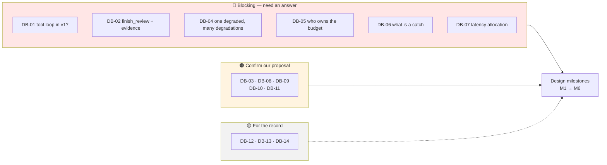
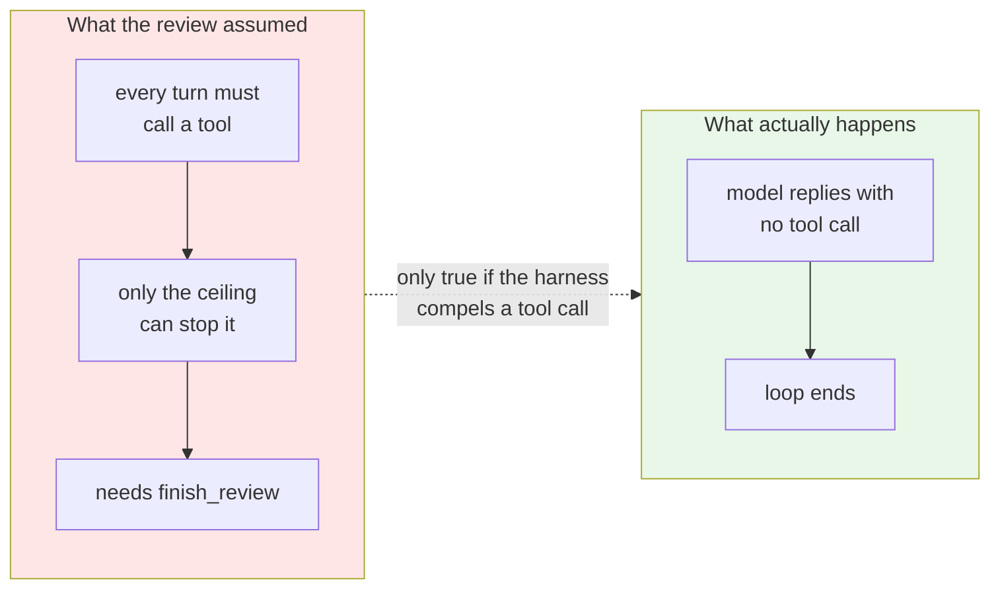
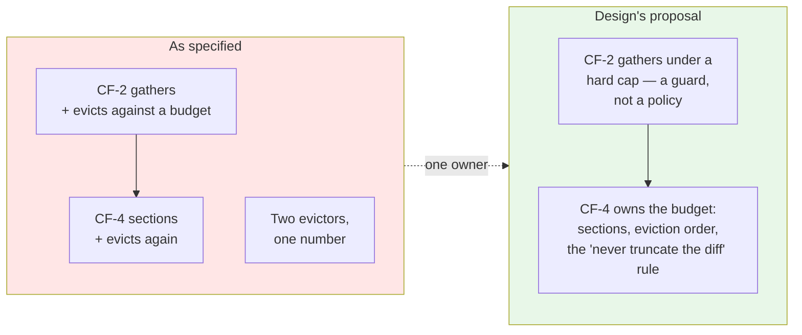
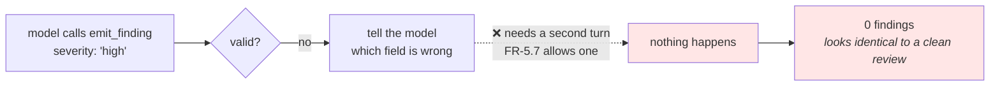
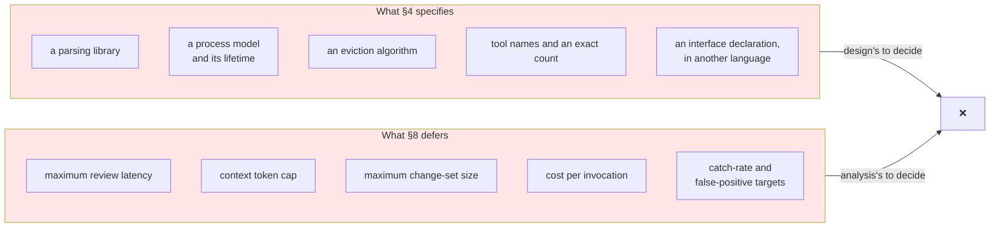

# Design Blockers — v1

**Raised by:** Design phase · **Date:** 2026-09-14 · **Against:** [`Docs/agentic-code-review-srs-v1.md`](./Docs/agentic-code-review-srs-v1.md) v1.0, [`Docs/adr/`](./Docs/adr/), [`Docs/technical_stack.md`](./Docs/technical_stack.md)
**Status:** ✅ **All 24 resolved** (2026-09-14). Seventeen in [SRS v1.1](./Docs/agentic-code-review-srs-v1.md#10-what-changed-in-v11), one as [ADR-0008](./Docs/adr/0008-agent-runtime-tool-registry-and-termination.md), two in the ADRs, two in the stack document, two settled in design.

*This file stays as the record of what was found and how each was answered. The response log at the end is the audit trail.*

**24 items raised. 24 closed.**

| | Count | Where |
|---|---|---|
| ✅ Specification, v1.1 | 17 | DB-01, 02, 04, 06\*, 07, 08, 09, 10, 12, 15, 17, 18 · DO-1, 2, 3, 4, 6\* |
| ✅ A new decision record — [ADR-0008](./Docs/adr/0008-agent-runtime-tool-registry-and-termination.md) | 1 | DB-03 |
| ✅ Notes and corrections in the ADRs and their index | 2 | DB-13, DB-14 |
| ✅ [`technical_stack.md`](./Docs/technical_stack.md) | 2 | DB-16, DO-5 |
| ✅ Settled in design, recorded here | 2 | DB-05, DB-11 |

\* **DB-06**: the *requirement* to define a catch exists (FR-6.2f); writing the predicate is design's work at M6, and its targets are TBD-6. **DO-6**: the structural complaint is answered — §8's unknowns are numbered, cited, and each has a labelled placeholder. The numbers themselves still have to be measured.

### What is genuinely left

Not blockers. Nothing here stops design or construction.

| | Resolved by |
|---|---|
| **TBD-1 … TBD-8** — eight numbered unknowns ([SRS §8](./Docs/agentic-code-review-srs-v1.md)) | Measurement. Each has a placeholder in force, labelled as one, and **no decision may be justified by a placeholder** |
| **S-1, S-2, S-3** — three untested technical assumptions ([`technical_stack.md`](./Docs/technical_stack.md) §7) | Running them. **S-1 first** — whether the free-tier model reliably calls one tool is the assumption everything downstream of ADR-0004 rests on |
| **M4, M5, M6** | Design work, now unobstructed |

---

## What this file is

Two parts.

| Part | Contents |
|---|---|
| **A — Conflicts and gaps** (DB-01…DB-16) | Places the hand-off **disagrees with itself**, or **stops short of a decision design cannot make alone** |
| **B — Design objections** (DO-1…DO-6) | Places the specification **did design's job**, or did it in a way that violates a standard the project itself adopted |

Part A is routine. Part B is a refusal, and it is meant to read as one: the v1 SRS is a strong document, but it repeatedly crosses from *what must be true* into *how it shall be built*, while deferring the numbers that are genuinely analysis's to produce. Where that happened, design says so rather than inheriting it silently.

The standard being applied is the project's own, from [`Docs/README.md`](./Docs/README.md):

> **Behaviour and technology are separate documents.** … If a library cannot satisfy a requirement, the library is wrong — changing the requirement is a specification change, not a stack change.

That rule only works if requirements do not name libraries. Several do.

| Symbol | Meaning |
|---|---|
| 🔴 | **Blocking.** Design cannot proceed on the affected milestone without an answer. |
| 🟠 | **Decide before the named milestone.** Design has a proposal; it needs confirming, because it is user-visible or schema-versioned. |
| 🟡 | **Noted for the record.** Design will proceed on its proposal; correct it if wrong. |

| Kind | Meaning |
|---|---|
| **Conflict** | Two documents say different things. |
| **Gap** | No document says anything, and design cannot invent it unilaterally. |

---

## Part A — the list at a glance

| # | Title | Kind | Sev | Blocks |
|---|---|---|---|---|
| [DB-01](#db-01) | Is the agent tool loop in v1 or not? | Conflict | ✅ **Answered** | — |
| [DB-02](#db-02) | `finish_review` and the finding `evidence` field were adopted but never baselined | Conflict | ✅ **Answered** — 2 adopted, 1 declined | — |
| [DB-03](#db-03) | The agent-runtime ADR was commissioned, then its number was taken | Conflict | ✅ **Written as ADR-0008** | — |
| [DB-04](#db-04) | `degraded` holds one value; degradations co-occur | Gap | 🔴 | M2, M5 |
| [DB-05](#db-05) | Two owners for one token budget — CF-2 and CF-4 | Conflict | 🔴 | M1, M5 |
| [DB-06](#db-06) | Nothing defines what counts as a "catch" | Gap | 🔴 | M6 |
| [DB-07](#db-07) | The 10–30s latency budget has no allocation, and CF-3 can spend it alone | Gap | ✅ **Answered — figure withdrawn** | — |
| [DB-08](#db-08) | Severity and category vocabularies are undefined | Gap | ✅ **Severity answered** · 🟠 category | M2 |
| [DB-09](#db-09) | The "finding model schema" is asked to carry things a finding has not got | Conflict | 🟠 | M2 |
| [DB-10](#db-10) | AC-10 does not verify what Appendix B says it verifies | Conflict | 🟠 | M1, M6 |
| [DB-11](#db-11) | The normative interface is TypeScript; the host language is Python | Conflict | 🟠 | M4 |
| [DB-12](#db-12) | FR-3.5 is filed under CF-9 but executes in CF-1 | Gap | 🟡 | M1 |
| [DB-13](#db-13) | The ADR index says FR-4.6 relaxes in v1; the SRS says it does not | Conflict | 🟡 | — |
| [DB-14](#db-14) | ADR-0005 assumes a v1 state file that v1 defers to v2 | Conflict | 🟡 | — |
| [DB-15](#db-15) | CF-5 owns a provider client that FR-5.8 forbids it to implement | Conflict | 🟠 | M1, M4 |
| [DB-16](#db-16) | The fixed pipeline has no module in the repository layout | Gap | 🟠 | M1 |
| [DB-17](#db-17) | A rejected finding at ceiling zero has no way to be corrected | Gap | ✅ **Answered** | — |
| [DB-18](#db-18) | A tool-call ceiling of zero forbids the only tool the system has | Conflict | ✅ **Answered** — ⚠️ two spec edits owed | — |



---

<a id="db-01"></a>
## DB-01 ✅ Is the agent tool loop in v1 or not? — **ANSWERED 2026-09-14**

> **Decision.** The tool loop **is in v1 scope**, at *Should* level, gated by FR-5.7b. §7 and Appendix A are authoritative; §1.2's "deliberately not in v1" bullet is stale wording.
> **Design does:** build the seam in M1/M3 — a one-node graph with a conditional edge that is not wired at ceiling 0 — and specify the three tools as a separate contract delivered at step 4.5.
> **Analysis still owes one edit:** delete "the agent tool loop" from SRS §1.2's *Deliberately not in v1* summary, so the section stops contradicting itself.

**Conflict — inside one section of the SRS.**

| Where | What it says |
|---|---|
| SRS §1.2, *In scope for v1* | "…single-pass by default, **with three read-only investigation tools available** once a baseline has been measured (FR-5.7a, FR-5.7b)" |
| SRS §1.2, *Deliberately not in v1* | "In summary: GitHub integration of any kind (v3), context depths 2 and above, risk triage, **the agent tool loop**, cross-run de-duplication…" |
| SRS §7 (the authoritative exclusion table) | Does **not** list the tool loop at all |
| SRS Appendix A | Schedules it as **step 4.5, inside v1**, "explicitly allowed to end in a revert" |
| `Draft/mvp-scope.md` §4 | Lists "The agent tool loop" as cut |

So the same paragraph both includes and excludes it, and the exclusion table — which §1.2 points at as the authority — stays silent.

**Why design cannot pick a side.** This decides whether CF-6 has *one* code path or *two*. A loop needs: a tool dispatcher, a `ToolObservation` type, per-turn remaining-budget messaging (FR-5.7c), a termination reason, and three tools that read files and search the repository — which in turn decides whether those tools live in CF-6 or are thin wrappers over CF-2. That is a materially different component design, not a flag.

**Design's proposal.** Read §7 as authoritative: the loop **is** in v1 scope, at *Should* level, gated by FR-5.7b.
Design the **seam** in M1/M3 (one-node graph with a conditional edge that is not wired at ceiling 0), and design the three tools as a separate contract delivered at step 4.5. Nothing is built twice; nothing is built early.

**What we need:** confirm §1.2's "deliberately not in v1" bullet is stale wording, and delete "the agent tool loop" from it — or add it to §7 and demote FR-5.7a–c out of v1.

---

<a id="db-02"></a>
## DB-02 🔴 `finish_review` and the finding `evidence` field were adopted but never baselined

**Conflict — an accepted analysis conclusion is missing from the baseline.**

[`Draft/agentic-architecture-review.md`](./Docs/Draft/agentic-architecture-review.md) §3 and §11 are unambiguous:

> "`finish_review` … **Adopt now.** It is a schema addition, it costs nothing, and it should be defined in v1 even though v1's ceiling of zero means nothing will call it."
>
> "**Change the v1 baseline in two small ways only:** define `finish_review` in the tool schema … add an evidence reference or explicit `unverified` marker to the finding model … Both are contract decisions. Making them now costs a schema line each; making them after v2 code exists costs a migration."

Neither reached the SRS. FR-5.2 has no evidence field. FR-5.7a says the system exposes "**exactly three** read-only investigation tools", which reads as excluding a fourth. The same document also recommends the `ToolObservation` shape with a `denied` status for v1 (§3, last paragraph) — also absent.

**Why it blocks.** These are *schema* decisions on a **versioned, provider-visible** contract (FR-0.4, §5 "one definition, not two"). Adding them after CF-5 ships costs a schema-version bump and a migration of every stored JSON artifact. Adding them now costs two fields. M2 defines that schema; it cannot be defined twice.

> **Decision (2026-09-14) — two adopted, one declined.**

| Proposal | Outcome | Where |
|---|---|---|
| **Evidence reference on a finding** | ✅ **Adopted** | SRS **FR-5.2c**, verified by **AC-15** |
| **`ToolObservation` with a `denied` status** | ✅ **Adopted** | SRS **FR-5.9** |
| **`finish_review` as a tool** | ❌ **Declined**, with a substitute | SRS **FR-5.10** |

### Why `finish_review` was declined

The architecture review called it "the best single idea in the review", on this reasoning:

> *"Without an explicit termination signal, a bounded loop has only one stopping condition: the ceiling. So every review at the critical tier spends fifteen steps whether or not the model was satisfied after four."*

**The premise does not hold for a tool-calling provider.** Such a model terminates by replying **without** a tool call, and every standard agent loop stops on exactly that. A model satisfied after four steps answers, and the loop ends.



So the failure is real but its cause is different: it occurs only where the harness **compels** a tool call each turn. The fix is a rule forbidding that — **FR-5.10** — not a new tool.

**The one genuine benefit, kept.** `finish_review` would have distinguished *"reviewed it, it is clean"* from *"never managed to call the tool"* — the [AC-7](./Docs/agentic-code-review-srs-v1.md) ambiguity again. That is obtainable without a tool: observe whether **any** call was made. FR-5.10's second clause does this, and AC-16 verifies it.

**And two costs avoided.** A second tool at v1 puts more weight on the capability the stack document flags as its highest risk (S-1 — whether the free-tier model reliably calls *one* tool); and under the [DB-18](#db-18) decision every tool call consumes the ceiling, so a termination call would spend a slot on saying nothing.

**Reconsider** if a measured loop shows the model failing to terminate on its own. Recorded in SRS §10 under *Considered and declined*, so it is not re-proposed from the same premise.

---

<a id="db-03"></a>
## DB-03 🟠 The agent-runtime ADR was commissioned, then its number was taken

`Draft/agentic-architecture-review.md` §11: *"Write **ADR-0007** — 'Agent runtime, tool registry, and termination'"*, listing six things it should record.

The actual [ADR-0007](./Docs/adr/0007-python-harness-typescript-target.md) is *Python harness, TypeScript target*. The commissioned record does not exist under any number, and [`Docs/adr/README.md`](./Docs/adr/README.md) lists seven records, none of them this one.

**Consequence.** Everything that review adopted — `finish_review`, the versioned tool registry (a gap ADR-0001 itself flagged as missing), the CLI execution quota, the wall-clock budget dimension, and trajectory criteria AC-A2/A3/A5/A6 — has **no normative home**. DB-02 is one symptom; the registry and the trajectory criteria are the others.

> **Resolved (2026-09-14).** Written as **[ADR-0008 — The agent runtime: what bounds it, what it may call, and how it stops](./Docs/adr/0008-agent-runtime-tool-registry-and-termination.md)**, Accepted, and added to the index.

It records five decisions and five deferrals. **Two of the six conclusions the review commissioned came out differently**, because six days of design work intervened:

| Commissioned | Recorded |
|---|---|
| `finish_review` becomes a tool | ❌ **Declined.** Its premise fails for tool-calling providers; ADR-0001's "may not end the review" prohibition is withdrawn anyway, because the model ends it by replying without a call |
| The tool list becomes a versioned registry | ✅ As commissioned |
| Runtime / policy / state layering named as v2 structure | ✅ As commissioned, explicitly v2 |
| Execution as an agent tool: CLI yes, Action no | ✅ **Sharpened** — prohibited on the Action for a *credential-boundary* reason ADR-0002 never gave, and not built in v1 at all |
| Budgets gain a wall-clock dimension | ⏳ **Deferred.** The latency figure it reasoned against was withdrawn as unproven ([DB-07](#db-07)). The dimension is right; its value is unknown |
| Trajectory criteria added, AC-A1 and AC-A4 rewritten | ⏳ Partly — AC-15 and AC-16 landed in SRS v1.1; the corpus-level measures wait on TBD-6 |

It also closes the gap **ADR-0001 flagged against itself** and never filled: *"the tool list and their argument schemas, as a versioned contract."*

---

<a id="db-04"></a>
## DB-04 🔴 `degraded` holds one value; degradations co-occur

SRS §4.2.2:

```ts
degraded?: 'no-index' | 'budget-exhausted' | 'unresolvable-imports';
```

One optional value. But:

```mermaid
flowchart TD
    R["One review run"] --> A["--depth 2 requested<br/>→ no-index (AC-8)"]
    R --> B["Node absent<br/>→ unresolvable-imports (AC-12)"]
    R --> C["Related context over cap<br/>→ budget-exhausted (FR-2.5b)"]
    A --> Q{"Which one does<br/>the field hold?"}
    B --> Q
    C --> Q
    style Q fill:#ffe6e6
```



All three can be true in the same run, and AC-8 and AC-12 each assert a *specific* value is reported.

There is a second, larger half. FR-11.2 requires a review "under **every** failure mode — checks unrunnable, context over budget, provider error, budget exhausted — **reporting the degradation**." Those degradations belong to CF-3, CF-4, CF-6 and the cross-cutting budget — not to CF-2. But the only degradation channel in the design is `RelatedContextResult.degraded`, and **FR-8.2c's list of what the JSON must record does not include degradations at all** (it lists depth, ceiling, tool calls, completion status, model and schema versions, scope).

So FR-11.2's "reporting" currently has no specified place to land.

**Design's proposal:** a run-level `degradations: Degradation[]` on the report model, each entry carrying `{ source: CF, code, detail }`; `RelatedContextResult.degraded` becomes a list, retaining the exact string values so AC-8 and AC-12 still read literally.

**What we need:** confirmation, because it changes a frozen interface (§5) and two acceptance criteria are written against the singular form.

---

<a id="db-05"></a>
## DB-05 🔴 Two owners for one token budget

| Document | Says |
|---|---|
| SRS §4.2.2 | `RelatedContextRequest` carries `budget: TokenBudget`, and CF-2 may return `degraded: 'budget-exhausted'` → **CF-2 enforces a budget** |
| FR-2.5a | "Context shall be budgeted **per section**… so that no section can starve another" → **CF-4 owns sections** |
| FR-2.5b | "When the budget is exceeded, the system shall **evict context units in descending order of `distance`**" → **CF-4 evicts** |

Two components can drop the same context unit for the same reason, and CF-2 drops it first — before CF-4 knows how much room the diff and the evidence actually left. A unit CF-4 would have kept can be gone before CF-4 is called.



> **Resolved (2026-09-14).** **CF-4 is the sole budget authority.** CF-2 receives a *retrieval cap* — a stop-gathering guard so it cannot pull a 50 MB dependency tree — and reports a budget degradation only when that guard fires. All eviction **policy** is CF-4's: the per-section split (FR-2.5a), the distance-ordered eviction (FR-2.5b), and the rule that the diff is never truncated.

The conflict is also gone at its source. SRS v1.1 replaced §4.2.2's TypeScript declaration with the six obligations in §4.2.3 ([DO-2](#do-2)), and **`budget` is not among them** — so nothing in the specification now grants CF-2 budget authority. What looked like a contradiction between requirements turned out to be a contradiction introduced by a code sample.

Recorded in [`design/01-logical-architecture.md`](./Docs/design/01-logical-architecture.md) §2 and in the stack layout, where `assembly/` is annotated as the sole budget owner.

---

<a id="db-06"></a>
## DB-06 🔴 Nothing defines what counts as a "catch"

FR-6.2b, FR-6.2d, AC-5, AC-6 and AC-11 all rest on a **catch rate**. No document says when an emitted finding *counts as catching* an expected defect.

Candidate rules, all defensible, all producing different numbers:

| Rule | Problem |
|---|---|
| Same file | Almost everything matches |
| Same file + exact line | A model that points at the call instead of the declaration scores zero |
| Same file + line ± N | What is N? It decides the score |
| Same `rule_id` | Only works for the five pattern rules; defects not tied to a rule can never be caught |
| Same category + enclosing symbol | Needs a category vocabulary — see [DB-08](#db-08) |

This is not a detail. **The catch rate is the project's primary instrument** (`mvp-scope.md` §1, question 2) and the stopping condition for the unbounded prompt-tuning risk (R-4). An undefined metric makes AC-5, AC-6 and AC-11 unverifiable, and makes two runs incomparable — which is exactly what FR-6.2e exists to prevent.

Two further gaps sit behind it:

- **No false-positive measure.** §8 defers the *target*, but the *metric* is a design input. Catch rate alone is trivially gamed: emit a finding on every line and catch everything. The corpus needs clean cases and a precision figure alongside recall.
- **Nondeterminism.** `agentic-architecture-review.md` §10 already warns catch rate becomes noisy once trajectories vary, and recommends pinning seed and ceiling — FR-6.2e does this, but says nothing about *repeat count* per corpus case.

**Design's proposal:** a match predicate reusing ADR-0005's position-independent fingerprint — `rule_id` when present, otherwise `file + enclosing symbol + category` — deliberately line-independent; plus a `precision` figure over clean cases, and a documented repeat count.

**What we need:** this is an analysis decision. Design will propose the predicate in M6 but will not set the metric definition alone.

---

<a id="db-07"></a>
## DB-07 🔴 The latency budget has no allocation, and CF-3 can spend it alone

| Document | Says |
|---|---|
| SRS §2.4 | "**Binding constraint is latency** … a developer waiting at a prompt abandons the tool after roughly **10–30 seconds**" |
| SRS §8 | Concrete budgets — "maximum review latency" — **deferred** |
| FR-4.1 | "shall run the project's **test suite**" |
| FR-4.4a | "a **configurable** time budget on the execution phase" — no default given |
| ADR-0006 | Locally a test run costs "**seconds**, against warm dependencies" |
| ADR-0002 | A test run costs "**minutes**" (on CI, but the suite is the same suite) |

A real `npm test` plus `tsc --noEmit` on a mid-sized repository routinely exceeds 30 seconds even warm. So one of these is true, and design needs to know which:

> **Decision (2026-09-14) — the figure is withdrawn, not replaced.**
>
> The 10–30 second threshold was an unproven estimate. It is removed from §2.4 in SRS v1.1 and rescheduled as an observation of **real users on the shipped MVP**, carried as TBD-2.

This is the right answer, and it is worth being precise about why: the number had stopped being an estimate and started being *evidence*. Four documents cited it, and it was sizing a resolver's process model, a tool-call ceiling, and a concurrency decision. **An unmeasured number that several decisions depend on is worse than an acknowledged unknown, because it cannot be argued with.** One requirement (FR-2.6f) had already hardened around it to the point of forbidding a measured improvement.

Nothing about *latency being the binding constraint* is withdrawn — only the figure.

### What design does in the absence of a number

| Rule | |
|---|---|
| **No design decision may cite a latency threshold as justification** | A decision needing one is waiting on TBD-2 and must say so. Two design choices were leaning on the withdrawn figure and have been rewritten |
| **Every stage records its own duration, every run** | FR-8.2c, FR-11.3. When real users are finally watched, the measurements explaining their behaviour already exist |
| **Placeholders are labelled as placeholders** | The execution timeout ships as a stated default, never as a finding |
| **v1 is sequential** | Concurrency was the main thing the number would have bought. It is an optimisation to be earned against a measurement |

### Still downstream of TBD-2

The default execution timeout (TBD-4); whether CF-2 and CF-3 overlap; the practical ceiling once investigation is switched on; and whether the resolver's boot cost (`technical_stack.md` S-3) is material next to a test run. **None of these blocks v1 from shipping** — each has a working default and a recorded measurement.

---

<a id="db-08"></a>
## DB-08 🟠 Severity and category vocabularies are undefined

FR-5.2 requires every finding to carry a **severity** and a **category**. No normative document enumerates either.

Fragments exist, and they do not agree:

| Source | Values |
|---|---|
| ADR-0004 (inside an example error message) | `blocking`, `important`, `nit` |
| `Draft/tool-reference.md` (a competitor's scheme) | Important, Nit, Pre-existing |
| SRS §7 | FR-5.4 blocking/non-blocking deferred — "**severity carries this for now**" |

Three things depend on the enum being fixed: FR-8.1b's count-by-severity summary, FR-10.4c's exit code, and the `emit_finding` tool schema the model is bound to — where a free-text severity would let the model invent values and defeat the whole point of ADR-0004.

> **Decision (2026-09-14) — severity.** `blocking | important | nit`. `blocking` carries FR-5.4's deferred blocking/non-blocking meaning until v2 splits it out, and is the only value that drives a non-zero exit code (FR-10.4c).
> **Still open — category.** Design proposes a closed seven-value set: `correctness` · `error-handling` · `interface-contract` · `test-evidence` · `security` · `performance` · `maintainability`. Confirm or replace.

---

<a id="db-09"></a>
## DB-09 🟠 The "finding model schema" carries things a finding has not got

FR-8.2b: *"The JSON shall conform to **the finding model's** versioned schema, including findings, severities, **and the evidence record**."*
FR-8.2c adds achieved depth, ceiling, tool calls made, completion status, model version, schema version, resolved scope.

A *finding* is one observation (FR-5.2: file, line, severity, category, rationale, rule id). It does not contain an evidence record or run metadata. What FR-8.2b describes is a **report**, and §5 lists "Finding model + schema" and "JSON output" as two separate interface rows.

This matters because §5 also requires the `emit_finding` schema to **equal** the finding model — "one definition, not two". If "the finding model" quietly means "the report", then the model is being bound to a tool schema containing run metadata it cannot know.

**Design's proposal:** two models, one version stream — `Finding` (== the `emit_finding` schema) nested inside `ReviewReport` (findings + evidence record + run metadata + degradations); both stamped with the same `schema_version`.

---

<a id="db-10"></a>
## DB-10 🟠 AC-10 does not verify what Appendix B says it verifies

AC-10 has three clauses and claims three requirements:

| AC-10 clause | Actually checks | Claimed |
|---|---|---|
| No module outside CF-7 imports a terminal-rendering dependency | FR-10.4a | FR-10.2 |
| No module outside CF-1 resolves a change scope | CF-1 encapsulation | FR-10.2 |
| No module outside CF-6 imports the agent framework | FR-5.8 ✅ | FR-5.8 |

Two problems.

1. **FR-10.2** ("no adapter contains logic that determines whether something is a finding") is not checked by either of the first two clauses. `mvp-scope.md` §9 concedes it is "testable only in v3" — there is one adapter in v1 — but AC-10 nonetheless claims to verify it.
2. **FR-2.6e** ("no consumer branches on which implementation served the request") is claimed by AC-10 and checked by **nothing**. `technical_stack.md` §4 notices this itself: the resolver-bundle contract is "worth adding even though **no acceptance criterion names it**."

FR-2.6e is described in the SRS as *"the highest-value structural constraint in this document."* It is currently the one with no test.

**Design's proposal:** five import-linter contracts, not three — adding (4) only `core/context/resolver/` may reference the bundle path, and (5) no module outside `core/context/` may name a concrete provider class (construction goes through a factory). Relabel AC-10's traceability accordingly.

---

<a id="db-11"></a>
## DB-11 🟠 The normative interface is TypeScript; the host language is Python

SRS §4.2.2 states the frozen `RelatedContextProvider` in TypeScript, with `Promise<RelatedContextResult>` and camelCase fields. ADR-0007 makes the host language Python. `technical_stack.md` §9 lists async boundaries as **open and unmeasured**.

Two decisions fall out, and both are visible outside the code:

| Question | Why it is not free |
|---|---|
| Is `resolve()` async? | If yes, CF-4 and CF-6 callers become async too. FR-5.8's "callable as ordinary functions" is about the *framework*, not about async — but an async pipeline is harder to unit-test without one, which is what FR-5.8 was protecting. |
| camelCase or snake_case in the JSON? | `achievedDepth` vs `achieved_depth` is a **published schema** (FR-8.2b). AC-12 quotes `degraded: 'unresolvable-imports'` literally, so the *values* are fixed either way. |

> **Resolved (2026-09-14).** A Python `Protocol`, **synchronous** in v1, with JSON serialised in **camelCase**.

| Half | Outcome |
|---|---|
| **Sync or async** | **Synchronous.** Settled in the specification itself: §4.2.3 states that concurrency is not specified and is a design decision to be made against the latency budget, and [`technical_stack.md`](./Docs/technical_stack.md) §2 now records *no concurrency in v1*. Async had arrived as syntax in a code sample, never as a decision |
| **Field naming** | **camelCase in JSON**, `snake_case` in Python. These are published names in a versioned schema, so the choice is worth stating once rather than discovering per field |

camelCase is chosen because the JSON artifact is consumed by tooling in the **target** language's ecosystem — a TypeScript project's scripts and editors — not by the host's. The host's convention stops at the host's boundary.

---

<a id="db-12"></a>
## DB-12 🟡 FR-3.5 is filed under CF-9 but executes in CF-1

Appendix B maps FR-3.5 (exclude generated, vendored and build-output paths) to **CF-9**, config. But excluding a path *changes the change set*. If CF-1 does not apply the list, then CF-2 parses, CF-3 considers, and CF-4 budgets files nobody asked to review.

**Design's proposal:** CF-9 owns the *list*; CF-1 *applies* it and records what it excluded — which FR-10.3b needs anyway, since the resolved scope stated in the output would otherwise be untrue.

---

<a id="db-13"></a>
## DB-13 🟡 The ADR index says FR-4.6 relaxes in v1; the SRS says it does not

[`Docs/adr/README.md`](./Docs/adr/README.md), version-applicability table: *"0002 — pipeline initiates test execution · binds **v1 on the CLI, where its prohibition relaxes**"*.

SRS FR-4.6 keeps the prohibition absolutely in v1: *"The review agent shall not be able to trigger check execution."*

The SRS wins, so nothing is at risk — but the ADR index tells a new reader to start with the ADRs, and this line will send them the wrong way.

---

<a id="db-14"></a>
## DB-14 🟡 ADR-0005 assumes a v1 state file that v1 defers to v2

ADR-0005's scope note: *"v1 stores state in a local file (FR-10.5), but if its fingerprints are built on line numbers, the v3 ledger inherits a broken foundation."*

SRS §7 defers FR-5.5 and FR-10.5 to **v2**. v1 has no state file and no fingerprint.

Worth correcting rather than ignoring, because the fingerprint design is exactly what [DB-06](#db-06)'s catch-matching predicate wants to reuse. If fingerprints are not being built in v1, the corpus matcher is their first user — and it should be designed so v2 and v3 inherit it rather than re-inventing it.

---

<a id="db-15"></a>
## DB-15 🟠 CF-5 owns a provider client that FR-5.8 forbids it to implement

**Conflict — raised by M1, 2026-09-14.**

| Document | Says |
|---|---|
| SRS §3 | CF-5 = "Finding model **and provider client**" |
| SRS §4.5 | FR-0.3 — "A new provider shall be integratable by mapping its output to the finding model" — filed under CF-5 |
| SRS §4.6 | FR-5.8 — "The agent framework shall be confined to CF-6. **No module outside CF-6 shall import it**" |
| `technical_stack.md` §2, §4 | The provider interface **is** LangChain; the contract is "Only `core/agent/` may import LangChain or LangGraph" |

CF-5 is assigned a responsibility it cannot implement in its own module. Taken literally, either the provider client moves into CF-6 — and CF-5's §3 description is wrong — or CF-5 imports LangChain and AC-10's third clause fails.

**Design's resolution:** split the responsibility at the interface.

- **`ModelPort`** — a plain Python protocol in `core/findings/` (Layer 0, zero library imports). This is what FR-0.3 is really about: one shape all providers map onto.
- **`LangChainModelAdapter`** — implements it, inside `core/agent/`. The library import never leaves CF-6.

Both requirements then hold unbent, and integrating a provider stays "a new adapter behind one port".

**What we need:** confirmation that CF-5's §3 line means *the provider **interface***, not the client implementation. If it genuinely means the client, FR-5.8 or the stack contract has to give.

---

<a id="db-16"></a>
## DB-16 🟠 The fixed pipeline has no module

**Gap — raised by M1, 2026-09-14.**

[ADR-0001](./Docs/adr/0001-fixed-pipeline-with-bounded-agency.md)'s decision is *"our code owns orchestration"*, and the SRS §2.1 pipeline is the shape of the whole system. But `technical_stack.md` §4 lists nine packages under `core/` — `changeset`, `context`, `execution`, `assembly`, `findings`, `agent`, `output`, `patterns`, `config` — and **none of them is the pipeline**.

**Why this is not just a missing folder.** Code with no home lands in the nearest caller, and the nearest caller is `cli/`. That would put the order of operations inside the adapter — which ADR-0006 forbids for a concrete reason: the v3 Action adapter would then have to reimplement it, and the two surfaces would produce different reviews from the same change. It is also exactly what AC-10 is meant to catch, and AC-10 has no clause for it.

> **Resolved (2026-09-14).** `core/pipeline/` is in [`technical_stack.md`](./Docs/technical_stack.md) §4 — above the capabilities, below the adapter, importing what the run needs and imported by nothing but `cli/`. Import contract 6 enforces the second half.

No requirement moved; this was a stack-document change, as expected.

---

<a id="db-17"></a>
## DB-17 🔴 A rejected finding at ceiling zero has no way to be corrected

**Gap — raised by M3, 2026-09-14.**

[ADR-0004](./Docs/adr/0004-findings-emitted-as-tool-calls.md)'s whole argument for validating at the call boundary is that corrections become precise and cheap:

> *"Rejected at the call boundary. The model is told exactly which field is wrong and what was expected."*

Telling the model anything requires a second turn. FR-5.7 permits **one**: *"a single model pass"*.

So at the v1 default, a single malformed call produces **zero findings** — and a review with zero findings reads exactly like a clean one.



This is AC-7's failure — "found nothing" and "broken" being indistinguishable — arriving through a door AC-7 does not watch.

> **Decision (2026-09-14).** **One repair turn**, capped at one per review, carrying only the validation error. It is counted and reported separately (`repair_turns`) and does not consume the tool-call ceiling — it is a *turn*, not a call.

This completes a mechanism ADR-0004 already specified and left half-built. It costs one extra model call, and only when something was actually wrong.

**Still binding regardless:** a run where the model's output could not be validated must be **distinguishable in the output from a run that found nothing** — AC-7's rule, applied to the model instead of to the checks. If the repair turn also fails, the run records `invalid-model-output` and says so.

---

<a id="db-18"></a>
## DB-18 🔴 A tool-call ceiling of zero forbids the only tool the system has

**Conflict — raised by M3, 2026-09-14.**

| Requirement | Says |
|---|---|
| **FR-5.6a** | Findings shall enter the system **exclusively through an `emit_finding` tool call** |
| **FR-5.7** | The review step's **tool-call ceiling** shall have a documented default of **zero** |

Read literally, together: zero tool calls are allowed, and a finding can only arrive as a tool call. **v1 can never produce a finding.**

The intent is clear from the surrounding prose — FR-5.7 goes on to describe "a single model pass in which `emit_finding` is the only tool exposed", which only makes sense if `emit_finding` does not count against the ceiling. But the requirement's *name* says otherwise, and three other places depend on the count meaning something exact:

| Depends on it | How |
|---|---|
| **AC-11** | Reports "catch rate **and mean tool calls** at two ceilings" — is a review emitting 6 findings at ceiling 0 scoring 0 tool calls, or 6? |
| **FR-8.2c** | Records "the number of tool calls actually made" |
| **FR-5.7c** | Tells each turn "how many tool calls remain" |

At ceiling 3, does a model that investigates twice and then emits four findings have 2 calls left, or −3?

> **Decision (2026-09-14).** The literal reading stands: **every tool call counts against the ceiling, `emit_finding` included.** The ceiling is a total tool-call budget for the review.

This is the honest reading of the requirement as written, and it has the advantage of bounding a runaway model with one number. It also forces three changes the analysis team must make, because the decision is incompatible with three requirements as they currently stand.

### Consequence 1 — the default of zero must change ⚠️ *specification change*

> **FR-5.7** … a documented default of **zero**

Under this decision, zero permits no emissions, so v1 produces nothing. The default must be a positive number.

**Design proposes 25**, reasoning: the cap exists to stop a looping model, not to ration findings. Twenty-five findings on one change set is already past the point of usefulness, so a cap there never truncates a review anyone would have read. The corpus can tune it later — this is the kind of number measurement should set.

### Consequence 2 — FR-5.7a's trigger no longer works ⚠️ *specification change*

> **FR-5.7a** **When the ceiling is above zero**, the system shall expose exactly three read-only investigation tools…

The ceiling is now *always* above zero. Read as written, FR-5.7a switches investigation on by default — which **FR-5.7b explicitly forbids** until a single-pass baseline has been measured.

**Fix:** separate the two ideas, which were only ever joined by the old counting scheme.

| Setting | Controls | v1 default |
|---|---|---|
| `tool_call_ceiling` | How many calls a review may make in total | 25 |
| `investigation_tools` | Whether the three read-only tools are bound at all | **off** |

This is arguably better than what it replaces: tool *exposure* and call *budget* are genuinely independent, and FR-5.7b's gate now sits on the switch it is actually about.

### Consequence 3 — AC-11 reports two metrics, and keeps both

> **AC-11** … report **catch rate and mean tool calls** at two ceilings on that same corpus

**Decision (2026-09-14): keep both metrics. Tool calls are counted as an agent runtime counts them** — every call the model makes, `emit_finding` included — and the investigation count is reported *alongside* it, not instead of it.

| Metric | Answers | Governed by the ceiling? |
|---|---|---|
| `tool_calls_total` | *What did this agent cost to run?* | ✅ Yes — the agent-standard count |
| `tool_calls_investigation` | *How hard did it have to look?* | Reported, not capped separately |
| `tool_calls_emission` | *How much did it have to say?* | Reported |
| `repair_turns` | *How often was its output unusable?* | Outside the ceiling — a turn, not a call |

Neither number substitutes for the other, and reporting only one would lose something real:

- **Total alone** moves with how many defects a change happens to contain, so a corpus case with eight defects looks like an expensive agent even at zero investigation.
- **Investigation alone** hides the actual cost of the run — which is the number the latency and token budgets are spent against.

AC-11's comparison across two ceilings reads the investigation figure to isolate its variable, and the total to price the result. Four integers in the run record; no requirement change needed for any of it.

---

---

# Part B — Design objections

Each of these is a place where the specification made a decision that is design's to make. Design will not simply inherit them: the objection is recorded, the underlying requirement is restated, and design proceeds against the **requirement**, not against the mechanism.

None of this is a scope argument. Every fix below leaves the system doing exactly what it does today.

| # | Objection | The rule it breaks |
|---|---|---|
| [DO-1](#do-1) | FR-2.2 names a library inside a requirement | "Behaviour and technology are separate documents" |
| [DO-2](#do-2) | §4.2.2 ships a language-specific interface declaration as normative | An SRS specifies semantics, not signatures |
| [DO-3](#do-3) | Requirements name internal identifiers | Acceptance criteria now test private names |
| [DO-4](#do-4) | FR-2.6f prescribes a mechanism to express a budget §8 defers | Constraints belong to analysis; mechanisms to design |
| [DO-5](#do-5) | The CF decomposition is a taxonomy, used as a module structure | Cohesion; three of nine blocks fail it |
| [DO-6](#do-6) | Analysis deferred its own work while doing design's | The exchange runs the wrong way |

---

<a id="do-1"></a>
## DO-1 · FR-2.2 names a library inside a requirement

> **FR-2.2 (Must)** The system shall build a **`tree-sitter`** AST for changed TS/JS files…

The convention says a library that cannot satisfy a requirement is the wrong library. FR-2.2 inverts it: the library *is* the requirement, so `tree-sitter` cannot be wrong — it is mandatory. `technical_stack.md` §5 states the consequence plainly, and treats it as normal:

> `tree-sitter` … **High cost — FR-2.2 names it**

A dependency inventory should price a swap by *how much code changes*, not by *whether the specification permits it*.

| | |
|---|---|
| **What the requirement actually is** | "The system shall build a syntax tree for changed TS/JS files **in the host process, without invoking the target language's toolchain**." |
| **What is genuinely normative** | In-process; no dependency on the reviewed project's toolchain; resilient to a mid-edit tree |
| **What is not** | Which parser |
| **Fix** | Strike the library name from FR-2.2. It is already recorded in `technical_stack.md` §2, which is where ADR-0007 put it. |
| **Cost** | One line. No behaviour changes, no design changes, `tree-sitter` is still what gets used. |

---

<a id="do-2"></a>
## DO-2 · §4.2.2 ships an interface declaration as normative

SRS §4.2.2 contains twenty-eight lines of **TypeScript** declaring `RelatedContextProvider` — in a system whose host language is Python (ADR-0007, Accepted, same date, same document set).

Three things follow that nobody chose:

| Leaked | Consequence |
|---|---|
| `Promise<RelatedContextResult>` | **Async is now a requirement.** Nothing in the SRS argues for concurrency; `technical_stack.md` §9 lists async boundaries as *open and unmeasured*. An unexamined choice became normative by syntax. |
| `camelCase` field names | Published JSON field names, fixed before anyone designed the output |
| `degraded?: 'a' \| 'b' \| 'c'` | A single-value field where three states co-occur — [DB-04](#db-04). A modelling error, protected by being in the normative document |

The **content** is right and design keeps all of it. It is the **form** that is misplaced: §5 freezes this interface, and a frozen TypeScript declaration in a Python project cannot be corrected by design without a specification change — so DB-04's modelling bug needs a specification amendment to fix a field nobody outside CF-2 and CF-4 will ever see.

| | |
|---|---|
| **What is genuinely normative** | (1) retrieval is parameterised by depth; (2) every unit carries relation and distance; (3) the result states the depth achieved; (4) a lower-than-requested depth is reported with a reason, never silent; (5) no consumer branches on the implementation |
| **Fix** | Keep those five as prose requirements. Move the declaration into design (M4), where a modelling error is a design fix rather than a specification change. |

---

<a id="do-3"></a>
## DO-3 · Requirements name internal identifiers

| Requirement | Names | Should say |
|---|---|---|
| FR-5.7a | `read_file`, `get_outline`, `search_repo`, and "**exactly three**" | Investigation tools shall be read-only, free of side effects, and unable to trigger check execution |
| FR-2.6g | the literal string `'unresolvable-imports'` | Degradation shall be reported with a machine-readable reason distinguishing an unavailable resolver from a successful resolution |
| AC-8, AC-12 | assert those literals | — |

The tool **count** is the sharpest case. "Exactly three" is a design decision about prompt surface area, and the SRS's own reasoning for it is a design argument — preloading beats a lookup at five rules, `find_references` needs a v2 index. Good reasoning, wrong document: if measurement at step 4.5 shows a fourth read-only tool earns its turn, adding it is now a **specification change**.

The consequence for verification is worse. **AC-12 tests a string.** Renaming an internal enum value — one no user and no adapter ever sees — fails an acceptance criterion.

**Partially conceded:** `emit_finding` (FR-5.6a) is fair to name. It is bound into a provider-visible tool schema, so it is closer to an external contract than an internal identifier.

| | |
|---|---|
| **Fix** | State the properties; let design name the identifiers and enumerate the values. Acceptance criteria assert *behaviour* — "a run without the resolver reports a distinguishable machine-readable degradation" — not spelling. |

---

<a id="do-4"></a>
## DO-4 · FR-2.6f prescribes a mechanism to express a budget §8 defers

> **FR-2.6f** … delegated to a **bundled resolver process** … **started at most once per invocation** …

The SRS's own commentary concedes what this is:

> *"the 'at most once per invocation' clause is **a latency requirement, not an implementation note**"*

Exactly. And §8 then defers the latency budget, and `technical_stack.md` §7 files the same question as **S-3**, unmeasured. So design is handed **the answer without the constraint** — and cannot evaluate the answer, because the criterion it was chosen against does not exist yet.

This is not academic. `technical_stack.md` §7 already names the alternative: *"If boot dominates, the fallback is a persistent daemon across invocations — a larger change, and a new decision."* A persistent daemon **violates FR-2.6f as written**, so the measured-better option is forbidden by a requirement that exists to express an unmeasured budget.

| | |
|---|---|
| **What the requirement actually is** | "Module-specifier resolution shall use the target language's own resolution algorithm, shall not be fetched at review time, shall not be observable outside CF-2, and shall not consume more than **N** of the review's latency budget." |
| **Fix** | Give design the number. Let design choose the process model and defend it against that number. |

---

<a id="do-5"></a>
## DO-5 · The CF decomposition is a taxonomy, used as a module structure

CF-1…CF-9 are an excellent way to **group requirements**, and Appendix B's traceability depends on them. They are not a module decomposition, and `technical_stack.md` §4 mirrors them into directories one-for-one as though they were.

Three of the nine do not hold together as modules:

| CF | Contains | Why it fails as a module |
|---|---|---|
| **CF-5** "Finding model **and** provider client" | A zero-dependency data type **and** a network client | Two reasons to change, opposite dependency directions — and FR-5.8 **forbids them sharing a package** ([DB-15](#db-15)). The contradiction became a directory because the layout mirrored the taxonomy |
| **CF-7** "Output" | Verdict computation, serialisation, terminal rendering, exit status | Spans core **and** adapter — the one seam ADR-0006 says must never blur. As one module it is the easiest place in the system to breach FR-10.2 |
| **CF-9** / FR-3.5 | Owns the exclusion **list**; the exclusion **happens** in CF-1 | Requirements grouped by topic, modules built by responsibility ([DB-12](#db-12)) |

| | |
|---|---|
| **Fix** | Keep CF-1…CF-9 as the **traceability axis** — they are good at that and nothing downstream needs changing. Stop treating them as the **module layout**. Design derives modules from responsibilities and maintains a CF → module mapping table, which is what [`01-logical-architecture.md`](./Docs/design/01-logical-architecture.md) §2 now does. |

> **Resolved (2026-09-14).** [`technical_stack.md`](./Docs/technical_stack.md) §4 no longer mirrors the nine core functions into nine directories. It carries the revised layout plus a section naming the three places the mapping is deliberately not one-to-one — the pipeline, CF-5, and CF-7 — with the reason for each.
>
> Both axes are kept. Appendix B of the specification remains the traceability record; `design/01-logical-architecture.md` §2 holds the mapping. Neither is derived from the other by copying, which is what let CF-5's contradiction become a directory in the first place.

---

<a id="do-6"></a>
## DO-6 · Analysis deferred its own work while doing design's

The headline objection; the other five are instances of it.



**The exchange runs backwards.** Design can choose a mechanism from a number. It cannot derive a number from a mechanism.

Concretely blocked on the missing numbers:

| Decision design cannot make | Needs |
|---|---|
| Sync or async pipeline | A latency budget ([DB-11](#db-11), [DB-07](#db-07)) |
| Whether CF-2 and CF-3 overlap | The same |
| Default check timeout (FR-4.4a) | The same |
| Practical ceiling at step 4.5 | The same — 15 steps is 30–75s by the architecture review's own arithmetic |
| Whether the sidecar's boot cost is acceptable | The same (S-3) |
| Context section budgets (FR-2.5a) | A token cap |

And two decisions that are **squarely analysis's**, left undone:

| Undone | Why it is analysis's |
|---|---|
| The severity and category vocabularies ([DB-08](#db-08)) | A user-visible domain vocabulary that determines what the tool *says*. Design filled it in on 2026-09-14 to unblock M2 — **that was itself a boundary breach**, and the answer should be back-ported into FR-5.2 rather than living only in a design document |
| What counts as a "catch" ([DB-06](#db-06)) | The definition of the project's primary success metric |

| | |
|---|---|
| **Fix** | Run the deferred NFR pass **before** design freezes contracts at M4. In exchange, strike the mechanisms — DO-1 through DO-4 — and let design answer them against the numbers. |

---

## Response log

For the analysis team to complete. Design proceeds on its stated proposals for 🟠 and 🟡 items unless corrected.

| # | Decision | Decided by | Date | Where it was recorded |
|---|---|---|---|---|
| DB-01 | In v1, *Should*, gated by FR-5.7b. Seam designed now, tools built at step 4.5. | Project maintainer | 2026-09-14 | This file, [DB-01](#db-01) · ⏳ SRS §1.2 edit still owed |
| DB-02 | Evidence reference **adopted** (FR-5.2c, AC-15). `ToolObservation` with `denied` **adopted** (FR-5.9). `finish_review` **declined** — its premise fails for tool-calling models; FR-5.10 substitutes. | Project maintainer | 2026-09-14 | SRS v1.1 §4.5, §4.6, §10 · this file, [DB-02](#db-02) |
| DB-03 | Written as ADR-0008, Accepted. Two of its six commissioned conclusions changed — `finish_review` declined, the Action's execution prohibition re-grounded on the credential boundary. | Project maintainer | 2026-09-14 | [`adr/0008`](./Docs/adr/0008-agent-runtime-tool-registry-and-termination.md) · [`adr/README.md`](./Docs/adr/README.md) |
| DB-04 | | | | |
| DB-05 | CF-4 is the sole budget authority; CF-2 gets a retrieval cap, not a policy. The conflicting `budget` parameter left the specification with DO-2. | Project maintainer | 2026-09-14 | SRS v1.1 §4.2.3 · [`technical_stack.md`](./Docs/technical_stack.md) §4 |
| DB-06 | | | | |
| DB-07 | The 10–30s figure is withdrawn as unproven, not replaced. To be established by observing real MVP users (SRS TBD-2). No design decision may cite a latency threshold until then. | Project maintainer | 2026-09-14 | SRS v1.1 §2.4, §8 · this file, [DB-07](#db-07) |
| DB-08 | Severity = `blocking \| important \| nit`; `blocking` alone drives exit 1. Category set still open. | Project maintainer | 2026-09-14 | This file, [DB-08](#db-08) · [`02-domain-model.md`](./Docs/design/02-domain-model.md) §3.4 |
| DB-09 | | | | |
| DB-10 | | | | |
| DB-11 | Synchronous in v1; JSON in camelCase, Python in snake_case. | Project maintainer | 2026-09-14 | SRS v1.1 §4.2.3 · [`technical_stack.md`](./Docs/technical_stack.md) §2 · [`design/02-domain-model.md`](./Docs/design/02-domain-model.md) |
| DB-12 | | | | |
| DB-13 | Index row corrected: ADR-0002's prohibition is *relaxable* on a local surface; v1 declines the option and FR-4.6 keeps it in full. | Design | 2026-09-14 | [`adr/README.md`](./Docs/adr/README.md) |
| DB-14 | ADR-0005's scope note corrected: v1 has no state file. Its fingerprint design binds v1 through FR-6.2f, the corpus matcher, instead. | Design | 2026-09-14 | [`adr/0005`](./Docs/adr/0005-cross-run-memory-as-hidden-comment-ledger.md) · [`adr/README.md`](./Docs/adr/README.md) |
| DB-15 | | | | |
| DB-16 | `core/pipeline/` added to the repository layout, with import contract 6 keeping it out of the adapter. | Project maintainer | 2026-09-14 | [`technical_stack.md`](./Docs/technical_stack.md) §4 |
| DB-17 | One repair turn, capped at one, counted separately, outside the ceiling. | Project maintainer | 2026-09-14 | This file, [DB-17](#db-17) |
| DB-18 | Every tool call counts against the ceiling, `emit_finding` included — agent-standard counting. Total **and** investigation both reported. ⏳ **Owed: FR-5.7 default ≠ 0, and FR-5.7a's trigger split from the ceiling.** | Project maintainer | 2026-09-14 | This file, [DB-18](#db-18) |
| DO-1 | | | | |
| DO-2 | | | | |
| DO-3 | | | | |
| DO-4 | | | | |
| DO-5 | Directories follow responsibility, not CF numbering. Three deliberate non-1:1 mappings documented. Both axes kept. | Project maintainer | 2026-09-14 | [`technical_stack.md`](./Docs/technical_stack.md) §4 · [`design/01`](./Docs/design/01-logical-architecture.md) §2 |
| DO-6 | §8's unknowns numbered TBD-1…TBD-8 and cited by the requirements that need them; each has a labelled placeholder. No decision may be justified by a placeholder. | Project maintainer | 2026-09-14 | SRS v1.1 §8 |
| 001/D-5 | *Raised after close, while planning feature 001.* With `emit_finding` the only tool (investigation off), "found nothing" and "never used the tool" are the same model reply, so every zero-finding run is a `no-tool-call` run. ADR-0008 decision 2's claim that the distinction is "obtainable by observing whether any call was made" holds only once investigation tools exist. **Decided: reword the feature's acceptance scenarios; ADR-0008 not reopened.** A zero-finding run is reported as `no-tool-call` and never presented as clean. Reconsider together with ADR-0008's own trigger if a measured loop warrants it. | Project maintainer | 2026-09-17 | [`specs/001-walking-skeleton/spec.md`](./specs/001-walking-skeleton/spec.md) Story 2, SC-003 · [`design/02`](./Docs/design/02-domain-model.md) §3.5 · [`design/01`](./Docs/design/01-logical-architecture.md) §4 |
