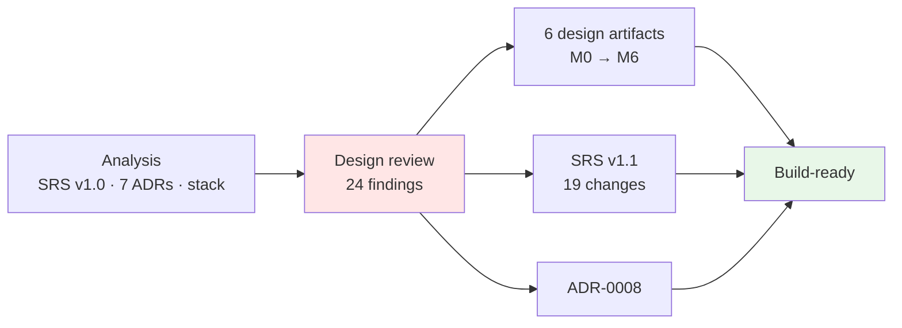
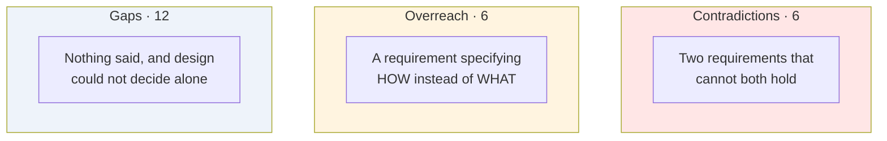
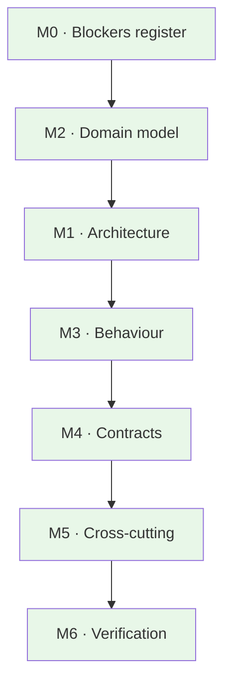

# Design Phase — Report

**Project:** Agentic Code Review v1 · **Phase:** Design · **Dates:** 2026-09-14 → 2026-09-15
**Input:** SRS v1.0, seven ADRs, the technical stack, and the analysis drafts
**Output:** six design artifacts, a specification at v1.1, a new decision record, and 24 resolved conflicts

---

## 1 · In one page

Design was given a well-argued specification and found **24 places it could not be built from as written** — three pairs of requirements that cancelled each other out, several requirements that specified a mechanism where a property was meant, and a handful of decisions that had been made in analysis documents and never reached the baseline.

All 24 are closed. The specification moved to **v1.1**, a commissioned decision record that had never been written now exists as **ADR-0008**, and six design artifacts cover types, components, behaviour, contracts, cross-cutting concerns, and verification.

| | |
|---|---|
| Artifacts produced | **6** design documents + 1 blockers register |
| Conflicts and gaps found | **24** — all closed |
| Requirements added | 11 · **amended** 13 · withdrawn 1 |
| Acceptance criteria added | 4 (AC-13 … AC-16) |
| Decision records written | 1 (ADR-0008) · notes added to 4 others |
| Left open deliberately | 8 numbered unknowns, 3 untested assumptions |

---

## 2 · How the phase was run

Seven milestones, each ending at a verification gate. **Nothing downstream started until the gate passed**, and two gates sent work back.

| # | Milestone | Outcome |
|---|---|---|
| M0 | Design readiness | 14 conflicts raised before any design was drawn |
| **M2** | Domain model | **Sent back once** — the diff representation was reworked |
| M1 | Logical architecture | Surfaced 2 further conflicts |
| M3 | Behaviour | Surfaced 2 more, both contradictions |
| M4 | Contracts | Clean |
| M5 | Cross-cutting | Clean |
| M6 | Verification | Clean |

**The sequence changed once, deliberately.** M2 was moved ahead of M1 on the reasoning that types are the spine every component passes around, and schema decisions are the most expensive in the design to reverse. That turned out right: three of the four sharpest findings were schema-shaped.

### The gate that mattered most

M2 was rejected on its first pass over the diff representation. Reworking it exposed a second flaw the review had not asked about — the whole change set was being embedded in the JSON artifact, when the specification asks only for the *scope*. The same reasoning had been applied correctly to context units one section earlier and not carried across.

**A rejected gate found a defect that a passed gate would have shipped.** That is the argument for the gates.

---

## 3 · What design found

Findings split into three kinds, and the middle one was the surprise.

### 3.1 The contradictions

The sharpest one took six days to notice because nothing had been built yet:

> **FR-5.6a:** findings enter the system *exclusively* through an `emit_finding` **tool call**.
> **FR-5.7:** the **tool-call ceiling** has a documented default of **zero**.

Read together, **v1 could never produce a finding.** Both requirements were individually sensible and had been reviewed by an external architecture review that missed it too.

Four others in the same family:

| | |
|---|---|
| §1.2 listed the investigation loop as **both in and out** of v1 | One paragraph, two lists |
| A rejected finding had **no correction path** — the mechanism ADR-0004 argued for needs a second turn the ceiling forbade | So a malformed call produced zero findings, reading exactly like a clean review |
| The "finding model schema" was asked to carry an **evidence record**, which a finding does not have | The tool schema and the report schema were being treated as one thing |
| CF-5 owned a **provider client FR-5.8 forbade it to implement** | The stack had mirrored the contradiction into a directory |

### 3.2 The overreach

The finding design did not expect. The project had adopted a clear rule:

> *"Behaviour and technology are separate documents… If a library cannot satisfy a requirement, the library is wrong."*

That rule cannot hold if requirements name libraries — and **six places, they did**. FR-2.2 required a *specific parser*, so the parser could not be wrong; it was mandatory. The stack document recorded the inversion without noticing it: *"High cost — FR-2.2 names it."*

The same shape recurred: a TypeScript interface declaration inside a Python project's specification (which silently made asynchrony a requirement), tool names and an exact count, and a resolver's process model standing in for a latency budget the document then deferred.

**The last one had teeth.** The stack's own open question named a persistent daemon as the fallback if startup cost dominated — and that fallback *violated the requirement as written*. A measured improvement was forbidden by a requirement substituting for an unmeasured number.

> **The general form, and the most useful sentence in the phase:** analysis specified mechanisms and deferred numbers. Design can choose a mechanism given a number; it cannot derive a number from a mechanism. The exchange was running backwards.

### 3.3 The gaps

Twelve, of which three were load-bearing:

| Gap | Why it mattered |
|---|---|
| **Nothing defined what counts as a "catch"** | Five acceptance criteria rest on catch rate. The project's primary instrument had no defined unit, so two runs were not comparable |
| **Severity and category were never enumerated** | Required fields with no values — and they are the words the tool says to a user |
| **FR-2.6e had no test** | The specification calls it *"the highest-value structural constraint in this document."* AC-10 claimed to verify it and none of its clauses touched it |

---

## 4 · What changed, and who decided it

Design raised; the maintainer decided. Three decisions went against the design's own recommendation or reshaped it, and those were the most productive.

| Decision | Design proposed | Decided | Result |
|---|---|---|---|
| **What the ceiling counts** | Count investigation only | **Count every call, agent-standard** | Better. It forced *investigation* into its own switch, and those were always two questions sharing one number |
| **The latency figure** | Asked which of two readings was binding | **Withdraw it as unproven**, observe real users post-MVP | Best call of the phase — see §5 |
| **`finish_review`** | *(design recommended declining)* | Declined | The external review's premise was wrong for tool-calling models: a reply with no tool call is already a stop signal |

### Where the changes landed

| Document | Change |
|---|---|
| **SRS v1.0 → v1.1** | 6 contradictions fixed · 5 mechanisms withdrawn · 4 gaps closed · 1 figure withdrawn · 4 criteria added. §10 records every one |
| **ADR-0008** | Written — commissioned by an analysis document, never produced, its number taken by another record |
| **ADR-0001, 0005, 0006, 0007** | Superseded-detail notes added. **Not edited** — the records are append-only, and the project's own practice already had the pattern |
| **technical_stack.md** | The pipeline module added; CF-to-directory mirroring stopped; import contracts 3 → 6 |
| **Requirement catalogue** | Registry note listing 11 reserved identifiers and 13 amended ones, plus a stale-translation warning |

---

## 5 · The decision worth keeping

The specification said a developer abandons the tool after **roughly 10–30 seconds**. It was an estimate nobody measured.

By the time design reached it, **four documents cited it** and it was sizing three decisions: a resolver's process model, a tool-call ceiling, and whether the pipeline should be concurrent. It had stopped being an estimate and become evidence.

The instruction was to remove it and revisit after testing the MVP on real users. That is right, and the reason generalises:

> **An unmeasured number that several decisions depend on is worse than an acknowledged unknown, because it cannot be argued with.**

Two rules came out of it, and they now bind the design:

1. **No design decision may cite a latency threshold as justification.** One that needs a number is waiting on TBD-2 and says so. Two design choices were quietly leaning on the withdrawn figure; both were rewritten.
2. **Every stage records its own duration, every run.** When real users are observed, the measurements explaining their behaviour already exist.

The second is the discipline the delivery sequence already applies to catch rate — build the instrument before the question is asked — applied to latency.

---

## 6 · How it went

### What worked

| | |
|---|---|
| **Gates that could reject** | Two of seven sent work back, and both rejections found real defects |
| **Types before components** | Reordering M2 ahead of M1 put the expensive-to-reverse decisions first |
| **A register, not a conversation** | 24 numbered items with a response log. Nothing was resolved by remembering it |
| **Separating "what" from "how"** | The most productive lens applied. It found six requirements that had quietly become design decisions |
| **Refusing to invent numbers** | Design set placeholders and labelled them as placeholders, rather than presenting a guess as a finding |

### What did not

| | |
|---|---|
| **Design deferred to the specification for too long** | Six requirements specified mechanisms; design had been inheriting them silently. It took an explicit instruction to push back — and the standard being violated was the project's own, written down and adopted |
| **Design overstepped in the other direction** | It set the severity vocabulary to unblock a milestone. That is a product decision, and it was flagged and back-ported — but it should have been raised as a blocker before being used |
| **The summary table was wrong once** | Three items had fallen out of the count. Caught on a direct question, not by the process |
| **Two contradictions took until M3** | The ceiling collision was visible in M0's inputs. Reading requirements *in pairs* would have caught it earlier |

---

## 7 · The state of the design

| Artifact | Covers |
|---|---|
| [`DESIGN_BLOCKERS.md`](./DESIGN_BLOCKERS.md) | 24 findings, each with a decision and a destination |
| [`Docs/design/02-domain-model.md`](./Docs/design/02-domain-model.md) | Types, what is frozen, what is versioned |
| [`Docs/design/01-logical-architecture.md`](./Docs/design/01-logical-architecture.md) | Six layers, the core/adapter seam, six import contracts |
| [`Docs/design/03-behaviour.md`](./Docs/design/03-behaviour.md) | Preflight, the failure matrix, exit codes, the review-step machine |
| [`Docs/design/04-contracts.md`](./Docs/design/04-contracts.md) | Provider interface, sidecar protocol, tool schema, CLI, config |
| [`Docs/design/05-cross-cutting.md`](./Docs/design/05-cross-cutting.md) | Budget, degradation, trace, configuration, credentials |
| [`Docs/design/06-verification.md`](./Docs/design/06-verification.md) | The catch predicate, the corpus, 16 criteria → 16 mechanisms |

**Sixteen acceptance criteria, sixteen mechanisms, all executable.** None requires reading the code to decide whether it passed.

### Deliberately still open

Not design work, and none of it blocks construction.

| | Resolved by |
|---|---|
| **TBD-1 … TBD-8** — eight numbered unknowns | Measurement. Each has a labelled placeholder, and **no decision may be justified by a placeholder** |
| **S-1, S-2, S-3** — three untested stack assumptions | Running them |

---

## 8 · The one thing to do next

**Run S-1 before writing code.**

Fifty runs of a fixed prompt against the chosen free-tier model, counting malformed and missing tool calls.

Everything downstream of ADR-0004 assumes the model reliably makes **one** `emit_finding` call. Three documents name this as the highest-risk assumption in the project, and it has been carried unverified since 8 September. If it fails, the structured-output fallback becomes the *primary* path — and the tool schema, the repair-turn design, and the four call counters all look different.

It is the cheapest test in the plan and it gates the most.

---

## 9 · The honest caveat, restated

The specification says this plainly and asks that it be repeated whenever v1 is shown. Design changed nothing about it:

> **v1 demonstrates that the pipeline works end to end. It does not yet demonstrate the project's thesis.**

At context depth 1 the reviewer can judge whether a change is internally sound. It cannot judge whether the change violates an assumption held by a caller it never looked at — that needs depth 2, in v2. And v1 serves the **author** before they push, not the **reviewer** clearing a queue, who is the persona the problem definition names.

What the design does provide is that both gaps are now **measurable rather than arguable**: the depth interface makes depth a parameter, the corpus makes catch rate a number, and the run record pins the settings that produced it. v2 can run the same defects at depth 1 and depth 2 and report the difference — one variable, controlled.

That was the point of building the instrument third rather than last.
