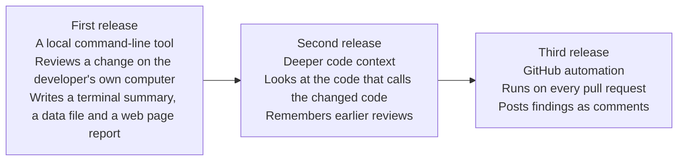
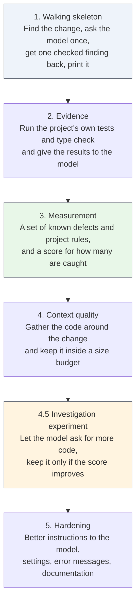
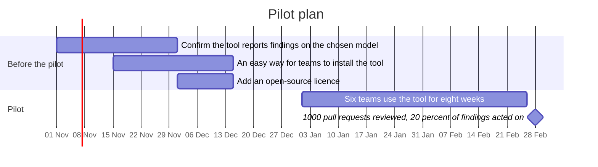
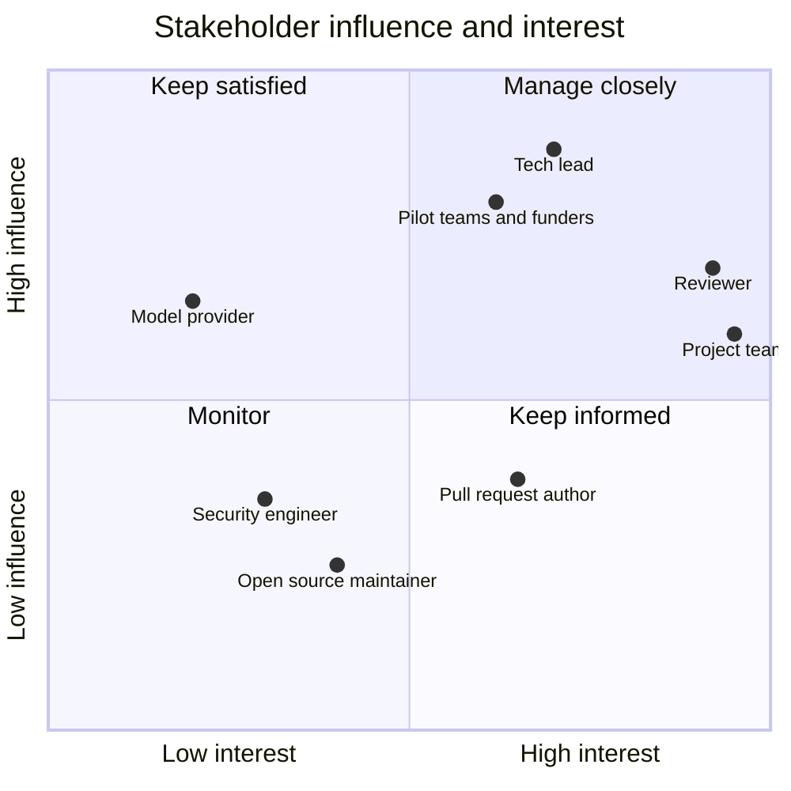
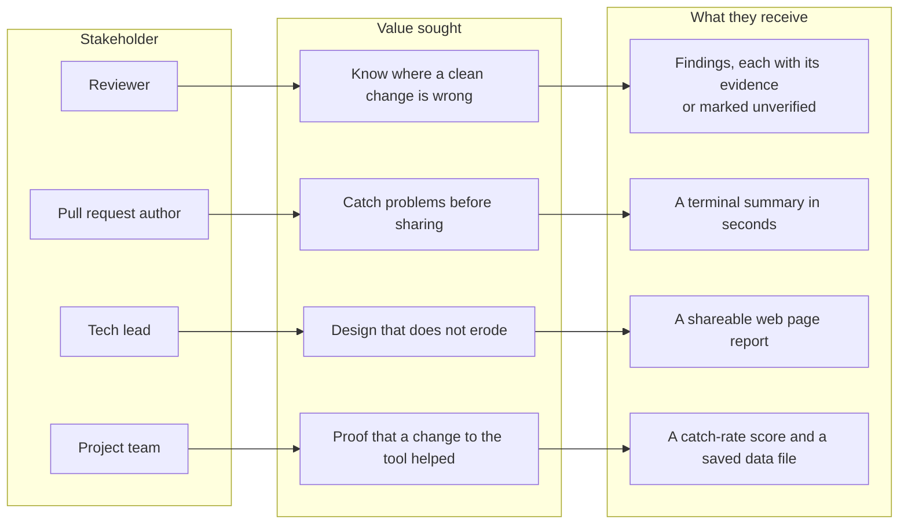
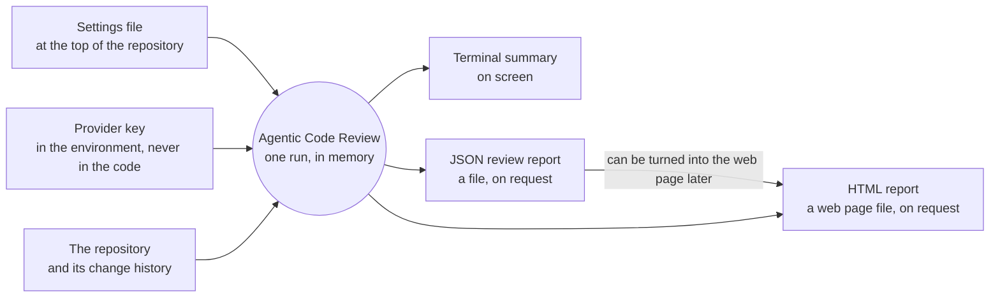
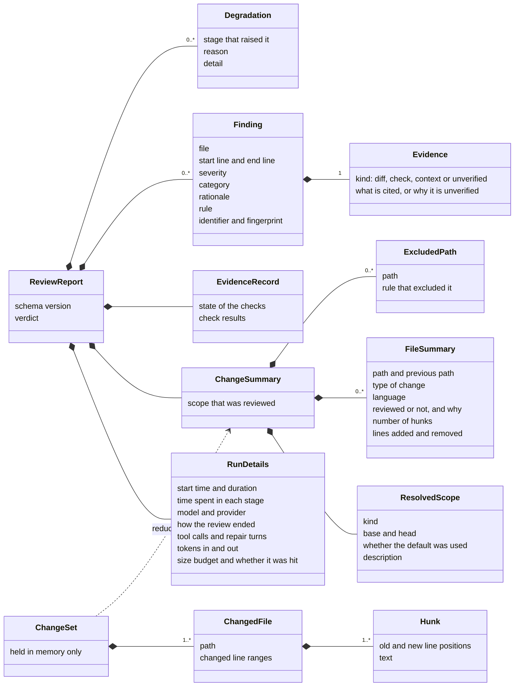
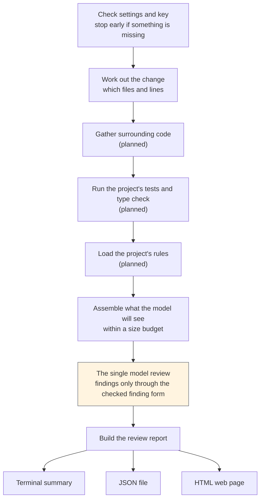
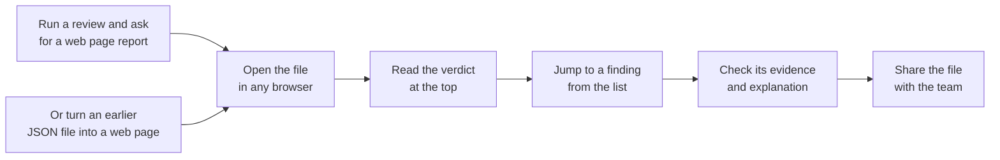
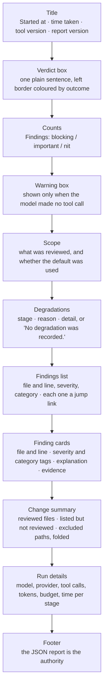

# Agentic Code Review — Project Documentation

**Agentic Code Review** is a tool that reviews a proposed change to a TypeScript or JavaScript program and shows the evidence behind every problem it reports. Its tagline is **"Review that shows its evidence."** This document summarises four parts of the project: how it is planned, who it is for, how its data is organised, and how its report looks to the people who read it.

---

## 1. Project Planning

### 1.1 Goal and scope

Developers now write a lot of code with help from artificial intelligence. That code usually looks clean and passes its tests, so the colleague who has to approve it can no longer tell, at a glance, where the problems are. The goal of the project is to give that colleague a second reviewer that reads the change, points at likely problems, and shows what each one is based on. When a problem cannot be backed by evidence, the tool says so openly.

The first release is a **command-line tool**: a program the developer runs by typing a command in a terminal on their own computer. It works out what changed, sends the change to an artificial intelligence model once, and writes the answer as a list of checked findings. A **finding** is one problem the reviewer reports, at one place in one file.

### 1.2 Three releases

The work is split into three releases. Each one adds to the previous one without rebuilding it.

### 1.3 Build order for the first release

The first release is built in a fixed order. Each step stands on the one before it.

**Why measurement comes third and not last.** Once there is a fixed set of known defects to test against, every later change can be judged by a number instead of by opinion. The context work in step 4 and the experiment in step 4.5 are both decided this way.

### 1.4 Where the work stands

| Part | State |
|---|---|
| Walking skeleton: find the change, one model call, checked findings, terminal summary | Built |
| Choosing what to review: uncommitted work, a range of commits | Built |
| Choosing what to review: staged work, a single commit | Not built yet |
| Reviewing a public pull request from its web address, read-only | Built |
| A data file of the review and a web page report made from it | Built |
| A diagram of the review, drawn as Mermaid | Not built yet |
| Tracing of each model call, for the team's own debugging | Not built yet (Langfuse only supplies the model's instructions today) |
| Automatic tests of the tool itself | 427 tests, run offline in under two minutes, on Linux and Windows |
| Running the reviewed project's tests and type check | Not built yet |
| Gathering the code around the change | Not built yet |
| The set of known defects and the catch-rate score | Not built yet |
| Loading the project's own rules | Not built yet |

A **pull request** is a proposed change to the software, sent to a colleague to approve before it goes in. A **test** is an automatic check that software runs on itself. A **type check** is an automatic check that values are used in the way the code declares.

### 1.5 Pilot plan

The next milestone is a pilot with real teams.

The pilot asks **6 teams** to use the tool for **8 weeks from 1 January 2027**. Success by **28 February 2027** means **1,000 pull requests reviewed**, with reviewers acting on **at least 20% of the findings**.

### 1.6 Team

| Role | Number |
|---|---|
| Junior software engineer | 4 |
| Senior Oracle developer | 1 |
| Sales manager | 1 |

### 1.7 Constraints and risks

- **Budget.** Free model tiers, or a single plan of about $20 a month. No paid servers for running models.
- **Waiting time matters more than cost.** A developer waiting at the terminal gives up on a slow tool. The acceptable waiting time is not fixed yet; it will be set by watching real users.
- **Honest gap 1.** The first release sees what the changed code uses, but not the code that calls it. A change that breaks an assumption made by a caller stays invisible until the second release.
- **Honest gap 2.** The first release mainly serves the author before they share their change. Reading a public pull request is the first thing it does for the reviewer, not the last.
- **The model may stay silent.** In early runs on one model, no finding was reported. The tool cannot yet tell "nothing to report" from "the model did not use the finding form", and it says exactly that instead of claiming a clean review.

---

## 2. Stakeholder Analysis

### 2.1 The problem and the one audience

**Problem.** Reviewers of TypeScript and JavaScript pull requests written with help from artificial intelligence cannot tell whether a clean-looking change that passes its tests actually fits the codebase. Rough code and failing tests used to show them where to look. Now the code arrives clean and green, even when it picks the wrong backend, breaks a team convention, or slowly erodes the design.

**Audience.** One group: **the reviewer** — an engineer who reviews a teammate's pull request written with help from artificial intelligence, in a company or a funded team.

**Business framing.** Artificial intelligence has made writing software cheap and checking it slower. Where its use is high, one industry study found that a review takes about five times as long, and nearly a third more changes skip review altogether.

### 2.2 Stakeholders

| Stakeholder | Role | What they want | Place in the project |
|---|---|---|---|
| Reviewer | Primary user | To know where a clean, test-passing change is actually wrong, with evidence they can check quickly | The one audience |
| Pull request author | Writes the change | A fast merge without a long back-and-forth | Later; uses the tool today before sharing a change |
| Tech lead | Leads the team, likely decides to adopt and pay | Nothing merges that quietly erodes the design | One pain included now; the rest later |
| Open-source volunteer maintainer | Reviews strangers' contributions | Their limited time not wasted on low-value changes | Later; their heaviest pains are about staffing, which a tool cannot fix |
| Security engineer | Guards against vulnerabilities | Secrets and vulnerabilities caught before a human sees them | Later; deep security checks come in the second release |
| Project team | Builds the tool | A fast build loop and a score that shows whether a change helped | Internal |
| Model provider | Serves the artificial intelligence model | Paid or free-tier usage | External supplier |
| Pilot teams and funders | Try and back the product | Proof that reviewers act on the findings | The pilot milestone |

### 2.3 Influence and interest

### 2.4 The reviewer's needs and pains

Each pain is scored for **severity** (how much it hurts, 1 to 5) and **frequency** (how often it happens, 1 to 5). The scores are the team's judgement, not measurements.

| Reviewer pain | Severity × frequency | Can a tool help? | Are rivals already solving it? | Place in the product |
|---|---|---|---|---|
| Clean, test-passing code that does not fit the codebase slips through | 5 × 4 = 20 | Partly | No | **Headline pain** |
| The design erodes or conventions drift while tests still pass (from the tech lead) | 5 × 3 = 15 | Partly | No | The kind of defect inside the headline pain |
| The same routine checks repeated on every pull request | 4 × 4 = 16 | Partly | Partly | Supporting pain 1 |
| A second opinion from a model that shares the writer's blind spots | 4 × 3 = 12 | Yes | No | Supporting pain 2 |
| Too many changes to sort by risk | 4 × 4 = 16 | Partly | Yes | Not claimed: rivals already offer it |
| Approving without really reading | 4 × 3 = 12 | No, it is cultural | — | Not claimed: no tool fixes habits |

**How we will know it is solved.** A measured catch rate on a set of known defects of this kind, with few enough false alarms that reviewers keep reading the output.

### 2.5 Value map

### 2.6 Where needs conflict

1. **Fast merge against thoroughness.** The author wants to merge quickly; the reviewer and tech lead want care. The evidence says the author should do more checking before sharing, which is exactly what the author is least keen to do.
2. **Everyone dislikes noise, but not equally.** Some sources say false alarms destroy trust; others say they are cheap. The right tolerance depends on who is served, so it is not averaged.
3. **Speed against gatekeeping.** A company lead counts success as changes merged; an open-source maintainer counts it as bad changes kept out. The same tool has opposite success measures for them, which is one reason the project serves one audience first.

---

## 3. Database Design

### 3.1 No database is used — and why

The project deliberately has **no database**. The reasons are simple:

1. **There is no server.** The tool runs on the developer's own computer, once per command, and then stops. There is nothing running all the time for a database to sit behind.
2. **Each review stands alone.** One change goes in, one report comes out. The first release keeps nothing from one run to the next. Remembering earlier reviews, for example to avoid repeating a finding, is planned for a later release.
3. **The code stays private.** The reviewed source code never leaves the developer's computer except for the one request to the model provider. No account, no shared store and no login are needed beyond the provider's key.
4. **A file is enough.** The review is saved, when asked, as a **JSON file** — a plain text file that stores structured data in a standard format that both people and programs can read. It can be kept beside the change, read by scripts, and turned into the web page report later, with no tool and no network needed.

### 3.2 Where the data lives instead

The JSON review report is the authority. The terminal summary and the web page are both views of it and never say anything it does not.

### 3.3 The data model

**Two kinds of data.** The **change set** holds the full change — every file and every **hunk** (one block of changed lines) — and lives only in memory while the review runs. The report keeps only a **summary** of it: which files, what kind of change, how many lines. This keeps the saved file small and keeps the source code out of it.

### 3.4 The main entities in plain words

| Entity | What it is | Main contents |
|---|---|---|
| Review report | The whole result of one review | Schema version, run details, change summary, evidence record, findings, degradations, verdict |
| Run details | What is needed to repeat and compare a run | When it started and how long it took, the model, how the review ended, how many tool calls were made, tokens used, budget |
| Change summary | What was reviewed, without the code itself | The scope, one line per file, and every path that was left out with the rule that left it out |
| Evidence record | What happened when the project's checks were run | In the current build it says plainly that checks were not attempted |
| Finding | One problem the reviewer reports | File, lines, severity, category, a short explanation, and exactly one piece of evidence |
| Evidence | What a finding is based on | A block of the change, a check result, a piece of surrounding code, or an honest "unverified" with the reason |
| Degradation | Something that went wrong or was skipped, but did not stop the review | The stage that raised it, a fixed reason name, and a detail sentence |

**Allowed values**

| Field | Values |
|---|---|
| Severity | **blocking** (do not merge), **important** (a real defect to fix), **nit** (minor and local) |
| Category | correctness, error-handling, interface-contract, test-evidence, security, performance, maintainability |
| Scope kind | working tree, staged, range of commits, pull request |
| How the review ended | findings emitted, nothing to review, no tool call, ceiling reached, budget exhausted, provider error, invalid model output |
| Verdict | blocking, findings, no findings, no judgement, nothing to review |

### 3.5 How data moves through one review

The order of steps is fixed by the program, not chosen by the model. The model appears in one step only.

**Findings enter through one door.** The model can only report a finding by filling in one fixed form, and the form is checked the moment it arrives. A finding with a missing field, an impossible line range or evidence the review never had is refused. The model's free text is never read for findings and never stored as one.

**Nothing fails silently.** If a step cannot run, the review still finishes and the problem is recorded as a degradation. A silent failure would look the same as a clean review.

### 3.6 Versioning

Every report carries a **schema version** — the version of the report's shape. When the tool reads an old report back, it checks that version first. A report from a newer version is refused with a clear sentence naming both versions, instead of being misread.

---

## 4. UI/UX Design — The HTML Report

### 4.1 Who reads it, and when

The terminal summary serves the person at the keyboard. The **HTML report** — a single web page file that opens in any browser — serves everyone else: the reviewer, a teammate, or a lead who was not at the terminal, reading later, on any computer, even one without the tool installed. It can be saved beside the change it describes.

### 4.2 User journey

Both routes produce the **same page, byte for byte**, because the page is drawn only from the report and never from the clock or the computer it runs on.

### 4.3 Page layout

### 4.4 Verdict sentences

The verdict is always one plain sentence, written exactly as below.

| Verdict | What the report says |
|---|---|
| blocking | Verdict: blocking. At least one finding is blocking. |
| findings | Verdict: findings, none blocking. |
| no findings | Verdict: no findings were accepted. |
| no judgement | Verdict: no judgement. No review was performed; see the degradations above. |
| nothing to review | Verdict: nothing to review. |

When the model made no tool call, the warning box adds: *"No findings. The model made no tool call, so this build cannot tell a change with nothing to report from a model that did not use the finding tool."*

### 4.5 Colours

Colour marks severity, and every colour is paired with a written word, so the meaning never depends on colour alone.

| Use | Light mode | Dark mode |
|---|---|---|
| Blocking | Red `#a3222b` | Light red `#ff7b85` |
| Important and warnings | Amber `#8a5a00` | Light amber `#e9b949` |
| Nit | Teal `#2a6072` | Light teal `#7fc8de` |
| Text | `#1a1c20` | `#e6e8ec` |
| Page background | `#ffffff` | `#14161a` |
| Panels | `#f6f7f9` | `#1d2026` |

### 4.6 Design decisions

| Decision | Why |
|---|---|
| **One self-contained file, with no scripts and nothing loaded from the internet** | It opens offline, it is safe to send on, and it does not tell anyone outside that a review happened. The explanations are written by a model about code nobody vouched for, so the page shows that text and never runs it. |
| **Light and dark mode follow the computer's own setting** | No switch to find; the page matches what the reader already uses. |
| **System fonts and a readable width, which also fits a phone** | Nothing to download, and lines stay short enough to read comfortably. |
| **The verdict comes first, the details after** | The reader learns the outcome in one glance, then goes as deep as they need. |
| **Every finding is a jump link from the list to its card** | Quick to move around a long report. |
| **Every finding shows its evidence, or says "unverified" with the reason** | This is the product's promise: a finding the reader can check quickly, or an honest admission that it could not be checked. |
| **A run where the model never used the finding form is never shown as clean** | "Found nothing" and "never looked" must never look the same. |
| **Nothing is hidden** | Every degradation and every excluded path is listed. Long lists are folded, not cut. |
| **The page states what the build does not do yet** | Lines such as "No checks were run in this build." and "No related context was gathered in this build." keep the reader from assuming more than happened. |
