# The Agentic Harness Layer — A Plain-Language Guide

What the "harness" is, and what it has to provide, explained without assuming the vocabulary.

Companion to [`agentic-code-review-srs.md`](./agentic-code-review-srs.md). Every requirement referenced here is stated in full, with its SRS tag in brackets for traceability.

> **Two surfaces.** [ADR-0006](../adr/0006-local-cli-core-action-as-adapter.md) (Accepted) established that this harness has **one core reached through two thin adapters**: a local command-line tool a developer runs on their own machine, and a GitHub Action that reviews a pull request. Almost everything below is shared by both. Where a section applies to only one surface, it says so at the top. The decisions that split are summarised in §11.
>
> **Which one exists when (2026-09-08).** GitHub integration is deferred to **v3** ([SRS §2.3.3](./agentic-code-review-srs.md)), so **v1 builds the CLI surface only**. Sections marked "GitHub Action surface only" — §4 on fork pull requests and §6 on the comment ledger — describe v3 work. They are worth reading before then anyway: §6's fingerprint design constrains the local state file v1 does build, and §4 explains why the Action needs a two-job structure rather than a flag. A proposed first increment, narrower still than v1, is in [`mvp-scope.md`](./mvp-scope.md).

---

## Vocabulary used throughout

| Term | Meaning in this document |
|---|---|
| **Harness** | The ordinary program code that surrounds the AI model — it prepares input, decides what the model is allowed to do, checks the model's output, and publishes results. It is not AI. It is **Python we write** ([ADR-0007](../adr/0007-python-harness-typescript-target.md)); TypeScript is the language it *reads*, not the language it is written in. |
| **The pipeline** | The fixed sequence of steps the harness runs on every pull request, start to finish. Defined below in §1. |
| **Model / LLM** | The AI language model we call over the network. |
| **Context window** | The single block of text we send to the model. It has a hard size limit. Everything the model knows about the pull request must fit inside it. |
| **Tool** | A function the model is allowed to ask us to run — "read this file for me" — and whose result we hand back. The model cannot run anything itself; it can only ask. |
| **Agent** | A model that runs in a loop, choosing tools until it decides it has enough information. |
| **Finding** | One review comment: file, line, severity, category, explanation. |
| **PR** | Pull request. |

---

## 1. What "the pipeline" is

The pipeline is the fixed list of steps our code performs for every pull request. Our code decides the order. The model does not.

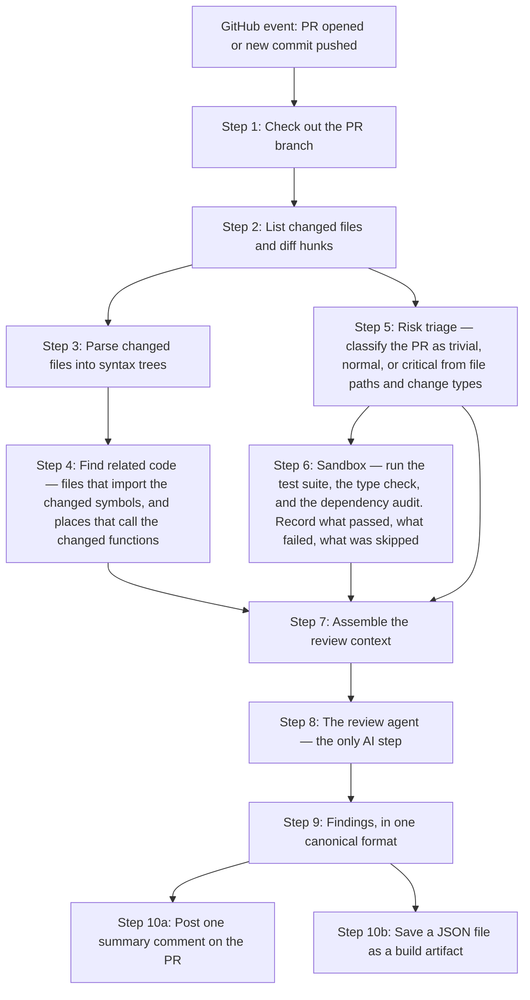

Steps 1–7 and 9–10 are plain code: no AI, fully deterministic, cheap, and testable. Step 8 is the only place a model is involved.

So when the earlier note said *"run the checks once in the pipeline"*, it meant: **run the tests at step 6, before the model is ever called.** The results are already sitting in memory by the time the model starts thinking.

### Why that ordering matters

The alternative is letting the model decide when to run the tests. Compare:

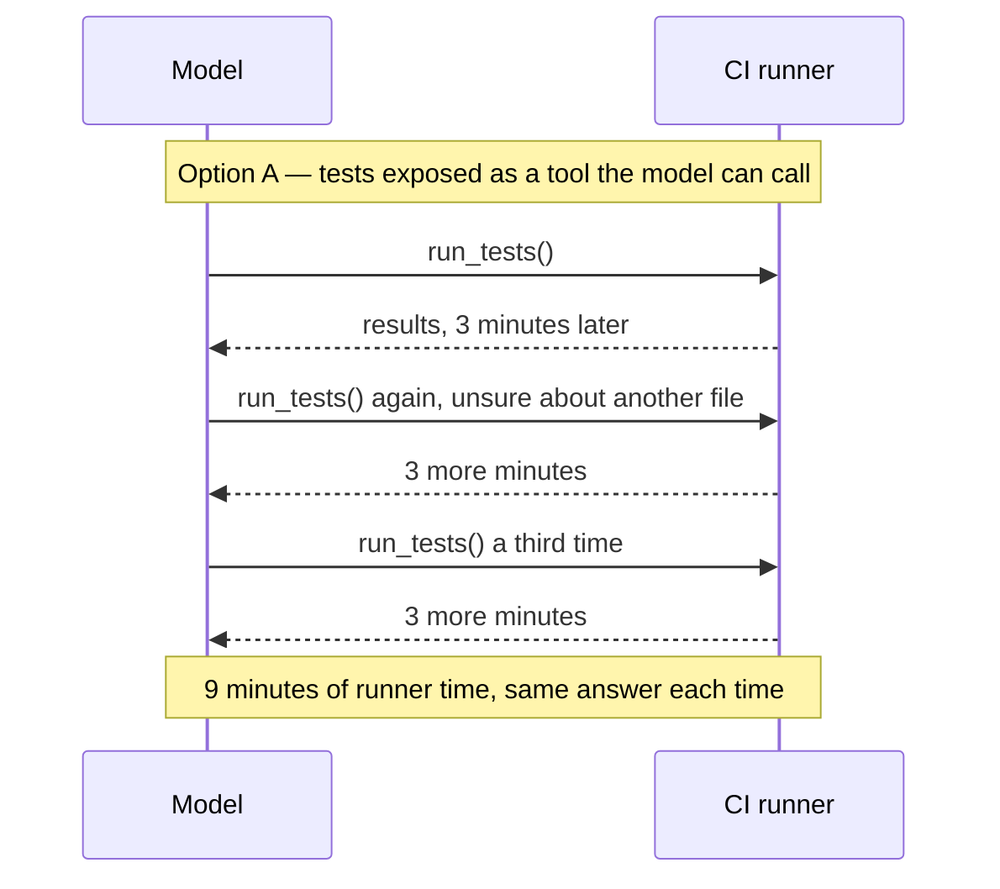

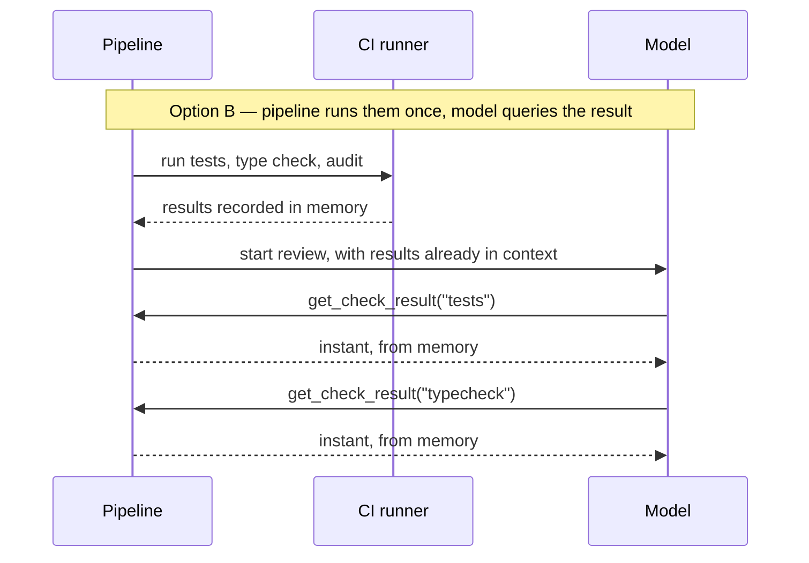

Option B is what we want. Test results don't change between calls, so letting the model re-request them buys nothing and costs minutes of free-tier CI budget every time.

### Where "agentic" fits in

A pipeline alone is not agentic. In the plain pipeline, step 7 gathers a fixed set of context and step 8 gets one shot at it:

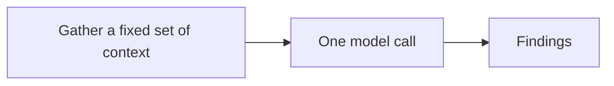

An agent loop instead lets the model pull information as it realises it needs it:

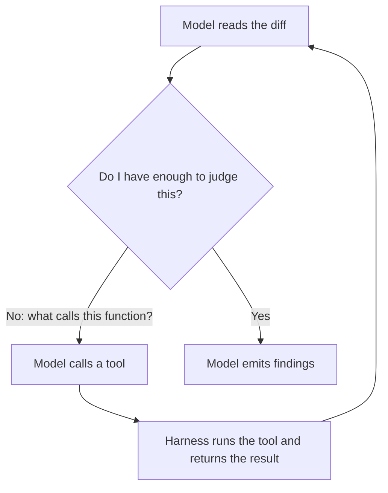

The loop reviews better and costs more — each turn resends the whole conversation. Since our budget objective is to operate on free tiers and roughly a $20 ceiling (SRS objective 6), we cannot afford the loop on every PR.

**The resolution is already in the SRS.** The requirement to route review depth by risk tier — fast-track trivial changes, deeper review for critical ones (FR-3.3) — becomes the dial that controls how agentic each run is:

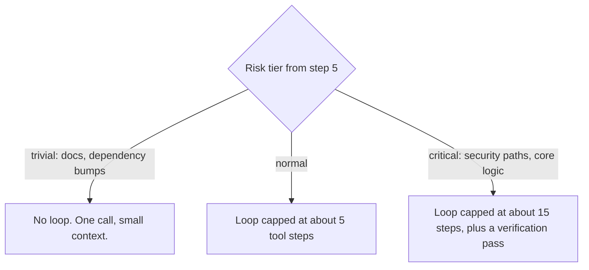

This makes "how agentic are we" a number in a config file rather than an architectural commitment.

---

## 2. The tool surface

A tool is a function we expose to the model. The model never executes anything; it emits a request like `read_file("src/auth.ts", 40, 80)` and our harness decides whether to honour it.

**The test for whether something should be a tool:** would the model's judgement about *when* to call it beat a fixed rule? If a fixed rule is just as good, do it in the pipeline and hand over the result.

| Tool | What it does | Runtime cost |
|---|---|---|
| `read_file(path, range)` | Returns source lines | Free |
| `get_outline(path)` | Lists the functions and classes in a file, without bodies | Free |
| `get_definition(symbol)` | Returns where a symbol is defined | Free |
| `find_references(symbol)` | Returns places that import or call it | Free |
| `search_repo(pattern)` | Plain text search — the escape hatch when syntax-tree analysis misses something, such as a dynamically built import path | Free |
| `get_check_result(check)` | Returns the recorded outcome of the tests, type check, or audit from step 6 | Free |
| `lookup_pattern_rule(id)` | Returns one project coding rule with its wrong/correct example | Free |
| `emit_finding({...})` | Records one review finding | Free |

All of these read from data we already have on disk or in memory. That's deliberate — every tool call is cheap, so a capped loop has a predictable cost.

### Two things that are deliberately not tools

**Running tests is not a tool** — for the reason shown in the sequence diagrams above. If we later want the model to be able to re-run something, it must be narrow and quota'd: `run_single_test_file(path)`, at most twice per review.

> **This one splits by surface.** The prohibition holds on the Action, where a test run costs minutes on a cold machine. Locally, against installed dependencies and a test runner's changed-file filter, a targeted run costs seconds — so the quota'd `run_single_test_file` tool is affordable there, and the model regains the ability to investigate by experiment. See [ADR-0002](../adr/0002-pipeline-initiates-test-execution.md) and its amendment in [ADR-0006](../adr/0006-local-cli-core-action-as-adapter.md).

**Nothing that writes to GitHub is a tool.** No `post_comment`, no `commit`, no `push`. The harness publishes results after the model is finished. This gives us two things at once:

- The SRS requirement that suggestions are advisory only, with no commits or pushes in v1 (FR-7.2), becomes structurally impossible to violate rather than a promise we have to trust.
- The model's process never holds a credential that can write to the repository — which matters enormously in §4.

---

## 3. `emit_finding` — why findings should arrive as tool calls

This is the single most useful design decision in the harness, so here it is slowly.

**The problem.** Models produce text. We need structured data: file path, line number, severity, category, explanation. Two SRS requirements depend on getting that reliably:

- All model output must be converted into the canonical finding format before anything downstream uses it; no component may read raw provider responses (FR-0.2).
- The agent's output must conform to that finding format, and the PR comment and JSON file must be derived from it rather than written by the model directly (FR-5.6).

**The naive approach: ask for JSON in the prose and parse it out.**

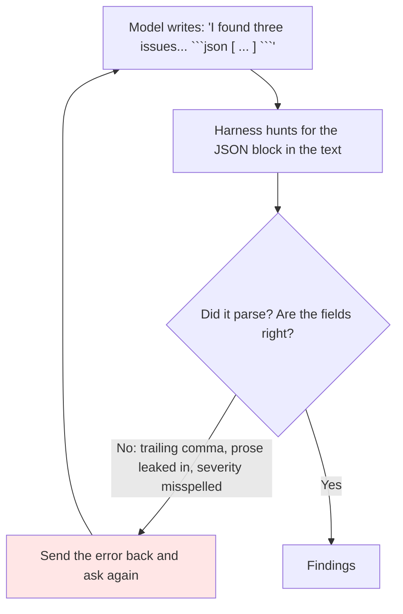

Every failure costs another full model call. On a free-tier model this failure rate is not small, and the retries eat the budget that was supposed to pay for the review itself.

**The better approach: make emitting a finding a tool call.**

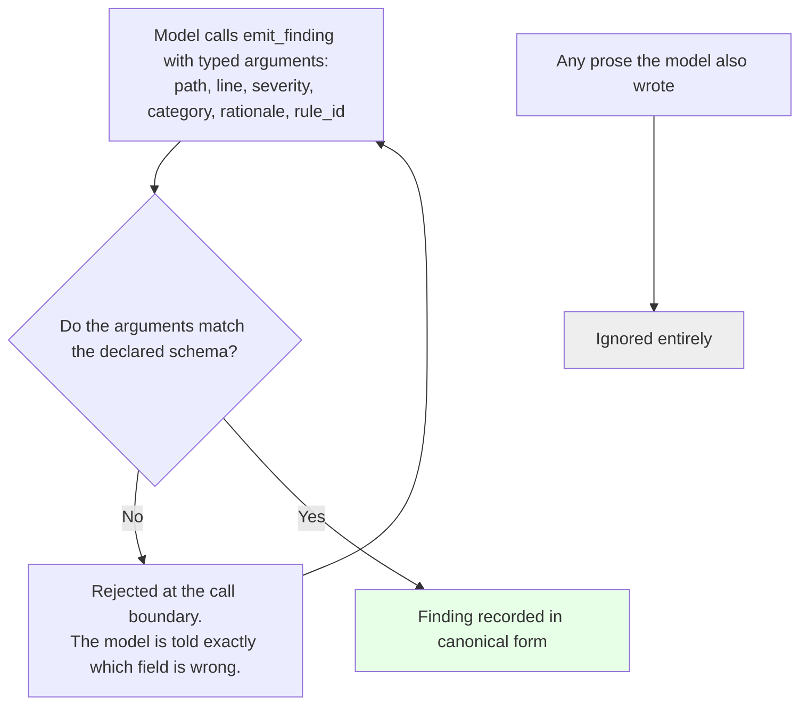

Three things improve:

1. **The shape is declared, not hoped for.** The tool's schema *is* the canonical finding format. Conformance stops being a parsing problem and becomes a validation check at the moment of the call.
2. **Errors are precise and cheap.** "`severity` must be one of blocking, important, nit" is a far better correction signal than "your JSON didn't parse", and many providers can enforce the schema during generation so the malformed call never happens.
3. **Prose is discarded rather than mined.** If the model writes "I also noticed the config looks odd" without calling the tool, that is not a finding and never reaches the PR. One path in, one format, no ambiguity.

That is what *"schema enforcement at the call boundary"* meant: the check happens where the model hands us the data, not afterwards on a wall of text.

---

## 4. Fork pull requests — what they are and why they're dangerous

> **GitHub Action surface only.** None of this section applies to the local command-line surface. There, the code being reviewed is the developer's own, already on their disk, and running their test suite is what they were about to do anyway — no stranger, no credential exposure, no trust boundary. See [ADR-0003](../adr/0003-untrusted-code-isolation-and-fork-triggers.md).

### What a fork PR is

An outside contributor cannot push branches to a repository they don't have write access to. Instead they **fork** it — make their own copy — commit there, and open a pull request from their copy into ours. This is how essentially all open-source contribution works, and our project explicitly targets public repositories (SRS objective: run on a public repo using only free tiers, FR-9.2).

### What "PR-authored code" means

**PR-authored code is the code written by whoever opened the pull request.** Not our code. Not the repository owner's code. A stranger's code, which our workflow is about to download and *execute* — because the SRS requires running the project's test suite in the runner and capturing the results (FR-4.1).

That includes more than test files. Running `npm install` executes any `postinstall` script declared in `package.json` — and `package.json` is a file the PR author can edit.

### The attack

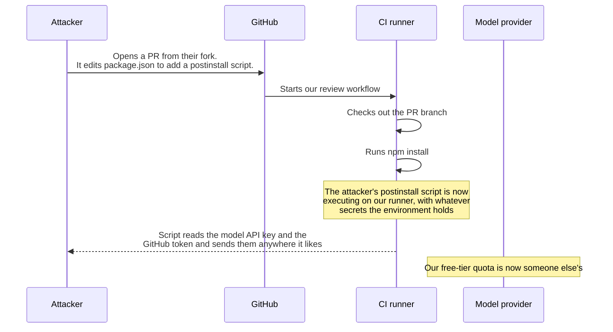

The GitHub token is the worse loss — depending on its permissions it can write to the repository.

### The fix: split the environment in two

Never let untrusted code run in the same environment as our credentials.

```mermaid
flowchart LR
    subgraph T["Analysis environment — trusted"]
        direction TB
        T1["Our harness code"]
        T2["Syntax-tree parsing of the diff"]
        T3["🔑 Model provider API key"]
        T4["🔑 GitHub token that can comment"]
    end
    subgraph U["Execution environment — untrusted"]
        direction TB
        U1["npm install — runs the PR author's scripts"]
        U2["The test suite — the PR author's tests"]
        U3["The type check and dependency audit"]
        U4["❌ No secrets of any kind"]
    end
    T -- "sends in: repository files only" --> U
    U -- "sends back: pass/fail plus captured output" --> T
```

Concretely: strip every secret from the environment of the steps that install dependencies and run tests, restrict that phase's network access to the package registry, and treat everything it returns as untrusted text. Combined with the earlier rule that the model process holds no write credential, the blast radius of a hostile PR collapses to "it wasted some CI minutes."

A second, lighter control worth adopting: **review fork PRs only on explicit request** — a maintainer comment or a label — rather than automatically. This is what Anthropic's Claude Code review feature does, described in [`tool-reference.md`](./tool-reference.md#L82).

None of this is currently specified. The SRS defers the security model for untrusted PR code to the non-functional pass (§5), while already requiring the workflow to trigger on every PR open and update (FR-1.1). The trigger is a v1 "Must" and the safeguard is deferred, which is the wrong order.

---

## 5. Memory — what the system remembers, and where

A GitHub Action is **stateless**. The runner is a fresh virtual machine that is destroyed when the workflow ends. Nothing survives unless we deliberately write it somewhere that outlives the run.

Four tiers of memory, distinguished by how long each must last:

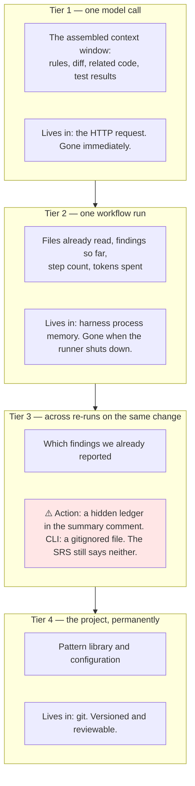

Tier 3 is a genuine hole. The SRS asks the agent to avoid duplicate or near-duplicate comments on unchanged findings across re-runs (FR-5.5), but the workflow re-triggers on every new commit (FR-1.1) and nothing carries over between those runs. Without somewhere to store what we already said, a ten-commit PR gets the same comment ten times — which is precisely the noise problem flagged as an adoption killer in [`competitive-landscape.md`](./competitive-landscape.md#L77).

The hole is real only on the Action surface, and for a specific reason: **the runner is destroyed after every run.** Locally the machine persists, so tier 3 is a file. §6 solves the hard case.

---

## 6. The fingerprint ledger — solving tier 3 on the Action surface

> **GitHub Action surface only.** Locally, a filesystem exists: tier-3 state is an ordinary gitignored file, and none of the hiding, size-capping, or tamper-handling below is needed. The fingerprint design in this section is shared by both surfaces; only the storage location differs. The motivation also weakens locally — a pull-request comment thread accumulates permanently and visibly, while terminal output is replaced on every run. See [ADR-0005](../adr/0005-cross-run-memory-as-hidden-comment-ledger.md).

### The idea in one sentence

Markdown hides HTML comments, so we can store a small machine-readable record **inside the PR comment we already post**, where humans never see it but our next run can read it back.

### Why the PR comment

We already post exactly one summary comment per run (FR-8.1a), and we already intend to update that same comment on re-runs rather than posting a new one (FR-8.1c). So the storage location already exists, is already being written, requires no database, no cache service, and no infrastructure — and it lasts as long as the pull request does.

### What it looks like

The comment body we post:

```markdown
## Agentic Code Review — normal risk

✅ Tests passed · ✅ Type check passed · ⚠️ 2 audit advisories

**3 findings** — 1 blocking, 2 nits.

<!-- agentic-review-ledger
{"schema":1,"run":4,"reported":[
  {"fp":"a3f19c","rule":"no-unawaited-promise","sym":"loadUser"},
  {"fp":"77b204","rule":"missing-error-branch","sym":"parseConfig"},
  {"fp":"c81e0d","rule":"nit-naming","sym":"tmp2"}
]}
-->
```

Everything between `<!--` and `-->` is invisible when GitHub renders the comment. A reader sees only the summary. Our next run fetches the comment through the API, reads the raw text, and recovers the list.

### How it works across runs

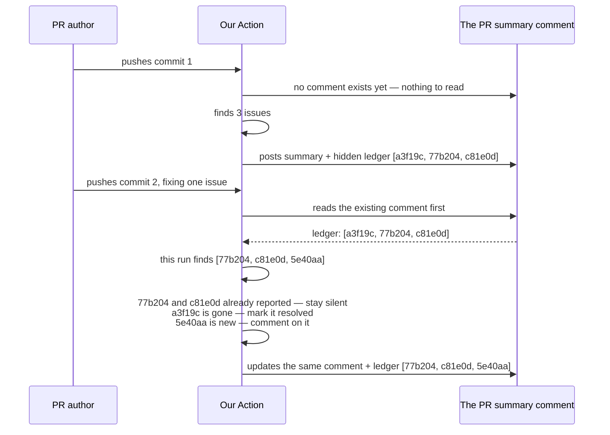

The author sees one comment that evolves, not a growing pile of repeats.

### The part that is easy to get wrong

A **fingerprint** is a short hash identifying a finding, so we can recognise the same issue again on the next run. What we hash decides whether this works at all.

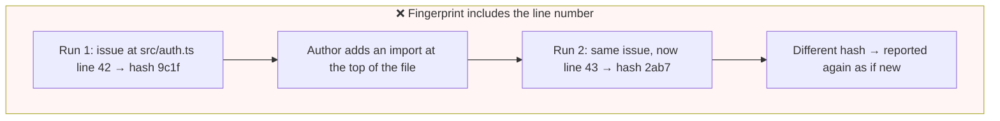

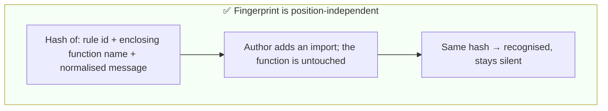

| Include in the hash | Exclude from the hash |
|---|---|
| The pattern rule identifier that fired | Line and column numbers |
| The name of the enclosing function or class | Surrounding code snippets |
| The file path | The model's exact wording |
| A normalised form of the message | Timestamps, run numbers |

Line numbers move on almost every push. Any fingerprint that depends on them invalidates itself constantly and the deduplication silently stops working.

---

## 7. Context engineering — deciding what goes in the window

The context window has a fixed size limit, and a real pull request offers far more material than fits. The SRS says to cap context and degrade gracefully when the limit is exceeded (FR-2.5) but doesn't say how. Here is a concrete policy.

### Give each kind of content its own budget

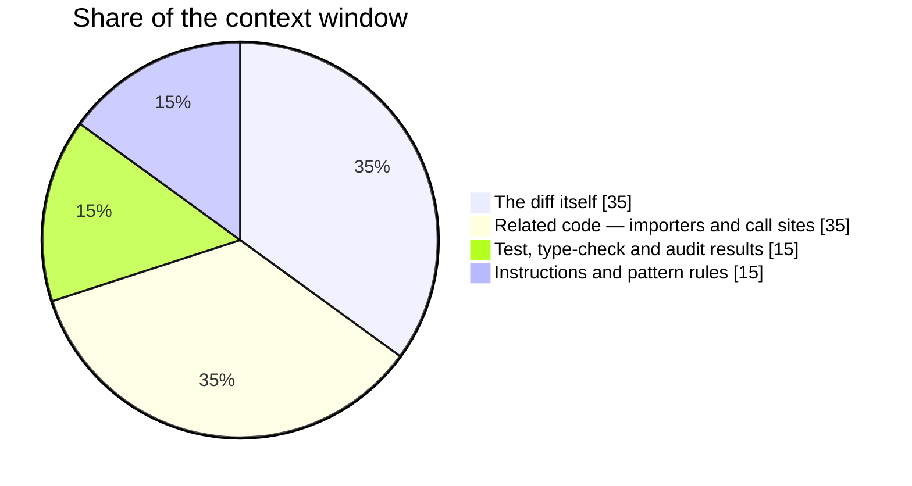

Each section is trimmed within its own share. Without this, one enormous diff swallows the whole window and the model reviews the change with no evidence and no rules — the worst possible failure, because it still produces confident output.

### Trim in a fixed order

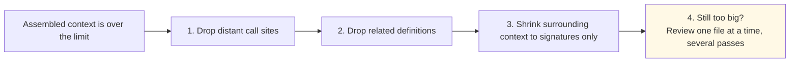

The diff is never truncated. Reviewing half a change is worse than reviewing it in two passes.

### Never paste raw test output

A failing test run can emit megabytes — every passing test name, full stack traces, framework banners. Pasting that in would consume the entire window and teach the model nothing.

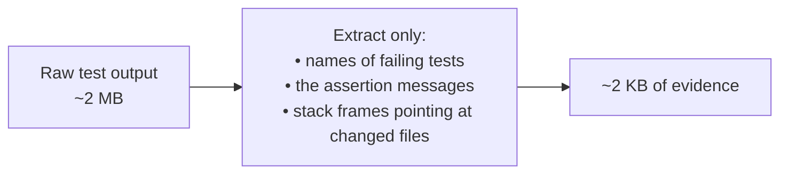

### Order the context so it can be cached

Put the parts that never change first — instructions, pattern rules, repository facts — and the volatile parts last — this diff, these results. When a large PR is reviewed one file at a time, every pass shares an identical opening block, which providers that cache repeated prefixes can charge for once instead of many times.

---

## 8. Choosing models — four jobs, not one

"Which LLM should we use" is really four questions, because the harness has four distinct jobs.

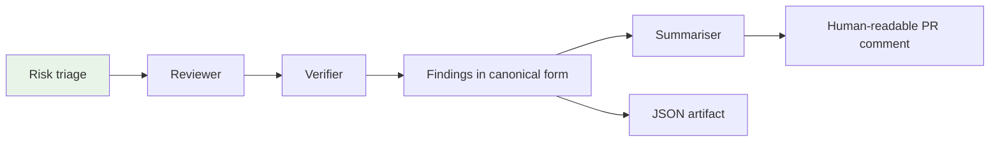

| Job | What it needs | Model to use |
|---|---|---|
| **Triage** — classify the PR as trivial, normal or critical | Nothing. The SRS already requires this to be deterministic, from file-path and change-type rules (FR-3.1) | **No model at all** |
| **Reviewer** — actually find the problems | Strong code comprehension and reliable tool calling | The largest code-trained model the budget allows |
| **Verifier** — re-check candidate findings before posting, to cut false positives | Adversarial re-reading; can be the same model with a different prompt | Same, or one tier smaller |
| **Summariser** — write the prose summary from findings that already exist | Fluent writing only | The smallest, cheapest model available |

Two rules attach to this diagram:

**Triage stays model-free.** It costs nothing, gives the same answer every time, and can be unit tested. Keeping a rules engine here rather than a model is an asset, not a shortcut.

**The summariser is strictly downstream.** It renders prose from findings that already exist and cannot invent one. The SRS requires the summary to state the risk tier, the checks run, the finding counts by severity, and a verdict (FR-8.1b) — all derived facts. If the summariser could add findings, the comment and the JSON file would disagree, and the human-readable output would become the one you cannot trust.

### The three criteria that actually decide the reviewer model

1. **Does it support native tool calling reliably?** Everything in §2 and §3 depends on it. Free-tier models vary enormously here, and a model that fails tool calls even 10% of the time turns a capped loop into a retry storm. **Test this before committing to a provider.**
2. **Can it enforce a schema while generating?** If yes, malformed findings become impossible and §3 costs nothing. If no, we need validate-and-retry with its own retry cap.
3. **Is it code-trained?** A general chat model reads TypeScript acceptably and reasons about cross-file consequences poorly — and cross-file reasoning is the value this project claims.

### One thing we are deliberately not using

**No embeddings, no vector database, in v1.** The syntax-tree analysis the SRS already requires — finding files that import a changed symbol and the call sites of a changed function (FR-2.3a, FR-2.3b) — answers "what does this change affect" more precisely, more cheaply, and reproducibly. Semantic search adds cost and non-determinism for no gain at this scope.

This is worth restating now that the harness is built on LangChain ([ADR-0007](../adr/0007-python-harness-typescript-target.md)), because that framework makes retrieval-augmented generation the path of least resistance — a vector store is four lines away, and the shape of every tutorial suggests reaching for one. The reason not to has not changed: we are not searching for *semantically similar* code, we are following *actual* edges in the import graph, and an approximate answer to a question with an exact answer is a downgrade.

### A portability caveat

The SRS promises that adding a provider is a matter of mapping its output to the canonical finding format, with no downstream changes (FR-0.3). That holds for output *shape*. It does not hold for *capability*: a provider without tool calling needs an entirely different code path. The model interface should therefore abstract four things — chat completion, tool calling, structured output, and token counting — and declare an explicit fallback for when tool calling is unavailable.

LangChain supplies three of those four directly — tool binding and structured output are the two mechanisms FR-5.6a and FR-5.6b were written against, and pointing an OpenAI-compatible client at a different base URL is most of what FR-0.3 asks for. It does **not** supply the capability question. A model that *accepts* a tool binding is not a model that *reliably calls it*, and the abstraction will happily hide that difference behind a uniform interface. The three criteria above still have to be tested against the actual chosen model before the provider is committed to; a framework that makes providers interchangeable in code does not make them interchangeable in behaviour.

---

## 9. What the harness owns, regardless of design choices

| Responsibility | Why |
|---|---|
| Step budget per risk tier | Stops the loop running forever |
| Token and spend accounting, with a hard stop | Makes the free-tier budget objective enforceable rather than aspirational |
| Retry and backoff on provider errors | Free tiers rate-limit |
| Validating tool arguments before dispatch | The model will eventually ask to read `../../etc/passwd` |
| Wall-clock timeout | Matches the existing requirement for a configurable execution time budget (FR-4.4a) |
| A recorded trace of every tool call and result | Auditability — the ability to explain why a finding was made |
| **Always produce a review, even a degraded one** | Generalises the existing rule that a timeout must still produce a review reporting the timeout (FR-4.4b) to every failure mode |

---

## 10. What the SRS would need to add

Things the harness needs that no current requirement covers:

| Gap | Blocking? |
|---|---|
| The tool list and their schemas, as a versioned contract | **Yes** — nothing can be built without it |
| Where per-change memory lives, so duplicate comments can actually be suppressed | **Yes** — the deduplication requirement (FR-5.5) is unimplementable without it |
| How the CLI resolves *what to review* — working tree, staged, or a branch range | **Yes** — ambiguous locally, and it silently changes what gets reviewed |
| The step budget and token budget per risk tier | No, but it decides the cost profile |
| Separation of the trusted analysis environment from the untrusted execution environment | No, but it is a live security exposure |
| Which mechanism guarantees structured output — native schema enforcement or validate-and-retry | No, but it determines the failure-handling code |
| That findings must not depend on which surface produced them | No, but it is the property that keeps one engine from becoming two |
| Supported operating systems and runtime versions | No, but it is a distribution contract the Action never needed |

---

## 11. What splits by surface

Everything not listed here is shared between the local command-line tool and the GitHub Action. That is deliberate: per [ADR-0006](../adr/0006-local-cli-core-action-as-adapter.md), an adapter may only **resolve** what to review, **render** findings, and **store** state. If an adapter ever decides what counts as a finding, the seam has been breached and the two surfaces will drift.

| Concern | GitHub Action | Local CLI |
|---|---|---|
| What is being reviewed | Pull request head against base — unambiguous | Working tree, staged, or a branch range — must be chosen |
| Whose code executes | A stranger's, alongside our credentials — §4 | The developer's own; no trust boundary |
| Who may trigger a test run | The pipeline only — §1 | The pipeline, plus a quota'd tool the model may call — §2 |
| Where findings go | One summary comment, plus suggested-change blocks | A terminal, plus machine-readable output |
| Tier-3 memory | A hidden ledger inside the comment — §6 | An ordinary gitignored file |
| Binding budget | Money — tokens against a fixed ceiling | Time — a developer's patience, roughly 10–30 seconds |
| Environment | One known runner image | Every operating system, runtime version, and package manager |

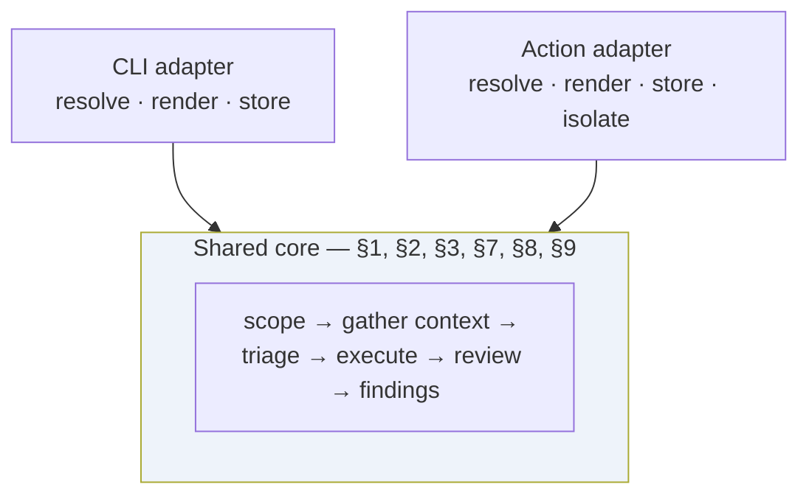
