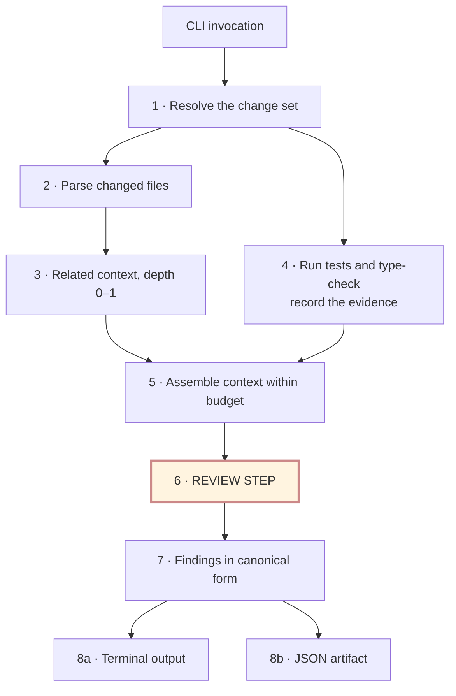
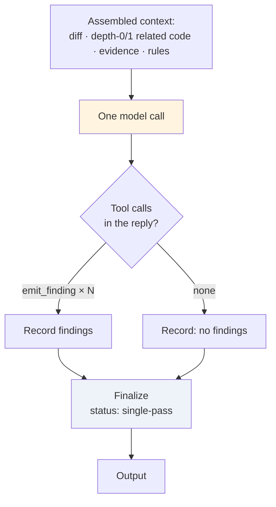
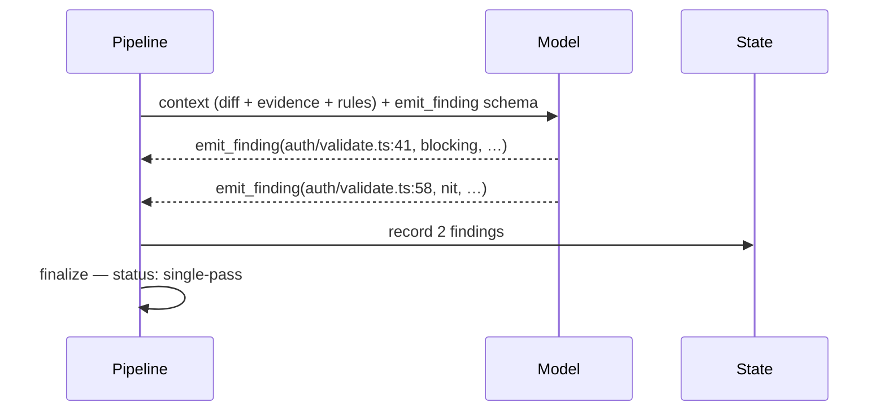
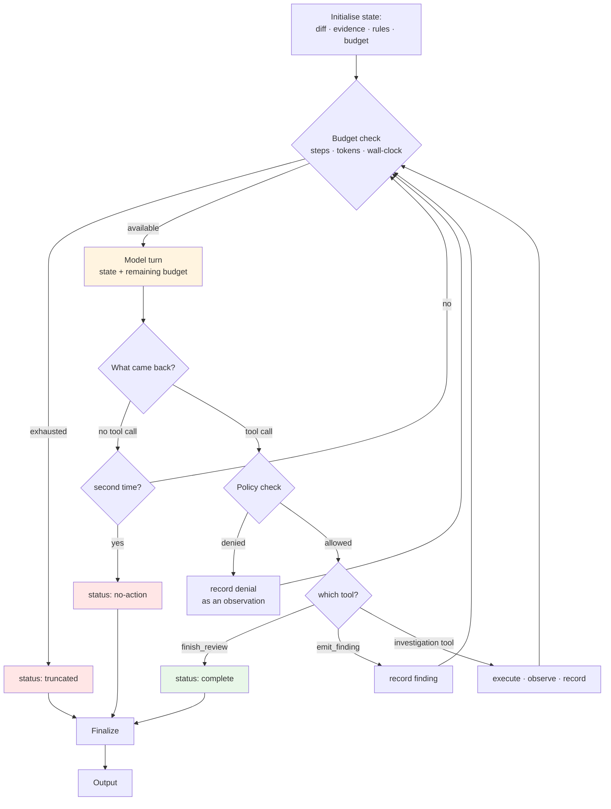
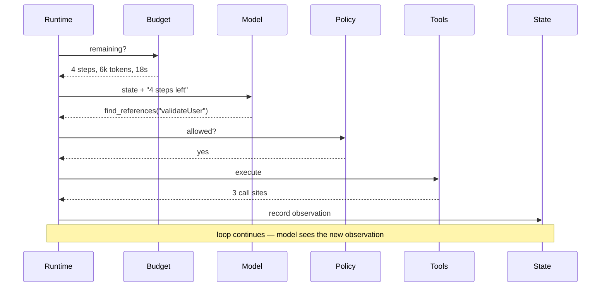
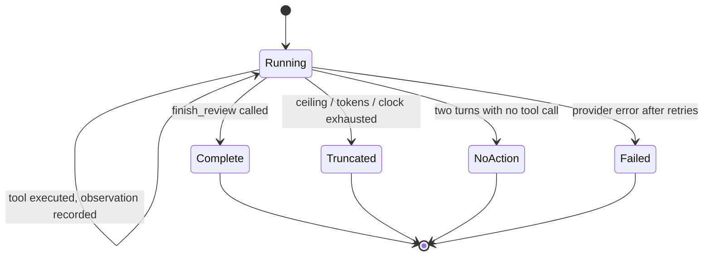
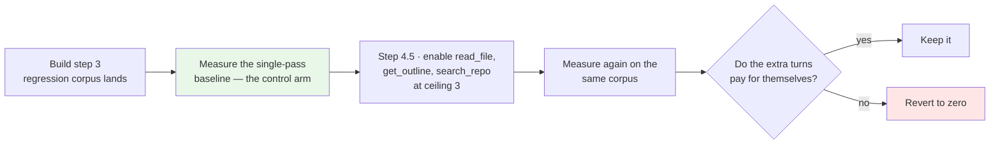

# The Agent Loop — v1 and after v2

**Status:** Design illustration · **Date:** 2026-09-08 · **Non-normative**

What actually happens inside the review step, before and after the tool loop is enabled. Companion to [`agentic-architecture-review.md`](./agentic-architecture-review.md) and [ADR-0001](../adr/0001-fixed-pipeline-with-bounded-agency.md).

The short version: **v2 changes the inside of one box.** Steps 1–7 and 9–10 of the pipeline are identical in both versions, and so are the finding model, the `emit_finding` boundary, and the adapters. What changes is whether step 8 runs once or runs until the agent says it is done.

---

## 1. Where the loop lives



Everything outside the highlighted box is ordinary deterministic code and is **unchanged between v1 and v2**. The diff and the check results stay precomputed in both, because both are needed in every review — spending a model turn to ask for something you already know is required is pure overhead.

---

## 2. v1 — the single pass

At step ceiling zero there is no loop. One model call, findings come back as tool calls, the runtime finalises.





**The model cannot ask a question.** If context assembly failed to include the caller that mattered, the finding is never made — and nothing in the output distinguishes that from a clean file. This is the accepted cost of v1, and it is the reason the honest framing in the v1 specification says the increment demonstrates the pipeline rather than the thesis.

---

## 3. v2 — the bounded loop



The two things to read off this diagram:

**`finish_review` is the only tool that returns *from* the loop.** Every other tool — including `emit_finding` — records an observation and hands control back to the model. That is what stops emitting from being the end of the review.

**The budget gate sits before the model call, not after.** Checking afterwards means discovering you could not afford the turn you already paid for.

### A turn, in sequence



### Termination states



`Complete` and `Truncated` must never render the same way. "No findings" that means *clean* and "no findings" that means *stopped looking* are different results, exactly as a skipped check and a passing check are different results (FR-4.5a).

---

## 4. The same change, reviewed both ways

A change to `validateUser()` in `src/auth/validate.ts`, where one of three callers depends on the old return contract.

### v1

```
precomputed   diff · depth-0/1 context · test results (4 passed, 1 failed) · 5 rules

turn 1        emit_finding(validate.ts:41, important,
                "return type changed; check callers")
              emit_finding(validate.ts:58, nit, "unused import")

result        status: single-pass · 2 findings · 1 model call
```

The real defect — the caller that breaks — is *guessed at* rather than established. The finding says "check callers" because the model could not.

### v2

```
precomputed   diff · depth-0/1 context · test results · 5 rules

turn 1        find_references("validateUser")
              → 3 call sites: session.ts:52, admin.ts:88, mw/guard.ts:14

turn 2        read_file("src/api/session.ts", 40, 80)
              → caller treats undefined as "not evaluated"

turn 3        emit_finding(session.ts:52, blocking,
                "caller relies on undefined; new code returns false",
                evidence: [test#4, context:session.ts:52])

turn 4        run_test({ file: "validate.spec.ts" })      [CLI only, quota 1 of 2]
              → passes — the suite does not cover this path

turn 5        emit_finding(validate.spec.ts, important,
                "no coverage for the changed branch",
                evidence: [test-run#2])

turn 6        finish_review({ status: "evidence-exhausted",
                summary: "one blocking caller break, one coverage gap" })

result        status: complete · 2 findings · 6 model calls
```

Same change, ~6× the cost, a materially better review — and a finding that names the broken caller instead of advising someone to go and look.

That ratio is the whole argument. It is why the ceiling is per-tier configuration rather than a constant, and why raising it should be gated on the regression corpus showing the improvement is real on the chosen provider.

---

## 5. What changes, and what does not

| | v1 | v2 |
|---|---|---|
| Steps 1–5, 7–8 of the pipeline | ✅ | ✅ identical |
| Diff and check results precomputed | ✅ | ✅ identical |
| Finding model and schema | ✅ | ✅ identical |
| `emit_finding` as the only way findings enter | ✅ | ✅ identical |
| Adapters decide nothing about findings | ✅ | ✅ identical |
| Model calls per review | 1 | 1 … ceiling |
| `emit_finding` ends the review | yes | **no** — it records and continues |
| Investigation tools callable | no | **yes** — read, define, references, search |
| Targeted test re-run callable | no | **CLI only, quota'd** — never on the Action |
| Agent may declare itself finished | no | **yes** — `finish_review` |
| Completion status | `single-pass` | `complete` / `truncated` / `no-action` / `failed` |
| Trajectory in the trace | one call | full turn sequence |

Five rows change. Everything else is untouched, which is the point of having decided the seams first.

---

## 6. What v1 should do now so v2 is a configuration change

| Do in v1 | Cost | Why now |
|---|---|---|
| Define the `finish_review` schema, unused | A schema block | Fixes the tool contract before code exists against it |
| Add `status` to the review result, `single-pass` in v1 | One field | The output shape stops changing when the loop lands |
| Add an evidence reference (or explicit `unverified`) to findings | One field | Findings become comparable across versions; enables the AC-A3 discipline |
| Record the turn sequence in the trace, length 1 in v1 | Trace shape | The trajectory format is settled before there are trajectories |

All four are contract decisions. Each costs a line or two now and a migration later.

---

## 7. The honest caveat

The v2 diagram assumes a model that can plan an investigation, remember what it has already seen, and stop when satisfied. On a free-tier provider that assumption is untested — [ADR-0001](../adr/0001-fixed-pipeline-with-bounded-agency.md) and [ADR-0004](../adr/0004-findings-emitted-as-tool-calls.md) both flag multi-step tool calling as the capability such models implement least reliably.

The failure mode is not a crash. It is a six-turn trajectory that re-reads the same file three times, emits the same finding it would have emitted on turn one, and costs six times as much. Nothing in the loop detects that; only the regression corpus does, by comparing catch rate against turns spent.

Which is why the ceiling stays at zero until there is something to measure it with.

---

## 8. Update — the ceiling comes off inside v1, not at v2

This document originally treated the loop as a v2 feature. That framing was wrong, and the correction is now in the baseline (FR-5.7a, FR-5.7b, AC-11).

The gate is not a version number, it is **the corpus existing**:



Three tools, not eight. `find_references` cannot join them — it needs the reverse index deferred to v2. `get_check_result` and `lookup_pattern_rule` are removed from the set entirely and preloaded, because at v1's scale — evidence distilled to ~2 KB, five pattern rules — a fixed rule beats a turn spent fetching. See the corrected tool table in [`agent-harness-design.md`](./agent-harness-design.md) §2.

So the middle column of §5 above is really three columns: **v1 default** (ceiling 0), **v1 after the experiment** (ceiling ~3, three tools), and **v2** (full loop, `find_references`, targeted test re-runs on the CLI). The worked trace in §4 is the v2 shape; the v1 experiment reaches something between the two.

The reason for the ordering is worth restating, because it is easy to read as excessive caution: enabling tools before the corpus exists does not just risk wasted turns. It destroys the control arm. The comparison that decides whether the loop is worth its cost needs a no-loop baseline measured on the same defects — and once the loop ships, that baseline can never be taken.
