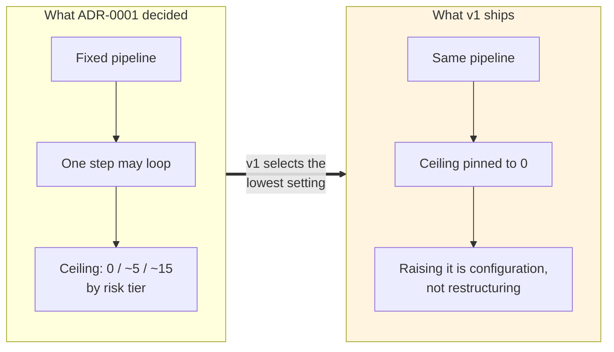
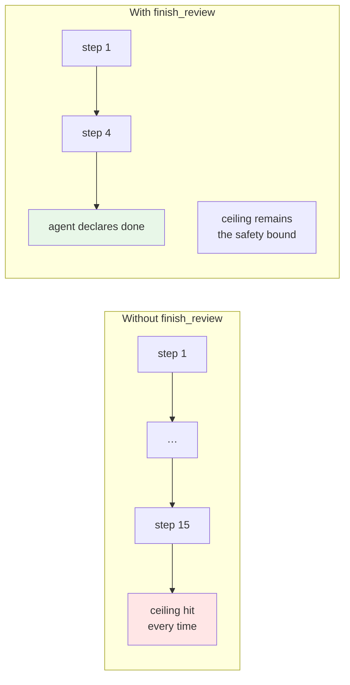
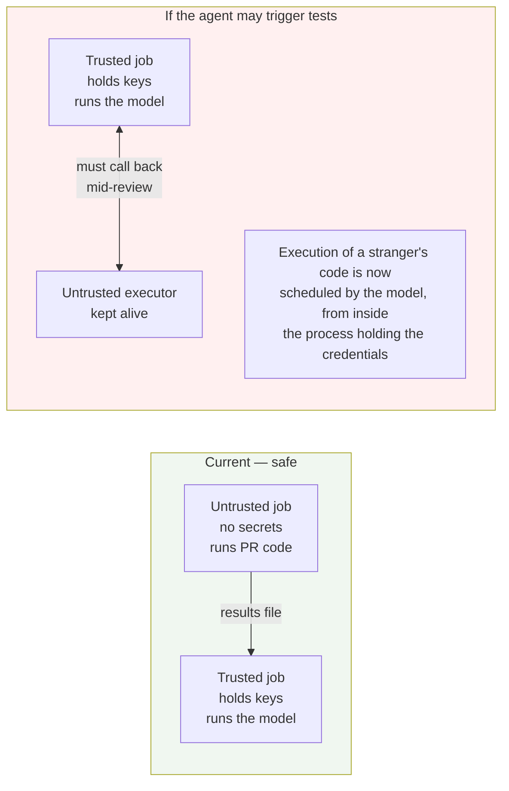
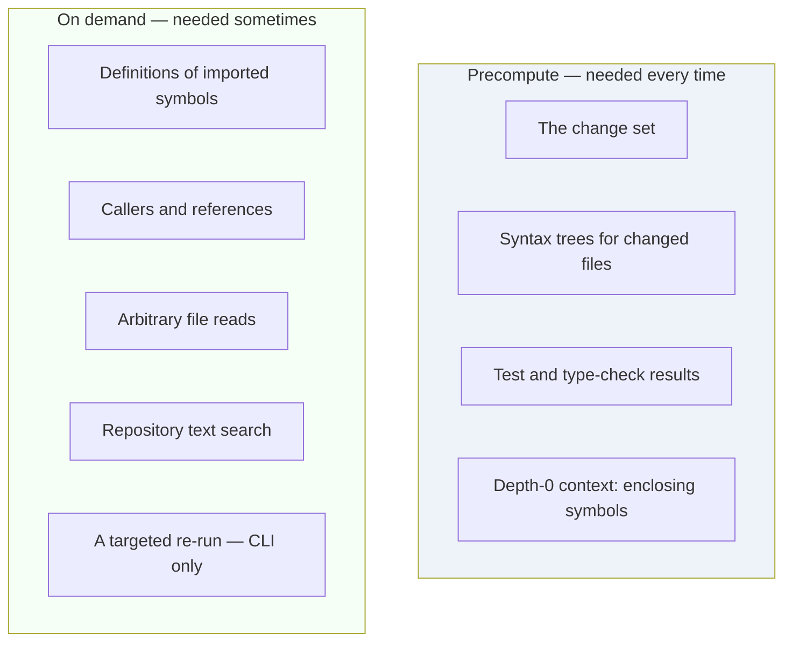

# Response to the Agentic Architecture Review

**Status:** Analysis · **Date:** 2026-09-08 · **Non-normative**

An assessment of an external review that examined the system as an agentic-AI architecture and proposed twelve changes. It argues the design is "workflow orchestration with an LLM step" rather than a genuine agentic loop, and recommends replacing the fixed pipeline with an agent runtime.

**Headline verdict: adopt roughly half, on a schedule — one item now, six at v2, two conditionally, three rejected.** The review is well-argued and several of its proposals are things this project should build. But it rests on one factual misreading that inflates the size of the change it is asking for, and it does not price four costs that decide whether the change is affordable at all.

| Documents this concerns | |
|---|---|
| [ADR-0001](../adr/0001-fixed-pipeline-with-bounded-agency.md) | The orchestration decision under review |
| [ADR-0002](../adr/0002-pipeline-initiates-test-execution.md) | Who may trigger test execution |
| [ADR-0004](../adr/0004-findings-emitted-as-tool-calls.md) | Findings as validated tool calls |
| [`agentic-code-review-srs-v1.md`](../agentic-code-review-srs-v1.md) | The v1 baseline the review actually read |

---

## 1. The correction that reframes everything

The review states:

> "the current v1 is intentionally designed as a deterministic pipeline with one LLM call, not an agentic loop. The SRS explicitly says this: the orchestration is a fixed pipeline, and the review agent has a step ceiling of zero."

Both halves are true of **v1**. Only the first is true of **the architecture**.

[ADR-0001](../adr/0001-fixed-pipeline-with-bounded-agency.md) rejected the pure pipeline. Its Option A is exactly the design the review describes — "gather a fixed context, call the model once" — and the record rejects it in these words: *"The model cannot follow a thread… Undermines the project's central claim of context-grounded review."* What it chose instead was Option C: a bounded tool loop inside the review step, with a ceiling that runs **up to about fifteen tool steps at the critical tier**.

Step ceiling zero is not the architecture. It is the **v1 baseline setting** (FR-5.7), adopted for one stated reason: at ceiling zero the provider needs to make one reliable tool call rather than fifteen, which removes most of the free-tier risk from the first increment.

This matters for the size of the ask. The review presents "introduce an explicit agent loop", "make context retrieval on-demand through tools", and "bound the tool environment" as new architecture. All three are already ADR-0001's decision — the record's allowed-actions table lists `read_file`, `get_definition`, `find_references`, `search_repo`, and `get_outline` as model-callable, and the surrounding harness design specifies argument validation before dispatch. The review is pushing on an open door and mistaking it for a wall.

**What actually remains contested is narrower**: whether the model may trigger execution, whether it may declare itself finished, how state is carried between turns, and when the ceiling should be raised above zero. Those are worth deciding on their merits. Everything else is a scheduling question.

Credit where due — the review says as much itself near the end: *"your existing SRS has already built many of the right seams."* That sentence is the accurate summary, and it sits somewhat awkwardly beside a recommendation to "replace fixed-pipeline orchestration with an Agent Runtime."

---

## 2. Verdicts

| # | Proposal | Verdict |
|---|---|---|
| 1 | Replace fixed-pipeline orchestration with an Agent Runtime | **Adopt in part** — adopt the runtime as a named component; reject replacing the pipeline |
| 2 | Define `AgentState` | **Adopt, lean** — v2 |
| 3 | Define `AgentAction` / `ToolObservation` | **Adopt** — the observation type in v1, the action union at v2 |
| 4 | A bounded `ToolRegistry` | **Adopt** — v2; already implicit, worth making explicit |
| 5 | Context retrieval as agent-callable tools | **Adopt-modified** — already decided; the new and good part is per-call depth |
| 6 | Agent-triggered targeted tests and type-checks | **Adopt on the CLI, reject on the Action** — surface-conditional, §5 |
| 7 | Hypotheses and evidence tracking | **Reject the machinery, adopt the kernel** — §6 |
| 8 | `finish_review` tool | **Adopt now** — the best single idea in the review |
| 9 | Replace the step ceiling with multi-dimensional budgets | **Adopt-modified** — add wall-clock, keep the ceiling, reject six dimensions |
| 10 | Trajectory-level acceptance criteria | **Adopt three, rewrite two** — §7 |
| 11 | Keep `emit_finding` as a validated boundary | **Agree** — already the decision ([ADR-0004](../adr/0004-findings-emitted-as-tool-calls.md)) |
| 12 | Pipeline components as capabilities, not stages | **Reject as stated** — §8 |
| §16 | Expand the definition of "Core" to name the runtime | **Adopt** — documentation only |
| §17 | Restructure CF-1…CF-9 into AC-1…AC-8 capabilities | **Reject** — §8 |
| §19 | Stop precomputing; initialise state and let the agent explore | **Reject as stated; adopt a sharper rule** — §9 |

---

## 3. Adopt now — one item

### `finish_review` (proposal 8)

The clearest gap the review found. ADR-0001's not-allowed table contains the line *"Decide when the review ends, beyond emitting findings."* That was a deliberate choice, and it is wrong for any ceiling above zero.

Without an explicit termination signal, a bounded loop has only one stopping condition: the ceiling. So every review at the critical tier spends fifteen steps whether or not the model was satisfied after four. The ceiling stops being a *safety bound* and becomes the *expected cost of every review* — which is the difference between a worst case you can compute and a worst case you always pay.

Adopt. It is a schema addition, it costs nothing, and it should be defined in v1 even though v1's ceiling of zero means nothing will call it. Defining it now means the v2 loop does not have to renegotiate the tool contract.

One caveat the review does not mention: a model that can end the review will sometimes end it too early, and that failure is invisible — a short trajectory looks like an efficient one. The regression corpus is the only thing that can distinguish them, which is another reason measurement (FR-6.2b, FR-6.2d) has to exist before the ceiling is raised.

**Also worth taking in v1, at near-zero cost:** the `ToolObservation` shape with a `denied` status (proposal 3, half of it). The v1 requirement to report degradation rather than fail silently (FR-11.2) already needs a structured way to say "this was refused" — the review's type is a better version of what v1 would otherwise invent ad hoc.

---

## 4. Adopt at v2, when the ceiling rises

These six are correct, and none of them is useful while the ceiling is zero. Building them now would be machinery with nothing to run.

| Proposal | Why it belongs to v2 | Note |
|---|---|---|
| **Agent runtime** as a named component | It is the loop. There is no loop at ceiling zero. | Adopt the *component*, not the framing that it replaces the pipeline. The pipeline still resolves the change set, runs checks, and publishes; the runtime owns step 8 only. |
| **`AgentState`** | Needs turns to carry state between. | Adopt a lean version: `exploredFiles`, `exploredSymbols`, `observations`, `findings`, `remainingBudget`, `status`. Drop `hypotheses` (§6). The explored-sets are the highest-value fields — they stop the model re-reading a file it already has and burning a step on it. |
| **`AgentAction` union** | Meaningless without dispatch. | Cheap once the registry exists. |
| **`ToolRegistry`** | Currently a table in an ADR; should be a versioned artifact. | This also closes a gap ADR-0001 itself flagged: *"the tool list and their argument schemas, as a versioned contract"* was listed as missing. |
| **Policy layer separate from runtime** | The distinction only pays once tools can be denied at run time. | Correct separation. Runtime owns the loop and budgets; policy owns what is permitted. |
| **Runtime/policy/tools/model layering** (§15) | Same. | Adopt as the v2 module structure. |

The definition of "Core" (§16) should be expanded now, in documentation, to name the runtime, state, registry, and policy as part of the surface-independent engine. That is free and it prevents someone putting the agent loop in the CLI adapter, which would break the constraint that adapters never decide what counts as a finding.

---

## 5. Conditional adopt — agent-triggered execution

The review wants FR-4.6 reversed so the agent can call `run_tests({scope: 'targeted'})`. This is the proposal with the most interesting answer, because it is **already half-decided and the review does not know it**.

[ADR-0002](../adr/0002-pipeline-initiates-test-execution.md) forbade it, for a specific reason: on a CI runner, each call costs about three minutes for an answer that does not change within a run. [ADR-0006](../adr/0006-local-cli-core-action-as-adapter.md) then amended that record — locally, against warm dependencies and a changed-file filter, a targeted run costs seconds, and *"the economics that produced that prohibition do not exist on this surface."*

So on the CLI the review is right, and the project already agreed. **Adopt on the local surface, under a hard call quota** — two or three targeted runs per review, never a full suite.

On the Action, keep the prohibition, and for a reason the review does not consider at all.

### The security interaction the review misses

[ADR-0003](../adr/0003-untrusted-code-isolation-and-fork-triggers.md) splits the Action into two jobs: an untrusted job that installs dependencies and runs the pull request author's tests **with no credentials**, and a trusted job that holds the model key and posts results. The untrusted job finishes before the trusted one starts.

Making execution agent-callable on the Action means keeping an untrusted executor alive and reachable from the credential-holding process for the duration of the review, with the model deciding when to invoke it. That is a materially worse security posture than the current split, and it is not recoverable by a quota.

**Verdict: adopt on the CLI with a quota; reject on the Action.** This is exactly the kind of surface-conditional decision ADR-0006 established, and it should be recorded as such rather than as a blanket reversal of FR-4.6.

---

## 6. Reject the hypothesis machinery; keep its kernel

The review proposes a `Hypothesis` type with confidence scores, supporting and contradicting evidence, and an investigate-until-resolved loop.

This is the most appealing idea in the review and the one I would most firmly decline **for now**, on four grounds.

**Calibrated confidence is not something a free-tier model produces.** The type requires `confidence: number`. Frontier models are poorly calibrated at this; smaller models are worse, and tend to cluster at high confidence regardless of evidence. A number that does not track reality is worse than no number, because downstream code will filter on it.

**It multiplies cost per finding.** Each hypothesis gets its own investigation cycle. Three hypotheses on one change means three cycles, against a ceiling that already has to cover everything else. The review does not price this.

**It cannot be verified with what v1 ships.** Testing whether hypothesis-driven investigation works requires a corpus with defects whose detection *depends* on falsification — a much richer instrument than the five-rule regression set of FR-6.3a. Building the machinery before the instrument that can evaluate it inverts the project's own commit-first logic.

**It is a research bet inside a budget-constrained MVP.** No tool in the [competitive reference](./tool-reference.md) documents a hypothesis-tracking reviewer. That does not make it wrong, but it makes it unproven, and this project's differentiator is deterministic execution evidence, not novel agent cognition.

### What to keep

The review's own **AC-A3** is the valuable kernel, and it needs none of the machinery:

> The agent shall not emit a finding requiring evidence until the required evidence has been obtained, or the agent explicitly records that the evidence could not be obtained.

That is a discipline on findings, enforceable at the `emit_finding` boundary that already exists — add an `evidence` field that is either a reference to a check result or context unit, or an explicit `unverified` marker with a reason. It delivers most of what the hypothesis idea is reaching for, it is checkable, and it costs one schema field.

**Adopt AC-A3 as a requirement. Defer the `Hypothesis` type, and revisit only when the regression corpus can measure whether it helps.**

---

## 7. The trajectory acceptance criteria — three good, two unfalsifiable

The review is right that the existing acceptance criteria measure a pipeline and would not detect whether the system is behaving agentically. Its six proposed criteria are not equally sound.

| Criterion | Verdict |
|---|---|
| **AC-A2** — multiple tool calls in one review, later actions determined by earlier observations | **Adopt.** Directly checkable from the trajectory trace. |
| **AC-A3** — no finding without its evidence, or an explicit record that evidence was unobtainable | **Adopt.** The best of the six. See §6. |
| **AC-A5** — clean termination on budget exhaustion | **Adopt.** Already implied by FR-11.2; making it trajectory-specific is right. |
| **AC-A6** — a denied tool call returns a structured observation and the agent may choose an alternative | **Adopt.** Pairs with the policy layer. |
| **AC-A1** — different defects produce different tool sequences | **Rewrite.** A nondeterministic model produces different sequences for the *same* input, so this passes on noise alone. It needs to be a correlation claim: over the corpus, defects requiring caller context invoke `find_references` at a rate significantly above the baseline for defects that do not. That requires the corpus and a statistical threshold — real work, and the only version of this criterion that means anything. |
| **AC-A4** — terminate when sufficient evidence exists; do not run unnecessary tools | **Rewrite.** "Unnecessary" is unfalsifiable per-run without ground truth about what was needed. Replace with an efficiency measure against the corpus: median tool calls per review at a fixed catch rate, tracked across versions. That turns a judgement into a number that can regress. |

---

## 8. Reject: restructuring core functions into capabilities

The review proposes replacing CF-1…CF-9 with AC-1…AC-8 — Observe Change, Inspect Code, Navigate Dependencies, and so on — because *"these are capabilities, not mandatory sequential steps."*

This confuses two orthogonal axes.

| | Core functions (CF) | Capabilities |
|---|---|---|
| Answer the question | Who builds what module | What the agent may do at run time |
| Consumed by | Contributors, the delivery plan, traceability | The model |
| Change together? | No — one capability can span several modules, and one module can expose several capabilities |

`find_references` as a capability is served by CF-2's context provider, constrained by CF-4's budget, and recorded through CF-7's trace. Replacing the CF decomposition with the capability list does not reorganise the design; it deletes the delivery structure and leaves nothing saying who builds the parser.

There is also a practical collision: the v1 specification already uses **AC-1…AC-10** for acceptance criteria. A second AC series meaning something else in the same document set is a needless source of confusion.

**Adopt the capability list as the tool taxonomy — it is a good one. Reject it as a replacement for the core functions, and rename it to avoid the identifier clash.**

---

## 9. Reject "don't precompute everything" — and replace it with a sharper rule

This is the review's stated *"single most important architectural transformation"*: stop precomputing the diff, the context, and the check results, and let the agent gather them on demand.

The proposal does not price the turn tax.

Some inputs are needed in **every** review, without exception: the diff, and the check results. Making them on-demand means the model must spend a turn asking for something we already know it needs — and each turn resends the whole conversation. That is one to two model calls of pure overhead on every review, for zero information gained, on a project whose binding constraint is a $20 budget and a developer's patience.

The correct principle is narrower and, I think, more useful:

> **Precompute what is unconditionally required. Make on-demand what is conditionally required.**

Check results sit in the precompute column deliberately, and it is worth being explicit about why: **execution evidence is this project's differentiator**, not an optional investigation branch. A review that skipped the tests because the model did not think to ask is not a cheaper review — it is a different, weaker product.

Depth 0 belongs there too. Expanding a hunk to its enclosing function is required to make the diff intelligible at all, and it is nearly free.

---

## 10. Four costs the review does not price

These are the reasons the answer is "adopt on a schedule" rather than "adopt".

### The loop does not fit the CLI latency budget

[ADR-0006](../adr/0006-local-cli-core-action-as-adapter.md) establishes that on the local surface the binding constraint is **not money but a developer's patience — roughly ten to thirty seconds**. Fifteen sequential model calls at two to five seconds each is thirty to seventy-five seconds, before any tool execution. The full loop, at the critical tier, does not fit the surface v1 ships on.

This is the same shape of tension the project already resolved once: the pipeline was in tension with the Action's *cost*; the agent loop is in tension with the CLI's *latency*. The resolution is the same — the ceiling is per-surface configuration, tuned against different budgets. It does mean the CLI's practical ceiling is small, perhaps three to five steps, not fifteen.

### Nondeterminism degrades the measurement instrument

ADR-0001 already noted that a model-driven path weakens auditability. The sharper problem is that it lands on the **regression harness** (FR-6.2b, FR-6.2d), which is the project's primary instrument and the thing it committed to building first.

If trajectories vary run to run, catch rate becomes a noisy statistic. Detecting whether a prompt change helped now requires several runs per corpus item, and the corpus becomes several times more expensive to evaluate. That cost lands squarely on the measurement capability the whole plan depends on. It is affordable, but it must be planned for — and it argues for **fixing the seed and the ceiling when running the corpus**, so that measurement runs stay comparable even though production runs vary.

### The free-tier model may not sustain a fifteen-step investigation

ADR-0001 and ADR-0004 both flag multi-step tool calling as the capability free-tier models implement least reliably. The review's architecture assumes a model that can plan an investigation, track what it has already seen, and stop when satisfied. That is a frontier-model assumption, and the budget objective rules frontier models out.

This does not invalidate the architecture — it determines the *order*. Build the seams; raise the ceiling only when measurement on the chosen provider supports it. Which is, again, what ADR-0001 already decided.

### Schedule risk against the one thing v1 must reach

The proposal adds a runtime, a state model, a policy engine, a registry, a budget manager, and a hypothesis tracker. ADR-0001 already counted "two paths to maintain" as a cost; this makes the agent path several times larger.

The v1 build order puts **measurement third** precisely so that everything after it can be evaluated rather than argued about. Inserting an agent runtime before that point spends the schedule on machinery whose value cannot yet be measured — and the corpus is what would tell you whether the loop is worth its cost. Build the instrument, then the thing it measures.

---

## 11. What I would actually do

**Do not revise ADR-0001.** Its decision — fixed pipeline, bounded loop in one step, ceiling by tier — survives this review intact. What the review exposes is that the record left three things unstated, and one of its not-allowed entries is wrong.

**Write ADR-0007 — "Agent runtime, tool registry, and termination"**, superseding two lines of ADR-0001 and adopting the accepted subset:

1. `finish_review` becomes a tool; ADR-0001's *"decide when the review ends"* prohibition is withdrawn.
2. The tool list becomes a versioned registry artifact — closing a gap ADR-0001 itself flagged as missing.
3. The runtime, policy, state, and budget layering is named as v2 module structure.
4. Execution as an agent-callable tool is permitted **on the CLI under a quota**, and remains prohibited on the Action, for the two-job reason in §5.
5. Budgets gain a wall-clock dimension; the step ceiling stays.
6. The trajectory criteria are added, with AC-A1 and AC-A4 rewritten as corpus-level measures.

**Change the v1 baseline in two small ways only:**

| Change | Requirement | Cost |
|---|---|---|
| Define `finish_review` in the tool schema, unused at ceiling zero | new | Schema only |
| Add an evidence reference or explicit `unverified` marker to the finding model | extends FR-5.2 | One field |

Both are contract decisions. Making them now costs a schema line each; making them after v2 code exists costs a migration.

**Defer everything else to the point where the ceiling first rises above zero** — which should itself be gated on the regression corpus existing, so that the first measurement anyone takes of the loop is a comparison against the single-pass baseline on the same defects.

---

## 12. The one-line summary

The review's guiding principle is right:

> *"Don't build an agent that executes a workflow. Build a runtime that gives an agent a controlled set of capabilities from which it can construct an investigation."*

That is close to what ADR-0001 chose. The disagreement is not about the destination but about **when the ceiling comes off zero**, and the answer to that should come from the regression corpus rather than from architectural preference — which is the same discipline the project has already applied to every other open question.
