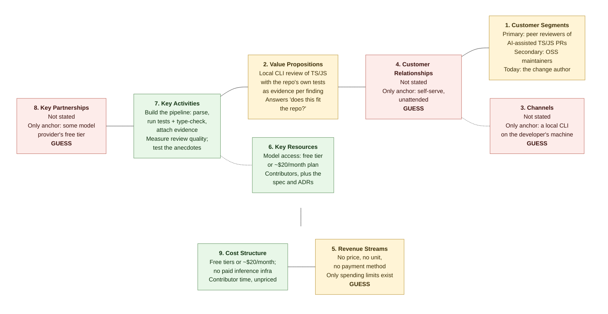

# Business Model Canvas — Agentic Code Reviewer

**Status: non-normative.** A business-side working document, not a specification. It defines nothing to build.

**Source discipline.** Every line below comes from what was stated about the idea, the customers, the money and the evidence — nothing else. No partner names, prices, market sizes, or customer counts have been supplied, and none are invented here. A block ending in **GUESS** is one where no information was given; the lines in it are placeholders, not findings.

---

## The nine blocks

### 1. Customer Segments
- Primary: peer reviewers of AI-assisted TS/JS pull requests in companies and funded engineering teams.
- Secondary: OSS TS/JS maintainers and contributors. Today's actual user: the change author reviewing their own work, plus the contributors building the system.

### 2. Value Propositions
- Local CLI review of a TS/JS change set, with the repository's own tests and type-check run as evidence attached to every finding.
- Answers "does this clean, test-passing code fit this repo?" — not just "does it pass?".

### 3. Channels
- Not stated. No distribution, discovery, or install route has been decided.
- Only anchor: it is a local command-line tool, so it reaches a user on their own machine. **GUESS**

### 4. Customer Relationships
- Not stated. No support, onboarding, or community model has been decided.
- Only anchor: self-serve, unattended use by a developer at a prompt. **GUESS**

### 5. Revenue Streams
- Not stated: no price, no unit, no payment method, no evidence anyone would pay.
- The only money figures that exist are spending limits, not income. **GUESS**

### 6. Key Resources
- Model-provider access on a free tier, or a single plan of about $20/month.
- The contributors building the system, and the specification and ADRs they work from.

### 7. Key Activities
- Build the pipeline: parse the change set, run the repo's tests and type-check, attach that evidence to findings.
- Measure review quality, and test the pain claims that are still anecdote.

### 8. Key Partnerships
- Not stated. No partner, vendor, or channel relationship has been named.
- Only anchor: dependence on some model provider's free tier. **GUESS**

### 9. Cost Structure
- Inference capped at free tiers or ~$20/month; no paid inference infrastructure.
- Contributor time — the dominant input, and unpriced.

---

## The three riskiest blocks

### 1. Revenue Streams — the block with nothing in it
No price, no unit, no payment method, and no one has said they would pay. A tool constrained to free tiers and ~$20/month can be built without answering this, which is exactly the trap: the question stays open until it is expensive to answer.

### 2. Customer Segments — the buyer is not the user
The named primary customer is the peer reviewer clearing a queue. The version being built serves the change author before they push. The paying segment and the served segment are different people, and the gap is not a marketing problem — it is a scope problem, already acknowledged in the specification.

### 3. Value Propositions — the pain is thin and partly out of reach
"Clean code hides wrong shape" is three anecdotes, unquantified. The named defect types come from a single first-hand account. Two sources disagree on how many false positives a reviewer will tolerate, so the quality bar for the core promise is unknown. The need for measurable review quality was never voiced by anyone — it was inferred. And the stated root cause is cultural, which means even a reviewer that works perfectly addresses a symptom.

---

## Canvas at a glance

**Legend.** Green = stated. Red = **GUESS**, nothing was given. Amber = the three riskiest blocks — note that two of them are populated, so this is not a map of what is missing; it is a map of what is unproven.

## Where the evidence stands

| Claim | Evidence given |
|---|---|
| "Clean code hides wrong shape" | 3 people, anecdotal, unquantified |
| Wrong backend / broken convention / architecture erosion | One first-hand account |
| Review quality must be measurable | Inferred, voiced by no one |
| Shared blind spot between generator and reviewer | Only for teams whose AI reviewer shares a model family with their generator |
| Tolerable false-positive rate | Two sources disagree |
| Root cause | Cultural — not fixable by a tool |
