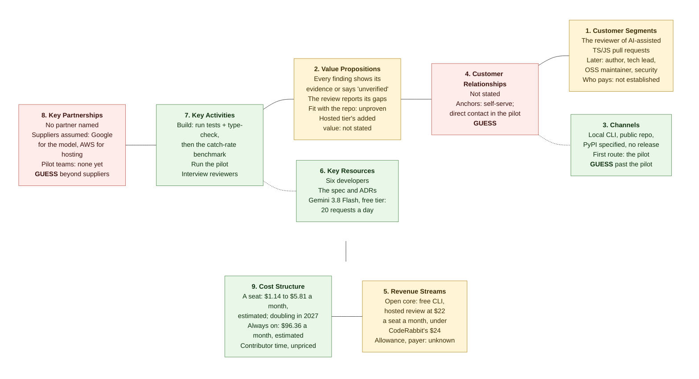

# Business Model Canvas — Agentic Code Reviewer

**Status: non-normative.** A business-side working document, not a specification. It defines nothing to build.

**Source discipline.** Every line below comes from what was stated about the idea, the customers, the money and the evidence, or from a measurement recorded in this folder — nothing else. No partner names or customer counts have been supplied, and none are invented here. A block ending in **GUESS** is one where no information was given; the lines in it are placeholders, not findings.

**Revised 2026-10-03 — open core.** The business model was decided on this date: the command-line tool stays free and open source, and revenue is planned from a paid hosted review service.

**Revised 2026-10-09 — one audience.** The audience and the problem are worded in one place, [`000-problem-and-audience.md`](./000-problem-and-audience.md): the reviewer is the one customer segment, and every other segment is a possible later expansion.

**Revised 2026-10-10 — full refresh.** All nine blocks, the three risks, the diagram and the evidence table were brought up to date with what has been decided or measured since:

- the price is $22 per seat per month, an average of two rivals' prices held under CodeRabbit's, and serving a seat is estimated at $1.14 to $5.81 a month ([`0052-unit-economics-and-financials.md`](./0050-financial-planning/0052-unit-economics-and-financials.md));
- the differentiator was re-checked against rivals' own pages and narrowed ([`competitive-landscape.md`](./competitive-landscape.md));
- the team is six developers, and the working model is Gemini 3.8 Flash.

Three blocks were **GUESS** before; two still are in part, and say so.

---

## The nine blocks

### 1. Customer Segments
- The reviewer: an engineer who reviews a teammate's AI-assisted TypeScript or JavaScript pull request, in a company or funded team. This is the one segment, set on 2026-10-09.
- Later, not now: the pull-request author, the tech lead, the open-source maintainer and the security engineer.
- Served today: a review of uncommitted changes before they are pushed, and a review of a public pull request. No one outside the team uses either yet.
- Who pays is not established: the reviewer, the team or its lead.

### 2. Value Propositions
- A review of a TS/JS change in which every finding shows its evidence or says it is unverified, and which reports what it did not check. Both are built. Today the evidence is the part of the change the finding rests on.
- The promise behind it: answering "does this clean, test-passing code fit this repo?", not just "does it pass?". It is not demonstrated: there is no measured catch rate.
- Specified, not built: evidence from the repository's own tests and type-check, and the project's own rules.
- What is ours, after the re-check of 2026-10-10: nothing is dropped silently, the review reports its own gaps, and the engine can be read. Showing evidence and running checks are things rivals also do, and our price is close to theirs.
- The paid hosted review service: what it gives a customer that the free tool does not is not stated.

### 3. Channels
- Stated: the tool is a local command-line program, specified to ship as a PyPI package (SRS §2.3), from a public repository, `github.com/MoKenawy/Pull-request-Reviewer`. No release is published.
- Stated: the first route to customers is the pilot asked for at the DEPI final pitch: 6 teams for 8 weeks from 1 January 2027.
- Not stated: how a reviewer who was not at the pitch finds the tool, and how the hosted service is reached. **GUESS** for everything past the pilot.

### 4. Customer Relationships
- Not stated. No support, onboarding, or community model has been decided.
- Anchors: self-serve, unattended use by a developer at a prompt; direct contact with pilot teams, through one contact address. **GUESS**

### 5. Revenue Streams
- Open core, decided 2026-10-03: the command-line tool is free and open source, and revenue comes from a hosted review service.
- Decided 2026-10-10: the service is priced **per seat per month, at the average of rivals' prices**, with two limits: under CodeRabbit's $24, and Greptile's $30 left out as an anomaly. That gives $22, the average of CodeRabbit's $24 and Graphite's $20. Two rules set earlier the same day were replaced: per review at cost plus a margin, and $27 a seat.
- Estimated: a seat leaves $16.19 to $20.86 a month after the cost of serving it, through 2026.
- Decided 2026-10-10: each seat includes 150 reviews a month, pooled across the team.
- Still not stated: the payment method, and what the service adds over the free tool — and there is no evidence anyone would pay.

### 6. Key Resources
- Six developers, one of them the team leader, and the specification and ADRs they work from.
- Model-provider access on a free tier, or a single plan of about $20/month. Gemini 3.8 Flash is the working model since 2026-10-10; its free tier allows 20 requests a day, which is enough to build with and not enough to measure or sell on.
- The measurements already made: pull-request and review volume in ten public TypeScript repositories, and five measured review runs.

### 7. Key Activities
- Build the pipeline: next, run the repository's tests and type-check and attach that evidence to findings; then the regression set that measures a catch rate.
- Run the pilot, and measure in it what is still blank: reviews per team, cost per review on real code, willingness to pay.
- Interview reviewers. No reviewer's own words have been collected.
- Finish the cost measurement on larger pull requests.

### 8. Key Partnerships
- No partner or channel relationship has been named.
- Suppliers the plans assume: Google, for the working model (any provider with an OpenAI-compatible address can replace it by changing an address and a model name), and AWS, which the cost sheet prices for the hosted service.
- Pilot teams: none yet. **GUESS** for everything beyond suppliers.

### 9. Cost Structure
- Building the tool: inference capped at free tiers or ~$20/month; no paid inference infrastructure.
- Running the hosted service, per seat: an estimated $1.14 to $5.81 a month through 2026 and $2.19 to $8.95 from 2027, when the provider's prices double. It is 25 to 75 reviews, the average for a developer's month, each $0.0418 in measured model tokens plus a repository download. Larger reviews cost more and are unmeasured.
- Running the hosted service, always on: an estimated $96.36 a month for one load balancer, one NAT gateway, one public address and one assumed small server.
- Contributor time — the dominant input, and unpriced.

---

## The three riskiest blocks

### 1. Revenue Streams — a market price, and no reason yet to pay it
The model, the unit and the price are stated: open core, a hosted service, $22 per seat per month, an average of two rivals' prices held under CodeRabbit's. On paper the economics are easy: a seat is estimated to cost $1.14 to $5.81 to serve, and five to six seats cover the always-on infrastructure.

The difficulty moved from cost to the customer. At $22 we are $2 under CodeRabbit, and the landscape says today's build does less than CodeRabbit does: one model pass, no checks, no measured catch rate. Two dollars is a thin reason to accept less, and the price was set by averaging, not by anything the customer said.

Two gaps remain from before, and the price sharpens the first. Nothing says what the hosted service gives a customer that the free tool does not, and the free tool on the customer's own key gives the same review for the cost of the tokens, an estimated $1.05 to $3.14 a month. And the hosted service is not designed: the requirement catalogue calls a hosted app "out of scope entirely" ([`agentic-code-review-srs.md`](../agentic-code-review-srs.md) §2.2), so the paid product has no specification, no version and no architecture decision.

A flat seat price carries a cost risk, which an allowance now limits. Each seat includes 150 reviews a month, pooled across the team, which costs an estimated $17.90 at most to serve. Without it a seat would cost more than $22 after 184 to 482 reviews in a month.

No one has said they would pay.

### 2. Customer Segments — the reviewer is named, and only partly served
The one customer is the reviewer. The version being built was specified for the change author before they push, and the specification still says so (SRS §2.2 and risk R-5). Since 2026-10-09 the same command also reviews a public pull request, which is the first thing the tool does from the reviewer's seat ([ADR-0011](../../adr/0011-cli-reads-a-public-pull-request.md)). It reads public repositories only, posts nothing on the pull request and runs no checks there, so the reviewer in a private company repository, who is the customer named above, is not reached that way yet.

The reviewers we can observe already have an automated reviewer. In ten public TypeScript repositories, a bot account reviewed 5,711 of 7,670 human pull requests in September 2026, and three commercial AI reviewers reviewed 2,064, 901 and 521 of them. In those teams the product would not be the first automated reviewer.

Who pays is not established either.

### 3. Value Propositions — the pain is thin, and the difference is narrower than it was
"Clean code hides wrong shape" is three anecdotes, unquantified. The named defect types come from a single first-hand account. No reviewer has been interviewed. Two sources disagree on how many false positives a reviewer will tolerate, so the quality bar for the core promise is unknown.

The difference from rivals was re-checked on 2026-10-10 and shrank. Rivals do not "verify with a model" only: one writes and runs tests in a sandbox, another runs verification scripts there, and two show the reader how a finding was checked. Our own test run is specified, not built. What is left is that nothing is dropped silently, that the review reports its own gaps, and an engine that can be read.

The build's review quality is unmeasured. On the working model, five measured runs reported no finding, and the build could not tell "nothing to report" from "did not use the finding tool". And the stated root cause is cultural, which means even a reviewer that works perfectly addresses a symptom.

---

## Canvas at a glance

**Legend.** Green = stated or measured. Red = **GUESS**, little or nothing was given. Amber = the three riskiest blocks — all three are populated, so this is not a map of what is missing; it is a map of what is unproven. Channels moved from red to green on 2026-10-10 for its first step only: the pilot is stated, and everything after it is still a guess.

## Where the evidence stands

| Claim | Evidence given |
|---|---|
| "Clean code hides wrong shape" | 3 people, anecdotal, unquantified |
| Wrong backend / broken convention / architecture erosion | One first-hand account |
| Review quality must be measurable | Inferred when written. Since measured in part: one peer-reviewed study (MSR 2026) found 12 of 13 review agents under 60% signal by a keyword-based measure. Still not a need any reviewer has voiced to us; none has been interviewed |
| Reviewers already have an automated reviewer | Measured in ten public TypeScript repositories, September 2026: a bot account reviewed 5,711 of 7,670 human pull requests |
| We verify where rivals only ask a model | Withdrawn on 2026-10-10. Rivals' own pages describe sandboxed tests and verification scripts; our test run is specified, not built |
| A review costs about four cents in model tokens | Two measured runs of one 160-line pull request on Gemini 3.8 Flash, $0.0226 and $0.0611. Larger pull requests unmeasured |
| A seat costs $1.14 to $5.81 a month to serve | An estimate built on those two runs, an average of 25 to 75 reviews a month and a repository download. Nothing has been run on a hosted service |
| $22 a seat is the right price | It is the average of two rivals' entry prices, chosen to stay under CodeRabbit's. No customer has been asked |
| The build finds real defects | Unmeasured. Five runs on the working model reported no finding; an earlier run on another model caught two of six planted defects |
| Shared blind spot between generator and reviewer | Only for teams whose AI reviewer shares a model family with their generator |
| Tolerable false-positive rate | Two sources disagree |
| Root cause | Cultural — not fixable by a tool |
| A team would pay for the hosted review service | None |
| The hosted service is worth more than the free tool | Not stated |
