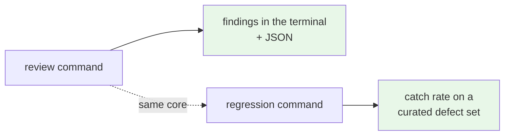
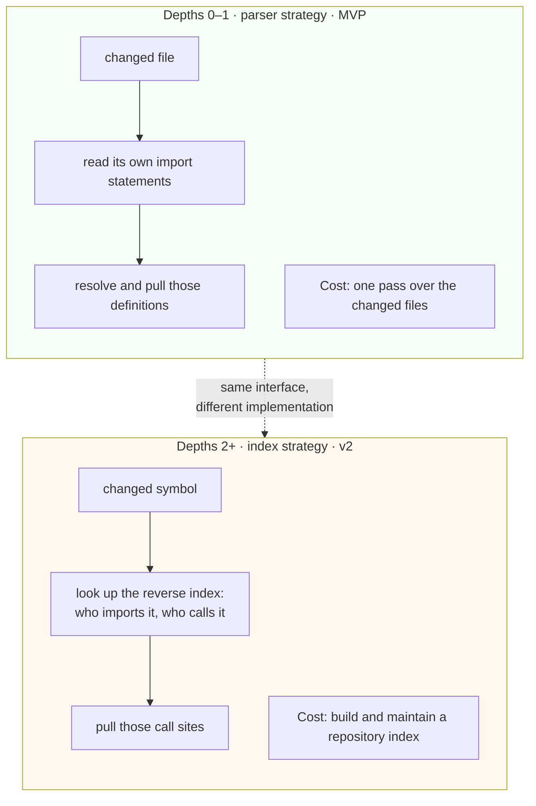
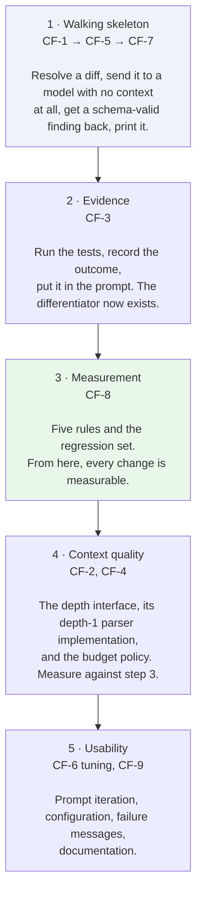

# MVP Scope — Core Function Analysis

**Status:** ✅ **Adopted — baselined as [`agentic-code-review-srs-v1.md`](../agentic-code-review-srs-v1.md)** · **Date:** 2026-09-08

An analysis of what a first shippable increment should contain, drawn from the requirements that remain after GitHub integration was deferred to v3 ([`agentic-code-review-srs.md`](./agentic-code-review-srs.md) §2.3.3).

> **This document is now the rationale record, not the specification.** Its conclusions were adopted and rewritten as a normative specification in [`agentic-code-review-srs-v1.md`](../agentic-code-review-srs-v1.md), which is the build target and which wins on any disagreement. Read this one for *why* each thing is in or out — the questions applied, the options weighed, and the honest accounting of what the cuts cost.
>
> The baselining added normative requirements this analysis only described in prose: the related-context interface (FR-2.6a–e), the single-pass constraint (FR-5.7), path exclusion in place of triage (FR-3.5), context budgeting (FR-2.5a–c), and the per-invocation budget and degradation rules (FR-11.1–FR-11.3).

---

## 1. How things were sorted

Three questions, applied to every remaining requirement in order:

1. **Would the tool produce a single useful finding without it?** If yes, it is not MVP.
2. **Is it the thing that makes this project different from a linter with an LLM bolted on?** If yes, it stays even when expensive. Two qualify: **evidence from a real test run**, and **a regression set that measures the reviewer's own catch rate**.
3. **Does deferring it force a rewrite later?** If yes, it stays. If it can be added as a new module behind an existing seam, it goes — and where the later work is large enough to be worth protecting, the MVP builds the seam even though it only has one thing to put behind it. Related context is the case where that applies; §5 specifies it.

Question 2 comes from the project's own analysis. [`Agentic_Code_Review_Problem_Definition_v1.md`](./Agentic_Code_Review_Problem_Definition_v1.md) commits first to building the versioned regression set (FR-6.2b), on the grounds that it is the instrument that converts every other claim from inference into measurement. An MVP that drops it can produce findings but cannot tell anyone — including its own authors — whether those findings are any good.

---

## 2. What the MVP is

> A command a developer runs in a TypeScript/JavaScript repository. It resolves what changed, parses it, runs the project's tests and type-check, sends the change plus that evidence plus a small set of project rules to one model, and prints findings — each one traceable to a rule or to a test result. A second command runs a regression set and reports how many known defects it caught.

Two commands, one core. That is the whole increment.



---

## 3. Proposed core functions

Nine function blocks. Complexity uses the scale in [`feature-inventory.md`](./feature-inventory.md): Low = hours to a day, Medium = days, High = weeks.

| # | Core function | What it does | Requirements | Complexity |
|---|---|---|---|---|
| **CF-1** | **Change-set resolution** | Turn "review my changes" into a concrete list of changed files and diff hunks: working tree, staged only, or against a branch. State which was used. | FR-10.3a, FR-10.3b | Low–Medium |
| **CF-2** | **Related-context provider, depth 1** | Build syntax trees for changed TS/JS files, and resolve related code **behind a depth-parameterised interface**. The MVP ships the parser-backed implementation, which serves depths 0 and 1. Deeper levels arrive later behind the same interface — **see §5**. | FR-2.2, FR-2.3d, FR-2.4 *(partial)* | Medium |
| **CF-3** | **Execution and evidence** | Run the test suite and the type check, under a time budget. Record for each check whether it ran, was skipped, or errored, plus its result and output. Continue to a review on timeout. | FR-4.1, FR-4.2, FR-4.4a, FR-4.4b, FR-4.5a, FR-4.5b, FR-4.5c | Medium |
| **CF-4** | **Context assembly** | Fit the diff, related code, evidence, and rules into the model's window under a per-section budget. Distil test output down to failing assertions rather than pasting it. | FR-2.3c, FR-2.5 | Medium |
| **CF-5** | **Finding model and provider client** | One typed representation for findings, with a versioned schema. A thin provider interface. Findings arrive as `emit_finding` tool calls validated at the boundary. | FR-0.1–FR-0.4, FR-5.6 | Medium |
| **CF-6** | **The review agent** | One model pass over the assembled context, isolated from any code-writing agent, folding in execution results and rules. **No tool loop in the MVP** — see §4. | FR-5.1, FR-5.2, FR-5.3 | **High** — and the one item whose effort cannot be bounded |
| **CF-7** | **Output** | Render findings to the terminal with a summary line — risk, checks run, counts by severity, verdict — and serialise the same findings to schema-valid JSON. Exit with a documented status code. | FR-8.1b, FR-8.2a, FR-8.2b, FR-10.4a, FR-10.4b, FR-10.4c | Low–Medium |
| **CF-8** | **Pattern library and regression harness** | Load a small set of "wrong vs. correct" rules; tag each finding with the rule that fired; run a curated defect set as a test and report the catch rate. | FR-6.1, FR-6.2a, FR-6.2b | Medium |
| **CF-9** | **Configuration and failure messages** | Read `.agentic-review.yml` with documented defaults and loud validation failures. Read the provider key from the environment. Say clearly when a prerequisite is missing. | FR-1.2a–d, FR-1.3a, FR-9.3, FR-9.1 | Low–Medium |

**25 requirements**, against roughly 58 in the full set.

---

## 4. What is cut, and why

| Cut | Requirements | Why it survives being deferred |
|---|---|---|
| **Context depths 2 and above** — who imports this symbol, what calls this function, and transitively | FR-2.3a, FR-2.3b | Not a cut so much as a **later rung on a ladder the MVP builds**. Depth 1 is answerable by parsing the changed files; depth 2 needs a whole-repository reverse index, the single largest effort item in the plan. Both sit behind one interface, so the later rung is a new implementation rather than a change to any caller. **See §5.** |
| **Risk triage and depth routing** | FR-3.1–FR-3.4 | Triage exists to avoid spending money on trivial changes. The developer already chose what to review by typing the command. Replace with a path-exclusion list for generated and vendored files — a few lines, most of the benefit. |
| **The agent tool loop** | *(ADR-0001 step ceiling above zero)* | The MVP runs at ceiling zero: one pass, no tools except `emit_finding`. This is the documented fallback in [ADR-0001](../adr/0001-fixed-pipeline-with-bounded-agency.md), not an improvisation — and it means the MVP needs the provider to make **one** reliable tool call rather than fifteen, which materially de-risks the free-tier dependency. |
| **Dependency audit** | FR-4.3 | Useful, unrelated to the thesis. `npm audit` output can be attached later without touching anything. |
| **Blocking vs. non-blocking distinction** | FR-5.4 | Severity already carries this. |
| **Cross-run de-duplication** | FR-5.5, FR-10.5 | Weak locally — terminal output is replaced on each run, and a developer re-running after a fix wants the current state, not a delta ([ADR-0006](../adr/0006-local-cli-core-action-as-adapter.md)). It becomes essential in v3, where comments accumulate permanently. |
| **Pattern coverage reporting** | FR-6.2c | Reporting *about* rules, once there are enough rules for it to say anything. |
| **A broad default rule set** | FR-6.3 | The MVP ships about five rules — enough to prove the mechanism and seed the regression set. Breadth is content authoring, and it scales linearly forever. |
| **Fix snippets and evidence links** | FR-7.1a, FR-7.3 | A finding with a clear rationale is useful without a patch attached. |
| **Platform support matrix** | FR-10.6 | The MVP runs from source on the maintainer's own platform. Prebuilt native binaries across operating systems and runtime versions are real work with no bearing on whether the reviewer is any good. |
| **Tolerating code that does not parse** | FR-10.7 | The MVP can require a parseable tree and say so plainly. |

Everything in this table adds behind a seam CF-1 to CF-9 already establish. None of it forces a rewrite.

---

## 5. Related context — one interface, delivered in layers

Forward imports and the reverse dependency map answer the same question at different distances: *what else does the reviewer need to see?* They are therefore **one capability with one interface, parameterised by depth**, and shipped one layer at a time. The MVP builds the interface and the first layer. Nothing above it changes when later layers arrive.

### 5.1 The depth ladder

| Depth | What it pulls in | Resolvable by | Ships in |
|---|---|---|---|
| **0** | The changed hunks, expanded to their enclosing function, class, or type boundaries | Parsing the changed files | **MVP** |
| **1** | What the changed code reaches *outward* to: definitions of the symbols it imports and calls | Parsing the changed files, then the files their import statements name | **MVP** |
| **2** | What reaches *inward* to the changed code: files importing a changed symbol, direct call sites of a changed function | A reverse index over the whole repository | v2 |
| **3** | Transitive neighbours — callers of callers, and the definitions those callers depend on | The same index, traversed further | v2+ |

The ladder is ordered by **cost of resolution**, not purely by graph distance — and that is a deliberate choice worth naming. Depth 1 is cheap because a file's import statements are inside the file: parse what changed, follow the names. Depth 2 is expensive because nothing in a changed file records who depends on it; answering that means having looked at everything else first.



### 5.2 The interface both implementations satisfy

```ts
type Relation = 'imports' | 'calls' | 'imported-by' | 'called-by';

interface ContextUnit {
  file: string;
  symbol?: string;
  range: [number, number];
  source: string;
  relation: Relation;   // why this is here          (FR-2.3d)
  distance: number;     // which depth pulled it in
}

interface RelatedContextRequest {
  changeSet: ChangeSet;
  depth: number;        // requested, not guaranteed
  budget: TokenBudget;
}

interface RelatedContextResult {
  units: ContextUnit[];     // ordered by distance, then by relevance
  achievedDepth: number;    // may be lower than requested
  degraded?: 'no-index' | 'budget-exhausted' | 'unresolvable-imports';
}

interface RelatedContextProvider {
  readonly maxDepth: number;
  resolve(req: RelatedContextRequest): Promise<RelatedContextResult>;
}
```

Two implementations, selected at run time by the highest `maxDepth` that can serve the request:

| Implementation | `maxDepth` | Needs | Ships in |
|---|---|---|---|
| `ParserContextProvider` | 1 | Nothing beyond the changed files | **MVP** |
| `IndexContextProvider` | 3 | A built reverse index; falls back to parser behaviour below depth 2 | v2 |

### 5.3 Five rules that make the layering work

**Depth is a request, not a guarantee.** A caller asking for depth 2 when no index exists gets `achievedDepth: 1` and `degraded: 'no-index'` — never a silent downgrade. This is what makes the graceful-degradation requirement (FR-2.5) observable instead of aspirational, and it means the MVP can accept `--depth 2` on the command line from day one and answer honestly that it cannot yet serve it.

**The strategy never leaks.** Context assembly (CF-4), the review agent (CF-6), and the output layer (CF-7) see `ContextUnit[]` and nothing else. No caller may branch on which provider answered. If any of them ever does, the layering has failed and the v2 work becomes a change to three modules instead of one.

**Provenance is mandatory from the first layer.** Every unit carries its `relation` and `distance` even in the MVP, where only `imports` and `calls` can occur. This satisfies the traceability requirement (FR-2.3d) — and without it, the depth-2 comparison in §5.4 has nothing to compare.

**`distance` drives eviction.** When the context budget is exceeded, CF-4 drops the highest-distance units first. That is exactly the truncation order already specified in [`agent-harness-design.md`](./agent-harness-design.md) §7 — call sites before definitions before surrounding context — expressed as one number instead of a special case per relation type.

**Depth is the knob risk triage will turn.** The deferred requirement to route review depth by risk tier (FR-3.3) has no defined meaning in the current requirements. This is it: a tier maps to a depth. Deferring triage in the MVP costs nothing, because the parameter it will eventually set already exists.

### 5.4 What this buys, and what it does not

It does **not** close the capability gap. At depth 1 the MVP can judge whether a change is internally sound and consistent with stated rules, but not whether it violates an assumption held by a caller it never looked at. The problem definition names the yardstick for "right shape" as what the repo already encodes — *existing patterns, imports, and call sites* — and inbound call sites are half of that.

**The honest framing is unchanged: the MVP demonstrates that the pipeline works end to end. It does not yet demonstrate the thesis.**

What the interface buys is that the gap becomes **measurable rather than arguable**. Because CF-8 ships the regression set in the MVP and depth is a parameter, v2 can run the identical curated defect set at depth 1 and depth 2 and report the difference in catch rate. One variable, controlled, on a fixed corpus.

That converts the largest open question in the design — *is the whole-repository index worth what it costs to build?* — from a design argument into an experiment, which is the same commit-first logic the problem definition already applied to measurement generally. It also protects against the opposite error: if depth 2 turns out to buy little on real defects, that is worth knowing before spending weeks on an index.

---

## 6. Suggested build order



The ordering is deliberate in two places.

**The skeleton comes before the context work.** Step 1 produces a bad reviewer, but it produces one end to end, which means every later change can be judged against something real instead of against a design document.

**Measurement comes third, not last.** Once CF-8 exists, steps 4 and 5 stop being matters of opinion. Building it after the context work would mean tuning prompts and context assembly with no way to tell whether any of it helped — which is precisely the position the project's competitive analysis says the entire market is stuck in.

There is a third reason, specific to step 4. Because the depth interface (§5) makes context depth a parameter, having the regression set already in place means step 4 can be evaluated at depth 0 versus depth 1 on the same corpus — and the same comparison extends to depth 2 in v2 with no new harness. The measurement instrument and the depth parameter were built to be used together.

---

## 7. When the MVP is done

| Test | Passes when |
|---|---|
| End-to-end | A single command reviews a public TS/JS repository and prints findings, using only a free provider tier (FR-9.2a) |
| Grounded | At least one finding in that run cites a real test or type-check result, not text inference |
| Structured | The JSON output validates against the versioned schema (FR-0.4, FR-8.2b) |
| Traceable | Findings from a pattern rule name the rule that fired (FR-6.2a) |
| **Measured** | The regression set runs as a test and reports a catch rate on curated defects (FR-6.2b) |
| Honest | A run where the tests could not be executed says so, and is distinguishable from a run that found nothing (FR-4.5a) |

The last two are the ones worth defending under schedule pressure. Without measurement there is no way to know whether the reviewer improved; without the skipped/errored distinction, "no findings" silently means both "clean" and "broken".

---

## 8. Risks this MVP carries

| Risk | Severity | Response |
|---|---|---|
| **The thesis is unproven at MVP.** At depth 1, wrong-shape defects that depend on a caller's assumptions may go uncaught. | High | Named openly in §5.4 — the interface does not close the gap. What it does is make the gap a controlled experiment: same defect corpus, depth 1 versus depth 2, one variable. |
| **The depth interface is designed against one real implementation.** Interfaces written before their second implementation exists usually need changing when it arrives. | Medium | Accepted, and cheap to correct — the abstraction has exactly one consumer boundary (CF-4). The mitigation is the "strategy never leaks" rule in §5.3: as long as no caller branches on the provider, a wrong guess costs one module. |
| **A single pass may be too shallow to find much.** | Medium | The step ceiling is configuration. Raising it above zero in v2 is a flip, not a rewrite — the tool interfaces are already there from CF-5. |
| **Five rules is not a product.** | Medium | Accepted. The MVP proves the mechanism; breadth is authoring work that never ends and should not gate a first release. |
| **Prompt and context tuning has no bounded effort.** | High | The reason the CLI surface was chosen at all ([ADR-0006](../adr/0006-local-cli-core-action-as-adapter.md)) — iteration runs in seconds. Build order puts measurement before tuning so the work has a stopping condition. |
| **The MVP does not address the stated problem.** It helps an author before they push, not a reviewer clearing a queue. | High | Structural, and inherited from deferring GitHub to v3 rather than created here. The product claim is made in v3. Worth restating whenever the MVP is demonstrated, so it is not mistaken for the product. |

---

## 9. Requirement disposition

Complete audit of the post-deferral requirement set.

| Requirement | Disposition |
|---|---|
| FR-0.1, FR-0.2, FR-0.3, FR-0.4 | **MVP** — CF-5 |
| FR-1.2a, FR-1.2b, FR-1.2c, FR-1.2d | **MVP** — CF-9 |
| FR-1.3a | **MVP** — CF-9 |
| FR-2.2 | **MVP** — CF-2 |
| FR-2.3c | **MVP** — CF-4 |
| FR-2.3d | **MVP** — CF-2; provenance is mandatory from depth 1, §5.3 |
| FR-2.4 | **MVP, partial** — depth 0 and depth 1 of the ladder in §5.1 |
| FR-2.5 | **MVP** — CF-4, with degradation reported through `achievedDepth`, §5.3 |
| FR-2.3a, FR-2.3b | v2 — depths 2 and above, same interface, §5 |
| FR-3.1, FR-3.2, FR-3.3, FR-3.4 | v2 — replaced in the MVP by a path-exclusion list. FR-3.3's undefined "review depth" resolves to the depth parameter in §5.3 |
| FR-4.1, FR-4.2, FR-4.4a, FR-4.4b | **MVP** — CF-3 |
| FR-4.5a, FR-4.5b, FR-4.5c | **MVP** — CF-3 |
| FR-4.3 | v2 |
| FR-5.1, FR-5.2, FR-5.3, FR-5.6 | **MVP** — CF-6, CF-5 |
| FR-5.4, FR-5.5 | v2 |
| FR-6.1, FR-6.2a, FR-6.2b | **MVP** — CF-8 |
| FR-6.2c, FR-6.3 | v2 |
| FR-7.2 | **MVP** — satisfied trivially; the MVP has no write path |
| FR-7.1a, FR-7.3 | v2 |
| FR-8.1b, FR-8.2a, FR-8.2b, FR-8.4 | **MVP** — CF-7 |
| FR-9.1, FR-9.3 | **MVP** — CF-9 |
| FR-9.2a | **MVP** — the end-to-end test in §7 |
| FR-10.1, FR-10.2 | **MVP** — FR-10.2 as a constraint on structure; testable only in v3 |
| FR-10.3a, FR-10.3b | **MVP** — CF-1 |
| FR-10.4a, FR-10.4b, FR-10.4c | **MVP** — CF-7 |
| FR-10.5, FR-10.6, FR-10.7 | v2 |
| FR-1.1, FR-1.3, FR-1.4, FR-2.1, FR-7.1, FR-8.1a, FR-8.1c, FR-8.3, FR-9.2 | v3 — GitHub integration (SRS §2.3.3) |
