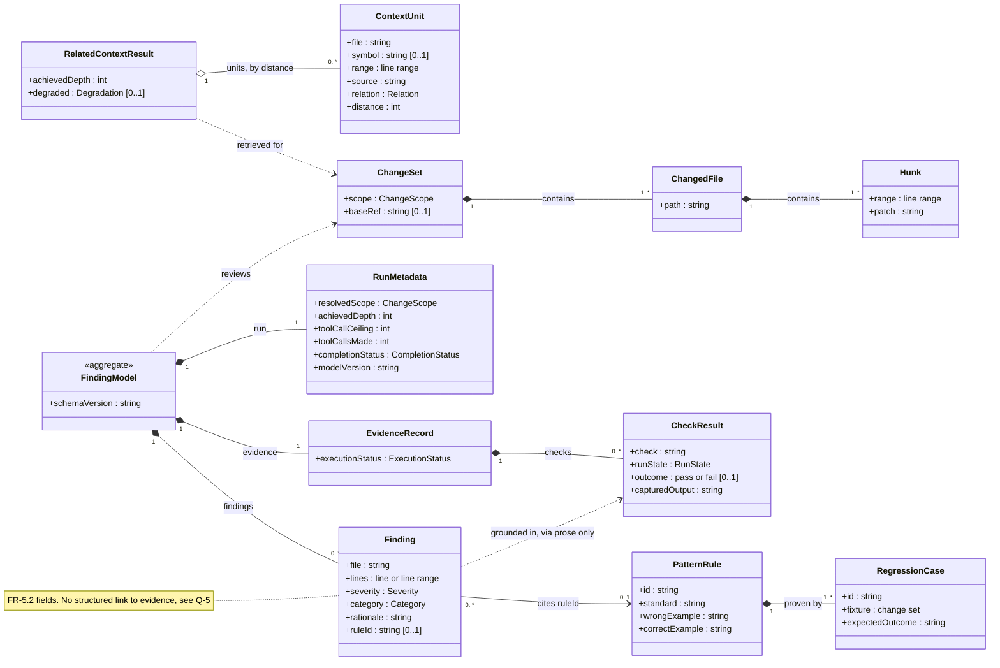

# Conceptual Domain Model

Part of the [v1 System Analysis](../system_analysis.md#43-conceptual-class-diagram) · Mermaid `classDiagram`

This diagram shows analysis entities, not implementation classes: attributes and structural relationships only, no operations. `ContextUnit` and `RelatedContextResult` follow the normative interface in SRS v1 §4.2.2. The other entities are drawn from the FR text. Value-set types (`ChangeScope`, `Relation`, `Degradation`, `RunState`, and so on) are listed in the main document, §4.2.

