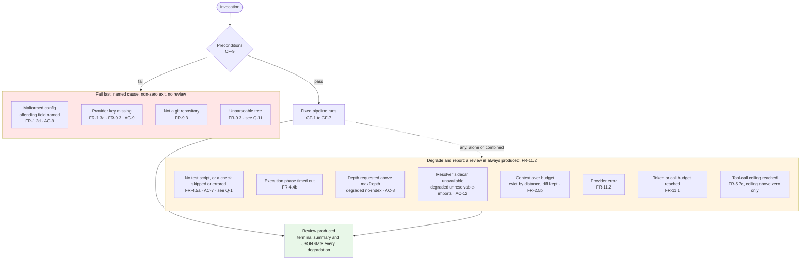

# Flowchart — Fail Fast versus Degrade and Report

Part of the [v1 System Analysis](../system_analysis.md#61-fail-fast-versus-degrade) · Mermaid `flowchart`

v1 has exactly two failure behaviours. A missing prerequisite stops the run before any review exists, and the error names the cause. Everything that goes wrong after that point degrades: the review is still produced, and it states what was lost. The boundary between the two is where FR-9.3 and FR-11.2 meet, and two of its cases are ambiguous in the SRS (Q-1, Q-11).

