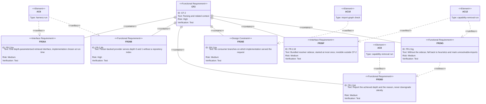

# Requirement Diagram — CF-2 Drill-Down: The Related-Context Interface

Part of the [v1 System Analysis](../system_analysis.md#23-requirement-diagrams) · Mermaid `requirementDiagram`

CF-2 carries the most risk in v1 (R-1, R-3, R-7). This view breaks out the FR-2.6 family and the three structural acceptance criteria that exercise it. FR-2.2, FR-2.3d, FR-2.4 and FR-2.6c are omitted; they are verified only incidentally, by AC-1.

