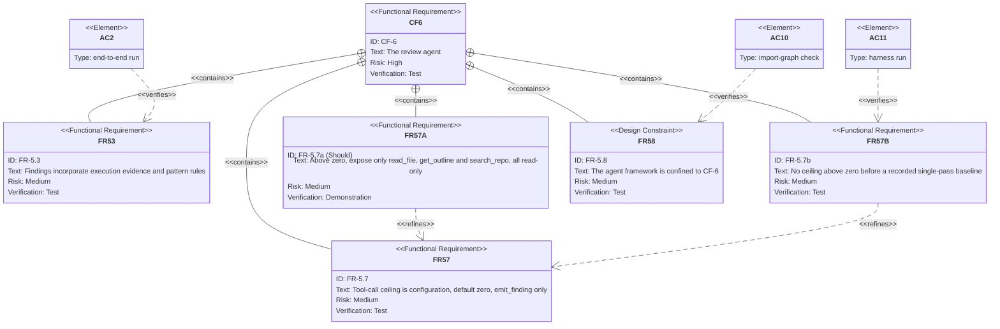

# Requirement Diagram — CF-6 Drill-Down: The Review Agent and Its Ceiling

Part of the [v1 System Analysis](../system_analysis.md#23-requirement-diagrams) · Mermaid `requirementDiagram`

CF-6 carries risks R-2, R-2a and R-4. This view shows how the tool-call ceiling is constrained, and which acceptance criteria hold it in place. FR-5.7a is a Should with no direct acceptance criterion. FR-5.1 is omitted: v1 has no code-writing agent to isolate from, so it holds by construction.

