# Requirement Diagram — Core Functions CF-1 to CF-6

Part of the [v1 System Analysis](../system_analysis.md#23-requirement-diagrams) · Mermaid `requirementDiagram`

The review core decomposed into its six pipeline functions, and the acceptance criteria that verify each one. Risk ratings are the analyst's reading of SRS v1 §9, not values the SRS assigns per function. Node names drop hyphens because Mermaid identifiers cannot contain them; the `id` field carries the real identifier.

```mermaid
requirementDiagram

requirement SYS {
    id: "SRS-v1"
    text: "Review a local change set and emit grounded, schema-valid findings"
    risk: high
    verifymethod: demonstration
}

functionalRequirement CF1 {
    id: "CF-1"
    text: "Resolve the change scope into changed files and hunks"
    risk: low
    verifymethod: demonstration
}

functionalRequirement CF2 {
    id: "CF-2"
    text: "Parse changed files and retrieve related context at depth 0 to 1"
    risk: high
    verifymethod: test
}

functionalRequirement CF3 {
    id: "CF-3"
    text: "Run the project's own checks once and record the evidence"
    risk: medium
    verifymethod: test
}

functionalRequirement CF4 {
    id: "CF-4"
    text: "Fit diff, context, evidence and rules into per-section budgets"
    risk: medium
    verifymethod: test
}

functionalRequirement CF5 {
    id: "CF-5"
    text: "One canonical finding model, entered only through emit_finding"
    risk: medium
    verifymethod: test
}

functionalRequirement CF6 {
    id: "CF-6"
    text: "An isolated, single-pass review agent"
    risk: high
    verifymethod: test
}

element AC1 {
    type: "end-to-end run"
}

element AC2 {
    type: "end-to-end run"
}

element AC3 {
    type: "schema validation"
}

element AC6 {
    type: "harness run"
}

element AC7 {
    type: "fault-injection run"
}

element AC8 {
    type: "capability-removal run"
}

element AC10 {
    type: "import-graph check"
}

element AC11 {
    type: "harness run"
}

element AC12 {
    type: "capability-removal run"
}

SYS - contains -> CF1
SYS - contains -> CF2
SYS - contains -> CF3
SYS - contains -> CF4
SYS - contains -> CF5
SYS - contains -> CF6

AC1 - verifies -> CF1
AC1 - verifies -> CF2
AC1 - verifies -> CF3
AC1 - verifies -> CF4
AC2 - verifies -> CF3
AC2 - verifies -> CF6
AC3 - verifies -> CF4
AC3 - verifies -> CF5
AC6 - verifies -> CF2
AC7 - verifies -> CF3
AC8 - verifies -> CF2
AC10 - verifies -> CF2
AC10 - verifies -> CF6
AC11 - verifies -> CF6
AC12 - verifies -> CF2
```

