# Requirement Diagram — Supporting Functions CF-7 to CF-9 and Cross-Cutting

Part of the [v1 System Analysis](../system_analysis.md#23-requirement-diagrams) · Mermaid `requirementDiagram`

This is the companion to [`req_core_functions.md`](./req_core_functions.md). Together the two place every acceptance criterion, AC-1 to AC-12. AC-4, AC-5 and AC-9 appear only here, because they verify output, measurement and configuration rather than the review pipeline itself.

```mermaid
requirementDiagram

requirement SYS {
    id: "SRS-v1"
    text: "Review a local change set and emit grounded, schema-valid findings"
    risk: high
    verifymethod: demonstration
}

functionalRequirement CF7 {
    id: "CF-7"
    text: "Terminal summary, JSON artifact and exit status, all from the finding model"
    risk: low
    verifymethod: test
}

functionalRequirement CF8 {
    id: "CF-8"
    text: "Pattern rules with attribution, and a catch-rate regression harness"
    risk: medium
    verifymethod: test
}

functionalRequirement CF9 {
    id: "CF-9"
    text: "Configuration, credentials and legible failure"
    risk: low
    verifymethod: test
}

requirement XC {
    id: "XC"
    text: "Cross-cutting: budgets, the adapter seam, and never degrading silently"
    risk: high
    verifymethod: test
}

element AC1 {
    type: "end-to-end run"
}

element AC3 {
    type: "schema validation"
}

element AC4 {
    type: "end-to-end run"
}

element AC5 {
    type: "harness run"
}

element AC6 {
    type: "harness run"
}

element AC7 {
    type: "fault-injection run"
}

element AC9 {
    type: "fault-injection run"
}

element AC10 {
    type: "import-graph check"
}

element AC11 {
    type: "harness run"
}

element AC12 {
    type: "capability-removal run"
}

SYS - contains -> CF7
SYS - contains -> CF8
SYS - contains -> CF9
SYS - contains -> XC

AC1 - verifies -> CF7
AC1 - verifies -> CF9
AC1 - verifies -> XC
AC3 - verifies -> CF7
AC4 - verifies -> CF8
AC5 - verifies -> CF8
AC6 - verifies -> CF8
AC7 - verifies -> XC
AC9 - verifies -> CF9
AC10 - verifies -> XC
AC11 - verifies -> CF8
AC12 - verifies -> XC
```

