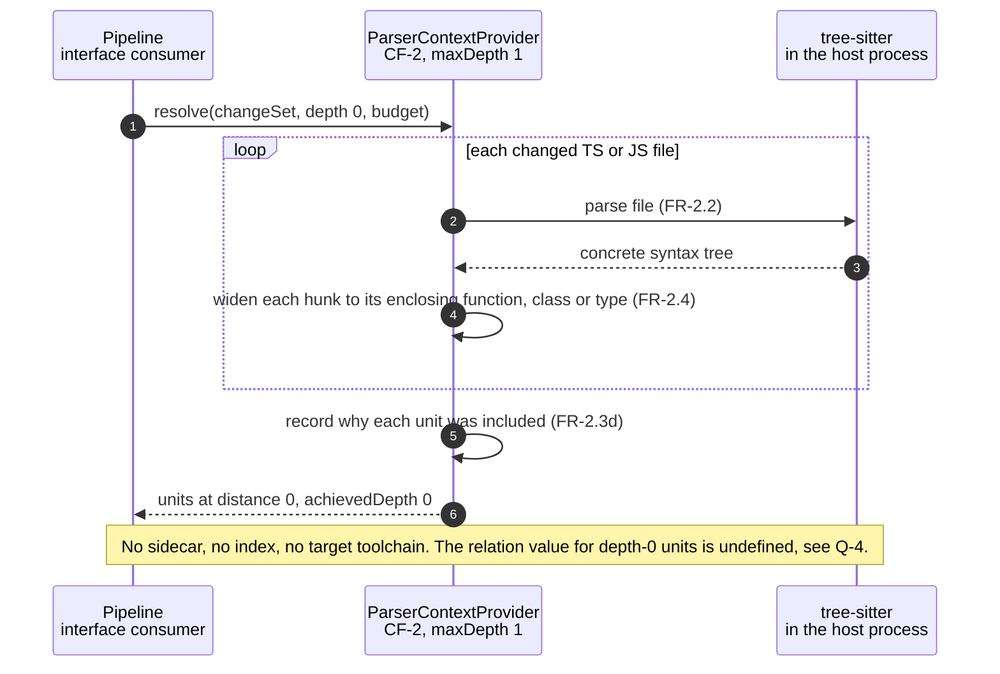

# Sequence Diagram — Context Depth 0

Part of the [v1 System Analysis](../system_analysis.md#53-context-laddering) · Mermaid `sequenceDiagram`

Depth 0 is pure syntax: parse the changed files and widen each hunk to the function, class or type that encloses it. It needs no resolver sidecar, no repository index, and no target-language toolchain.

