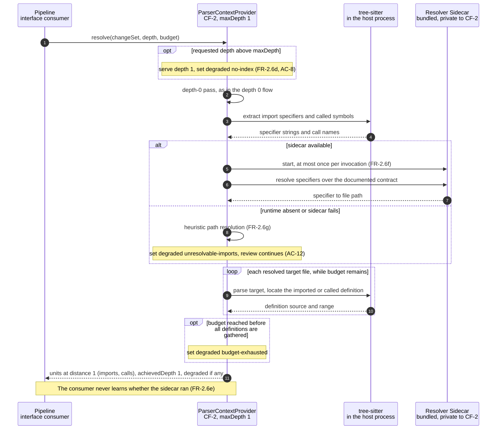

# Sequence Diagram — Context Depth 1

Part of the [v1 System Analysis](../system_analysis.md#53-context-laddering) · Mermaid `sequenceDiagram`

Depth 1 reaches outward to the definitions of symbols the change imports and calls. Syntax still comes from tree-sitter. The only new step is working out which file an import specifier names, and that is delegated to the bundled resolver sidecar. Each of the three `degraded` values is set in this flow. None of them stops the review.

