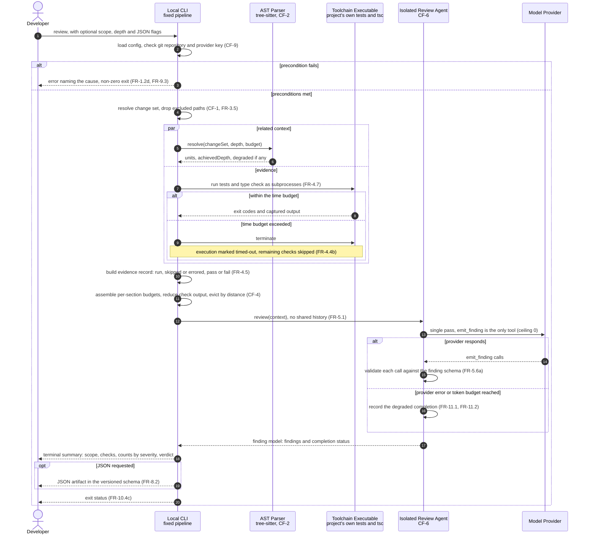

# Sequence Diagram — End-to-End Review Pass

Part of the [v1 System Analysis](../system_analysis.md#52-end-to-end-review-pass) · Mermaid `sequenceDiagram`

One invocation at the default ceiling of zero. The outer `alt` separates the fail-fast path, where no review is produced, from the pipeline path. Inside the pipeline, each `alt` shows a degradation that still ends in a review. Context retrieval is summarised in one exchange here; the depth 0 and depth 1 flows are decomposed in their own diagrams.

