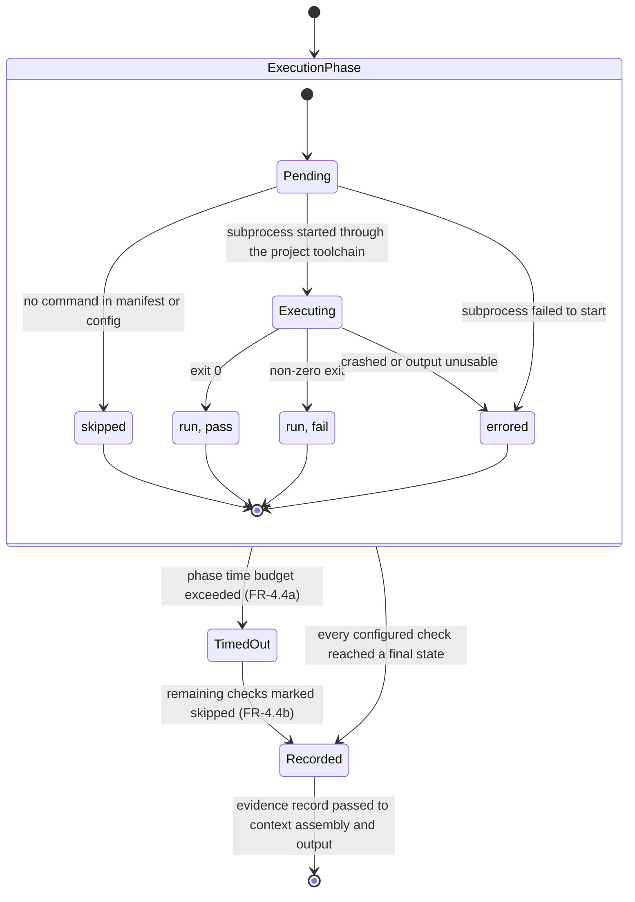

# State Diagram — Check Execution Lifecycle

Part of the [v1 System Analysis](../system_analysis.md#54-check-execution-lifecycle) · Mermaid `stateDiagram-v2`

The execution phase runs once per invocation, before the review pass (FR-4.6). Every check ends in one of four recorded states, and a phase-level timeout can cut the phase short at any point. `Passed` and `Failed` are both `run` in FR-4.5a terms; the pass/fail outcome is recorded separately (FR-4.5b). The state of a check that is still running when the timeout fires is not specified (Q-6).

