---
title: "Phase 1 Agentic Code Review - System Analysis Document"
date: 2026-09-10
author: "Lead Systems Analyst"
status: "Draft / Analysis"
tags: [system-analysis, srs, agentic-review, uml, requirements]
---

# Phase 1 Agentic Code Review — System Analysis

> [!IMPORTANT]
> **Non-normative.** This package analyses the baselined specification, [`agentic-code-review-srs-v1.md`](../../agentic-code-review-srs-v1.md). It adds no requirements. Where the two differ, the SRS wins. Where the analysis finds the SRS ambiguous or incomplete, it raises the point in [§7](#7-analyst-findings-and-open-questions) instead of settling it.

[//]: # (Requirement, acceptance-criterion and risk identifiers are copied verbatim from SRS v1. Nothing is renumbered, per the Docs README convention.)

## Table of Contents

- [Package Contents](#package-contents)
- [1. System Vision and Domain Scope](#1-system-vision-and-domain-scope)
  - [1.1 Actors and Stakeholders](#11-actors-and-stakeholders)
  - [1.2 System Context Diagram](#12-system-context-diagram)
  - [1.3 Stakeholder Value Map](#13-stakeholder-value-map)
  - [1.4 Use Case Overview](#14-use-case-overview)
  - [1.5 Scope Boundary](#15-scope-boundary)
- [2. Requirements Decomposition and Verification](#2-requirements-decomposition-and-verification)
  - [2.1 Decomposition by Core Function](#21-decomposition-by-core-function)
  - [2.2 Verification Strategy](#22-verification-strategy)
  - [2.3 Requirement Diagrams](#23-requirement-diagrams)
- [3. User Stories and Acceptance Criteria Mapping](#3-user-stories-and-acceptance-criteria-mapping)
  - [3.1 Story Map](#31-story-map)
  - [3.2 Stories](#32-stories)
- [4. Domain Entity and Conceptual Data Model](#4-domain-entity-and-conceptual-data-model)
  - [4.1 Entity Catalogue](#41-entity-catalogue)
  - [4.2 Value Sets](#42-value-sets)
  - [4.3 Conceptual Class Diagram](#43-conceptual-class-diagram)
- [5. Operational Workflow and System Behavior](#5-operational-workflow-and-system-behavior)
  - [5.1 Developer Journey (Business Activity)](#51-developer-journey-business-activity)
  - [5.2 System Architecture Overview](#52-system-architecture-overview)
  - [5.3 Pipeline Phases](#53-pipeline-phases)
  - [5.4 End-to-End Review Pass](#54-end-to-end-review-pass)
  - [5.5 Context Laddering](#55-context-laddering)
  - [5.6 Check Execution Lifecycle](#56-check-execution-lifecycle)
- [6. Resilience, Degradation, and Traceability Matrix](#6-resilience-degradation-and-traceability-matrix)
  - [6.1 Fail Fast versus Degrade](#61-fail-fast-versus-degrade)
  - [6.2 Traceability Matrix](#62-traceability-matrix)
  - [6.3 Verification Gaps](#63-verification-gaps)
- [7. Analyst Findings and Open Questions](#7-analyst-findings-and-open-questions)

## Package Contents

Each diagram lives in its own file under [`assets/`](./assets/) and is embedded below in a collapsed block. The two copies are kept identical.

| Asset | Engine | Diagram | Used in |
|:---|:---:|:---|:---:|
| [`c4_context.md`](./assets/c4_context.md) | Mermaid | System Context (C4 L1) | [§1.2](#12-system-context-diagram) |
| [`stakeholder_value_map.md`](./assets/stakeholder_value_map.md) | Mermaid | Stakeholder Value Map | [§1.3](#13-stakeholder-value-map) |
| [`uc_overview.puml`](./assets/uc_overview.puml) | PlantUML | Use case | [§1.4](#14-use-case-overview) |
| [`req_core_functions.md`](./assets/req_core_functions.md) | Mermaid | `requirementDiagram` | [§2.3](#23-requirement-diagrams) |
| [`req_cf2_context_depth.md`](./assets/req_cf2_context_depth.md) | Mermaid | `requirementDiagram` | [§2.3](#23-requirement-diagrams) |
| [`req_cf6_review_agent.md`](./assets/req_cf6_review_agent.md) | Mermaid | `requirementDiagram` | [§2.3](#23-requirement-diagrams) |
| [`req_supporting_functions.md`](./assets/req_supporting_functions.md) | Mermaid | `requirementDiagram` | [§2.3](#23-requirement-diagrams) |
| [`domain_model.md`](./assets/domain_model.md) | Mermaid | `classDiagram` | [§4.3](#43-conceptual-class-diagram) |
| [`dev_journey.md`](./assets/dev_journey.md) | Mermaid | `flowchart` | [§5.1](#51-developer-journey-business-activity) |
| [`architecture_overview.md`](./assets/architecture_overview.md) | Mermaid | `flowchart` | [§5.2](#52-system-architecture-overview) |
| [`seq_review_pass.md`](./assets/seq_review_pass.md) | Mermaid | `sequenceDiagram` | [§5.4](#54-end-to-end-review-pass) |
| [`seq_context_depth0.md`](./assets/seq_context_depth0.md) | Mermaid | `sequenceDiagram` | [§5.5](#55-context-laddering) |
| [`seq_context_depth1.md`](./assets/seq_context_depth1.md) | Mermaid | `sequenceDiagram` | [§5.5](#55-context-laddering) |
| [`state_check_execution.md`](./assets/state_check_execution.md) | Mermaid | `stateDiagram-v2` | [§5.6](#56-check-execution-lifecycle) |
| [`flow_failure_modes.md`](./assets/flow_failure_modes.md) | Mermaid | `flowchart` | [§6.1](#61-fail-fast-versus-degrade) |

> [!NOTE]
> PlantUML is used once, for the use case diagram, because Mermaid has no native use case notation. GitHub does not render PlantUML, so that one diagram needs a PlantUML extension or `java -jar plantuml.jar`. Every other diagram is Mermaid and renders natively on GitHub, both in its asset file and in the collapsed blocks below.

---

## 1. System Vision and Domain Scope

v1 is a self-contained command-line program that reviews a local change set in a TypeScript/JavaScript repository. It works out what changed, gathers related source at context depth 0 or 1, runs the project's own tests and type check, and makes one model pass whose only output channel is a schema-validated `emit_finding` call. A regression harness measures how many known defects that pass catches.[^srs21]

Three properties set the domain boundary:

- **Local and stateless.** There is no server, no remote state, no GitHub API, and no account beyond a model-provider key (FR-10.1).
- **One core behind a thin adapter.** The CLI is the only adapter in v1, and no adapter may decide what counts as a finding (FR-10.2). That rule is what lets the v3 GitHub Action arrive as an addition rather than a rewrite.
- **A fixed pipeline with bounded agency.** Our code orchestrates. The model appears in exactly one step, whose tool-call ceiling defaults to zero.[^fr57]

> [!WARNING]
> **v1 demonstrates the pipeline, not the thesis.** At depth 1 the reviewer sees what a change reaches outward to, never who calls it. Defects that break a caller's assumptions stay invisible until depth 2 arrives in v2 (R-1). v1 also serves the change's author before they push, not the reviewer clearing a queue whom the problem statement names (R-5). Any demonstration of v1 should say both.[^risks]

### 1.1 Actors and Stakeholders

| Actor | Kind | Goal in v1 | Touches the system through |
|:---|:---:|:---|:---|
| **Developer (author)** | Primary · human | A review of their own work before pushing | The CLI |
| **Contributor** | Primary · human | A fast iteration loop and a measurable engine | The CLI and the regression harness |
| **Maintainer** | Primary · human | Evidence that a change to prompts, context or rules helped or hurt | The regression harness and the pattern library |
| **Regression Harness** | Secondary · automated | Run the corpus as a test at pinned settings and report a catch rate | Calls the review core directly (FR-5.8) |
| **Project Toolchain** | Secondary · system | Run the reviewed project's own tests and type check | A subprocess, with no shared runtime (FR-4.7) |
| **Model Provider** | Secondary · external | Serve the single review pass | HTTPS, through an OpenAI-compatible client |

> [!NOTE]
> **The resolver sidecar is not an actor.** It is a bundled helper process private to CF-2, and no consumer may observe it.[^fr26f] It appears in the depth-1 sequence in [§5.5](#55-context-laddering) and nowhere above that level.

### 1.2 System Context Diagram

[View System Context Diagram](./assets/c4_context.md) · Mermaid `flowchart` (C4 Level 1).

This is the 30-second elevator pitch. The system is shown as a single entity in the center, surrounded by the human users and external systems it interacts with. It establishes the boundary: what is inside the system's control, and what is external.

<details>
<summary>System Context diagram source (Mermaid)</summary>

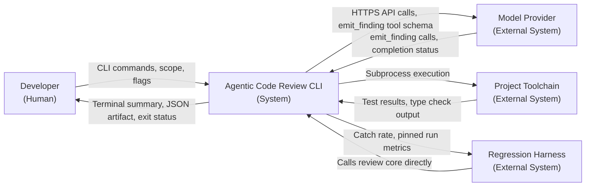

</details>

### 1.3 Stakeholder Value Map

[View Stakeholder Value Map](./assets/stakeholder_value_map.md) · Mermaid `flowchart`.

This diagram maps the system's value proposition. It connects the human stakeholders to the specific capabilities they desire and the tangible artifacts they receive in return. Use this to align product discussions and ensure development effort tracks to actual user value.

<details>
<summary>Stakeholder Value Map source (Mermaid)</summary>

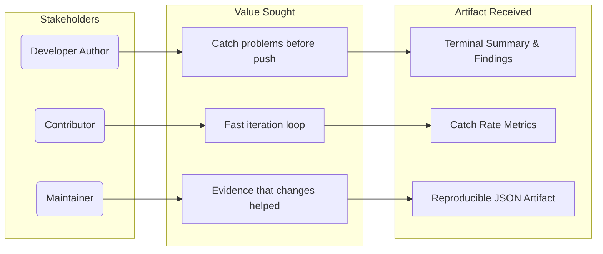

</details>

### 1.4 Use Case Overview

[View Use Case Diagram](./assets/uc_overview.puml) · PlantUML, used because Mermaid lacks native use case syntax.

| UC | Use case | Actor | Relationship | Core functions | Verified by |
|:---:|:---|:---|:---:|:---:|:---:|
| UC1 | Review a local change set | Developer | — | CF-1 to CF-7 | AC-1, AC-2 |
| UC2 | Resolve change scope | — | «include» UC1 | CF-1 | AC-1 |
| UC3 | Validate configuration and prerequisites | — | «include» UC1 | CF-9 | AC-9 |
| UC4 | Gather related context, depth 0 to 1 | — | «include» UC1 | CF-2, CF-4 | AC-6, AC-8, AC-12 |
| UC5 | Run project checks and record evidence | → Project Toolchain | «include» UC1 | CF-3 | AC-2, AC-7 |
| UC6 | Generate schema-valid findings | → Model Provider | «include» UC1 | CF-5, CF-6 | AC-3, AC-4 |
| UC7 | Export JSON artifact | — | «extend» UC1 | CF-7 | AC-3 |
| UC8 | Measure catch rate at pinned depth and ceiling | Contributor / Maintainer, → Harness | «include» UC1 | CF-8 | AC-5, AC-6, AC-11 |
| UC9 | Maintain pattern rules and regression cases | Contributor / Maintainer | — | CF-8 | AC-4, AC-5 |

<details>
<summary>Use case diagram source (PlantUML)</summary>


</details>

### 1.5 Scope Boundary

| Concern | In v1 | Deferred | Deferred to |
|:---|:---|:---|:---:|
| What is reviewed | Working tree, staged changes, or a comparison against a named branch or commit | Pull request head against base | v3 |
| Context depth | 0 and 1: enclosing scope, then outward imports and calls | 2 and 3: inbound importers, call sites, transitive neighbours | v2 |
| Agency | Single pass at ceiling 0, with a corpus-gated route to three read-only tools | `find_references` and reverse `get_definition`; `get_check_result` and `lookup_pattern_rule` as tools | v2 / at scale |
| Pattern library | At least five rules, each with a regression case | A broad default rule set; coverage reporting | v2 / later |
| Output | Terminal summary, JSON artifact, exit status | PR comments, suggested-change blocks, fix snippets, evidence links | v3 / later |
| Execution trust | The developer's own code, on their own machine | Untrusted-code isolation | v3 |
| State | None between runs | Cross-run de-duplication, local state | later |
| Triage | A default exclusion list (FR-3.5) | Risk triage and depth routing | later |
| Write path | None: suggestions are advisory (FR-7.2) | — | — |

[//]: # (Deferred-to values appear only where SRS v1 states a version. Everything else is marked later.)

---

## 2. Requirements Decomposition and Verification

v1 contains **72 requirements: 63 Must and 9 Should**. They are organised under nine core functions plus a cross-cutting group, and each requirement belongs to exactly one group.

### 2.1 Decomposition by Core Function

| CF | Function | Must | Should | Total | Risk | Driving risks | Verification strength |
|:---:|:---|---:|---:|---:|:---:|:---|:---|
| CF-1 | Change-set resolution | 3 | 0 | 3 | Low | — | **Weak.** AC-1 exercises a single scope |
| CF-2 | Parsing and related context | 9 | 1 | 10 | High | R-1, R-3, R-7 | **Strong.** AC-6, AC-8, AC-10, AC-12 |
| CF-3 | Execution and evidence | 9 | 0 | 9 | Medium | Runnable-suite assumption (§2.4) | **Partial.** The timeout path is never exercised |
| CF-4 | Context assembly | 5 | 0 | 5 | Medium | R-4 | **Weak.** Eviction and output reduction are never observed |
| CF-5 | Finding model and provider client | 7 | 1 | 8 | Medium | Tool-calling assumption (§2.4) | **Good.** AC-3 |
| CF-6 | The review agent | 5 | 3 | 8 | High | R-2, R-2a, R-4 | **Good.** AC-2, AC-10, AC-11 |
| CF-7 | Output | 6 | 2 | 8 | Low | — | **Good.** AC-1, AC-3 |
| CF-8 | Pattern library and regression harness | 5 | 1 | 6 | Medium | R-4, R-6 | **Strong.** AC-4, AC-5, AC-6, AC-11 |
| CF-9 | Configuration and diagnostics | 8 | 0 | 8 | Low | — | **Partial.** AC-9 covers FR-1.2d and FR-9.3 only |
| XC | Cross-cutting | 6 | 1 | 7 | High | FR-11.2 | **Partial.** One of FR-11.2's four named failure modes is exercised (AC-7) |
| | **Total** | **63** | **9** | **72** | | | |

> [!NOTE]
> The SRS rates risks (§9) but not core functions. The **Risk** column is this analysis's reading of which §9 risks land on which function. XC is rated High because the SRS itself warns that FR-11.2 is the requirement most likely to be quietly violated.[^fr112]

### 2.2 Verification Strategy

The SRS requires every acceptance criterion to be "verifiable by execution, not inspection" (§6). The twelve criteria use five techniques:

| Technique | Acceptance criteria | What a pass proves |
|:---|:---:|:---|
| End-to-end run | AC-1, AC-2, AC-4 | The pipeline works on a real public repository on a free tier, and findings rest on evidence and rules |
| Schema validation | AC-3 | The output contract holds and records what is needed to reproduce the run |
| Harness run | AC-5, AC-6, AC-11 | The measurement instrument works, and depth and ceiling can be compared on one corpus |
| Fault injection or capability removal | AC-7, AC-8, AC-9, AC-12 | Degradation is reported rather than silent, and missing prerequisites fail legibly |
| Import-graph check | AC-10 | The structural seams that make v2 and v3 additions still hold |

> [!TIP]
> SRS §6 names **AC-5 and AC-7** as the two to defend under schedule pressure. Without AC-5 nobody can tell whether the reviewer improved. Without AC-7, "no findings" means both "clean" and "broken".

### 2.3 Requirement Diagrams

The requirement view is split across four diagrams of 9 to 16 nodes each: an overview of the review pipeline, drill-downs into its two high-risk functions, and a companion for output, measurement and configuration. Between them they place all twelve acceptance criteria.

> [!NOTE]
> Node names such as `CF2` and `AC12` drop the hyphen because Mermaid identifiers cannot contain one. Each requirement's `id` field carries the real identifier.

#### Core functions CF-1 to CF-6

[View Requirement Diagram](./assets/req_core_functions.md)

<details>
<summary>Requirement diagram: CF-1 to CF-6 and their acceptance criteria</summary>

```mermaid
requirementDiagram

requirement SYS {
    id: "SRS-v1"
    text: "Review a local change set and emit grounded, schema-valid findings"
    risk: high
    verifymethod: demonstration
}

functionalRequirement CF1 {
    id: "CF-1"
    text: "Resolve the change scope into changed files and hunks"
    risk: low
    verifymethod: demonstration
}

functionalRequirement CF2 {
    id: "CF-2"
    text: "Parse changed files and retrieve related context at depth 0 to 1"
    risk: high
    verifymethod: test
}

functionalRequirement CF3 {
    id: "CF-3"
    text: "Run the project's own checks once and record the evidence"
    risk: medium
    verifymethod: test
}

functionalRequirement CF4 {
    id: "CF-4"
    text: "Fit diff, context, evidence and rules into per-section budgets"
    risk: medium
    verifymethod: test
}

functionalRequirement CF5 {
    id: "CF-5"
    text: "One canonical finding model, entered only through emit_finding"
    risk: medium
    verifymethod: test
}

functionalRequirement CF6 {
    id: "CF-6"
    text: "An isolated, single-pass review agent"
    risk: high
    verifymethod: test
}

element AC1 {
    type: "end-to-end run"
}

element AC2 {
    type: "end-to-end run"
}

element AC3 {
    type: "schema validation"
}

element AC6 {
    type: "harness run"
}

element AC7 {
    type: "fault-injection run"
}

element AC8 {
    type: "capability-removal run"
}

element AC10 {
    type: "import-graph check"
}

element AC11 {
    type: "harness run"
}

element AC12 {
    type: "capability-removal run"
}

SYS - contains -> CF1
SYS - contains -> CF2
SYS - contains -> CF3
SYS - contains -> CF4
SYS - contains -> CF5
SYS - contains -> CF6

AC1 - verifies -> CF1
AC1 - verifies -> CF2
AC1 - verifies -> CF3
AC1 - verifies -> CF4
AC2 - verifies -> CF3
AC2 - verifies -> CF6
AC3 - verifies -> CF4
AC3 - verifies -> CF5
AC6 - verifies -> CF2
AC7 - verifies -> CF3
AC8 - verifies -> CF2
AC10 - verifies -> CF2
AC10 - verifies -> CF6
AC11 - verifies -> CF6
AC12 - verifies -> CF2
```

</details>

#### CF-2 drill-down: the related-context interface

[View Requirement Diagram](./assets/req_cf2_context_depth.md)

<details>
<summary>Requirement diagram: the FR-2.6 family and its structural checks</summary>

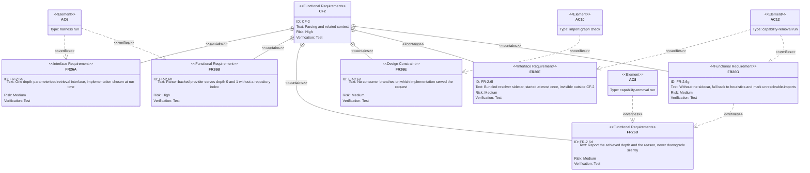

</details>

#### CF-6 drill-down: the review agent and its ceiling

[View Requirement Diagram](./assets/req_cf6_review_agent.md)

<details>
<summary>Requirement diagram: the tool-call ceiling and what holds it in place</summary>

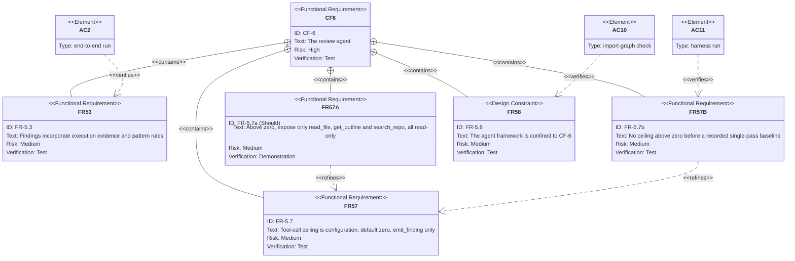

</details>

#### Supporting functions CF-7 to CF-9 and cross-cutting

[View Requirement Diagram](./assets/req_supporting_functions.md)

<details>
<summary>Requirement diagram: output, measurement, configuration and cross-cutting</summary>

```mermaid
requirementDiagram

requirement SYS {
    id: "SRS-v1"
    text: "Review a local change set and emit grounded, schema-valid findings"
    risk: high
    verifymethod: demonstration
}

functionalRequirement CF7 {
    id: "CF-7"
    text: "Terminal summary, JSON artifact and exit status, all from the finding model"
    risk: low
    verifymethod: test
}

functionalRequirement CF8 {
    id: "CF-8"
    text: "Pattern rules with attribution, and a catch-rate regression harness"
    risk: medium
    verifymethod: test
}

functionalRequirement CF9 {
    id: "CF-9"
    text: "Configuration, credentials and legible failure"
    risk: low
    verifymethod: test
}

requirement XC {
    id: "XC"
    text: "Cross-cutting: budgets, the adapter seam, and never degrading silently"
    risk: high
    verifymethod: test
}

element AC1 {
    type: "end-to-end run"
}

element AC3 {
    type: "schema validation"
}

element AC4 {
    type: "end-to-end run"
}

element AC5 {
    type: "harness run"
}

element AC6 {
    type: "harness run"
}

element AC7 {
    type: "fault-injection run"
}

element AC9 {
    type: "fault-injection run"
}

element AC10 {
    type: "import-graph check"
}

element AC11 {
    type: "harness run"
}

element AC12 {
    type: "capability-removal run"
}

SYS - contains -> CF7
SYS - contains -> CF8
SYS - contains -> CF9
SYS - contains -> XC

AC1 - verifies -> CF7
AC1 - verifies -> CF9
AC1 - verifies -> XC
AC3 - verifies -> CF7
AC4 - verifies -> CF8
AC5 - verifies -> CF8
AC6 - verifies -> CF8
AC7 - verifies -> XC
AC9 - verifies -> CF9
AC10 - verifies -> XC
AC11 - verifies -> CF8
AC12 - verifies -> XC
```

</details>

---

## 3. User Stories and Acceptance Criteria Mapping

The roles come from SRS §2.2. Each story maps to exactly one acceptance criterion, so completing the twelve stories completes v1. Checklist items cite the requirements they exercise, and the boxes stay unchecked until the behaviour is demonstrated.

### 3.1 Story Map

| Story | Role | Wants | AC | Core functions |
|:---:|:---|:---|:---:|:---:|
| [US-01](#us-01-review-before-i-push) | Developer | A one-command review before pushing | AC-1 | CF-1, CF-3, CF-7, CF-9, XC |
| [US-02](#us-02-evidence-not-inference) | Developer | Findings grounded in real check results | AC-2 | CF-3, CF-4, CF-6 |
| [US-03](#us-03-a-reproducible-record) | Maintainer | Schema-valid, reproducible JSON | AC-3 | CF-5, CF-7 |
| [US-04](#us-04-know-which-rule-fired) | Developer | Rule-based findings that name their rule | AC-4 | CF-8 |
| [US-05](#us-05-a-measurable-engine) | Maintainer | A catch rate over a corpus | AC-5 | CF-8 |
| [US-06](#us-06-price-the-depth) | Maintainer | Depth 0 compared with depth 1 on one corpus | AC-6 | CF-2, CF-8 |
| [US-07](#us-07-broken-is-not-clean) | Developer | Unrunnable tests reported, never silent | AC-7 | CF-3, XC |
| [US-08](#us-08-honest-depth) | Developer | The depth actually reached, with a reason | AC-8 | CF-2 |
| [US-09](#us-09-legible-failure) | Developer | Config and key failures that name the cause | AC-9 | CF-9 |
| [US-10](#us-10-seams-that-hold) | Contributor | Boundaries enforced by an import check | AC-10 | CF-1, CF-2, CF-6, CF-7, XC |
| [US-11](#us-11-earn-the-loop) | Maintainer | A baseline before any tool loop | AC-11 | CF-6, CF-8 |
| [US-12](#us-12-node-stays-optional) | Developer | A review that survives a missing sidecar | AC-12 | CF-2, XC |

### 3.2 Stories

#### US-01 Review before I push

**As a** developer author, **I want** one command that reviews my local changes end to end, **so that** I catch problems before anyone else sees them.

<sub>Verifies **AC-1** · CF-1, CF-3, CF-7, CF-9, XC</sub>

- [ ] One command reviews a public TS/JS repository end to end on a free provider tier (FR-9.2a)
- [ ] No GitHub API access or repository credential is needed (FR-10.1)
- [ ] The output states the resolved change scope, including when the default applied (FR-10.3b)
- [ ] Generated, vendored and build-output paths are excluded by default (FR-3.5)
- [ ] Nothing is committed, pushed or applied (FR-7.2)

#### US-02 Evidence, not inference

**As a** developer author, **I want** findings that cite my project's real test and type-check results, **so that** I can trust them more than a text-only opinion.

<sub>Verifies **AC-2** · CF-3, CF-4, CF-6</sub>

- [ ] Tests and type check run as subprocesses of the project's own toolchain (FR-4.1, FR-4.2, FR-4.7)
- [ ] The agent sees reduced check output, and the JSON keeps the full output (FR-2.5c, FR-4.5c)
- [ ] At least one finding in the AC-1 run cites a real test or type-check result (FR-5.3)
- [ ] The agent cannot trigger a check; execution runs once, before the review (FR-4.6)

#### US-03 A reproducible record

**As a** maintainer, **I want** machine-readable output that validates against a published schema, **so that** any run can be reproduced and compared.

<sub>Verifies **AC-3** · CF-5, CF-7</sub>

- [ ] JSON output, produced on request, validates against the published schema (FR-8.2b, FR-10.4b)
- [ ] It records achieved depth, ceiling in force, tool calls made, completion status, model and schema versions, and resolved scope (FR-8.2c)
- [ ] The schema carries a schema-version field (FR-0.4)
- [ ] Terminal output and JSON both derive from the same finding model (FR-5.6, FR-10.4a)

#### US-04 Know which rule fired

**As a** developer author, **I want** rule-based findings to name their rule, **so that** I can read the wrong and correct examples behind them.

<sub>Verifies **AC-4** · CF-8</sub>

- [ ] The pattern library is configurable (FR-6.1)
- [ ] At least five rules ship, each with a wrong example, a correct example and a regression case (FR-6.3a)
- [ ] Every finding produced from a rule carries that rule's identifier (FR-6.2a)

#### US-05 A measurable engine

**As a** maintainer, **I want** a regression harness that reports a catch rate, **so that** every change to prompts, context or rules is measured instead of argued about.

<sub>Verifies **AC-5** · CF-8</sub>

- [ ] The corpus runs as a test (FR-6.2b)
- [ ] The harness reports a catch rate over the corpus (FR-6.2d)
- [ ] Each result records its pinned depth, ceiling, model and sampling parameters (FR-6.2e, Should)

#### US-06 Price the depth

**As a** maintainer, **I want** to run the same corpus at depth 0 and depth 1, **so that** I know what depth 1 buys.

<sub>Verifies **AC-6** · CF-2, CF-8</sub>

- [ ] The harness accepts a context depth (FR-6.2d)
- [ ] Depth is selected through the single retrieval interface, with no change to its consumers (FR-2.6a, FR-2.6e)
- [ ] Runs at depth 0 and depth 1 on the same corpus produce comparable catch rates

#### US-07 Broken is not clean

**As a** developer author, **I want** a run whose tests could not execute to say so, **so that** "no findings" never hides a broken run.

<sub>Verifies **AC-7** · CF-3, XC</sub>

- [ ] Each check is recorded as run, skipped or errored (FR-4.5a)
- [ ] When the tests cannot execute, both outputs say so (FR-11.2)
- [ ] That run is distinguishable, in both outputs, from a clean run with zero findings
- [ ] A timeout marks execution `timed-out`, skips the remaining checks, and still produces a review (FR-4.4b)

#### US-08 Honest depth

**As a** developer author, **I want** the reviewer to report the depth it actually reached, **so that** I never assume it looked further than it did.

<sub>Verifies **AC-8** · CF-2</sub>

- [ ] Requesting depth 2 yields `achievedDepth: 1` with the reason `no-index` (FR-2.6d)
- [ ] The review still completes
- [ ] Every context unit states its relation and distance (FR-2.6c)

#### US-09 Legible failure

**As a** developer author, **I want** configuration and credential problems to name their cause, **so that** I can fix them without reading the source.

<sub>Verifies **AC-9** · CF-9</sub>

- [ ] A malformed `.agentic-review.yml` fails and names the offending field (FR-1.2d)
- [ ] With no config file, documented defaults apply, and a missing field takes its documented default (FR-1.2b, FR-1.2c)
- [ ] A missing provider key fails with a message saying so (FR-9.3)
- [ ] The key is read only from the environment or user-level configuration (FR-1.3a)

#### US-10 Seams that hold

**As a** contributor, **I want** module boundaries checked automatically, **so that** v2 and v3 arrive as additions, not rewrites.

<sub>Verifies **AC-10** · CF-1, CF-2, CF-6, CF-7, XC</sub>

- [ ] Only CF-7 imports a terminal-rendering dependency
- [ ] Only CF-1 resolves a change scope
- [ ] Only CF-6 imports the agent framework (FR-5.8)
- [ ] No consumer branches on which context provider served it (FR-2.6e), and no adapter decides what counts as a finding (FR-10.2)

#### US-11 Earn the loop

**As a** maintainer, **I want** a single-pass baseline recorded before any tool loop is enabled, **so that** extra model turns have to justify their cost.

<sub>Verifies **AC-11** · CF-6, CF-8</sub>

- [ ] A single-pass baseline catch rate, at ceiling 0, is recorded on the corpus first (FR-5.7b)
- [ ] The harness reports catch rate and mean tool calls at two ceilings on that corpus (FR-6.2d)
- [ ] Above zero, only `read_file`, `get_outline` and `search_repo` are exposed, all read-only (FR-5.7a, Should)
- [ ] The output says whether the agent finished or hit the ceiling (FR-5.7c, Should)

#### US-12 Node stays optional

**As a** developer author, **I want** a review to complete even when the resolver sidecar cannot start, **so that** a missing runtime costs quality, not the whole run.

<sub>Verifies **AC-12** · CF-2, XC</sub>

- [ ] With the sidecar unavailable, the review completes on heuristic resolution (FR-2.6g)
- [ ] The result reports `degraded: 'unresolvable-imports'`
- [ ] That run is distinguishable from one in which every import resolved
- [ ] When available, the sidecar is bundled, never fetched, and started at most once per invocation (FR-2.6f)

---

## 4. Domain Entity and Conceptual Data Model

### 4.1 Entity Catalogue

| Entity | Owner | Meaning | Invariants | Source |
|:---|:---:|:---|:---|:---:|
| `ChangeSet` | CF-1 | The resolved answer to "what am I reviewing?" | Same structure however it was resolved; frozen, so the v3 adapter can supply a different producer | FR-10.3c |
| `ContextUnit` | CF-2 | One piece of related source in the review context | Carries its relation and distance; distance decides eviction order | FR-2.6c, FR-2.5b |
| `RelatedContextResult` | CF-2 | The output of one retrieval | States the achieved depth and, when it falls short of the request, why; units ordered by distance, then relevance | FR-2.6d |
| `EvidenceRecord` | CF-3 | What happened when the checks ran | Produced once, before the review; the agent cannot add to it | FR-4.5, FR-4.6 |
| `CheckResult` | CF-3 | The outcome of one check | Run, skipped or errored; pass/fail and output exist only if it ran | FR-4.5a, FR-4.5b |
| `FindingModel` | CF-5 | The versioned document every output derives from | Carries a schema version; terminal summary, JSON and exit status are all views of it | FR-0.1, FR-0.4, FR-8.2b |
| `Finding` | CF-5 | One review observation | Enters only through a validated `emit_finding` call; means the same at every ceiling | FR-5.2, FR-5.6a, FR-5.7d |
| `RunMetadata` | CF-7 | The settings and outcome needed to reproduce a run | Records depth, ceiling, tool calls made, completion status, model and scope | FR-8.2c |
| `PatternRule` | CF-8 | A "wrong vs. correct" example with an identifier | Has at least one regression case | FR-6.1, FR-6.3a |
| `RegressionCase` | CF-8 | A known defect with an expected outcome | Runnable as a test | FR-6.2b |

> [!NOTE]
> **Modeling interpretation.** SRS v1 uses "the finding model" for two things: the structure of one finding (FR-5.2, which is also the `emit_finding` schema) and the versioned schema of the whole output, which covers "findings, severities, and the evidence record" (FR-8.2b). This model separates them. `Finding` is the item and `FindingModel` is the aggregate. SRS §5 says the `emit_finding` schema "equals the finding model; one definition, not two", so the tool schema should be generated from the `Finding` definition inside the `FindingModel` schema rather than maintained beside it.

### 4.2 Value Sets

| Type | Values | Source | Status |
|:---|:---|:---:|:---|
| `ChangeScope` | working tree · staged · branch or commit | FR-10.3a | Defined. The default is undecided (Q-10) |
| `Relation` | `imports` · `calls` · `imported-by` · `called-by` | FR-2.6c | Defined. The last two need depth 2 and cannot occur in v1. No value fits depth-0 units (Q-4) |
| `Degradation` | `no-index` · `budget-exhausted` · `unresolvable-imports` | SRS §4.2.2 | Defined, but a result can hold only one value (Q-3) |
| `RunState` | run · skipped · errored | FR-4.5a | Defined. The state of a check still running at timeout is unspecified (Q-6) |
| `ExecutionStatus` | `timed-out`, or completed | FR-4.4b | Only `timed-out` is named |
| `CompletionStatus` | finished · ceiling reached | FR-5.7c | Incomplete: nothing for a provider error or a budget stop (Q-2) |
| `Severity`, `Category` | — | FR-5.2 | Required fields with no value set (Q-9) |

### 4.3 Conceptual Class Diagram

[View Class Diagram](./assets/domain_model.md)

Read the diagram left to right. It starts with what is reviewed (`ChangeSet`), then what the reviewer sees (`RelatedContextResult`, `EvidenceRecord`), then what it says (`FindingModel`), and finally what that is measured against (`PatternRule`, `RegressionCase`). The dashed dependency from `Finding` to `CheckResult` is deliberately weak. Nothing in the finding's structure links it to the evidence it relies on, which is the gap Q-5 raises.

<details>
<summary>Class diagram: conceptual entities and their relationships</summary>

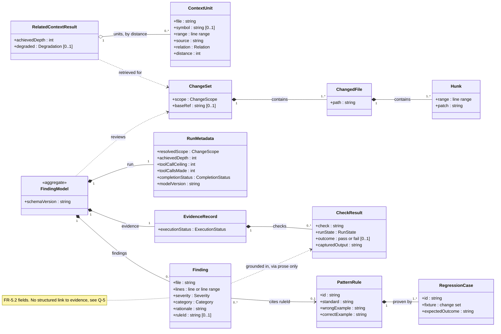

</details>

---

## 5. Operational Workflow and System Behavior

### 5.1 Developer Journey (Business Activity)

[View Developer Journey Diagram](./assets/dev_journey.md) · Mermaid `flowchart`.

This diagram maps the business-level workflow of the developer using the tool. Unlike a sequence diagram that shows message calls, this focuses on *what the human does* before, during, and after the review. It highlights the iteration loop and decision points.

<details>
<summary>Developer Journey diagram source (Mermaid)</summary>

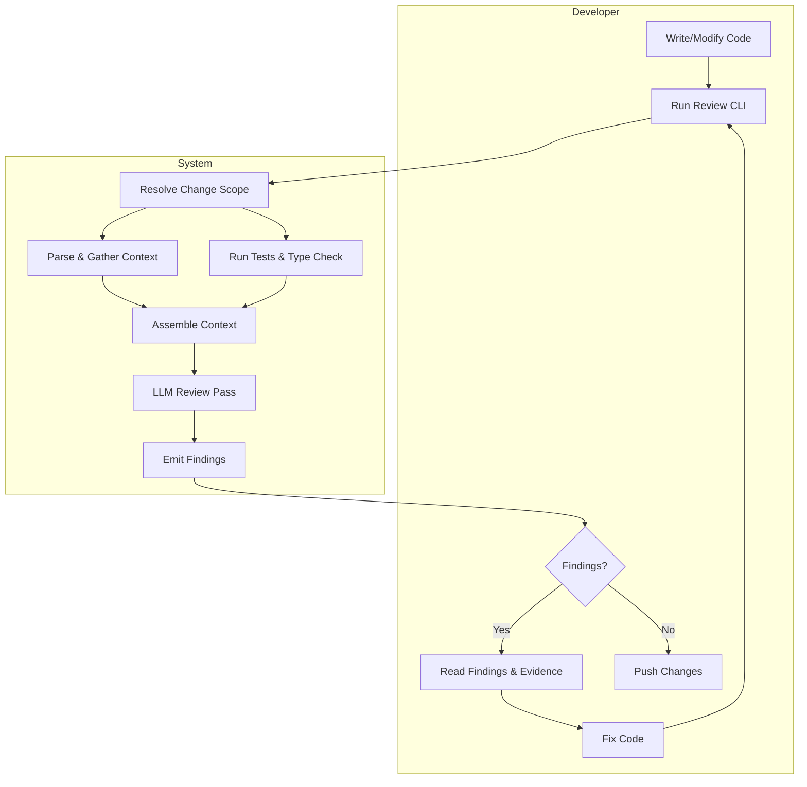

</details>

### 5.2 System Architecture Overview

[View Architecture Overview](./assets/architecture_overview.md) · Mermaid `flowchart`.

This container-level diagram provides the "map" of the internal system structure. It groups the Core Functions (CF-1 through CF-9) into logical components, showing the high-level data flow. This is the diagram a developer pins above their desk to understand how the pieces fit together.

<details>
<summary>Architecture Overview diagram source (Mermaid)</summary>

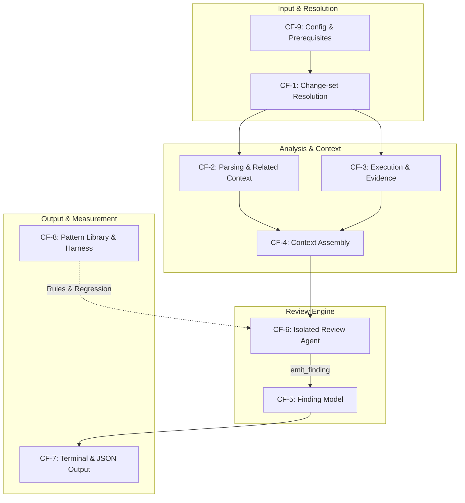

</details>

### 5.3 Pipeline Phases

Step numbers follow the pipeline in SRS §2.1.

| Step | Phase | CF | Model? | Produces | When it goes wrong |
|:---:|:---|:---:|:---:|:---|:---|
| — | Load configuration, check prerequisites | CF-9 | — | Effective configuration | **Stop** with a named cause |
| 1 | Resolve the change set | CF-1 | — | `ChangeSet` | **Stop** if not a git repository |
| 2–3 | Parse changed files, gather related context | CF-2 | — | `RelatedContextResult` | **Degrade:** `no-index`, `unresolvable-imports`, `budget-exhausted` |
| 4 | Execute checks, record evidence | CF-3 | — | `EvidenceRecord` | **Degrade:** skipped, errored, `timed-out` |
| 5 | Assemble context within budget | CF-4 | — | The model's input | **Degrade:** evict by distance, never the diff |
| 6 | One review pass | CF-6 | **Yes** | `emit_finding` calls | **Degrade:** provider error, budget reached, ceiling reached |
| 7 | Findings in canonical form | CF-5 | — | `FindingModel` | Invalid calls rejected at the schema boundary |
| 8 | Terminal output and JSON artifact | CF-7 | — | Summary, JSON, exit status | — |

Steps 2–3 and step 4 depend only on step 1, so they may run concurrently. Step 6 is the only step that involves a model, and the agent framework is confined to it. Every other step is an ordinary function.[^fr58]

Five behavioural invariants hold across every path:

- **Execution comes before the review, once.** The agent cannot start a check (FR-4.6).
- **Findings have one door.** Only a validated `emit_finding` call creates a finding, and prose is never parsed for them (FR-5.6a).
- **The diff is never truncated.** Budget pressure evicts the most distant context first (FR-2.5b).
- **Nothing degrades silently.** Every shortfall is named in both outputs (FR-2.6d, FR-11.2).
- **The consumer is implementation-blind.** No step outside CF-2 knows which provider served it, or whether the sidecar ran (FR-2.6e).

### 5.4 End-to-End Review Pass

[View Sequence Diagram](./assets/seq_review_pass.md)

This is one invocation at the default ceiling of zero. The outer `alt` separates the fail-fast path, which produces no review, from the pipeline path. Every `alt` inside the pipeline is a degradation that still ends in a review.

<details>
<summary>Sequence diagram: developer to terminal, with the degradation branches</summary>

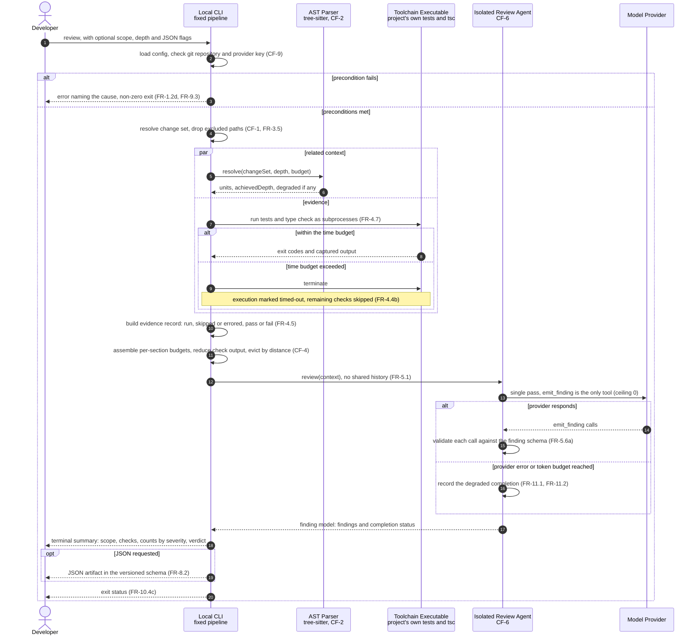

</details>

### 5.5 Context Laddering

| Depth | Reaches | Needs | Can degrade with | In v1 |
|:---:|:---|:---|:---|:---:|
| 0 | The function, class or type enclosing each hunk | tree-sitter only | `budget-exhausted` | ✅ |
| 1 | The definitions of what the change imports and calls | tree-sitter, plus the resolver sidecar for authoritative resolution | `unresolvable-imports`, `budget-exhausted` | ✅ |
| 2+ | Inbound importers, call sites, transitive neighbours | A reverse index | Served at depth 1, with `no-index` | v2 |

#### Depth 0

[View Sequence Diagram](./assets/seq_context_depth0.md)

<details>
<summary>Sequence diagram: depth 0, syntax only</summary>

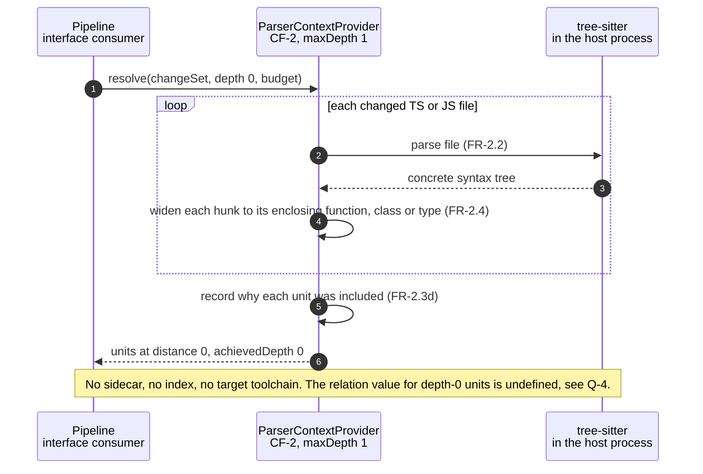

</details>

#### Depth 1

[View Sequence Diagram](./assets/seq_context_depth1.md)

<details>
<summary>Sequence diagram: depth 1, with the sidecar and every degradation it can raise</summary>

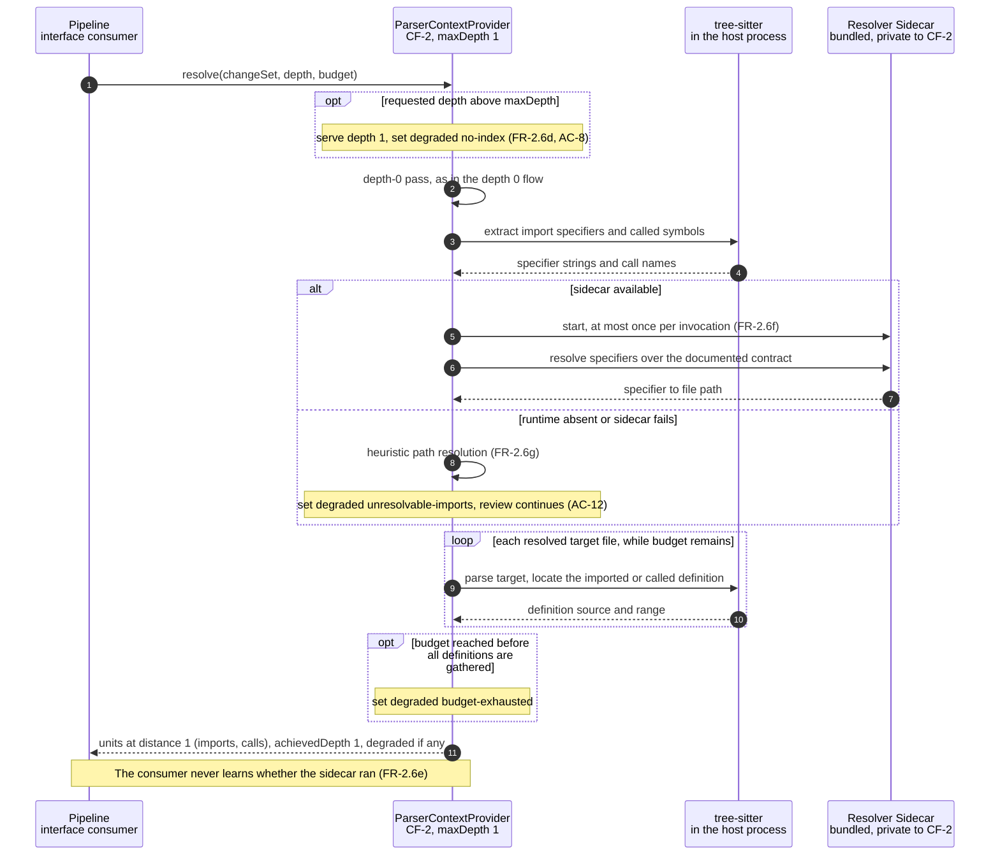

</details>

> [!WARNING]
> `degraded` holds a single value, but one depth-1 run can trigger all three conditions: depth 2 requested, sidecar missing, and budget reached. Whichever value is recorded, the other two are lost. SRS §5 freezes this interface, so this needs deciding before v1 ships (Q-3).

### 5.6 Check Execution Lifecycle

[View State Diagram](./assets/state_check_execution.md)

Each check ends in one of four recorded states, and a phase-level timeout can cut the phase short. `Passed` and `Failed` are both `run` in FR-4.5a's terms; the pass/fail outcome is recorded separately, under FR-4.5b. The capability AC-7 depends on is keeping `Skipped` and `Errored` apart from a clean pass.

<details>
<summary>State diagram: per-check states and the phase timeout</summary>

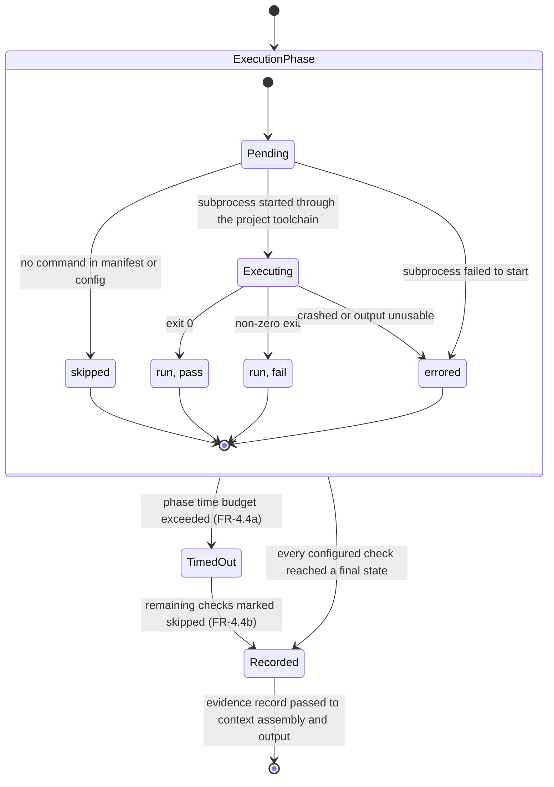

</details>

---

## 6. Resilience, Degradation, and Traceability Matrix

### 6.1 Fail Fast versus Degrade

[View Flowchart](./assets/flow_failure_modes.md)

v1 has two failure behaviours and no third. A missing prerequisite stops the run before any review exists, and the error names the cause. Anything that goes wrong after that point degrades: the review is still produced, and it states what was lost. FR-11.2 makes the second behaviour universal, and the SRS singles it out as the requirement most likely to be quietly violated.[^fr112]

<details>
<summary>Flowchart: which failures stop the run and which degrade it</summary>

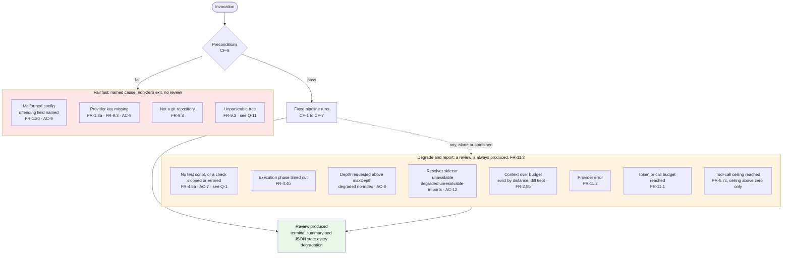

</details>

### 6.2 Traceability Matrix

[//]: # (Mapping source: SRS v1 Appendix B, reconciled with the Verifies column of SRS section 6. Where AC-6, AC-10 or AC-12 appear beyond Appendix B, the Verifies column is the source.)

| CF | Requirements | Degradation modes | How it surfaces | Acceptance criteria |
|:---:|:---|:---|:---|:---:|
| CF-1 | FR-10.3a–c | None once preconditions pass. Not being in a git repository stops the run | Resolved scope, in both outputs | AC-1 |
| CF-2 | FR-2.2, FR-2.3d, FR-2.4 *(S)*, FR-2.6a–g | Depth above the maximum; sidecar unavailable; retrieval budget reached | `achievedDepth` and `degraded` | AC-1, AC-6, AC-8, AC-10, AC-12 |
| CF-3 | FR-4.1, FR-4.2, FR-4.4a–b, FR-4.5a–c, FR-4.6, FR-4.7 | Check skipped or errored; phase timed out | Per-check run state; `timed-out` | AC-1, AC-2, AC-7 |
| CF-4 | FR-2.3c, FR-2.5, FR-2.5a–c | Context over budget: evict by descending distance, never the diff | **Not recorded in the output** (Q-7) | AC-1, AC-3 |
| CF-5 | FR-0.1–0.4, FR-5.2, FR-5.6, FR-5.6a, FR-5.6b *(S)* | Invalid `emit_finding` rejected at the boundary; structured-output fallback when the provider has no tool calling | Which path was used (FR-5.6b) | AC-3 |
| CF-6 | FR-5.1, FR-5.3, FR-5.7, FR-5.7a *(S)*, FR-5.7b, FR-5.7c–d *(S)*, FR-5.8 | Provider error; ceiling reached | Completion status; tool calls made | AC-2, AC-10, AC-11 |
| CF-7 | FR-8.1b, FR-8.2a–c, FR-8.4 *(S)*, FR-10.4a–b, FR-10.4c *(S)* | None of its own; it renders every other degradation | Verdict and exit status | AC-1, AC-3 |
| CF-8 | FR-6.1, FR-6.2a, FR-6.2b, FR-6.2d, FR-6.2e *(S)*, FR-6.3a | None; measurement pins its settings instead | Catch rate, with the pinned settings | AC-4, AC-5, AC-6, AC-11 |
| CF-9 | FR-1.2a–d, FR-1.3a, FR-3.5, FR-9.1, FR-9.3 | An absent file or field takes documented defaults, which is not a degradation. A malformed config or a missing key stops the run | An error naming the cause | AC-1, AC-9 |
| XC | FR-10.1, FR-10.2, FR-9.2a, FR-11.1, FR-11.2, FR-11.3 *(S)*, FR-7.2 | Token or call budget reached; every failure mode still produces a review | A budget-stop notice and each degradation, in both outputs | AC-1, AC-7, AC-10, AC-12 |

*(S)* marks a Should requirement. All others are Must.

### 6.3 Verification Gaps

These Must requirements are mapped to an acceptance criterion in SRS Appendix B, but the criterion as written would pass whether or not the requirement holds.

| Requirement | Level | Mapped to | Why the mapping is weak | A check that would close it |
|:---|:---:|:---:|:---|:---|
| FR-10.3a | Must | AC-1 | One run exercises one scope | One run per scope, against a fixture whose staged, unstaged and branch diffs differ |
| FR-4.4a–b | Must | AC-1, AC-2, AC-7 | Nothing forces a timeout | A fixture test that sleeps past the budget; assert `timed-out` and a completed review |
| FR-2.5a–c | Must | AC-1, AC-3 | Nothing forces the budget | An oversized-context fixture; assert the diff is intact and the farthest units go first |
| FR-11.1 | Must | AC-7 | AC-7 covers unrunnable tests, not a budget stop | A tiny token budget; assert a clean stop that says so |
| FR-11.2, provider error | Must | AC-7, AC-12 | Neither injects a provider failure | An unreachable provider endpoint; assert a review with the degradation recorded |
| FR-3.5 | Must | AC-1 | Exclusion is invisible when nothing excluded changed | Change a file under a default-excluded path; assert it is not reviewed |
| FR-1.2b–c | Must | AC-9 | AC-9 covers only the malformed case | Run with no config file, then with a partial one; assert the documented defaults |
| FR-1.3a | Must | AC-9 | AC-9 covers only a missing key | Put a key only in a committed repository file; assert it is treated as missing |

---

## 7. Analyst Findings and Open Questions

These were found by walking each entity, state and flow above against the requirement text. None changes v1's scope. Each is a place where two requirements pull against each other, or where a requirement names a field or behaviour without defining it.

> [!IMPORTANT]
> Q-2, Q-3 and Q-9 touch interfaces that SRS §5 freezes or versions. They are cheapest to settle before the first schema version ships.

| ID | Finding | Where | Recommendation |
|:---:|:---|:---|:---|
| **Q-1** | **Missing test script: stop or degrade?** FR-9.3 lists it as a prerequisite that needs a "failure message". AC-7 and FR-11.2 require a review that says the tests could not run. | FR-9.3 · FR-11.2 · AC-7 | Degrade. State that the script is missing, record the check as skipped, and complete the review. Reserve stops for config, key and repository. |
| **Q-2** | **Completion status is incomplete.** FR-5.7c defines "finished" and "ceiling reached". A budget stop (FR-11.1) and a provider error (FR-11.2) need terminal states of their own, and FR-8.2c records a status it never enumerates. | FR-5.7c · FR-8.2c · FR-11.1 · FR-11.2 | Enumerate it in the schema: finished, ceiling-reached, budget-exhausted, provider-error. |
| **Q-3** | **`degraded` holds one value.** A single run can trigger `no-index` and `unresolvable-imports` together, and only one survives. | SRS §4.2.2 · FR-2.6d · AC-8 · AC-12 | Make it a list, or define a precedence, before the interface freezes. |
| **Q-4** | **Depth-0 units have no relation.** FR-2.6c requires `imports`, `calls`, `imported-by` or `called-by` on every unit, and none of them describes a hunk's own enclosing scope. | FR-2.6c · depth ladder | Add a value such as `enclosing`, or define depth-0 expansion as part of the diff section. Either way, state whether FR-2.5b's "never truncate the diff" covers it. |
| **Q-5** | **AC-2 has no structured hook.** A finding carries no reference to the evidence it cites (FR-5.2), so "cites a real test result" can only be judged by reading prose. That is inspection, which SRS §6 rules out. | FR-5.2 · AC-2 · FR-7.3, deferred | Add an optional evidence reference, such as the check's name, to `Finding`, or state how AC-2 is judged. |
| **Q-6** | **The check in flight at timeout has no state.** FR-4.4b skips the remaining checks, but none of run, skipped or errored describes the check that was killed. | FR-4.4b · FR-4.5a | Record it as errored with the reason `timed-out`, or add a `terminated` state. |
| **Q-7** | **Eviction is invisible.** FR-11.2 requires "context over budget" to be reported, but no FR-8.2c field records what CF-4 evicted. `budget-exhausted` belongs to CF-2 retrieval, not to assembly. | FR-2.5b · FR-8.2c · FR-11.2 | Record the evicted units, or at least a count, in the run metadata. |
| **Q-8** | **AC-10 tests requirements that are not written.** Its CF-1 clause ("only CF-1 resolves a scope") and its CF-7 clause ("only CF-7 imports terminal rendering") match no requirement in its Verifies column. | AC-10 · FR-10.2 · FR-10.3c | Add the two boundary requirements, or trim AC-10 to what FR-10.2, FR-2.6e and FR-5.8 state. |
| **Q-9** | **Severity, category, verdict and exit status are undefined.** FR-8.1b needs counts by severity and an overall verdict, and FR-10.4c needs an exit status that reflects the outcome. None has a value set or a derivation rule, and FR-10.2 puts any verdict rule in the core rather than the CLI. | FR-5.2 · FR-8.1b · FR-10.4c · FR-10.2 | Define both value sets and the verdict function in the versioned schema (FR-8.4). |
| **Q-10** | **The default change scope is not chosen.** FR-10.3b requires a documented default. Neither the SRS nor [ADR-0006](../../adr/0006-local-cli-core-action-as-adapter.md) picks one, and ADR-0006 notes that the choice silently changes what gets reviewed. | FR-10.3b · ADR-0006 | Decide it and record the decision, in an ADR or an SRS amendment. |
| **Q-11** | **"Parseable tree" is undefined.** tree-sitter recovers from syntax errors, so it rarely fails outright. FR-9.3 treats an unparseable tree as a stop, while tolerating one (FR-10.7) is deferred. | FR-9.3 · FR-10.7 · FR-2.2 | Define the threshold, for example error nodes inside a changed hunk, and say whether crossing it stops or degrades. |

[^srs21]: SRS v1 §2.1, Product Perspective, and §2.3, Operating Environment.
[^fr57]: FR-5.7 sets the ceiling's default to zero, and FR-5.7b gates any increase on a recorded single-pass baseline. See [ADR-0001](../../adr/0001-fixed-pipeline-with-bounded-agency.md).
[^risks]: SRS v1 §2.5, and §9, risks R-1 and R-5.
[^fr26f]: FR-2.6e and FR-2.6f; [ADR-0007](../../adr/0007-python-harness-typescript-target.md).
[^fr112]: SRS v1 §4.10, the commentary on FR-11.2: "the single requirement most likely to be quietly violated under schedule pressure".
[^fr58]: FR-5.8 and [ADR-0007](../../adr/0007-python-harness-typescript-target.md): the agent framework is confined to CF-6.
```