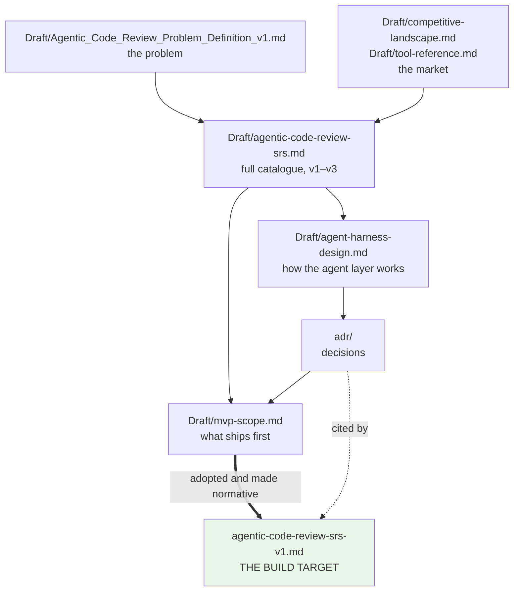

# Documentation

## Start here

| Document | What it is |
|---|---|
| **[`agentic-code-review-srs-v1.md`](./agentic-code-review-srs-v1.md)** | **The specification for the version being built.** Normative — if you are implementing or reviewing an implementation, this is the document. |
| [`adr/`](./adr/) | Architecture decision records. Why the system is shaped the way it is. Start with [ADR-0006](./adr/0006-local-cli-core-action-as-adapter.md), then the [index](./adr/README.md). |

## Background and working documents

Everything in [`Draft/`](./Draft/) is **non-normative**. It records analysis, rationale, and requirements for versions that do not exist yet. Where any of it conflicts with the baselined specification, the specification wins.

| Document | What it is |
|---|---|
| [`Draft/agentic-code-review-srs.md`](./Draft/agentic-code-review-srs.md) | The full requirement catalogue across v1–v3. The identifier registry the ADRs cite. |
| [`Draft/agentic-code-review-srs-ar.md`](./Draft/agentic-code-review-srs-ar.md) | Arabic translation of the catalogue. |
| [`Draft/mvp-scope.md`](./Draft/mvp-scope.md) | The analysis that selected v1's scope. Explains every inclusion and every cut. |
| [`Draft/agent-harness-design.md`](./Draft/agent-harness-design.md) | Plain-language guide to the agent harness — tools, memory, environments, model selection. |
| [`Draft/agentic-architecture-review.md`](./Draft/agentic-architecture-review.md) | Assessment of an external agentic-architecture review of [ADR-0001](./adr/0001-fixed-pipeline-with-bounded-agency.md): what to adopt, when, and what to reject. |
| [`Draft/agent-loop-v1-v2.md`](./Draft/agent-loop-v1-v2.md) | The review step visualised before and after the tool loop is enabled, with a worked trace of the same change reviewed both ways. |
| [`Draft/Agentic_Code_Review_Problem_Definition_v1.md`](./Draft/Agentic_Code_Review_Problem_Definition_v1.md) | Problem definition, personas, and the commit-first decision. |
| [`Draft/competitive-landscape.md`](./Draft/competitive-landscape.md) | Where this project sits against existing tools. |
| [`Draft/tool-reference.md`](./Draft/tool-reference.md) | Neutral descriptions of seven comparable tools. |
| [`Draft/feature-inventory.md`](./Draft/feature-inventory.md) | Feature tables with complexity estimates, planned and candidate. |
| [`Draft/chat_result_*.md`](./Draft/) | Research and analysis session records. |

## How the documents relate

## Conventions

- **Requirement identifiers are stable.** A requirement keeps its identifier across versions; a version tag says when it applies. Nothing is renumbered, so ADR cross-references stay valid.
- **Must / Should.** Must = required for the version to be complete. Should = included if time allows.
- **One normative source.** Exactly one document defines what to build at any time. Everything else explains or anticipates.
