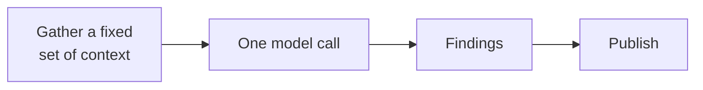
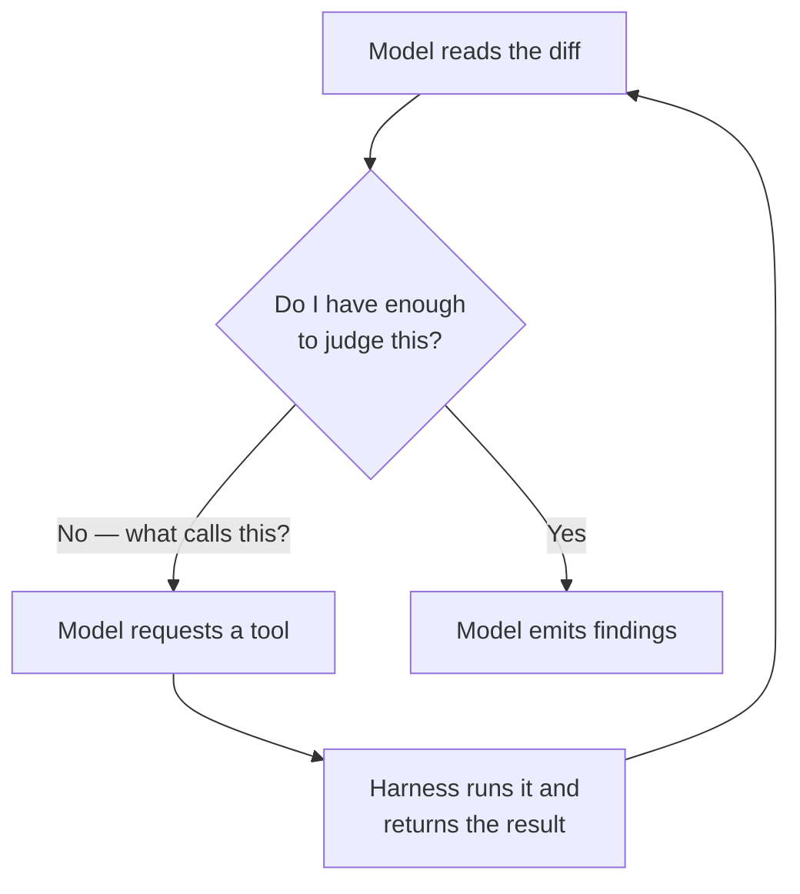
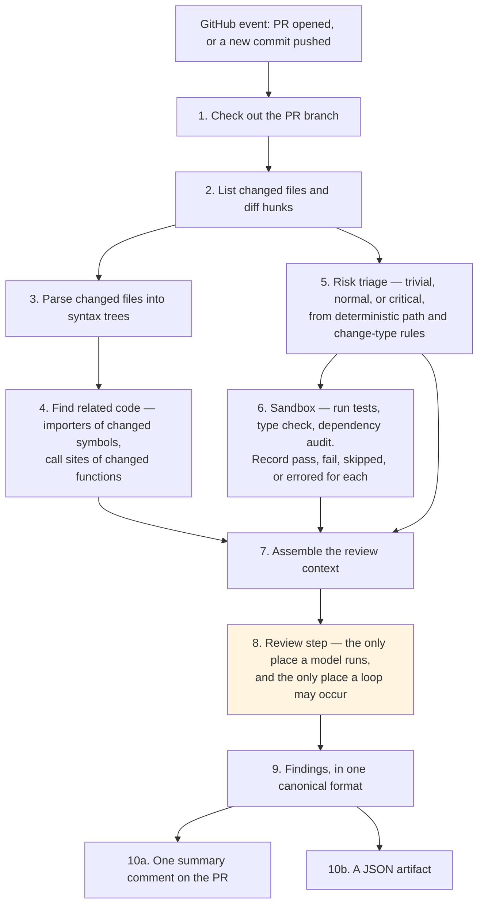
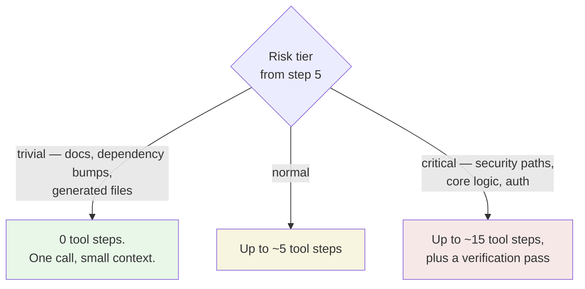

# ADR-0001 — Orchestration is a fixed pipeline; model agency is a bounded loop inside one step

| | |
|---|---|
| **Status** | Proposed |
| **Date** | 2026-09-08 |
| **Deciders** | Project maintainers |
| **Children** | [ADR-0002 — who initiates test execution](./0002-pipeline-initiates-test-execution.md) · [ADR-0003 — untrusted code isolation and fork triggers](./0003-untrusted-code-isolation-and-fork-triggers.md) |
| **Constrains** | [ADR-0004 — findings as tool calls](./0004-findings-emitted-as-tool-calls.md) |
| **Amended by** | [ADR-0006 — local CLI core, Action as adapter](./0006-local-cli-core-action-as-adapter.md) |

> **Amendment note.** [ADR-0006](./0006-local-cli-core-action-as-adapter.md) (Accepted) added a second delivery surface: a local command-line tool sharing this same core. **The structure below is unchanged** — the fixed pipeline and the tier-gated step ceiling hold on both surfaces. What differs is what the ceiling is tuned against: **money** on the Action, where tokens come from a fixed budget, and **wall-clock latency** on the CLI, where a developer waiting at a prompt gives up after roughly ten to thirty seconds. Both remain configuration values.

> **Superseded detail (2026-09-14) — the latency figure, and what the ceiling counts.** Two details in this record have since been corrected by [SRS v1.1](../agentic-code-review-srs-v1.md). **The decision is unaffected**; both corrections are about numbers and counting, not about who owns orchestration.
>
> **The "ten to thirty seconds" above is withdrawn.** It was an estimate nobody measured, and by the time four documents were citing it, it had begun sizing design decisions as though it were evidence. SRS §2.4 now states that latency is the binding constraint on this surface without attaching a figure, and carries the threshold as **TBD-2** — to be established by observing real users of the shipped MVP. *Latency being the CLI's binding budget is unchanged. Only the number is gone.*
>
> **The step ceiling counts every tool call, including `emit_finding`.** This record's "0 / ~5 / ~15 tool steps" table reads naturally as counting investigation steps. SRS v1.1 found that reading collided with [ADR-0004](./0004-findings-emitted-as-tool-calls.md) — if findings arrive only as tool calls and the ceiling is zero, no finding can ever be emitted. The ceiling now bounds **total** calls, and *whether the model may investigate at all* is a separate switch (FR-5.7a). The tier-gated shape this record chose survives intact; it is now expressed with two settings instead of one overloaded number.

---

## The question

Who decides what happens next during a review — **our code, or the model?**

This is the first decision because every other one depends on it. If our code drives, then our code also owns when tests run, what the model may see, and what it may do — which is what the two child records settle. If the model drives, all of those become the model's business and the security and cost properties change completely.

## Vocabulary

| Term | Meaning here |
|---|---|
| **Orchestration** | Deciding the order of operations: what happens first, what happens next, when to stop |
| **Pipeline** | A fixed sequence of steps written in ordinary code. Same order every time. |
| **Agent loop** | A model that repeatedly chooses a tool, reads the result, and chooses again, until it decides it is done |
| **Tool** | A function the model may *ask* us to run. It cannot run anything itself. |
| **Turn** | One request to the model and its reply. Each turn resends the whole conversation so far, so turn five costs more than turn one. |

---

## Context

### What the specification already assumes

The requirements describe a sequence, not a loop. Check out the branch and identify changed files and diff hunks (FR-2.1); build syntax trees for the changed files (FR-2.2); find the files that import each changed symbol and the call sites of each changed function (FR-2.3a, FR-2.3b); classify the pull request into a risk tier from file paths and change types (FR-3.1); run the test suite and the type check in the runner (FR-4.1, FR-4.2); produce findings (FR-5.2); post a summary comment and a JSON artifact (FR-8.1a, FR-8.2a).

Read literally, that is a pipeline with one AI step in the middle:

Nothing in the requirements says the model may ask for more information. But a reviewer that cannot ask "what calls this function?" when the answer matters is doing text pattern-matching, not review — and the project's stated purpose is reviews grounded in real context and execution rather than text-only inference (SRS objective 2).

### What full agency would cost

The alternative is to let the model pull what it needs:

This reviews better. It also has no natural stopping point, and each turn resends everything before it, so cost grows faster than the number of turns.

The measured comparison is in [`tool-reference.md`](../Draft/tool-reference.md#L86): Anthropic's managed multi-agent reviewer averages **$15–25 per review**, scaling with how many findings need verification. That is roughly our entire monthly budget spent on one pull request. Our budget objective is to operate on free tiers and a single low-cost provider, around $20 total (SRS objective 6).

So unbounded agency is not affordable, and zero agency is not the product.

### The dial nobody noticed

The requirements already contain the mechanism for resolving this. There is a requirement to classify every pull request into a risk tier — trivial, normal, or critical — using deterministic file-path and change-type rules (FR-3.1), and a second requirement to **route review depth by that tier**: fast-track trivial changes, review critical ones more deeply (FR-3.3).

"Review depth" was never defined. Defining it as *how many tool steps the model is allowed* turns the cost question into a configuration value.

---

## Options considered

### Option A — Pure pipeline, single model call

Gather a fixed context, call the model once, take what it returns.

| | |
|---|---|
| **For** | Cheapest possible. Fully predictable cost and runtime. Trivially testable — one input, one output. No tool-calling support required from the provider. |
| **Against** | The model cannot follow a thread. Any question the context-gathering step failed to anticipate goes unanswered, and the model either guesses or stays silent. Undermines the project's central claim of context-grounded review. |

### Option B — Fully model-driven agent

The model decides everything, including when to run tests and when to stop.

| | |
|---|---|
| **For** | Best review quality. Simplest conceptual story. Matches how the strongest commercial reviewers work. |
| **Against** | Unbounded cost on a fixed free-tier budget. Unbounded runtime against GitHub's runner limits. Non-reproducible — the same PR reviewed twice takes different paths, which weakens auditability. Requires a strong model at reliable tool calling; free-tier models are the weakest at exactly this. Hands orchestration of *executing untrusted code* to the model, which makes [ADR-0003](./0003-untrusted-code-isolation-and-fork-triggers.md) much harder. |

### Option C — Fixed pipeline, with a bounded loop inside the review step, sized by risk tier ✅

Our code owns the order of operations. Step 8 — and only step 8 — may run a tool loop, with a hard step ceiling set by the tier assigned in step 5.

| | |
|---|---|
| **For** | Cost has a computable worst case. The expensive path is spent only on the changes that warrant it. Trivial changes stay nearly free, which is what makes the free-tier budget arithmetic work. Everything outside step 8 stays deterministic and unit-testable. Degrades gracefully: if tool calling proves unreliable on the chosen provider, set every tier's ceiling to zero and Option A is still there. |
| **Against** | Two code paths to build and test — looping and non-looping. Step ceilings are a guess until measured. A capped loop can stop mid-thought, so the model must be told its remaining budget and instructed to emit what it has. |

---

## Decision

**Our code owns orchestration. The pipeline is fixed and identical on every run. The model's agency is confined to one step, bounded by a step ceiling that the risk tier determines.**

The pipeline:

The ceiling on step 8:

Those numbers are starting values to be tuned against real pull requests, and they belong in configuration, not in code.

### What the model may and may not do inside step 8

| Allowed | Not allowed |
|---|---|
| Read files and line ranges | Run tests or any other command — see [ADR-0002](./0002-pipeline-initiates-test-execution.md) |
| List the functions and classes in a file | Post comments, commit, or push |
| Look up where a symbol is defined | Reach the network |
| Find importers and call sites of a symbol | Read anything outside the checked-out repository |
| Search the repository by text | Change its own step ceiling |
| Query already-recorded check results | Decide when the review ends, beyond emitting findings |
| Emit a finding — see [ADR-0004](./0004-findings-emitted-as-tool-calls.md) | |

Every allowed action reads data we already hold. That is what makes the ceiling meaningful: each step costs tokens but no runner time, so the worst case is a number we can compute in advance.

---

## Consequences

### Good

- **The worst-case cost of a review is computable before we ship**: step ceiling × context size × per-token price, per tier.
- **Nine of the ten pipeline steps are ordinary deterministic code** — fast to test, and unaffected by whichever model we end up using.
- **The requirement to route review depth by risk tier (FR-3.3) gets a concrete meaning**, instead of remaining an unspecified intention.
- **Auditability survives.** The step sequence is fixed, so a trace of a review is comparable to a trace of any other review.
- **There is a fallback.** If the chosen free-tier model turns out to be unreliable at tool calling, setting all ceilings to zero degrades cleanly to Option A rather than failing.

### Bad

- **Two paths to maintain**, looping and single-shot, and the looping one needs its own tests with a mocked provider.
- **The ceilings are guesses** until we have measurements from real pull requests. Too low and critical reviews are shallow; too high and the budget disappears.
- **A truncated loop is a real failure mode.** The model must be told how many steps remain and instructed to emit what it has rather than stopping mid-investigation.
- **We inherit responsibility for context assembly.** Because the model cannot go looking for whatever it wants, the quality of step 7 caps the quality of the review.

### Neutral

- Requires a provider with reliable tool calling for anything above the trivial tier. That is also required by [ADR-0004](./0004-findings-emitted-as-tool-calls.md), so it is one dependency rather than two.
- The step ceiling, the token budget, and the tier thresholds all become user-facing configuration, which enlarges the configuration schema.

---

## How we would know this decision was violated

- A tool appears that performs an action rather than reading data.
- Any loop exists outside step 8.
- A review runs without a tier-derived ceiling in effect.
- The trace of a run cannot be replayed from the recorded tool calls.

---

## What the requirements would need to add

| Missing | Why it matters |
|---|---|
| The tool list and their argument schemas, as a versioned contract | Nothing in step 8 can be built without it |
| The step ceiling per risk tier | Determines the cost profile of the whole system |
| The instruction to the model on what to do when the ceiling is nearly reached | Otherwise a capped loop silently loses findings |
