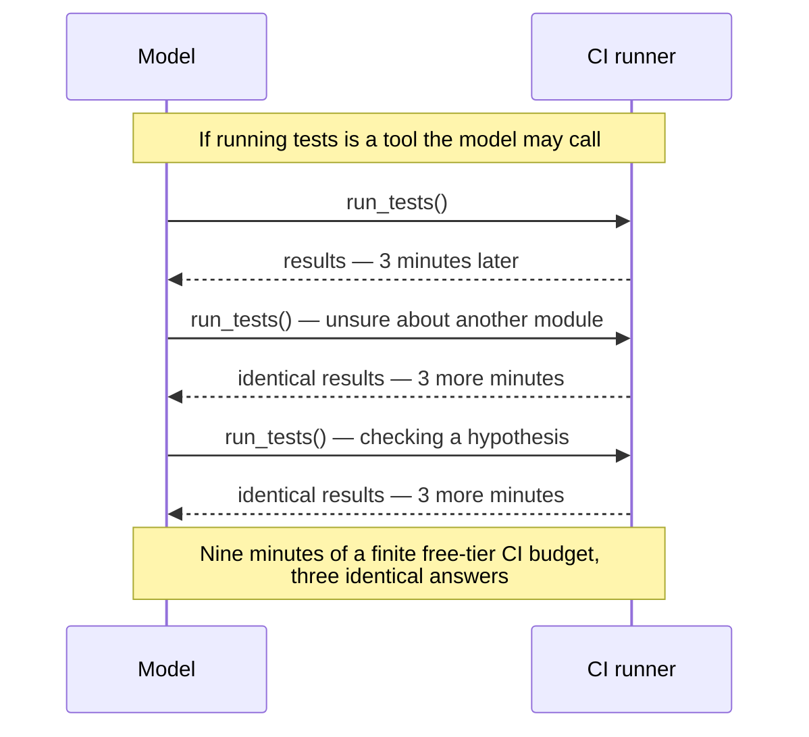
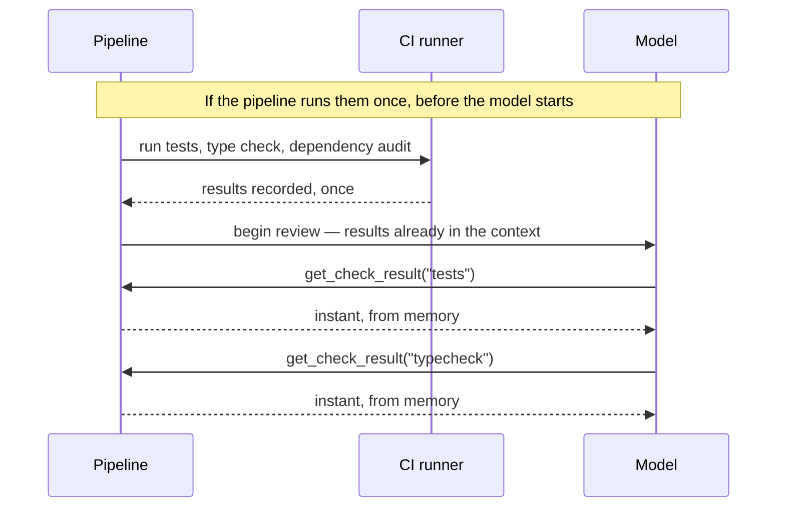
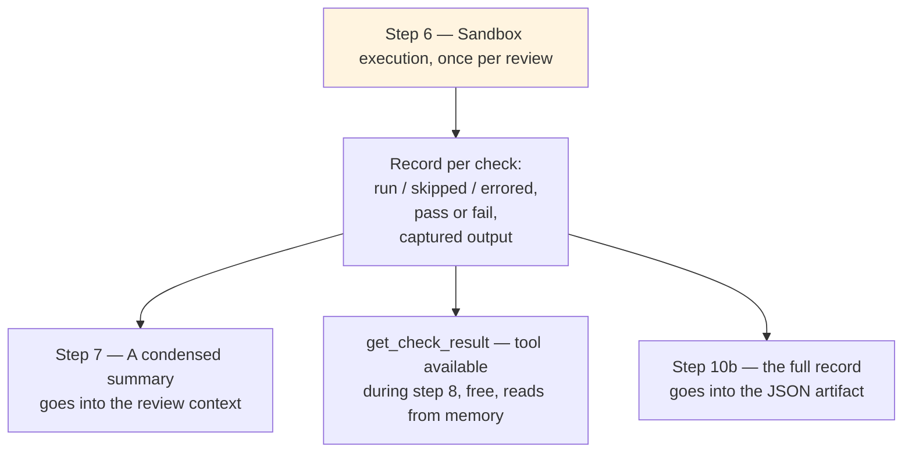
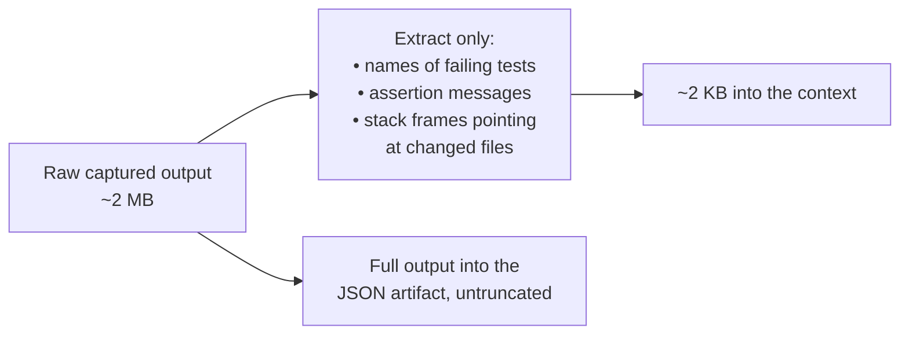

# ADR-0002 — The pipeline runs the tests once; the model queries the recorded results

| | |
|---|---|
| **Status** | Proposed |
| **Date** | 2026-09-08 |
| **Deciders** | Project maintainers |
| **Parent** | [ADR-0001 — fixed pipeline with bounded agency](./0001-fixed-pipeline-with-bounded-agency.md) |
| **Sibling** | [ADR-0003 — untrusted code isolation and fork triggers](./0003-untrusted-code-isolation-and-fork-triggers.md) |
| **Amended by** | [ADR-0006 — local CLI core, Action as adapter](./0006-local-cli-core-action-as-adapter.md) — **scoped to the Action surface** |

> **Amendment note.** [ADR-0006](./0006-local-cli-core-action-as-adapter.md) (Accepted) added a local command-line surface, and **the economics that produced this decision do not exist there.** The prohibition below is binding on the GitHub Action, where a test run costs minutes on a cold machine. On a developer's own machine, against installed dependencies and a test runner's changed-file filter, a targeted run costs seconds — so Option C at the end of this record, a narrow execution tool under a call quota, becomes affordable on the CLI. It stays deferred on the Action. This is the one earlier decision that genuinely inverts by surface, which is why it is worth reading both this record and the amendment before implementing either.

---

## The question

**Who decides when the test suite runs — our code, or the model?**

The parent record settled that our code owns the order of operations in general. This record settles the specific case that costs the most, because running a test suite is the single most expensive thing this system does.

---

## Context

### What executing means here

The requirements ask the system to run the project's test suite in the isolated runner and capture pass/fail results and output (FR-4.1), to run build and type checks such as the TypeScript compiler and capture the results (FR-4.2), and to run a dependency audit (FR-4.3). They also require a configurable time budget on the execution phase, with the run marked as timed out and the review still produced if it is exceeded (FR-4.4a, FR-4.4b).

This is what makes the project different from a text-only reviewer. It is also, in wall-clock terms, almost the entire runtime of a review. A model call takes seconds. Installing dependencies and running a test suite takes minutes.

### Why the question arises at all

If the model is allowed a tool loop, an obvious tool to offer is `run_tests()`. It looks symmetrical with `read_file()`. It is not, for two reasons.

**Test results do not change during a review.** The code under review is fixed for the duration of the run. Running the suite a second time produces the same answer as the first, at the same cost.

**The model cannot tell that it already knows.** Left with a `run_tests` tool and any uncertainty, a model will call it, read the result, reason for a while, become uncertain about a different file, and call it again.

Against the alternative:

### The constraint that decides it

GitHub's free tier gives public repositories generous but finite runner minutes, and every review competes with the repository's own continuous integration for them. Test execution is the only part of this system that consumes minutes rather than tokens. Leaving the number of executions to a model's judgement means the most expensive resource is the one thing we do not control.

---

## Options considered

### Option A — Expose `run_tests()` as a tool the model may call

| | |
|---|---|
| **For** | Conceptually uniform: everything is a tool. The model can decide a change is low-risk and skip the suite entirely, occasionally saving minutes. In principle allows hypothesis-testing — "does this break if I look at it this way". |
| **Against** | Repeated identical calls are the expected behaviour, not an edge case. Runtime becomes unpredictable, which collides with the requirement for a configurable time budget on the execution phase (FR-4.4a) — a budget is hard to enforce when the model decides how many executions happen. Also hands the *timing* of untrusted-code execution to the model, which conflicts with [ADR-0003](./0003-untrusted-code-isolation-and-fork-triggers.md), where that execution must happen in a separate environment established before any credential is present. |

### Option B — The pipeline runs everything once, up front; the model queries results ✅

| | |
|---|---|
| **For** | Exactly one execution per review — predictable minutes, predictable wall clock. The time budget requirement becomes enforceable, because our code owns the clock. Execution can happen in a separate, credential-free environment, which is what makes [ADR-0003](./0003-untrusted-code-isolation-and-fork-triggers.md) possible at all. Querying a recorded result is free, so the step ceiling from the parent record stays meaningful. |
| **Against** | We run the full suite even for a one-line documentation change, unless the tier rules skip it. The model cannot run an experiment to resolve a question — it has one snapshot of behaviour and must reason from it. |

### Option C — Pipeline runs once, plus a narrow, quota'd re-run tool

Option B, plus `run_single_test_file(path)` limited to two calls per review.

| | |
|---|---|
| **For** | Recovers some ability to investigate — "this test is the one that matters, run just it" — at a bounded cost. |
| **Against** | Cost predictability weakens: worst case becomes the suite plus two file runs. Adds a second execution environment lifecycle in the middle of the review. Not needed to satisfy any current requirement. |

---

## Decision

**The pipeline executes the test suite, the type check, and the dependency audit exactly once, at step 6, before any model call. Results are recorded. The model reads them through a free query tool and cannot trigger execution.**

This directly satisfies the requirements to record for each check whether it ran, was skipped, or errored, to record its result and output, and to make that record available both to the review step and to the structured output (FR-4.5a, FR-4.5b, FR-4.5c).

**Option C is deferred, not rejected.** If measurement shows the model repeatedly reasoning in circles about a specific failing test, a narrow re-run tool with a hard quota of two calls is the intended remedy. It should not be built speculatively.

### What goes into the context, and what does not

Recording the output is not the same as showing it to the model. A failing test run can emit megabytes — every passing test name, full stack traces, framework banners. That would consume the entire context window and teach the model nothing.

The full text still reaches the artifact, so nothing is lost for a human or a downstream tool.

---

## Consequences

### Good

- **One execution per review.** Runner minutes become a fixed cost we can state in the documentation.
- **The execution time budget requirement (FR-4.4a) becomes enforceable**, because our code holds the clock and decides when to stop.
- **Execution can be isolated.** Because it happens at a known point, before the model and its credentials are involved, it can run in a separate environment — the mechanism [ADR-0003](./0003-untrusted-code-isolation-and-fork-triggers.md) depends on.
- **The step ceiling from the parent record keeps its meaning**, since every tool the model can reach is free.

### Bad

- **We pay for a full test run on changes that did not need one.** Mitigation: let the trivial tier skip execution entirely, and record it as skipped so the output distinguishes "found nothing" from "did not look."
- **The model cannot investigate by experiment.** It sees one snapshot of behaviour. This is a genuine loss of review power, accepted deliberately in exchange for cost control.
- **Flaky tests get one sample.** A test that fails intermittently produces a finding based on a single run. The captured record should note that a single execution occurred, so the summary can hedge rather than assert.

### Neutral

- Requires deciding, per tier, which checks run at all — a new configuration surface.
- Parsing test output into a structured record is more work than it looks: package-manager detection, monorepo layouts, and different reporter formats across Jest, Vitest, and Mocha.

---

## How we would know this decision was violated

- A tool exists that starts a process, rather than reading recorded data.
- Wall-clock time for a review varies with model behaviour rather than with repository size.
- The execution record contains more than one entry per check for a single run.
