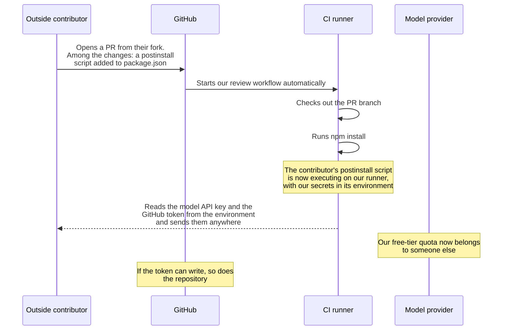
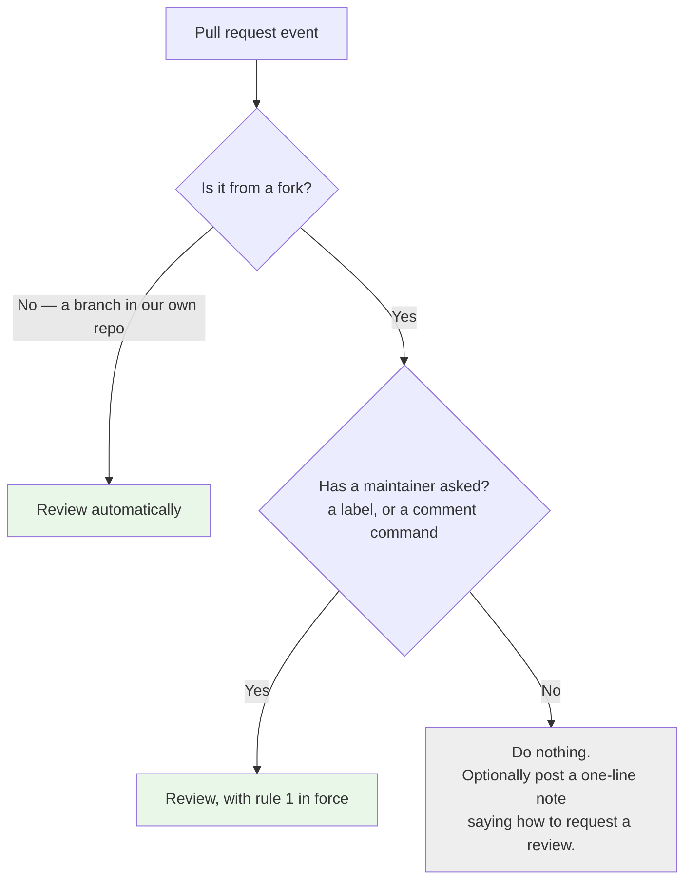

# ADR-0003 — Untrusted PR code never shares an environment with credentials, and fork PRs are reviewed only on request

| | |
|---|---|
| **Status** | Proposed |
| **Date** | 2026-09-08 |
| **Deciders** | Project maintainers |
| **Parent** | [ADR-0001 — fixed pipeline with bounded agency](./0001-fixed-pipeline-with-bounded-agency.md) |
| **Sibling** | [ADR-0002 — the pipeline initiates test execution](./0002-pipeline-initiates-test-execution.md) |
| **Constrains** | [ADR-0005 — cross-run memory ledger](./0005-cross-run-memory-as-hidden-comment-ledger.md) |
| **Amended by** | [ADR-0006 — local CLI core, Action as adapter](./0006-local-cli-core-action-as-adapter.md) — **scoped to the Action surface** |

> **Scope note (2026-09-08).** GitHub integration is now deferred to **v3** ([SRS §2.3.3](../Draft/agentic-code-review-srs.md)). This record therefore has **no effect in v1 or v2** — it becomes binding when the Action ships. It is not withdrawn: the exposure it describes is real and arrives with the Action, and the ordering problem it names (the trigger being a Must while the safeguard was deferred) is precisely what deferring the whole surface resolves.

> **Amendment note.** [ADR-0006](./0006-local-cli-core-action-as-adapter.md) (Accepted) added a local command-line surface. **Everything in this record applies to the GitHub Action and to nothing else.** On a developer's own machine there is no trust boundary to defend: the code is theirs, it is already on their disk, and running their own test suite is what they were going to do anyway. No fork exists, no credential is exposed to a stranger, and no two-job split is needed. The record remains fully binding wherever the Action runs — and confining it to one adapter is part of why that split is worth having.

---

## The question

Our system downloads code written by a stranger and runs it. **What is that code allowed to see while it runs, and should we do it automatically at all?**

Two decisions, recorded together because they defend the same thing from two directions: one removes what an attacker could steal, the other removes the automatic opportunity to try.

---

## Vocabulary

| Term | Meaning here |
|---|---|
| **Fork** | A personal copy of a repository. Contributors without write access cannot push branches to the original, so they commit to their fork and open a pull request from it. This is how nearly all open-source contribution works. |
| **PR-authored code** | **The code written by whoever opened the pull request.** Not our code, not the repository owner's code — a stranger's code, which our workflow downloads and executes. It includes test files, source files, and `package.json`. |
| **`postinstall`** | A command declared in `package.json` that a package manager runs automatically after installing dependencies. `package.json` is a file the pull request author can edit. |
| **Secret** | A credential stored in the repository settings and injected into a workflow as an environment variable — our model provider API key, and the GitHub token. |
| **`GITHUB_TOKEN`** | A credential GitHub injects into every workflow run. Depending on the trigger, it may be able to write to the repository — including posting comments. |

---

## Context

### What we are actually doing

The requirements ask us to check out the pull request branch (FR-2.1) and run the project's test suite and type check in the runner, capturing the results (FR-4.1, FR-4.2). To run a test suite you must first install dependencies. Installing dependencies executes whatever `postinstall` scripts the project declares. On a pull request, the project's `package.json` is part of the change under review.

So the system, by design, **executes attacker-controllable code on a machine that holds our credentials.**

### Why this is live right now

The requirements say the system runs on pull request `opened` and `synchronize` events (FR-1.1) — that is, automatically, on every pull request and every new commit. It is a **Must** for version 1. The requirements also target public repositories, with an explicit goal of running against a public repo using only free tiers (FR-9.2). Public repository means fork pull requests from people we have never met.

Meanwhile the security model for untrusted pull request code is deferred to the non-functional requirements pass (SRS §5). **The exposure is scheduled for version 1 and the safeguard is scheduled for later.** That ordering is the reason this record exists.

### The attack

No exotic technique is involved. The script runs because package managers are designed to run it.

### Why the naive fix does not work

GitHub already anticipates this. On the standard `pull_request` event, a workflow triggered by a fork gets a **read-only** token and, by default, **no access to repository secrets**. That is safe — and it makes our system impossible: no provider API key means no review, and no write token means no comment to post the review into.

The tempting workaround is the `pull_request_target` event, which does provide secrets and a write token. It runs in the context of the base repository and, by default, checks out *our* code rather than the contributor's. If you then explicitly check out the pull request's head — which we must, in order to review it — you have reassembled exactly the dangerous combination, with the safety property removed by hand. This is a well-documented footgun and the mechanism behind several real-world supply-chain incidents.

So the choice is not "secrets or no secrets". It is **where** the secrets are, relative to where the stranger's code runs.

---

## Options considered

### Option A — Keep the current specification: review every PR automatically, one environment

| | |
|---|---|
| **For** | Simplest. Best contributor experience: feedback arrives with no maintainer involvement. |
| **Against** | Either the review cannot run on forks at all (no secrets under `pull_request`), or it runs with secrets exposed to attacker-controlled code (`pull_request_target` plus a head checkout). Neither is acceptable, and the second is worse for being invisible. |

### Option B — Never review fork pull requests

| | |
|---|---|
| **For** | Eliminates the risk completely. Trivial to implement. |
| **Against** | Destroys the primary use case. On a public repository, fork pull requests *are* the contributions. A reviewer that only reviews maintainers' own branches has little value in open source. |

### Option C — Split the environment in two, and review forks only on explicit request ✅

Untrusted code runs in a job with no secrets. The model call and the comment posting happen in a separate job that has secrets but never executes contributor code. On top of that, fork pull requests are reviewed only when a maintainer asks.

| | |
|---|---|
| **For** | The environment split means a hostile pull request has nothing to steal, so the trigger policy is a second line of defence rather than the only one. The trigger policy additionally protects the *budget* — without it, anyone can drain a free-tier quota by opening pull requests. Matches established practice: Anthropic's reviewer runs on fork pull requests only on explicit request ([`tool-reference.md`](../Draft/tool-reference.md#L82)). |
| **Against** | Two workflow files instead of one, with an artifact handoff between them — more moving parts to document and to get right. Outside contributors wait for a maintainer before receiving feedback, which is a real loss in exactly the scenario the project exists to help. |

### Option D — Split the environment, but keep automatic review of forks

| | |
|---|---|
| **For** | Preserves the automatic contributor experience while removing the credential exposure. |
| **Against** | Leaves the quota-drain problem: every fork pull request spends model tokens and runner minutes, and opening pull requests is free for anyone. On a fixed budget that is a denial-of-wallet problem, not a theoretical one. Reasonable to adopt later, once spend caps exist. |

---

## Decision

**Two rules, adopted together.**

### Rule 1 — Untrusted code and credentials never share an environment

```mermaid
flowchart LR
    subgraph U["Job 1 — untrusted"]
        direction TB
        U1["Check out the PR branch"]
        U2["Install dependencies —<br/>runs the author's scripts"]
        U3["Run tests, type check, audit"]
        U4["❌ No secrets<br/>❌ No write token<br/>⏱️ Hard timeout"]
        U5["Writes: a results file"]
    end
    subgraph T["Job 2 — trusted"]
        direction TB
        T1["Reads the results file<br/>as untrusted data"]
        T2["Parses syntax trees, assembles context"]
        T3["Calls the model"]
        T4["Posts the comment,<br/>uploads the JSON artifact"]
        T5["🔑 Model API key<br/>🔑 Write token<br/>🚫 Never runs PR code"]
    end
    U -- "results file only" --> T

    style U fill:#fff0f0
    style T fill:#f0f7f0
```

Job 1 runs on the standard `pull_request` event with no secrets, and uploads its results as a build artifact. Job 2 is triggered by job 1's completion, holds the credentials, downloads that artifact, and never checks out the contributor's branch as executable code.

Everything crossing the boundary is **data, not instructions**. Captured test output is text a stranger controls, and it ends up inside a model prompt — so it is truncated, escaped, and clearly delimited as untrusted content before it goes anywhere near the model.

This rule holds regardless of the trigger policy. It is the one that must not be traded away.

### Rule 2 — Fork pull requests are reviewed only on explicit request

This extends rather than contradicts the existing trigger requirement (FR-1.1), and it pairs naturally with the existing requirement for a way to skip the review via a label or configuration flag (FR-1.4) — the same mechanism, inverted for untrusted sources.

---

## Consequences

### Good

- **A hostile pull request has nothing to steal.** The worst outcome becomes wasted runner minutes.
- **The budget is protected from strangers.** Nobody can spend our model quota by opening pull requests.
- **It closes the ordering problem in the specification**, where automatic execution of untrusted code is a version 1 Must and the security model is deferred.
- **The split has a second benefit**: because job 1 holds no credentials, its network access can be restricted to the package registry without breaking the model call, which lives in job 2.

### Bad

- **Outside contributors get slower feedback**, which is the exact audience the project most wants to help. Mitigation: post a short automatic note on fork pull requests explaining how to request a review, so the delay is legible rather than a silence.
- **Two workflow files and an artifact handoff.** More to document, and the example workflow required by the shipped-documentation requirement (FR-9.1) becomes noticeably more complex.
- **Maintainers must act.** A repository that never labels anything gets no reviews on contributions, and will conclude the tool is broken.

### Neutral

- Everything crossing between jobs must be treated as untrusted input — schema-validated, size-capped, and never interpolated into a prompt without delimiting.
- Interacts with [ADR-0005](./0005-cross-run-memory-as-hidden-comment-ledger.md): the memory ledger lives inside a posted comment, so it exists only where job 2 runs. On a fork pull request that no maintainer has requested, there is no comment and therefore no memory — which is correct, because there is also no review.

---

## How we would know this decision was violated

- Any job that checks out the pull request head also declares a secret.
- `pull_request_target` appears alongside a checkout of the contributor's branch.
- Captured test output is interpolated into a model prompt without truncation or delimiting.
- A fork pull request receives a full review with no maintainer action.

---

## What the requirements would need to add

| Missing | Why it matters |
|---|---|
| A statement that credentials and untrusted execution are separated | Currently deferred to the non-functional pass while the risky trigger is a version 1 Must |
| The fork trigger policy, as an extension of the trigger requirement (FR-1.1) | Otherwise the default behaviour is the unsafe one |
| A rule that captured execution output is untrusted data | It is stranger-controlled text that ends up inside a model prompt |
