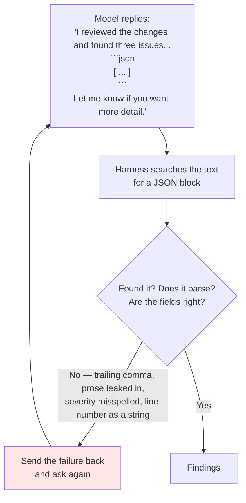
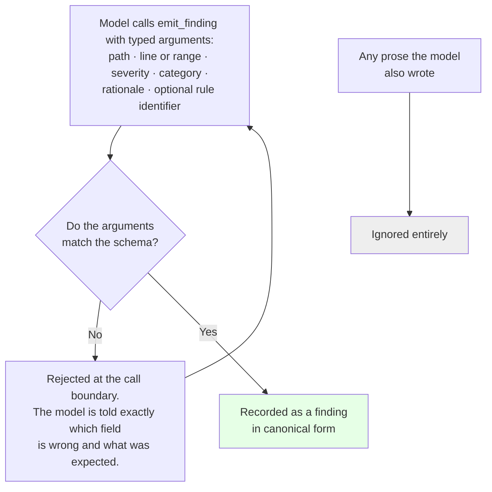
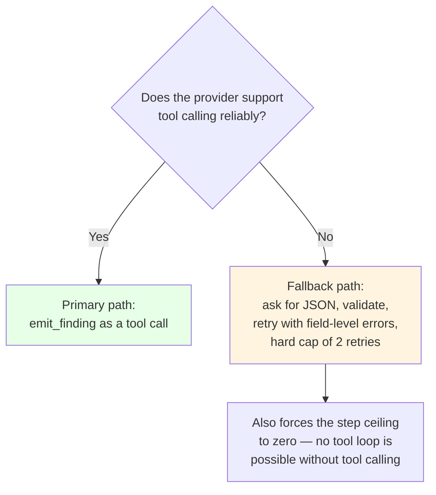

# ADR-0004 — Findings are emitted as tool calls validated against a schema, not parsed out of prose

| | |
|---|---|
| **Status** | Proposed |
| **Date** | 2026-09-08 |
| **Deciders** | Project maintainers |
| **Constrained by** | [ADR-0001 — fixed pipeline with bounded agency](./0001-fixed-pipeline-with-bounded-agency.md) |
| **Unchanged by** | [ADR-0006 — local CLI core, Action as adapter](./0006-local-cli-core-action-as-adapter.md) |

> **Amendment note.** [ADR-0006](./0006-local-cli-core-action-as-adapter.md) (Accepted) added a local command-line surface. This record is **unchanged, and reinforced by it**: with two renderers — a terminal and a pull-request comment — consuming the same findings, a single typed representation matters more, not less. A finding must mean the same thing on both surfaces, and that property only holds if there is exactly one door through which findings enter the system.

---

## The question

The model produces text. We need structured records. **Where does the conversion happen, and what happens when it goes wrong?**

---

## Vocabulary

| Term | Meaning here |
|---|---|
| **Schema** | A written-down description of the exact shape data must take: which fields exist, their types, and which values are allowed |
| **Tool call** | Instead of writing an answer as prose, the model emits a structured request to call a named function with named arguments. The provider returns it as data, not as text. |
| **Constrained decoding** | A provider feature that restricts generation so the output *cannot* violate a schema — malformed output becomes impossible rather than unlikely |
| **Finding** | One review comment: file path, line or range, severity, category, explanation, and optionally the identifier of the project rule that triggered it |

---

## Context

### What the requirements demand

Three requirements make this decision load-bearing rather than a style preference:

- There must be a single provider-independent internal structure for all findings, defined once (FR-0.1).
- **All model output must be converted into that structure before anything downstream uses it; no component may consume a raw provider response** (FR-0.2).
- The review step's output must conform to that structure, and the summary comment and JSON artifact must be *derived from it* rather than produced independently by the model (FR-5.6).

Together these say: there is exactly one door through which model output enters the system, and everything past that door is typed. This record is about how to build that door.

### The obvious approach, and why it hurts

The default instinct is to ask the model for JSON inside its reply and pull it out afterwards.

Every failure costs a **complete additional model call**, because the whole conversation is resent. On the free-tier provider this project targets — the budget objective is to work within free tiers and roughly a $20 ceiling (SRS objective 6) — those retries consume the budget that was supposed to pay for reviewing the code.

There is a subtler failure too. When a model writes prose *and* JSON, the two can disagree. It mentions a fourth issue in the narrative that never made it into the array. Whoever reads the raw response sees four; the system records three. That is precisely the situation the requirement forbidding consumption of raw provider responses (FR-0.2) exists to prevent.

---

## Options considered

### Option A — Ask for JSON in the reply and parse it out

| | |
|---|---|
| **For** | Works with any provider, including ones with no tool-calling support. Nothing to configure. Easy to inspect while developing. |
| **Against** | Failures cost a full extra call each. Retry loops need their own cap or they eat the budget. Prose and structure can disagree. The prompt has to spend tokens explaining the format, on every single call. |

### Option B — Constrained decoding over the whole response

Ask the provider to force the entire reply to match a JSON schema.

| | |
|---|---|
| **For** | Malformed output becomes impossible. No retries. No format instructions needed in the prompt. |
| **Against** | Not universally supported, and support varies by model even within one provider. Forces the *entire* response into a rigid shape, which sits badly with the tool loop from [ADR-0001](./0001-fixed-pipeline-with-bounded-agency.md), where the model must sometimes reason and request a file rather than answer. |

### Option C — Emitting a finding is itself a tool call ✅

`emit_finding` is offered alongside the reading tools. The model reports an issue by calling it with typed arguments.

| | |
|---|---|
| **For** | The tool's argument schema *is* the canonical finding structure — one definition, no second copy to drift. Validation happens at the moment of the call, and errors name the offending field. Many providers can constrain tool arguments during generation, so bad calls never occur. It composes naturally with the tool loop we already need: the model reads, reasons, reads again, and emits findings as it becomes confident. Findings arrive incrementally, so a loop that hits its step ceiling still yields everything emitted so far. |
| **Against** | Requires tool-calling support from the provider — a hard dependency, and the capability that varies most across free tiers. A model may write about an issue without calling the tool, and that observation is then lost. |

### Option D — Fine-tune or grammar-constrain a model ourselves

| | |
|---|---|
| **For** | Total control over output shape. |
| **Against** | Far outside the budget and the scope. The specification is explicit that version 1 uses a single free or low-cost provider behind a thin interface. |

---

## Decision

**Findings enter the system exclusively through an `emit_finding` tool call, validated against a schema at the call boundary. Prose the model writes is not mined for findings; it is discarded.**

The arguments are exactly the fields the requirements demand of every finding — file path, line or line range, severity, category, rationale, and optionally a reference to a suggested fix (FR-5.2) — plus the identifier of the matched project rule when the finding came from one, which satisfies the requirement that a finding generated from a pattern rule references that rule's identifier (FR-6.2a).

### Why "at the call boundary" matters

The check happens **where the model hands us the data**, not afterwards on a wall of text. Three things follow.

**One definition, not two.** The tool schema and the canonical finding structure are the same artifact. There is no separate parser to keep in sync, so the requirement for a documented, versioned schema with a schema-version field (FR-0.4) covers both at once.

**Corrections are precise and often free.** `severity must be one of: blocking, important, nit` is a better signal than *your JSON did not parse*, and where the provider constrains tool arguments during generation, the malformed call never happens at all.

**One path in.** If the model writes "the config handling also looks suspicious" without calling the tool, that is not a finding and never reaches the pull request. This makes the requirement that outputs are derived from the canonical structure (FR-5.6) structurally true rather than something to verify.

### The fallback, stated explicitly

The specification promises that a new provider can be integrated by mapping its output to the finding structure, with no downstream changes (FR-0.3). That promise covers output *shape*. It does not cover *capability*: a provider without tool calling needs a different code path.

The model interface must therefore abstract four capabilities, not one: chat completion, tool calling, structured output, and token counting. **Whether a candidate provider supports reliable tool calling is the first thing to test when evaluating one** — it decides both this record and the loop in [ADR-0001](./0001-fixed-pipeline-with-bounded-agency.md).

---

## Consequences

### Good

- **Malformed findings largely stop existing**, and where they do occur the correction is a single field rather than a whole response.
- **The canonical structure is defined exactly once**, as the tool schema.
- **Prose and structure cannot disagree**, because prose is not a source of findings.
- **Findings survive a truncated loop.** They accumulate as they are emitted, so a loop stopped at its step ceiling still returns everything the model had committed to.
- **Prompts get shorter**, because the format no longer has to be explained in words on every call.

### Bad

- **A hard dependency on provider tool-calling support** for the primary path, and it is the capability free tiers implement most inconsistently.
- **Observations the model does not commit to a tool call are lost.** If it hedges in prose instead of emitting, nothing is recorded. Mitigation: instruct it that only `emit_finding` counts, and count zero-finding reviews in the telemetry so silent failures are visible.
- **Two code paths** — primary and fallback — until we settle on a provider, and both need tests.

### Neutral

- Changing the finding structure means changing a tool schema, which is a provider-visible interface. The schema-version field required by (FR-0.4) becomes the mechanism for handling that.
- Deduplication depends on finding fields being stable and typed, which this makes easier — see [ADR-0005](./0005-cross-run-memory-as-hidden-comment-ledger.md).

---

## How we would know this decision was violated

- A regular expression or JSON-block search appears in the primary path.
- Any component reads a raw provider response instead of a typed finding.
- The finding structure is declared in more than one place.
- A finding reaches the pull request that did not arrive through `emit_finding`.
