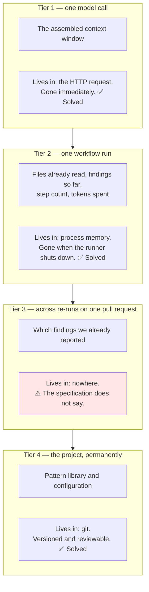
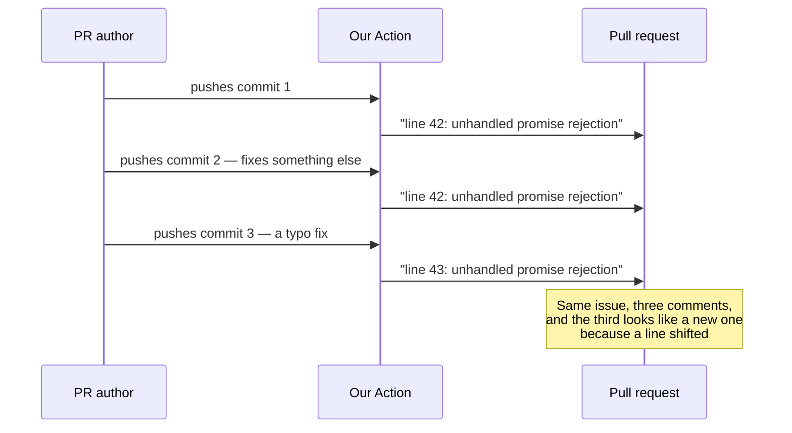
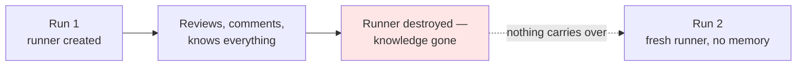
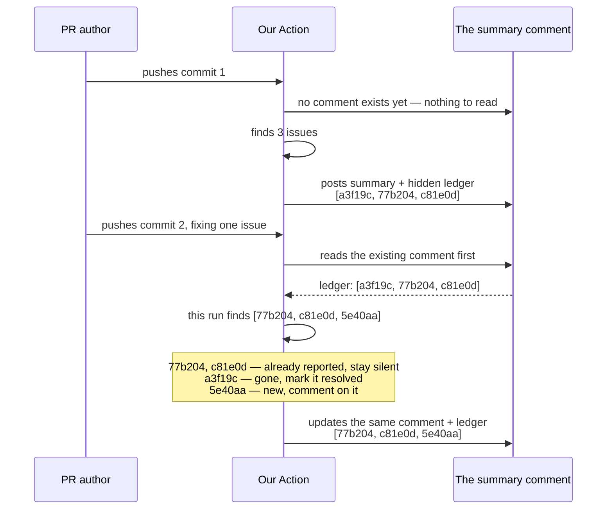
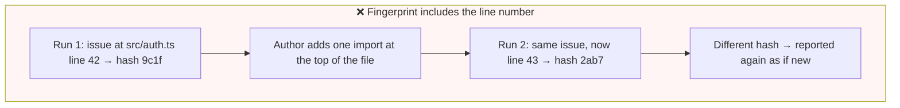
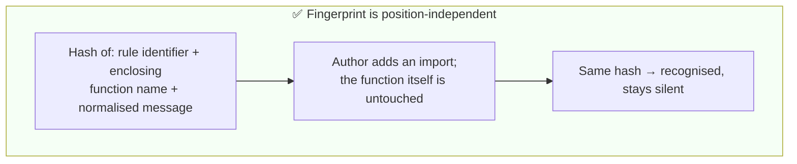

# ADR-0005 — Memory that must survive between runs lives in a hidden ledger inside the summary comment

| | |
|---|---|
| **Status** | Proposed |
| **Date** | 2026-09-08 |
| **Deciders** | Project maintainers |
| **Constrained by** | [ADR-0003 — untrusted code isolation and fork triggers](./0003-untrusted-code-isolation-and-fork-triggers.md) |
| **Depends on** | [ADR-0004 — findings as tool calls](./0004-findings-emitted-as-tool-calls.md) |
| **Amended by** | [ADR-0006 — local CLI core, Action as adapter](./0006-local-cli-core-action-as-adapter.md) — **scoped to the Action surface** |

> **Scope note (2026-09-08).** GitHub integration is now deferred to **v3** ([SRS §2.3.3](../Draft/agentic-code-review-srs.md)), so this record has **no effect in v1 or v2**. The fingerprint design in §"The part that decides whether this works at all" is the part worth reading early: v1 stores state in a local file (FR-10.5), but if its fingerprints are built on line numbers, the v3 ledger inherits a broken foundation.

> **Amendment note.** [ADR-0006](./0006-local-cli-core-action-as-adapter.md) (Accepted) added a local command-line surface, where **the problem this record solves largely does not arise.** A developer's machine has a filesystem, so state is an ordinary gitignored file rather than a hidden comment. The fingerprint design below is shared by both surfaces; only the storage location differs. The *motivation* also weakens locally: pull-request comments accumulate permanently and visibly, whereas terminal output is replaced on every run, and a developer re-running after a fix wants the current full state rather than a delta of what is new.

---

## The question

A GitHub Action runs on a machine that is destroyed when the workflow ends. Yet we are required not to repeat ourselves across runs. **Where does that memory live, without standing up any infrastructure?**

---

## Vocabulary

| Term | Meaning here |
|---|---|
| **Stateless** | Nothing survives the run. The runner is a fresh virtual machine, wiped afterwards. |
| **Fingerprint** | A short hash that identifies a finding, so the same issue can be recognised on a later run |
| **Ledger** | The stored list of fingerprints we have already reported on this pull request |
| **HTML comment** | Text between `<!--` and `-->`. Markdown renders it as nothing at all — it is present in the source, invisible in the page. |

---

## Context

### The four tiers of memory, and which one is missing



Three of the four have obvious homes. Tier 3 does not.

### Why tier 3 is required, not optional

Two requirements collide. The system runs on pull request `opened` **and** `synchronize` — meaning every new commit re-triggers it (FR-1.1). And the review step must avoid duplicate or near-duplicate comments on unchanged findings across re-runs (FR-5.5).

With no memory between runs, the second requirement is unimplementable. A pull request with ten commits gets the same comment ten times.



This is not a cosmetic problem. Noise is identified in [`competitive-landscape.md`](../Draft/competitive-landscape.md#L77) as what kills adoption of tools in this category — an automated reviewer that repeats itself gets muted, and a muted reviewer has no value.

### Where the agent itself runs

Before asking where memory goes, it is worth stating where the agent goes — because the answer is not "nowhere", and an earlier draft of this record leaned on a phrase, "zero infrastructure", that is not literally true.

| Piece | Runs on | Owned by | Lifetime | Paid for by |
|---|---|---|---|---|
| The harness and the review agent | A GitHub-hosted runner, inside the adopter's repository | GitHub | One run, then destroyed | The adopter's Actions minutes — free for public repositories |
| Test and type-check execution | A second runner job holding no credentials, per [ADR-0003](./0003-untrusted-code-isolation-and-fork-triggers.md) | GitHub | One run, then destroyed | Same |
| The model | The provider's servers | The provider | One request | The adopter's API key, on a free tier |
| Tier-4 memory — pattern library and configuration | Git | The adopter | Forever | Free |
| **Tier-3 memory** | **This record decides** | | | |

So the system already depends on infrastructure: a virtual machine and a third-party inference API. What distinguishes that from adding a database is not the absence of hardware but two narrower properties:

- **Nothing runs between reviews.** The runner is requested, used, and destroyed. When no pull request is open, nothing idles, waits, or needs monitoring.
- **Nothing is ours to operate.** GitHub runs the runner; the provider runs the model. Neither is a service this project patches, backs up, pays for, or stores anyone's data in.

And note the irony, because it is the whole reason this record exists: **the agent's compute is ephemeral, and that ephemerality is exactly what makes tier 3 a problem.** The machine that knows what we already reported is deleted moments after reporting it.



### The constraint that rules out most answers

The product is deliberately **not** a hosted service. The specification places it below the complexity of a hosted GitHub App with webhooks, a backend, and a database, and states that the system holds no persistent server-side state — review history lives in pull request comments and per-run artifacts (SRS §2.2).

Stated precisely, the requirement is: **durable per-pull-request memory that needs nothing running between reviews and makes this project a custodian of nobody's data.**

---

## Options considered

### Option A — No memory; accept the repetition

| | |
|---|---|
| **For** | Nothing to build. |
| **Against** | Leaves a Should-level requirement unimplemented and ships the failure mode most likely to make people turn the tool off. |

### Option B — GitHub Actions cache

The cache action stores files between runs under a key we choose.

| | |
|---|---|
| **For** | Built in. No extra service. Straightforward API. |
| **Against** | **Evictable** — entries are removed under a repository-wide size limit and after a week of disuse, so memory silently disappears. Cache scoping across branches and forks is subtle and easy to get wrong. Invisible to humans, so when deduplication misbehaves there is nothing to inspect. |

### Option C — Actions artifacts

Upload the ledger as a build artifact and download it on the next run.

| | |
|---|---|
| **For** | Built in. Durable for the retention period. Already used for the JSON output required by (FR-8.2a). |
| **Against** | Reading a *previous* run's artifact means querying the API to locate the right run for this pull request and downloading it — awkward, and slow. Artifacts expire on a retention policy. Invisible to humans. |

### Option D — Commit a state file to the repository

| | |
|---|---|
| **For** | Perfectly durable and fully visible. |
| **Against** | Writing to the repository directly contradicts the requirement that suggestions are advisory and the system never commits or pushes in version 1 (FR-7.2). It would also pollute every pull request diff with churn from the reviewer. Rejected outright. |

### Option E — An external database or hosted service

| | |
|---|---|
| **For** | The general answer, and it would support cross-pull-request learning later. |
| **Against** | The only option that must **exist while nothing is running** — it needs uptime, credentials, backups, and a bill, whether or not anyone opens a pull request. Either every adopter provisions their own, or we host a shared one and become the custodian of metadata about everybody's code, with the privacy and availability obligations that follow. Contradicts the positioning as a self-contained Action with no server-side state (SRS §2.2). |

### Option F — Re-read our own existing review comments and infer

Fetch the review comments we posted earlier and match them against this run's findings.

| | |
|---|---|
| **For** | Genuinely zero infrastructure. The data is already there. Nothing extra to write. |
| **Against** | Matching is **fuzzy** — recovering "which finding was this" from rendered prose is exactly the parsing problem [ADR-0004](./0004-findings-emitted-as-tool-calls.md) exists to avoid, one layer further out. GitHub marks comments on changed lines as outdated and may hide them, so the set we read back is not the set we wrote. Costs an API call per page of comments on every run. |

### Option G — A hidden ledger inside the summary comment ✅

Store the fingerprints as an HTML comment inside the single summary comment we already post.

| | |
|---|---|
| **For** | The storage already exists and is already being written, so it costs no extra call. Durable for the life of the pull request — comments are never evicted or expired. Precise, because we store structured data rather than re-reading prose. Inspectable: a maintainer debugging odd deduplication can read the comment source. |
| **Against** | Publicly readable, so nothing sensitive may go in it. Editable by anyone with write access, so it must be treated as untrusted input. Bounded by GitHub's comment size limit of roughly 65,000 characters, so the ledger needs a cap. Ties tier-3 memory to GitHub specifically. |

### Comparison

| | A: none | B: cache | C: artifacts | D: commit | E: database | F: re-read comments | **G: hidden ledger** |
|---|---|---|---|---|---|---|---|
| Survives runner destruction | — | Yes | Yes | Yes | Yes | Yes | **Yes** |
| Needs something running between reviews | No | No | No | No | **Yes** | No | **No** |
| Can vanish unexpectedly | — | **Evicted** | **Expires** | No | No | **Hidden when outdated** | **No** |
| Precise, not fuzzy | — | Yes | Yes | Yes | Yes | **No** | **Yes** |
| Human-inspectable | — | No | No | Yes | No | Yes | **Yes** |
| Violates a requirement | (FR-5.5) | No | No | **(FR-7.2)** | **§2.2** | No | **No** |

**Read the second row carefully, because it is weaker than it looks.** It eliminates exactly one option and then stops being useful: six of the seven need nothing running between reviews, since they all store state inside GitHub, on the adopter's own account, at no cost. "No infrastructure" is therefore *not* the reason to prefer the hidden ledger over the cache, artifacts, or re-reading comments — those tie on that dimension.

The rows that actually decide this are **durability** — the cache is evicted, artifacts expire, outdated comments get hidden, a comment body persists as long as the pull request — **precision**, and **inspectability**. The ledger wins on all three. It wins on nothing to do with hardware.

---

## Decision

**Tier-3 memory is stored as an HTML comment embedded in the summary comment we already post. Nothing else persists between runs.**

### Why this location and no other

We already post **exactly one summary comment per review run** (FR-8.1a), and we already intend to **update that same comment on re-runs rather than posting a new one** (FR-8.1c). The write is happening regardless. Attaching the ledger to it costs one hidden block and no additional API call.

The reason is durability, not the absence of hardware. A pull request comment is the longest-lived writable thing we can reach: it is not evicted under a size quota like the Actions cache, it does not expire on a retention policy like an artifact, and it is not hidden when the lines around it change like a review comment. It lasts precisely as long as the thing it describes.

### What it looks like

What a reader sees is just the summary. What the source contains:

```markdown
## Agentic Code Review — normal risk

✅ Tests passed · ✅ Type check passed · ⚠️ 2 audit advisories

**3 findings** — 1 blocking, 2 nits.

<!-- agentic-review-ledger
{"schema":1,"run":4,"reported":[
  {"fp":"a3f19c","rule":"no-unawaited-promise","sym":"loadUser"},
  {"fp":"77b204","rule":"missing-error-branch","sym":"parseConfig"},
  {"fp":"c81e0d","rule":"nit-naming","sym":"tmp2"}
]}
-->
```

Everything between `<!--` and `-->` renders as nothing. The next run fetches the comment through the API, reads its raw body, and recovers the list.

### How a re-run uses it



The author sees one comment that evolves, not a growing pile of repeats.

### The part that decides whether this works at all

A fingerprint identifies a finding across runs. **What we hash determines whether the whole scheme functions.**





| Include in the hash | Exclude from the hash |
|---|---|
| The pattern rule identifier that fired | Line and column numbers |
| The name of the enclosing function or class | Surrounding code snippets |
| The file path | The model's exact wording |
| A normalised form of the message | Timestamps and run numbers |

Line numbers move on nearly every push. Any fingerprint depending on them invalidates itself constantly, and deduplication stops working without producing an error.

This is where [ADR-0004](./0004-findings-emitted-as-tool-calls.md) pays off a second time: because findings arrive as typed tool arguments, the fields being hashed are already structured and stable. Fingerprinting prose would be guesswork.

### Rules the ledger must follow

| Rule | Reason |
|---|---|
| Fingerprints and rule identifiers only — no code, no file contents, no messages | The comment is public on a public repository |
| Validate against a schema on read; on anything unexpected, discard and start fresh | Anyone with write access can edit the comment, so it is untrusted input |
| Cap the entry count and drop the oldest first | GitHub comment bodies are limited to roughly 65,000 characters |
| Carry a schema version | The format will change, and old pull requests will still hold old ledgers |
| A missing or corrupt ledger degrades to "no memory", never to a crash | Mirrors the existing rule that a timed-out execution still produces a review (FR-4.4b) |

---

## Consequences

### Good

- **The deduplication requirement (FR-5.5) becomes implementable** without adding anything that must exist while no review is running.
- **Memory lasts as long as the pull request** — no eviction, no expiry, no retention policy.
- **It is debuggable by a human** who can read the comment source and see exactly what the system believed.
- **The pull request stays clean**: one evolving comment instead of an accumulating thread.
- **It composes with the JSON artifact** required by (FR-8.2a). The artifact is the full record for machines; the ledger is the minimum needed to not repeat ourselves.

### Bad

- **The ledger is public.** Fingerprints are opaque hashes, but rule identifiers do leak which project rules fired. Acceptable, since the pattern library is itself in the repository — but it forbids ever putting message text or code in the ledger.
- **It is tamperable.** Anyone with write access can edit or delete the block, and deleting it makes the next run repeat everything. This is annoying, not dangerous.
- **A size cap means old entries are dropped**, so a very long-lived pull request can eventually re-report something it dropped from the ledger.
- **Deduplication only exists where a comment exists.** [ADR-0003](./0003-untrusted-code-isolation-and-fork-triggers.md) reviews fork pull requests only on request; before a maintainer asks, there is no comment and therefore no memory. That is consistent — no review, nothing to remember — but it means fork pull requests and internal branches behave differently, and the documentation must say so.
- **It binds tier-3 memory to GitHub.** The mechanism is a GitHub comment body. Supporting GitLab or Bitbucket — out of scope for version 1 (SRS §2.3.2), but a plausible later direction — would need a different home for the ledger on each platform. The fingerprint design carries over unchanged; only the storage location would have to be re-decided, which is a small, contained ADR rather than a rework.

### Neutral

- Adds a read of the existing comment at the start of every run — one API call.
- Fingerprint design becomes a thing to test deliberately: the regression suite required for pattern examples with expected outcomes (FR-6.2b) should include *stability* cases, where the same issue must fingerprint identically after unrelated edits shift the file.

---

## How we would know this decision was violated

- A fingerprint incorporates a line number, a column, or a code snippet.
- Anything other than fingerprints and rule identifiers appears in the ledger.
- A malformed ledger causes a run to fail rather than to proceed without memory.
- More than one summary comment exists on a pull request.

---

## What the requirements would need to add

| Missing | Why it matters |
|---|---|
| A statement of where per-pull-request memory lives | The deduplication requirement (FR-5.5) cannot be implemented without one |
| The fingerprint definition, and that it must be position-independent | The single detail that decides whether deduplication works at all |
| A rule that the ledger is untrusted input, size-capped, and versioned | It sits in a publicly editable location |
