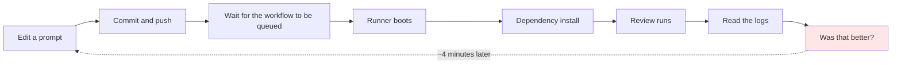
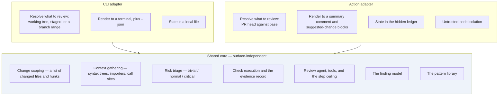

# ADR-0006 — The reviewing core is a local CLI; the GitHub Action is an adapter over it

| | |
|---|---|
| **Status** | **Accepted** |
| **Date** | 2026-09-08 |
| **Deciders** | Project maintainers |
| **Amends** | [ADR-0001](./0001-fixed-pipeline-with-bounded-agency.md) (retuned) · [ADR-0002](./0002-pipeline-initiates-test-execution.md) (scoped) · [ADR-0003](./0003-untrusted-code-isolation-and-fork-triggers.md) (scoped to the Action) · [ADR-0005](./0005-cross-run-memory-as-hidden-comment-ledger.md) (scoped to the Action) |
| **Leaves unchanged** | [ADR-0004](./0004-findings-emitted-as-tool-calls.md) |

> **Superseded detail (2026-09-14) — the latency figure.** Where this record puts a developer's patience at "roughly ten to thirty seconds", that figure is **withdrawn** by [SRS v1.1](../agentic-code-review-srs-v1.md) §2.4. It was an estimate nobody measured, and it had spread into four documents and begun sizing design decisions as if it were a finding — at one point forbidding a measured improvement (see [ADR-0007](./0007-python-harness-typescript-target.md)'s note). The threshold is now carried as **TBD-2**, to be established by observing real users of the shipped MVP.
>
> **This changes nothing in the decision below.** The core argument of this record is that the binding constraint *differs by surface* — money on the Action, **time** on the CLI — and that argument never depended on how much time. The iteration-speed reasoning that motivated the local surface (minutes versus seconds) is a comparison, not a threshold, and stands as written.

---

## The question

Every earlier record assumed one delivery surface: a GitHub Action reviewing a pull request. **Should the reviewing engine instead be a local command-line tool that a developer runs on their own machine, with the Action built on top of it?**

---

## Vocabulary

| Term | Meaning here |
|---|---|
| **Surface** | The way a user reaches the system. Two exist here: a command typed in a terminal, and a workflow that runs on a pull request. |
| **Core** | The part that does the reviewing: scoping a change, gathering context, running checks, calling the model, producing findings. Identical for both surfaces. |
| **Adapter** | A thin layer that translates between a surface and the core — turning a pull request into a change to review, and findings into comments. |
| **Diff scope** | The answer to "which change am I reviewing?" Unambiguous on a pull request; ambiguous on a working machine. |
| **Working tree** | The files as they currently exist on a developer's disk, including edits not yet committed. |

---

## Context

### What the pull-request surface costs us during development

The core loop of this project is qualitative: adjust a prompt, adjust context assembly, adjust a pattern rule, and judge whether the findings got better. That loop needs to run hundreds of times before the reviewer is any good — it is the one piece of work in the entire plan whose effort cannot be estimated, because "done" is a judgement rather than a passing test.

Run through a GitHub Action, one iteration is:

Run locally against a warm working tree, the same iteration is a few seconds. We would be developing the most iteration-hungry part of the system through the slowest feedback mechanism available to us.

### What the two surfaces actually differ in

Most of the system does not care where it runs. A short list of what does:

| Concern | Pull-request surface | Local surface |
|---|---|---|
| What is being reviewed | Pull request head against base — unambiguous | Working tree? Staged only? Against the default branch? Since the branch point? — **ambiguous** |
| Whose code executes | A stranger's, on a machine holding our credentials | The developer's own, on their own machine |
| Where output goes | Comments and a check, written once | A terminal, transient, re-rendered each run |
| What survives between runs | Nothing — the runner is destroyed | A filesystem |
| Cost of running the test suite | Minutes, on a cold machine | Seconds, against warm dependencies |
| Binding constraint | Money — tokens on a fixed budget | **Time** — a developer waiting at a prompt |
| Environment | One known runner image | Every OS, Node version, and package manager |

Each row on the right either deletes an earlier problem or creates a new one. None of them touches the finding model, the symbol graph, the pattern library, or the review agent itself.

### The inversion worth naming

[ADR-0002](./0002-pipeline-initiates-test-execution.md) forbade the model from triggering test runs, because each call cost roughly three minutes of scarce continuous-integration time for an answer that never changes within a run. Its stated cost was severe and accepted deliberately: *the model cannot investigate by experiment.*

Locally, against installed dependencies and a test runner's changed-file filter, a targeted run costs **seconds**. The economics that produced that prohibition do not exist on this surface.

---

## Options considered

### Option A — Action only, as previously specified

| | |
|---|---|
| **For** | Matches the stated product. One surface to build, document, and support. |
| **Against** | Develops the least estimable part of the system through a four-minute feedback loop. Every architectural decision is entangled with continuous-integration constraints, so it is never clear which constraints are essential and which are incidental to the runner. |

### Option B — Local CLI only

| | |
|---|---|
| **For** | Simplest engineering. Deletes the security work, the GitHub API work, and the packaging work entirely. Fastest possible iteration. |
| **Against** | Abandons the product. The problem this project exists to solve is a review bottleneck on pull requests, and a tool the author runs before pushing does not address a reviewer's queue. Also weakens the differentiator: locally the developer already has a terminal and can run their own tests. |

### Option C — A shared core, with the CLI as the primary development surface and the Action as an adapter ✅

| | |
|---|---|
| **For** | The iteration loop runs at terminal speed while the product remains the Action. Forces a clean seam: anything that cannot be exercised from a terminal is, by construction, surface-specific and belongs in an adapter. Ships a second genuinely useful surface at low marginal cost — every comparable tool in [`tool-reference.md`](../Draft/tool-reference.md) offers both. |
| **Against** | Two surfaces to document and support. Distributing a CLI that depends on a native parsing module across operating systems and Node versions is real work the Action made free. The CLI is the surface developers will judge the project by first, so it cannot be a rough internal tool. |

### Option D — Two implementations sharing a library

| | |
|---|---|
| **For** | Each surface optimised independently. |
| **Against** | Two review engines drift. The behaviour that matters — which findings appear — would differ between what a developer sees locally and what appears on their pull request, which is worse than having only one surface. |

---

## Decision

**One core, exercised through two thin adapters. The CLI is the primary development and testing surface. The Action is the primary product surface. Both ship.**

**The rule that keeps the seam honest:** an adapter may only translate. It resolves what to review, it renders findings, and it stores state. If an adapter ever decides *what counts as a finding*, the seam has been breached and the two surfaces will diverge.

### How this amends the earlier records

| Record | Effect |
|---|---|
| [ADR-0001](./0001-fixed-pipeline-with-bounded-agency.md) — fixed pipeline, tier-gated agency | **Structure unchanged, tuning split.** The pipeline and the tiered step ceiling hold on both surfaces. The ceiling is tuned against *money* on the Action and against *wall-clock latency* locally, where a developer's patience runs out after roughly ten to thirty seconds. Both are configuration. |
| [ADR-0002](./0002-pipeline-initiates-test-execution.md) — the pipeline initiates execution | **Scoped.** Binding on the Action, for the reasons given there. On the CLI, where dependencies are warm and a targeted run costs seconds, a narrow execution tool may be offered to the model under a call quota. This is the Option C that record deferred; the local surface is where it becomes affordable. |
| [ADR-0003](./0003-untrusted-code-isolation-and-fork-triggers.md) — untrusted code isolation, fork triggers | **Scoped to the Action, entirely.** Locally there is no trust boundary: the code is the developer's own, on their own machine, and running their tests is what they were going to do anyway. The record remains fully binding wherever the Action runs. |
| [ADR-0005](./0005-cross-run-memory-as-hidden-comment-ledger.md) — hidden comment ledger | **Scoped to the Action.** Locally a filesystem exists, so state is an ordinary gitignored file. The fingerprint design is shared; only the storage location differs. Note also that the motivation weakens locally: pull-request comments accumulate permanently and visibly, while terminal output is replaced on each run, and a developer re-running after a fix wants the current state rather than a delta. |
| [ADR-0004](./0004-findings-emitted-as-tool-calls.md) — findings as tool calls | **Unchanged**, and reinforced. With two renderers consuming findings, a single typed representation matters more, not less. |

### What the CLI surface adds

| New concern | Why it is not trivial |
|---|---|
| **Resolving what to review** | Uncommitted, staged, against the default branch, and since the branch point are all legitimate readings of "review my changes", and they give different answers. The default must be chosen deliberately and the others exposed as flags. |
| **Reviewing code that does not compile** | A working tree can be mid-edit. Syntax-tree parsing recovers from broken syntax, but the agent must distinguish *wrong* from *unfinished* or it will lecture developers about code they are still typing. |
| **Distribution across platforms** | The parsing library is a native module: prebuilt binaries per operating system and runtime version, or a WebAssembly build with a performance cost. The Action made this free by controlling the machine. |
| **Terminal experience** | Streaming output, progress while the model thinks, detecting a terminal from a pipe, machine-readable output, and meaningful exit codes. |
| **Configuration and cache discovery** | Repository-level and user-level configuration and their merge order; a cache location that behaves on every platform. |

---

## Consequences

### Good

- **The iteration loop for the hardest work drops from minutes to seconds.** This is the entire reason for the decision.
- **A clean architectural seam is enforced by construction.** Anything not exercisable from a terminal is surface-specific by definition, which prevents continuous-integration assumptions leaking into the core.
- **The model regains the ability to investigate by experiment** on the local surface, recovering a capability [ADR-0002](./0002-pipeline-initiates-test-execution.md) gave up.
- **Incremental parsing finally pays.** A persistent local index can be updated rather than rebuilt, which is what the parsing library is designed for and which a fresh runner wastes on every run.
- **The Action's own risk profile improves**, because the highest-risk work — untrusted execution, comment positioning — is now confined to one adapter rather than spread through the system.
- **A second useful surface ships** at low marginal cost, matching what every comparable tool offers.

### Bad

- **The differentiator thins locally.** "We ran your tests and here is what broke" is evidence the reviewer uniquely supplies in continuous integration. On a developer's machine they already have a terminal and already ran them. Locally the claim must shift from *running* the tests to *connecting a failure to its cause* — a harder claim on a free-tier model.
- **It shifts who the user is.** The problem definition names the **reviewer** as the primary persona — a peer reviewing someone else's pull request. The CLI serves the **author**, before they push. That is a different person with a different need, and it is not the need the project's problem statement was written against. The Action remains the surface that addresses the stated problem; the CLI must not be allowed to quietly become the product.
- **Platform distribution is genuinely new work**, and native-module packaging is the kind that fails on other people's machines rather than ours.
- **Two surfaces to document and support**, including two ways to configure the same behaviour.
- **Cost becomes visible per invocation.** A developer running this thirty times a day on their own key notices in a way that amortised continuous-integration spend never surfaces. This raises the stakes on cheap-model selection and on caching stable prompt prefixes.

### Neutral

- Latency joins cost as a first-class budget, with different values per surface.
- The regression suite for pattern examples becomes far cheaper to run, since it no longer needs a workflow — which makes the measurement instrument the project committed to building first easier to use, not harder.
- There is an argument, not relied upon here, that a pre-push local review acts on comprehension erosion — the axis the problem definition classifies as a root cause that tooling cannot reach. It is recorded as an observation, not a justification.

---

## How we would know this decision was violated

- An adapter contains logic that decides whether something is a finding.
- The same change reviewed locally and on a pull request produces materially different findings.
- Core code imports a GitHub client, or reads a workflow environment variable.
- A core module cannot be exercised from a terminal without a network call to GitHub.

---

## What the requirements would need to add

| Missing | Why it matters |
|---|---|
| The CLI as a shipped delivery surface alongside the Action | The scope section currently names only the Action |
| The change-scope resolution rules and their default | Ambiguous locally, and it silently changes what gets reviewed |
| A statement that findings must not depend on the surface | The property that keeps one engine from becoming two |
| Supported platforms and runtime versions | A distribution contract the Action never needed |
