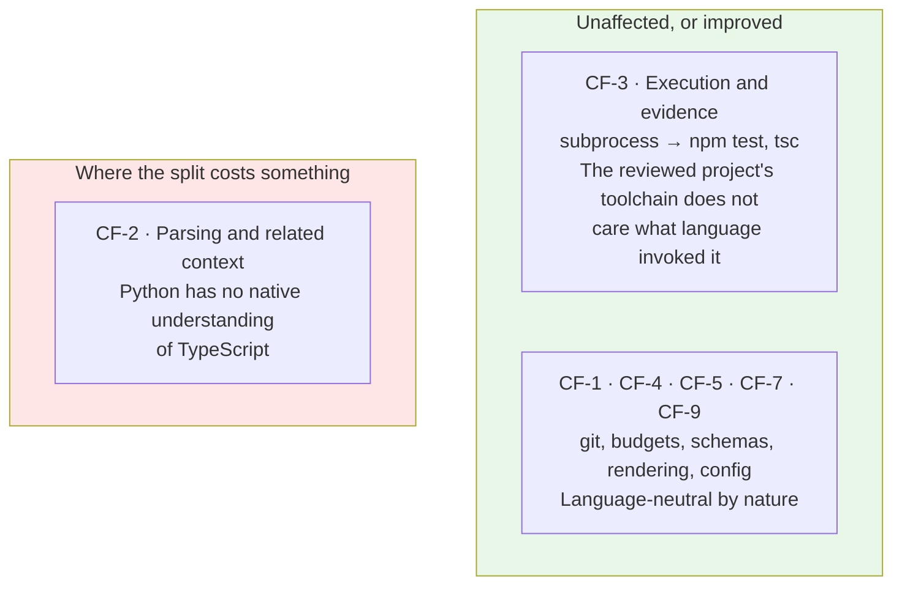
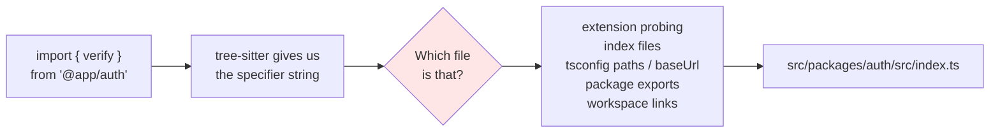
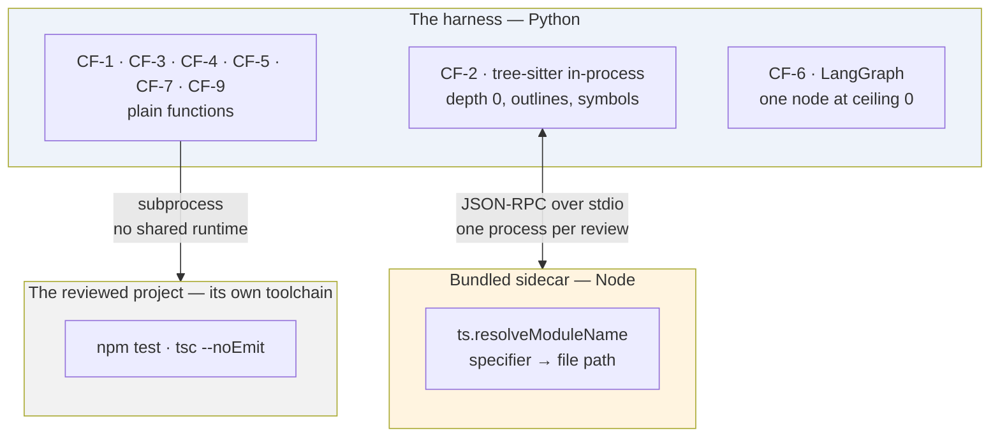

# ADR-0007 — The harness is Python with LangGraph; the reviewed language is TypeScript

| | |
|---|---|
| **Status** | **Accepted** |
| **Date** | 2026-09-08 |
| **Deciders** | Project maintainers |
| **Amends** | [ADR-0006](./0006-local-cli-core-action-as-adapter.md) (distribution consequences only) |
| **Leaves unchanged** | [ADR-0001](./0001-fixed-pipeline-with-bounded-agency.md) · [ADR-0002](./0002-pipeline-initiates-test-execution.md) · [ADR-0003](./0003-untrusted-code-isolation-and-fork-triggers.md) · [ADR-0004](./0004-findings-emitted-as-tool-calls.md) · [ADR-0005](./0005-cross-run-memory-as-hidden-comment-ledger.md) |

---

## The question

Every earlier record left the implementation language implicit, and everything written so far assumed one answer: that the harness would be written in the same language as the code it reviews. [`agent-harness-design.md`](../Draft/agent-harness-design.md) defines the harness as "TypeScript we write"; the requirement catalogue specifies distribution as an npm package.

**The harness is Python, using LangChain and LangGraph. The first target language is TypeScript.** Given that, three things have to be decided: how a Python process understands TypeScript, where the agent framework's authority ends, and how the tool reaches a user who lives in the Node ecosystem.

---

## Vocabulary

| Term | Meaning here |
|---|---|
| **Harness** | The ordinary program code surrounding the model — it prepares input, decides what the model may do, validates output, and renders results. It is not AI. |
| **Target language** | The language of the code being reviewed. TypeScript/JavaScript, in v1. |
| **Host language** | The language the harness itself is written in. Python, by this decision. |
| **Module resolution** | Turning an import specifier — the string `'./auth'` or `'@app/db'` — into the file on disk it actually refers to. |
| **Concrete syntax tree** | What `tree-sitter` produces: the shape of the source text. It knows `'./auth'` is an import specifier. It does not know which file that is. |
| **Sidecar** | A small helper process in a different language, started by the harness, spoken to over a defined protocol, and owned entirely by one module. |
| **Wheel** | A Python distribution archive. It can carry non-Python files — including a bundled JavaScript file — as package data. |

---

## Context

### The asymmetry that decides everything

Splitting host language from target language affects two of the nine core functions, and it affects them in opposite directions.

CF-3 is arguably better off. The harness was always going to shell out to the project's own test runner; now it *cannot* accidentally do anything else, because it has no way to import the project's dependencies into its own process. Runtime isolation stops being a discipline and becomes a property of the design.

CF-2 is the problem, and CF-2 is where this project's claim lives.

### Depth 0 is fine. Depth 1 is the whole cost.

The context depth ladder ([v1 SRS](../agentic-code-review-srs-v1.md) §4.2.1) asks for two things in v1:

- **Depth 0** — expand a hunk to its enclosing function, class, or type boundary. This is pure syntax. `tree-sitter` answers it from Python exactly as well as from Node, and the requirement to build a `tree-sitter` AST for changed files (FR-2.2) survives untouched.
- **Depth 1** — the definitions of the symbols the changed code imports and calls. This needs an answer to *which file does `'./auth'` mean?*

`tree-sitter` hands over the string and stops. Everything after that is TypeScript's own module-resolution algorithm: extension probing, directory index files, `tsconfig` `baseUrl` and `paths`, `package.json` `exports` maps, and workspace links in a monorepo.

Reimplementing that in Python is roughly 300–600 lines that will be about right on a conventional repository and wrong on an aliased monorepo — which is precisely the kind of repository where cross-file review is worth having.

### The constraint the two surfaces do not share

The requirement that this be answered *fast* is specific to the local surface. §2.4 of the v1 specification puts a developer's patience at roughly 10–30 seconds, and [ADR-0006](./0006-local-cli-core-action-as-adapter.md) named latency as the CLI's binding budget where money is the Action's. Any resolution strategy that needs to warm up over a whole repository before answering the first question is spending the user's entire budget before the review starts.

---

## Options considered — how Python understands TypeScript

### Option A — Pure Python, `tree-sitter` only

Reimplement module resolution in Python.

| | |
|---|---|
| **For** | One language in the repository. One wheel, no second toolchain, nothing to bundle. The install story is as simple as it can be. |
| **Against** | Depth-1 quality is a guess, and it fails on exactly the repositories that most need cross-file review. No type information ever, so a whole class of finding stays out of reach. Depth 2 in v2 has to build its reverse index from the same shaky foundation. |

### Option B — `tree-sitter` in-process, plus a Node sidecar over the TypeScript compiler API ✅

Syntax stays in Python; the resolution question goes to a bundled Node process that calls `ts.resolveModuleName` — the same function the TypeScript compiler itself uses.

| | |
|---|---|
| **For** | Authoritative resolution, from the reference implementation, including every `tsconfig` and workspace case. Depth 2 in v2 stops being an index-building project, because the same process can answer `findReferences`. The sidecar is confined inside one module, so FR-2.6e still holds — no consumer knows it exists. |
| **Against** | A second language in the repository and in the build. A process boot to pay for. The wheel has to carry a bundled JavaScript file. Node becomes a runtime prerequisite for the best answer. |

### Option C — An LSP client to `typescript-language-server`

| | |
|---|---|
| **For** | The richest answer of the three — definitions, references, and outlines over one standard protocol, with depth 2 nearly falling out of it. |
| **Against** | The language server indexes the project before it is useful. On a large repository that warm-up can consume the entire latency budget for a review that has not started yet. It also means managing a stateful, long-lived server from a one-shot command-line invocation, which is a lifecycle problem the other options do not have. |

### Option D — A Python-native TypeScript parser

Not viable. Nothing in the Python ecosystem parses TypeScript to a standard that a reviewer could rely on, and adopting an immature one would put the project's central claim on top of someone else's abandoned side project.

---

## Options considered — where LangGraph's authority ends

[ADR-0001](./0001-fixed-pipeline-with-bounded-agency.md) decided that our code owns orchestration and the model's agency is confined to one step. Adopting an agent framework is an opportunity to violate that decision by accident, so the boundary is worth stating rather than discovering.

### Option A — The graph owns the whole pipeline

Every core function becomes a node.

| | |
|---|---|
| **For** | Checkpointing, streaming, and a visual graph of the entire run, for free. |
| **Against** | Puts a third-party framework in the position ADR-0001 reserved for our own code. Makes CF-1 and CF-3 harder to exercise in isolation, and makes AC-10's structural checks harder to state — when everything is a node, "no module outside CF-1 resolves a change scope" is a property of a graph rather than of an import list. |

### Option B — The graph owns the review step only ✅

CF-1 through CF-5 and CF-7 are plain Python functions. LangGraph is confined to CF-6.

| | |
|---|---|
| **For** | Matches ADR-0001 with no distortion: the fixed part stays fixed code, and the framework sits exactly where a loop might one day exist. v1's single pass is a one-node graph; raising the ceiling (FR-5.7) adds a conditional edge, which is what makes that requirement's promise — *configuration, not restructuring* — literally true rather than aspirational. Framework churn is contained to one module. |
| **Against** | Less leverage from the framework. Tracing, retry, and failure handling across the pipeline stay ours to write — though FR-11.2 and FR-11.3 already demand semantics no framework would have given us for free. |

### Option C — LangChain now, LangGraph at the ceiling experiment

| | |
|---|---|
| **For** | The smallest possible v1. |
| **Against** | Step 4.5 of the delivery sequence becomes a restructuring rather than a config change, which is the exact outcome FR-5.7 was written to avoid. |

---

## Options considered — distribution

[ADR-0006](./0006-local-cli-core-action-as-adapter.md) recorded platform distribution as the CLI's largest new cost, on the assumption of an npm package carrying a native parser. The host language changes the shape of that cost but not its size.

| Option | For | Against |
|---|---|---|
| **PyPI wheel, `uv tool install` / `pipx`** ✅ | Standard packaging. Native `tree-sitter` wheels work normally. The bundled sidecar ships as package data. Fastest to iterate on. | Adds a prerequisite the target user may not have — see the consequence below |
| **Standalone binary (PyInstaller)** | No prerequisite at all; closest to the `npx` experience | Freezing native extensions alongside a bundled sidecar is sharp, per-OS build work that v1 would have to carry from the start |
| **Docker image** | Cleanest environment contract, and the natural shape for the v3 Action | Breaks CF-3. Running the project's tests in seconds depends on their warm local `node_modules`, which a container does not have |

---

## Decision

**The harness is Python. `tree-sitter` runs in-process for syntax; a bundled Node sidecar over the TypeScript compiler API answers module resolution, and its absence degrades rather than fails. LangGraph is confined to CF-6. The tool ships as a PyPI package.**

### The three follow-on choices, and why

**One long-lived sidecar process per review, spoken to over JSON-RPC on stdio.** The process boot is a fixed cost of a few hundred milliseconds; paying it once and batching every specifier query against it keeps that cost constant regardless of how many imports the change touches. A process per query would multiply the boot across dozens of imports. HTTP would add a port and a lifecycle for nothing.

**Bundled, never fetched.** The sidecar is built to a single JavaScript file and shipped inside the wheel. Fetching it at review time would put a network round-trip inside the latency budget and introduce a version skew between the harness and the resolver that nobody controls.

**Node is a runtime prerequisite for authoritative depth 1, and never a prerequisite for installation.** Where the sidecar cannot start, CF-2 falls back to heuristic resolution, marks the result degraded, and the review completes — which is the behaviour FR-2.6d and FR-11.2 already require of every other partial failure. In practice the degrade path will rarely fire, because a developer with a TypeScript repository has Node.

### What this does not change

The finding model, the `emit_finding` boundary, the depth interface, the adapter seam, the fixed pipeline, and the step ceiling are all untouched. None of them named a language. That is worth noticing: the decisions taken before the stack was chosen survived the stack being chosen, which is the test of whether they were the right decisions.

### How this amends ADR-0006

| That record said | Now |
|---|---|
| Distribution is an npm package; supported operating systems and Node.js versions form a distribution contract | Distribution is a PyPI package; the contract is operating systems and **Python** versions (FR-10.6) |
| Native-module packaging "fails on other people's machines rather than ours" | Still true, and now it is `tree-sitter` Python wheels plus a bundled JavaScript file rather than a Node native module |
| The CLI is the surface developers judge the project by first | Unchanged, and sharpened — see the first consequence below |

Nothing in ADR-0006's core reasoning depended on the language. The core/adapter seam, the argument for the local surface, and the CLI's list of new concerns all stand as written.

---

## Consequences

### Good

- **The review agent's ecosystem is the one the agent tooling actually lives in.** LangGraph, structured output, evaluation tooling, and the tracing ecosystem are all first-class in Python, and CF-8 — the measurement instrument the project committed to building third — is a `pytest` corpus rather than a bespoke runner.
- **Runtime isolation between reviewer and reviewed becomes structural.** The harness has no mechanism for importing the project's dependencies, so a dependency conflict between the reviewer and the repository under review is not a bug that can be introduced.
- **Multi-language support gets cheaper later.** `tree-sitter` grammars are uniformly available from Python, so extending past TS/JS in a later version is a grammar and a resolution strategy rather than a rewrite.
- **The sidecar is a smaller commitment than it looks.** It is one module's private implementation detail, behind an interface (FR-2.6e) that already forbids anyone else from knowing about it.
- **Depth 2 arrives cheaper in v2.** The same process that resolves modules can answer `findReferences`, so the reverse index becomes an optimisation rather than a prerequisite.

### Bad

- **The target user may not have Python.** A TypeScript developer has Node; they do not necessarily have a working Python or `pipx`. "Install Python to review your TypeScript" is real adoption friction that the npm route did not have, and it is the clearest cost of this decision. It is accepted for v1, where the primary users are the people building the system; it should be revisited before the tool is offered widely.
- **Two languages in one repository.** Two build steps, two dependency files, and a bundling step that has to run before the wheel is built. A repository that reviews TypeScript is now itself partly TypeScript, which is either fitting or annoying depending on the day.
- **Depth-1 quality is now conditional on an optional prerequisite.** The degrade path is specified and reported, but a review run without the sidecar is genuinely worse, and the regression corpus has to be able to measure both.
- **Python has no equivalent of the TypeScript compiler's type information in-process.** Findings that would need a type checker's view — rather than a resolver's — remain out of reach unless the sidecar's role grows, which would be a new decision.

### Neutral

- The `npm audit` requirement (FR-4.3, v2) is unaffected: it is a property of the reviewed project, not of the harness.
- The v3 Action becomes a Docker-based action rather than a composite one, since it now needs a Python environment the runner does not ship by default. This is a v3 packaging detail, not a change to the adapter seam.
- Provider access goes through LangChain's OpenAI-compatible client pointed at the NVIDIA NIM endpoint, rather than a vendor-specific integration package. FR-0.3 — integrating a new provider without downstream change — reduces to a base URL and a model name for anything OpenAI-compatible.

---

## How we would know this decision was violated

- A module outside CF-2 knows the sidecar exists, or branches on whether it is available.
- A module outside CF-6 imports LangGraph.
- An invocation fails because Node is absent, rather than completing with a reported degradation.
- The harness imports, or requires the user to install, anything from the reviewed project's dependency tree.
- The sidecar is started more than once per review, or fetched from the network at review time.
- Resolution logic is reimplemented in Python *in addition to* the sidecar, so that two answers to the same question exist.

---

## What the requirements would need to add

| Missing | Why it matters |
|---|---|
| The sidecar contract and its lifetime | CF-2 cannot be built without it, and "at most once per invocation" is the part that makes the latency budget work |
| The obligation to degrade rather than fail when the sidecar is unavailable | Otherwise an optional prerequisite silently becomes a required one |
| That checks run through the reviewed project's own toolchain, in a separate runtime | The one CF-3 consequence of splitting host from target language |
| That the agent framework is confined to the review step | The property that keeps ADR-0001 true once a framework is in the repository |
| Supported operating systems and **Python** versions | FR-10.6 currently names Node.js versions |
