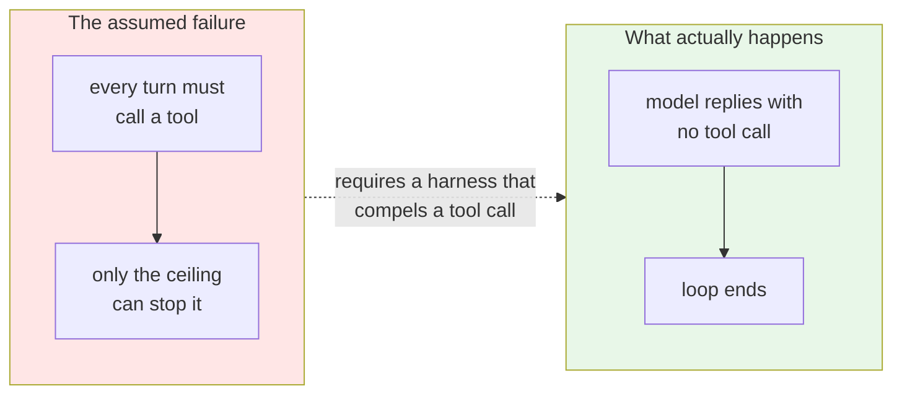

# ADR-0008 — The agent runtime: what bounds it, what it may call, and how it stops

| | |
|---|---|
| **Status** | **Accepted** |
| **Date** | 2026-09-14 |
| **Deciders** | Project maintainers |
| **Supersedes in part** | [ADR-0001](./0001-fixed-pipeline-with-bounded-agency.md) — two details: what the step ceiling counts, and the prohibition on the model ending its own review |
| **Scopes** | [ADR-0002](./0002-pipeline-initiates-test-execution.md) — records where agent-triggered execution becomes permissible, and where it does not |
| **Leaves unchanged** | [ADR-0004](./0004-findings-emitted-as-tool-calls.md) · [ADR-0006](./0006-local-cli-core-action-as-adapter.md) · [ADR-0007](./0007-python-harness-typescript-target.md) |

---

## Why this record exists

[`Draft/agentic-architecture-review.md`](../Draft/agentic-architecture-review.md) §11 commissioned it, under the number 0007:

> *"Write ADR-0007 — 'Agent runtime, tool registry, and termination', superseding two lines of ADR-0001 and adopting the accepted subset."*

That number went to the host-language decision instead, and the record was never written. Six adopted conclusions were left with no normative home, and the design phase found them missing ([`DESIGN_BLOCKERS.md`](../../DESIGN_BLOCKERS.md), DB-03). This is that record, written late, with two of its six conclusions changed by what has been learned since.

---

## Vocabulary

| Term | Meaning here |
|---|---|
| **Runtime** | The thing that runs the loop: calls the model, dispatches tool calls, counts, and stops |
| **Registry** | The list of tools the model may call, with their argument schemas, as a versioned artifact |
| **Policy** | What is permitted *right now* — distinct from what exists. A tool can be in the registry and refused on this run |
| **Observation** | What a tool hands back to the model: a status, a reason, and possibly content |
| **Termination** | How a review ends — by the model finishing, or by a bound being reached |

---

## The five decisions

### 1. The ceiling counts every tool call

[ADR-0001](./0001-fixed-pipeline-with-bounded-agency.md) set a "step ceiling" of 0, ~5, ~15 by risk tier. Read alongside [ADR-0004](./0004-findings-emitted-as-tool-calls.md) — findings enter **only** as tool calls — a ceiling of zero permits no findings at all. The two records cancelled out, and nobody noticed for six days because nothing had been built.

**Decided: a tool call is a tool call**, counted as an agent runtime counts them, `emit_finding` included. The ceiling bounds the total.

The consequence is that *whether the model may investigate* can no longer be expressed by setting the ceiling to zero, so it becomes its own switch:

| Setting | Bounds | v1 default |
|---|---|---|
| Tool-call ceiling | What a review may cost | A positive number |
| Investigation tools | Whether the model may look around at all | **Off** |

This is better than what it replaces. The two were only ever joined because zero happened to answer both, and the gate that matters — no investigation until a baseline exists — now sits on the switch it is about.

**One number cannot then serve as the cost metric.** With emissions counted, a total moves with how many defects a change contained, not with how hard the agent looked. **Both are reported** (FR-8.2d): the total prices the run, the investigation count is the variable the experiment isolates.

### 2. Termination is the model declining to call a tool

The review proposed a `finish_review` tool, calling it "the best single idea in the review", on the grounds that a bounded loop without an explicit stop signal can only stop at its ceiling.

**That premise does not hold for a tool-calling provider.** Such a model terminates by replying *without* a tool call, and every standard agent loop stops on exactly that.

**Decided: no `finish_review` tool. The harness shall never compel a tool call**, and a reply without one is accepted as termination (FR-5.10).

ADR-0001's prohibition — *"decide when the review ends, beyond emitting findings"* — is **withdrawn**, as the review asked. The model does decide when the review ends. It simply does not need a tool to say so.

**The one real benefit is kept.** `finish_review` would have distinguished *"reviewed it, it is clean"* from *"never managed to call the tool"*. That is obtainable by observing whether **any** call was made, which costs nothing and puts no extra weight on the provider capability the stack document flags as its highest risk (S-1: whether a free-tier model reliably calls *one* tool).

**Reconsider** if a measured loop shows a model failing to terminate on its own.

### 3. The tool list is a versioned registry

ADR-0001 listed the model's permitted actions in a table and flagged the gap itself: *"the tool list and their argument schemas, as a versioned contract"* — recorded as missing, never supplied.

**Decided: the registry is an artifact, not a table in a record.** It names each tool, its argument schema, and the version at which it appeared. Adding a tool is a registry change; it is not a specification change, which is why FR-5.7a no longer names tools or fixes their count.

Every tool in it must be **read-only, free of side effects, and unable to trigger check execution**. Those are the properties that make a ceiling meaningful: each call costs tokens and nothing else.

### 4. Observations are structured, and a refusal is not an error

**Decided: every tool result is an observation carrying a status — `ok`, `error`, `denied` — and a reason where the status is not `ok`** (FR-5.9).

`denied` has no producer in v1: the only tool is `emit_finding`, and nothing may refuse it. It is defined now because it is a **model-visible contract**. Introducing a third status later means the model has learned two-thirds of a vocabulary, and every call site that switched on the old shape needs revisiting.

The distinction earns its place as soon as policy exists: *"that failed"* invites a retry, *"that is not permitted"* invites a different approach.

### 5. Execution as an agent-callable tool: surface-conditional, and not in v1

[ADR-0002](./0002-pipeline-initiates-test-execution.md) forbade the model from triggering test runs, because on a CI runner each call costs minutes for an answer that does not change within a run. [ADR-0006](./0006-local-cli-core-action-as-adapter.md) then observed that locally, against warm dependencies, the same call costs seconds — *"the economics that produced that prohibition do not exist on this surface"*.

**Decided, in three parts:**

| Surface | Ruling |
|---|---|
| **The Action** | **Prohibited**, permanently, and for a reason ADR-0002 did not give. [ADR-0003](./0003-untrusted-code-isolation-and-fork-triggers.md) splits the workflow into an untrusted job that runs a stranger's tests with no credentials, and a trusted job holding the model key. Making execution agent-callable means keeping an untrusted executor alive and reachable *from the credential-holding process*, with the model scheduling it. No quota recovers that |
| **The CLI, v2+** | **Permitted**, under a hard call quota — two or three targeted runs, never a full suite |
| **The CLI, v1** | **Not built.** FR-4.6 keeps the prohibition. With investigation off there is no loop in which such a tool could be called, so building it now is machinery with nothing to run |

---

## What this does not decide

The review's larger proposals are recorded here as **deferred, with their reasons**, so they are not re-proposed from the same premises:

| Proposal | Status |
|---|---|
| **`AgentState`** — explored files and symbols, observations, findings, remaining budget | **v2.** Needs turns to carry state between. The explored-sets are the valuable part: they stop a model re-reading a file it already has |
| **Policy as a layer distinct from the runtime** | **v2.** The separation only pays once a tool can be denied at run time. The `denied` status above is its forward edge |
| **Runtime / policy / tools / model layering** | **v2 module structure.** v1's review step is a single node; layering it now would be architecture with one occupant |
| **`Hypothesis` tracking with confidence scores** | **Declined, revisitable.** Free-tier models are poorly calibrated, so a confidence number that does not track reality is worse than none — downstream code will filter on it. It also multiplies cost per finding, and cannot be evaluated with the corpus v1 ships. Its valuable kernel was extracted instead and is now FR-5.2c: a finding cites its evidence or marks itself unverified |
| **Wall-clock as a budget dimension** | **Deferred to measurement.** SRS v1.1 withdrew the latency figure the review reasoned against as unproven (TBD-2). A wall-clock budget is right; its value is not yet known |

---

## Consequences

### Good

- **Two records stop contradicting each other.** ADR-0001 and ADR-0004 could not both be satisfied at ceiling zero; now they can.
- **Cost and effort are separately visible.** A review that found eight defects no longer looks like a hard-working agent.
- **Adding a tool stops being a specification change**, which is what makes the measured experiment at delivery step 4.5 cheap enough to actually run.
- **The model-facing vocabulary is fixed before a model learns it** — statuses now, not after two of three exist.
- **The Action's execution prohibition gains its real justification.** ADR-0002 argued from cost; the binding reason is the credential boundary in ADR-0003.

### Bad

- **Two settings where there was one**, both documented, both configurable, both able to be set into a combination nobody tested.
- **Four counters where FR-8.2c asked for one.** Justified, but it is more schema surface and more to keep honest.
- **`denied` ships unreachable.** A status with no producer is a thing to explain to every new reader until v2 gives it one.
- **This record is written after the design it governs.** ADR-0001's gap sat open for six days and was found by design rather than by review, which says something about how the records were being read.

### Neutral

- The registry becomes a versioned artifact to maintain, with its own compatibility question when a tool's arguments change.

---

## How we would know this decision was violated

- The harness sets a required tool choice, compelling a call every turn.
- A tool appears that performs an action rather than reading data.
- A tool is exposed to the model without a registry entry.
- A single "tool calls" number is reported without its breakdown.
- Investigation is enabled without a recorded single-pass baseline (FR-5.7b).
- An agent-callable execution tool appears on the Action surface, at any quota.
- A tool refusal reaches the model as an error, or as silence.
