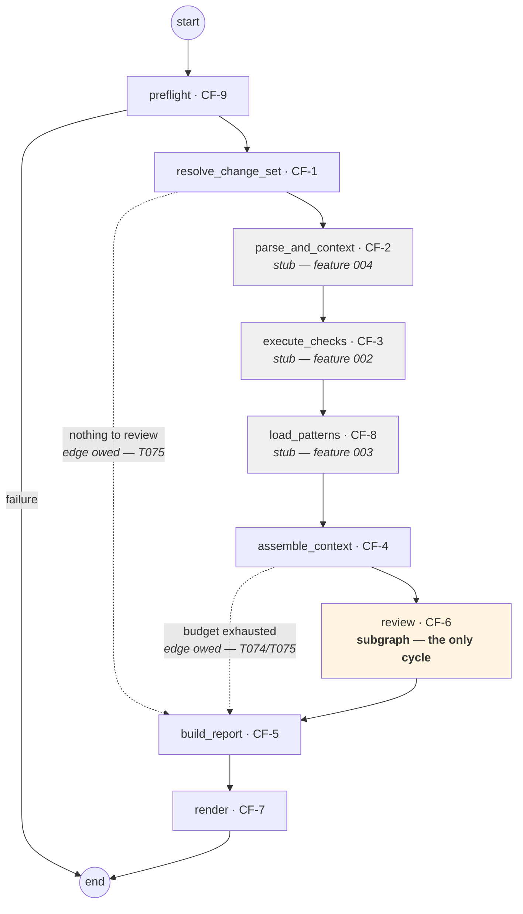

# ADR-0009 — The pipeline is a declared graph; the core functions stay framework-free

| | |
|---|---|
| **Status** | Accepted |
| **Date** | 2026-09-20 |
| **Deciders** | Project maintainers |
| **Amends** | [ADR-0001 — fixed pipeline with bounded agency](./0001-fixed-pipeline-with-bounded-agency.md) · [ADR-0007 — Python harness, TypeScript target](./0007-python-harness-typescript-target.md) |
| **Supersedes detail** | FR-5.8's confinement of the agent framework to CF-6, and AC-10's third import contract |

> **What this record does not change.** ADR-0001's decision — *our code owns orchestration, the model does not* — stands entirely. So does every prohibition in it. This record changes **how the fixed order is written down**, not who decides it.

---

## The question

The order of operations is fixed and owned by our code. Should that order be **written as imperative Python statements**, or **declared as a graph**?

This is not the ADR-0001 question restated. ADR-0001 asked *who decides what happens next* and answered "our code, never the model." That answer is untouched here. This record asks a narrower question that only became askable once a graph library was already in the repository for CF-6: given that our code owns the order, what is the best form in which to express it?

## Vocabulary

| Term | Meaning here |
|---|---|
| **Declared graph** | Nodes and edges registered up front, then compiled. The topology is fixed at build time and is inspectable before anything runs. |
| **Imperative pipeline** | The same order written as sequential statements and `if` branches inside one function. |
| **Node** | One phase. A thin adapter that calls a core function and returns updated state. |
| **Framework-free** | A package that imports no LangChain and no LangGraph, and is callable as an ordinary Python function. |

---

## Context

### What FR-5.8 was actually defending

FR-5.8 reads: *"The agent framework shall be confined to CF-6. No module outside CF-6 shall import it, and the pipeline steps outside CF-6 shall be callable as ordinary functions without it."*

It defends two distinct things, and they have been read as one:

1. **Orchestration stays ours.** A framework that owns the control flow is a framework that could later be handed the steering wheel. Keeping it out of the pipeline keeps ADR-0001 true by construction.
2. **The core functions stay ordinary.** Every step outside CF-6 must be testable by calling a function with arguments — no graph, no state dict, no framework fixture.

The second is the load-bearing one. The first conflates *the framework being present* with *the model being in charge*, and those are not the same claim. A LangGraph graph whose topology we author statically, whose every node is our own function, and whose only cycle is inside CF-6, hands the model exactly as much orchestration authority as a `for` loop does: none.

### What the current code actually looks like

[`core/pipeline/run.py`](../../src/agentic_review/core/pipeline/run.py) is the imperative form. It reads well, and it is honest about the order. But two things are worth noticing.

**The order it implements is not the order the contract specifies.** [`contracts/internal-seams.md`](../../specs/001-walking-skeleton/contracts/internal-seams.md) §1 requires `preflight → change set → [nothing to review? → output] → assembly → [budget exhausted? → output] → review → output`. Neither early-exit branch exists in the code. `assemble()` returns only `ReviewContext` where the contract says `ReviewContext | BudgetExhausted`, and `budget_hit=False` is hardcoded. The divergence is invisible because nothing declares the intended shape anywhere a reader or a test can check it.

**Six of the nine core functions are not built yet.** CF-2, CF-3 and CF-8 have no package; CF-1, CF-4 and CF-9 are partial. The pipeline's eventual shape is documented in four places — SRS §2.1's diagram, ADR-0001's diagram, the seams contract, and the roadmap in [`specs/README.md`](../../specs/README.md) — and implemented in none of them. A reader learns the shape from prose and has to trust that the code agrees.

### Why this is worth changing now rather than later

Every remaining feature (002 evidence, 003 measurement, 004 context) adds a stage and at least one degradation branch. Added imperatively, each one lengthens a function that is already the least-tested part of the system and whose divergence from its own contract went unnoticed. Added as nodes, each one is a registration plus a function, and the shape stays legible.

The cost of the change also only rises. Three CFs are unbuilt; converting six real stages later is strictly more work than converting three real stages and three stubs now.

---

## Options considered

### Option A — Keep the imperative pipeline, confine LangGraph to CF-6

The status quo. FR-5.8 as written.

| | |
|---|---|
| **For** | No requirement changes. No new ADR. The framework's blast radius stays as small as it can be. Nothing to relearn. |
| **Against** | The pipeline's shape lives only in prose, so code and contract can diverge silently — and already have. Each new stage makes one function longer. The unbuilt CFs have nowhere to exist as placeholders, so the roadmap is invisible in the code. |

### Option B — Whole pipeline as a graph, core functions import the framework

Each CF package owns its own node definitions.

| | |
|---|---|
| **For** | The most direct expression: a capability and its node live together. |
| **Against** | **Destroys the half of FR-5.8 that matters.** Every CF becomes untestable without a graph fixture, every package takes a heavyweight dependency, and swapping frameworks becomes a nine-package change. This is the option FR-5.8 was written to prevent, and it should stay prevented. |

### Option C — The orchestrator declares the graph; the core functions stay framework-free ✅

`core/pipeline/` registers one node per phase. Each node is a thin adapter that calls a core function which knows nothing about graphs. LangGraph's permitted import sites go from one package to two.

| | |
|---|---|
| **For** | Keeps FR-5.8's real guarantee — every CF stays an ordinary, framework-free function, testable by direct call. The pipeline's shape becomes a declared object that can be rendered, diffed, and asserted against the seams contract. Unbuilt CFs exist as pass-through nodes, so the roadmap is visible in the code and wiring a capability is replacing a stub. Degradation branches become named edges instead of buried `if`s. |
| **Against** | Two packages may import the framework instead of one. Indirection: reading one stage now means reading a node and the function it calls. A graph's control flow is less obvious to a newcomer than sequential statements. AC-10's third contract and FR-5.8's text both need rewording. |

---

## Decision

**The review pipeline is a declared LangGraph graph with one node per phase, including phases that are purely deterministic and phases not yet built. The nine core-function packages remain framework-free and callable as ordinary functions.**

LangGraph's permitted import sites become exactly two: `core/pipeline/` and `core/agent/`. Everywhere else it stays forbidden.

### The four rules that make this safe

**A node adapts; it never decides.** A node reads state, calls one core function, and writes the result back. Any logic worth testing lives in the core function, where it can be tested without a graph. A node that grows a branch is a node whose core function is missing one.

**The pipeline graph is acyclic. CF-6's subgraph is the only place a cycle may exist.** This is ADR-0001's violation test — *"any loop exists outside step 8"* — restated as a property of the compiled object rather than a habit of the authors. It is checkable: assert the pipeline graph has no back edge.

**An unbuilt capability is a pass-through node.** `parse_and_context`, `execute_checks` and `load_patterns` forward state unchanged. Their **presence in the compiled topology is the record** — they are real nodes that run and render, not placeholders in a comment — and they carry no state field that nothing yet reads, because unread machinery added for a future feature is the thing this project's conventions forbid. When feature 002 lands, `execute_checks` stops being a pass-through. The topology does not move.

**The core functions never learn the framework exists.** Import contract 3 is narrowed, not dropped: `core/changeset/`, `core/assembly/`, `core/findings/`, `core/output/`, `core/config/` and every future CF package must still import no LangGraph and no LangChain. This is the half of FR-5.8 worth keeping, and it is the one this record does not touch.

---

## Consequences

### Good

- **The pipeline's shape becomes an object.** It can be rendered, and it can be asserted against [`contracts/internal-seams.md`](../../specs/001-walking-skeleton/contracts/internal-seams.md) §1 by a test rather than by a reviewer's memory. The two missing branches this record found would have failed such a test.
- **The two spec'd degradation branches become visibly absent rather than silently absent.** `nothing to review` and `budget exhausted` are edges the seams contract requires and the code does not have. This change does not build them — that is T074/T075 — but once the topology is declared, their absence is a property of an object a test can read, instead of something a reviewer has to notice is missing from a long function.
- **The roadmap is legible in the code.** Three stub nodes say what is coming and where it goes.
- **Adding a stage is additive** — a node, an edge, and a function — rather than an edit to a function every other stage shares.
- **Every core function stays unit-testable by direct call.** No change to any existing CF test.

### Bad

- **Two import sites instead of one.** The framework's blast radius grows, and only a lint contract keeps it from growing further. That contract must be enforced, not merely written.
- **Indirection.** Reading one stage means reading a node and its core function. For stages that are one line today this is a net loss in directness.
- **Graph control flow is less obvious than statements** to someone reading the code for the first time, and LangGraph's state-merge semantics are a real thing to learn.
- **Two requirement edits are owed** — FR-5.8's text and AC-10's third contract. Until they are made, the code and the specification disagree, and the specification wins on paper while the code does something else. That is the exact failure mode this record complains about above.

### Neutral

- The state object passed between nodes is one more published type to keep in step with [`02-domain-model.md`](../design/02-domain-model.md).
- CF-8's regression command is not part of this graph. The pattern **library** (FR-6.1) is a pipeline stage and gets a node; the regression **harness** (FR-6.2b) is a separate command that drives the same graph over a corpus.

---

## How we would know this decision was violated

- Any package other than `core/pipeline/` or `core/agent/` imports LangChain or LangGraph.
- The compiled pipeline graph contains a cycle.
- A node contains branching logic that is not a routing decision — that is, logic a core function should own.
- A core function's signature mentions the graph state type, or it cannot be called without one.
- The model is given any influence over which node runs next.

---

## What the requirements would need to change

| Document | Change owed |
|---|---|
| **FR-5.8** | From *"confined to CF-6"* to: the framework is confined to CF-6 and the pipeline orchestrator; **no core-function package shall import it**, and every core function shall remain callable as an ordinary function. The second clause is unchanged and is the substantive one. |
| **AC-10**, contract 3 | From *"no module outside CF-6 imports the agent framework"* to *"no module outside CF-6 and `core/pipeline/` imports the agent framework"*. |
| **SRS §2.1** | The pipeline diagram gains the two degradation branches the seams contract already specifies. |
| **`technical_stack.md` §4** | Import contract 3 restated; `core/pipeline/` added as a permitted site. |
| **`01-logical-architecture.md` §8** | Same, in the five-contract table. |

*Accepted 2026-09-20, with the first two edits made in the same change. The dashed edges in the diagram above are **not** built by this decision — `assemble()` still returns `ReviewContext` alone, and the two early exits remain owed as T074/T075. The topology is declared so that what is missing is legible.*
