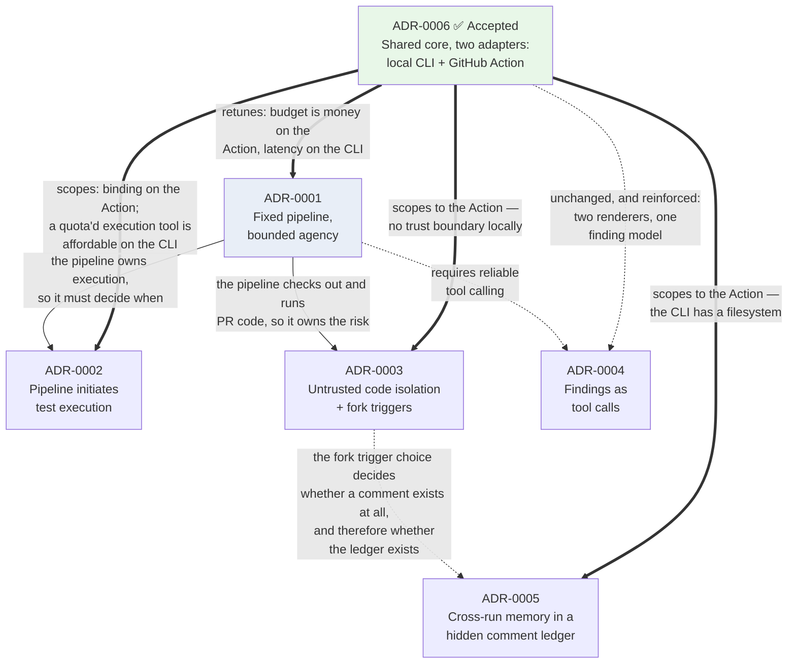

# Architecture Decision Records

An **ADR** is a short document that records one architectural decision: what we were choosing between, what we picked, and what we now have to live with. It is written once, at the moment of the decision, and then left alone. If we later change our minds, we write a *new* ADR that supersedes the old one rather than editing history — so that a year from now, someone can see not just what we chose but what we knew at the time.

These records use the same plain-language style as [`agent-harness-design.md`](../Draft/agent-harness-design.md), which is the narrative explanation these decisions came out of. Every requirement referenced is stated in words, with its identifier in brackets for traceability — normative for the current version in [`agentic-code-review-srs-v1.md`](../agentic-code-review-srs-v1.md), and catalogued across all versions in [`Draft/agentic-code-review-srs.md`](../Draft/agentic-code-review-srs.md).

## The records

| # | Decision | Status |
|---|---|---|
| [0001](./0001-fixed-pipeline-with-bounded-agency.md) | Orchestration is a fixed pipeline; model agency is a bounded loop inside one step, sized by risk tier | Proposed |
| [0002](./0002-pipeline-initiates-test-execution.md) | The pipeline runs the tests once; the model queries the recorded results | Proposed |
| [0003](./0003-untrusted-code-isolation-and-fork-triggers.md) | Untrusted PR code never shares an environment with credentials; fork PRs are reviewed only on request | Proposed |
| [0004](./0004-findings-emitted-as-tool-calls.md) | Findings are emitted as tool calls validated against a schema, not parsed out of prose | Proposed |
| [0005](./0005-cross-run-memory-as-hidden-comment-ledger.md) | Memory that must survive between runs lives in a hidden ledger inside the summary comment | Proposed |
| [0006](./0006-local-cli-core-action-as-adapter.md) | The reviewing core is a local CLI; the GitHub Action is an adapter over it | **Accepted** |

## How they relate

Solid arrows are parent/child: the child decision only makes sense because of the parent. Dashed arrows are constraints one decision places on another. **Thick arrows** are amendments — ADR-0006 changed the scope or tuning of four earlier records without reversing any of them.

### Version applicability

GitHub integration was deferred to **v3** on 2026-09-08, and v1 was baselined as [`agentic-code-review-srs-v1.md`](../agentic-code-review-srs-v1.md). That does not change any decision below, but it changes when each one starts to matter:

| Record | Binds from |
|---|---|
| 0001 — fixed pipeline, bounded agency | **v1**, at step ceiling zero — stated normatively as FR-5.7 |
| 0002 — pipeline initiates test execution | **v1** on the CLI, where its prohibition relaxes; strictly from v3 on the Action |
| 0003 — untrusted code isolation, fork triggers | **v3** — no trust boundary exists locally |
| 0004 — findings as tool calls | **v1** — the one record with no version or surface caveat |
| 0005 — cross-run memory ledger | **v3** — though its fingerprint design binds v1's local state file |
| 0006 — CLI core, Action as adapter | **v1** — and it is what lets v3 be an addition rather than a rewrite |

### Reading order

ADR-0006 was decided last but changes how the others should be read, so read it **first** if you are new to this set. Records 0001 through 0005 were written assuming a single delivery surface — a GitHub Action reviewing a pull request. They remain correct on that surface. Where 0006 marks one as scoped, its reasoning applies to the Action adapter and not to the shared core.

## Status values

| Status | Meaning |
|---|---|
| **Proposed** | Written down, not yet agreed by the maintainers |
| **Accepted** | Agreed; the codebase should reflect it |
| **Superseded** | A later ADR replaced it; the record stays for history |
| **Deprecated** | No longer relevant, but not replaced by anything |

[ADR-0006](./0006-local-cli-core-action-as-adapter.md) is **Accepted**. The other five remain **Proposed** — not ratified, and three of them describe gaps in the current requirements rather than decisions the specification already made.
