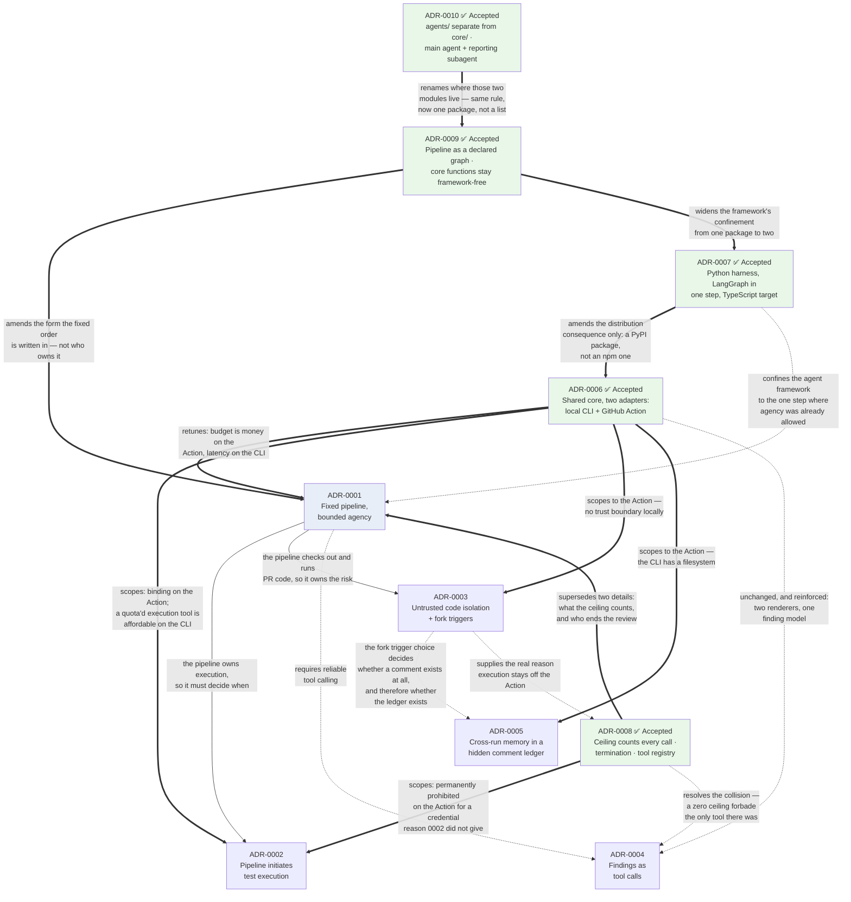

# Architecture Decision Records

An **ADR** is a short document that records one architectural decision: what we were choosing between, what we picked, and what we now have to live with. It is written once, at the moment of the decision, and then left alone. If we later change our minds, we write a *new* ADR that supersedes the old one rather than editing history — so that a year from now, someone can see not just what we chose but what we knew at the time.

These records use the same plain-language style as [`agent-harness-design.md`](../Draft/agent-harness-design.md), which is the narrative explanation these decisions came out of. Every requirement referenced is stated in words, with its identifier in brackets for traceability — normative for the current version in [`agentic-code-review-srs-v1.md`](../agentic-code-review-srs-v1.md), and catalogued across all versions in [`Draft/agentic-code-review-srs.md`](../Draft/agentic-code-review-srs.md).

## The records

| # | Decision | Status |
|---|---|---|
| [0001](./0001-fixed-pipeline-with-bounded-agency.md) | Orchestration is a fixed pipeline; model agency is a bounded loop inside one step, sized by risk tier | Proposed |
| [0002](./0002-pipeline-initiates-test-execution.md) | The pipeline runs the tests once; the model queries the recorded results | Proposed |
| [0003](./0003-untrusted-code-isolation-and-fork-triggers.md) | Untrusted PR code never shares an environment with credentials; fork PRs are reviewed only on request | Proposed |
| [0004](./0004-findings-emitted-as-tool-calls.md) | Findings are emitted as tool calls validated against a schema, not parsed out of prose | Proposed |
| [0005](./0005-cross-run-memory-as-hidden-comment-ledger.md) | Memory that must survive between runs lives in a hidden ledger inside the summary comment | Proposed |
| [0006](./0006-local-cli-core-action-as-adapter.md) | The reviewing core is a local CLI; the GitHub Action is an adapter over it | **Accepted** |
| [0007](./0007-python-harness-typescript-target.md) | The harness is Python with LangGraph; the reviewed language is TypeScript | **Accepted** |
| [0008](./0008-agent-runtime-tool-registry-and-termination.md) | The ceiling counts every tool call; termination is the model declining to call one; the tool list is a versioned registry | **Accepted** |
| [0009](./0009-pipeline-as-declared-graph.md) | The pipeline is a declared graph with one node per phase; the core functions stay framework-free | **Accepted** |
| [0010](./0010-agents-package-separate-from-core.md) | Agents live in their own package; `core/` is framework-free | **Accepted** |

## How they relate

Solid arrows are parent/child: the child decision only makes sense because of the parent. Dashed arrows are constraints one decision places on another. **Thick arrows** are amendments — ADR-0006 changed the scope or tuning of four earlier records without reversing any of them, and ADR-0007 changes one consequence of ADR-0006.

ADR-0007 is the only record that names an implementation technology. Everything above it was decided before the stack was chosen and survived the stack being chosen unaltered — which is the evidence that those decisions were taken at the right level.

### Version applicability

GitHub integration was deferred to **v3** on 2026-09-08, and v1 was baselined as [`agentic-code-review-srs-v1.md`](../agentic-code-review-srs-v1.md). That does not change any decision below, but it changes when each one starts to matter:

| Record | Binds from |
|---|---|
| 0001 — fixed pipeline, bounded agency | **v1**, with investigation switched off — stated normatively as FR-5.7a |
| 0002 — pipeline initiates test execution | **v1 and v3, in full.** Its prohibition is *relaxable* on a local surface, but v1 does not take that option: FR-4.6 keeps it absolutely |
| 0003 — untrusted code isolation, fork triggers | **v3** — no trust boundary exists locally |
| 0005 — cross-run memory ledger | **v3.** Its *fingerprint* design binds v1 — not as state, which v1 has none of, but as the corpus matcher required by FR-6.2f |
| 0004 — findings as tool calls | **v1** — the one record with no version or surface caveat |
| 0006 — CLI core, Action as adapter | **v1** — and it is what lets v3 be an addition rather than a rewrite |
| 0007 — Python harness, TypeScript target | **v1** — it binds from the first line of code, because it decides which language that line is in |
| 0008 — agent runtime, registry, termination | **v1** for counting, termination, the registry and observations; its execution ruling binds **v2** on the CLI and **v3** on the Action |
| 0009 — pipeline as a declared graph | **v1** — it changes the shape of the code every later feature is added to, so its cost rises with each stage built imperatively |
| 0010 — agents separate from core | **v1** — it decides which package every later module is written into |

*Two rows were corrected on 2026-09-14. **0002** previously read "v1 on the CLI, where its prohibition relaxes", which invites an implementer to build the thing FR-4.6 forbids — [ADR-0006](./0006-local-cli-core-action-as-adapter.md) made the relaxation **available**, and v1 declined it. **0005** previously said its fingerprint design "binds v1's local state file"; v1 has no state file (FR-10.5 is v2), but the design binds v1 through a different door. See the correction note in that record.*

### Superseded details

These records are append-only and are not edited. Where a **detail** in one has since been overtaken, it is noted at the top of that record and listed here. In every case the **decision** stands — what changed is a number, a lifetime, or a way of counting.

| Record | Detail | Superseded by |
|---|---|---|
| 0001, 0006, 0007 | The **10–30 second** latency figure | [SRS v1.1](../agentic-code-review-srs-v1.md) §2.4 — withdrawn as an unmeasured estimate; carried as TBD-2, to be established by observing real MVP users. *Latency remains the CLI's binding constraint; only the number is gone* |
| 0001 | The **step ceiling counts investigation steps** | [ADR-0008](./0008-agent-runtime-tool-registry-and-termination.md) and SRS v1.1 FR-5.7 — it counts **every** tool call, `emit_finding` included, and investigation becomes a separate switch. Resolves a collision with ADR-0004 |
| 0001 | *"Decide when the review ends"* listed as **not allowed** | [ADR-0008](./0008-agent-runtime-tool-registry-and-termination.md) — withdrawn. The model ends the review by replying without a tool call; the harness may never compel one (FR-5.10) |
| 0002 | Agent-triggered execution deferred on **cost** grounds | [ADR-0008](./0008-agent-runtime-tool-registry-and-termination.md) — permanently prohibited on the Action for a **credential-boundary** reason instead; permitted on the CLI from v2 under a quota; not built in v1 |
| 0007 | **One sidecar process per review**, as a requirement | SRS v1.1 FR-2.6f — restated as a property plus a budget. One process per review remains the right default; it is no longer mandated, so a measured alternative is permitted |
| 0005 | "v1 stores state in a local file" | [SRS §7](../agentic-code-review-srs-v1.md) — v1 has no state file. The fingerprint design binds v1 through FR-6.2f instead |
| 0001, 0007 | The agent framework **confined to CF-6** (FR-5.8) | [ADR-0009](./0009-pipeline-as-declared-graph.md) — narrowed to "no *core-function* package may import it", adding `core/pipeline/` as a second permitted site. ADR-0001's decision that our code owns orchestration is untouched; what changes is the form the fixed order is written in |

The first four were raised during the design phase and are recorded in [`DESIGN_BLOCKERS.md`](../../DESIGN_BLOCKERS.md). The fifth was raised while building feature 001 and is carried by ADR-0009 itself.

### Reading order

ADR-0006 was decided last but changes how the others should be read, so read it **first** if you are new to this set. Records 0001 through 0005 were written assuming a single delivery surface — a GitHub Action reviewing a pull request. They remain correct on that surface. Where 0006 marks one as scoped, its reasoning applies to the Action adapter and not to the shared core.

**Read the note at the top of a record before its body.** Amendment, scope and superseded-detail notes are how this set stays append-only: the reasoning below a note is preserved exactly as it was written, which means a number or a mechanism in it may since have been overtaken. The note says which. Where a record and [the specification](../agentic-code-review-srs-v1.md) disagree, the specification wins.

## Status values

| Status | Meaning |
|---|---|
| **Proposed** | Written down, not yet agreed by the maintainers |
| **Accepted** | Agreed; the codebase should reflect it |
| **Superseded** | A later ADR replaced it; the record stays for history |
| **Deprecated** | No longer relevant, but not replaced by anything |

[ADR-0006](./0006-local-cli-core-action-as-adapter.md), [ADR-0007](./0007-python-harness-typescript-target.md), [ADR-0008](./0008-agent-runtime-tool-registry-and-termination.md), [ADR-0009](./0009-pipeline-as-declared-graph.md) and [ADR-0010](./0010-agents-package-separate-from-core.md) are **Accepted**. The other five remain **Proposed** — not ratified, and three of them describe gaps in the current requirements rather than decisions the specification already made.

[ADR-0009](./0009-pipeline-as-declared-graph.md) is the only record that **amended a Must requirement** rather than filling a gap. FR-5.8 and AC-10 were edited in the same change that accepted it, so the specification and the code agree; the three remaining edits it lists are to the stack and design documents.
