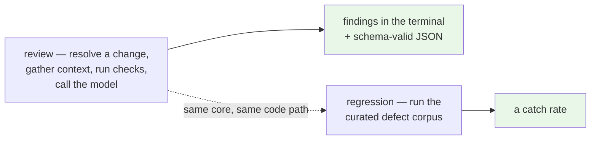
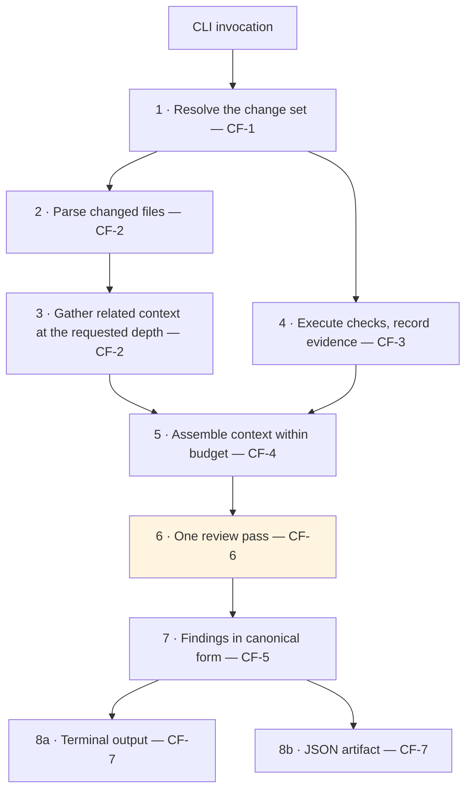
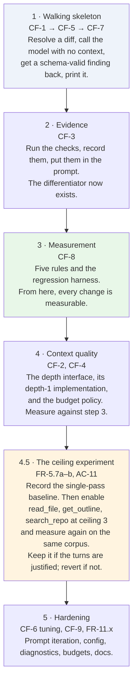

# Software Requirements Specification — Agentic Code Review v1

**Status:** Baselined · **Version:** 1.0 · **Date:** 2026-09-08
**Scope:** Local command-line reviewer for TypeScript/JavaScript
**Audience:** Contributors building v1, and reviewers verifying that a change meets it

---

## 0. About this document

This is the **authoritative specification for the version being built**. It is self-contained: everything required to implement and verify v1 is here.

It was derived from the analysis in [`Draft/mvp-scope.md`](./Draft/mvp-scope.md), which selected this subset from the larger requirement catalogue in [`Draft/agentic-code-review-srs.md`](./Draft/agentic-code-review-srs.md). Those documents remain as the record of *why* — the rationale, the options weighed, and the requirements deferred. **Where they disagree with this document, this document wins.**

| Document | Role |
|---|---|
| **This document** | What v1 is. Normative. |
| [`adr/`](./adr/) | Architecture decisions and their reasoning. Normative where cited below. |
| [`Draft/agentic-code-review-srs.md`](./Draft/agentic-code-review-srs.md) | The full requirement catalogue across v1–v3 and beyond. Historical and forward-looking; not the build target. |
| [`Draft/mvp-scope.md`](./Draft/mvp-scope.md) | The analysis that selected this scope. Explains every inclusion and every cut. |
| [`Draft/agent-harness-design.md`](./Draft/agent-harness-design.md) | Plain-language design guide for the harness layer. |
| [`Draft/`](./Draft/) (remainder) | Problem definition, competitive landscape, tool reference, feature inventory. Background. |

**Requirement identifiers are inherited unchanged** from the catalogue, so every cross-reference in the ADRs and design documents stays valid. Requirements introduced by this baseline are marked **(new in v1)**.

---

## 1. Introduction

### 1.1 Purpose

v1 delivers a reviewing engine that a developer runs from a terminal against their own uncommitted work, and an instrument that measures how good that engine is. It is an **engineering milestone, not the product**: the product claim — reducing a reviewer's queue on pull requests — is made in v3, when the same core reaches GitHub.

Two commands constitute the deliverable:



### 1.2 Scope

**In scope for v1**

- A local CLI reviewing a working tree, staged changes, or a branch range in a TS/JS repository
- Syntax-tree parsing and related-context retrieval behind a depth-parameterised interface, with the parser-backed implementation serving depths 0 and 1
- Execution of the project's tests and type-check, with a recorded evidence trail
- A review agent isolated from any code-writing agent, grounded in that evidence and in a pattern library — single-pass by default, with three read-only investigation tools available once a baseline has been measured (FR-5.7a, FR-5.7b)
- A canonical finding model with a versioned schema, terminal rendering, and JSON output
- A pattern library and a runnable regression harness reporting a catch rate
- Configuration, credential handling, and diagnosable failure messages

**Deliberately not in v1** — §7 lists these with their destination version. In summary: GitHub integration of any kind (v3), context depths 2 and above, risk triage, the agent tool loop, cross-run de-duplication, and fix-patch generation.

### 1.3 Definitions

| Term | Definition |
|---|---|
| **Change set** | The resolved answer to "what am I reviewing?": a list of changed files and diff hunks. |
| **Context depth** | How far from the changed code the system reaches when gathering related source. Defined as a ladder in §4.2.1. |
| **Context unit** | One piece of related source included in the review context, carrying why it was included and how far away it is. |
| **Core** | The surface-independent reviewing engine. In v1 the CLI is its only caller. |
| **Adapter** | A layer translating between a surface and the core. It resolves what to review, renders findings, and stores state; **it never decides what counts as a finding**. |
| **Evidence record** | The structured outcome of executing checks: per check, whether it ran, was skipped, or errored, plus its result and captured output. |
| **Finding** | One review observation: file, line or range, severity, category, rationale, and optionally a matched rule identifier. |
| **Finding model** | The single canonical typed structure for findings (FR-0), from which all outputs are derived. |
| **Pattern rule** | A "wrong vs. correct" example with an identifier, applied by the agent when producing findings. |
| **Regression harness** | A runnable test over a curated corpus of known defects, reporting how many the reviewer caught. |
| **Host language** | The language the system itself is written in — Python ([ADR-0007](./adr/0007-python-harness-typescript-target.md)). Distinct from the **target language**, TypeScript/JavaScript, which is the language of the code being reviewed. |
| **Resolver sidecar** | A bundled helper process, in the target language's own toolchain, that answers "which file does this import specifier refer to?". Private to CF-2 (FR-2.6f). |
| **Must / Should** | **Must** = required for v1 to be complete. **Should** = required if time allows; its absence does not block release. |

### 1.4 References

- Architecture decisions: [`adr/`](./adr/) — particularly [ADR-0001](./adr/0001-fixed-pipeline-with-bounded-agency.md) (pipeline and step ceiling), [ADR-0004](./adr/0004-findings-emitted-as-tool-calls.md) (findings as tool calls), [ADR-0006](./adr/0006-local-cli-core-action-as-adapter.md) (CLI core, Action as adapter), [ADR-0007](./adr/0007-python-harness-typescript-target.md) (Python harness, TypeScript target)
- Scope derivation: [`Draft/mvp-scope.md`](./Draft/mvp-scope.md)
- Full catalogue: [`Draft/agentic-code-review-srs.md`](./Draft/agentic-code-review-srs.md)
- Non-functional requirements: deferred to a dedicated pass (§8)

---

## 2. Overall Description

### 2.1 Product Perspective

The system is a self-contained command-line program. It runs on a developer's machine, reads a git repository, executes that repository's own test commands, and makes HTTPS calls to one external model provider. It operates no server, holds no remote state, and requires no account beyond a provider API key.

Internally it is **one core behind a thin adapter**, per [ADR-0006](./adr/0006-local-cli-core-action-as-adapter.md). v1 builds one adapter (the CLI). The constraint that adapters never decide what counts as a finding binds from the first line of code, because it is what allows v3 to add the GitHub Action without a rewrite.

Orchestration is a **fixed pipeline** owned by our code, per [ADR-0001](./adr/0001-fixed-pipeline-with-bounded-agency.md):



Step 6 is the only step involving a model. In v1 it is a **single pass** — the step ceiling is zero (FR-5.7).

The pipeline is plain Python. The agent framework is confined to step 6 (FR-5.8), which is the step where a loop is one day permitted and the only step where a framework has anything to orchestrate. That confinement is what makes FR-5.7's promise — that raising the ceiling is configuration rather than restructuring — true by construction: at ceiling zero the review step is a graph with one node, and above zero it is the same graph with an edge back to it. See [ADR-0007](./adr/0007-python-harness-typescript-target.md).

### 2.2 Users

| User | Need v1 serves |
|---|---|
| **The developer author** | A review of their own work before they push it |
| **The contributor building this system** | A fast iteration loop and a measurable engine |
| **The maintainer** | Evidence that a change to prompts, context, or rules improved or worsened the reviewer |

Note that v1's primary user is the **author**, not the reviewer named as the primary persona in [`Draft/Agentic_Code_Review_Problem_Definition_v1.md`](./Draft/Agentic_Code_Review_Problem_Definition_v1.md). This is a known and accepted consequence of sequencing GitHub integration into v3 (§9, R-5).

### 2.3 Operating Environment

The system is written in a different language from the code it reviews. That split is decided in [ADR-0007](./adr/0007-python-harness-typescript-target.md) and it is the reason this section distinguishes three environments that earlier drafts treated as one.

| | |
|---|---|
| **Platform** | A developer workstation — Linux, macOS, or Windows |
| **Host runtime** | Python, with `tree-sitter` bindings as a native extension (FR-2.2) |
| **Agent libraries** | LangChain for the provider interface, tool binding, and structured output; LangGraph for the review step only (FR-5.8) |
| **Resolver sidecar** | A bundled Node.js script over the TypeScript compiler API, used for depth-1 module resolution (FR-2.6f). Node is a **runtime prerequisite for authoritative depth 1, never for installation** — its absence degrades and reports (FR-2.6g) |
| **Repository under review** | A TypeScript/JavaScript project with a runnable test script, under git. Its checks run through **its own** toolchain, in a separate process (FR-4.7) |
| **Distribution** | A PyPI package with a console entry point, installed with `uv tool install` or `pipx`. The bundled resolver ships as package data |
| **External dependency** | One AI model provider reachable over HTTPS (NVIDIA NIM free tier as the default), accessed through an OpenAI-compatible client so that FR-0.3 reduces to a base URL and a model name |
| **Credentials** | A provider API key supplied through the environment or user-level configuration |

### 2.4 Assumptions and Constraints

- **Budget:** free provider tiers, or a single plan around $20/month. No paid inference infrastructure.
- **Binding constraint is latency, not runner minutes.** A developer waiting at a prompt abandons the tool after roughly 10–30 seconds. Cost is borne per invocation and is visible to the user.
- **Value depends on a runnable test suite.** Execution-backed review adds nothing to a repository whose tests cannot run; the system must say so rather than degrade silently (FR-9.3).
- **The provider must support tool calling for at least one call per review.** v1 requires exactly one reliable `emit_finding` call, not a multi-step loop — this is the documented fallback configuration in [ADR-0001](./adr/0001-fixed-pipeline-with-bounded-agency.md) and materially reduces the free-tier dependency risk.
- **The system and the repository under review share no runtime.** Checks are executed through the project's own toolchain as subprocesses (FR-4.7); the system never imports the project's dependencies and never asks the project to install its own. This removes a class of version-conflict failure that a shared runtime would have carried.
- **Node.js is optional at install time and required only for authoritative depth-1 resolution** (FR-2.6f, FR-2.6g). In practice the target user has it, because they have a TypeScript repository; the degrade path exists so that its absence is reported rather than fatal.
- **The host language is not the target language, and this costs something in CF-2.** Syntax is fully served in-process; module resolution is not, which is why the sidecar exists. See [ADR-0007](./adr/0007-python-harness-typescript-target.md) and §9, R-7.
- Single provider and single language are deliberate scoping decisions, not technical limitations.

### 2.5 What v1 deliberately is not

v1 **demonstrates that the pipeline works end to end. It does not yet demonstrate the project's thesis.** At context depth 1 the system can judge whether a change is internally sound and consistent with stated rules; it cannot judge whether the change violates an assumption held by a caller it never looked at. Inbound call sites arrive at depth 2, in v2.

This is stated here rather than buried because it governs how v1 should be demonstrated and described. See §9, R-1.

---

## 3. Core Functions

The requirements in §4 are organised around nine function blocks. Each requirement belongs to exactly one.

| # | Core function | Responsibility |
|---|---|---|
| **CF-1** | Change-set resolution | Turn an invocation into a concrete list of changed files and hunks |
| **CF-2** | Parsing and related context | Syntax trees, and related source retrieved at a requested depth |
| **CF-3** | Execution and evidence | Run the project's checks; record what happened |
| **CF-4** | Context assembly | Fit diff, related context, evidence, and rules into the model window |
| **CF-5** | Finding model and provider client | The canonical structure, its schema, and the model interface |
| **CF-6** | The review agent | A grounded, isolated review pass — single by default, with a corpus-gated route to a bounded loop |
| **CF-7** | Output | Terminal rendering, JSON artifact, exit status |
| **CF-8** | Pattern library and regression harness | Rules, rule attribution, and measurement |
| **CF-9** | Configuration and diagnostics | Config, credentials, and legible failure |

---

## 4. Functional Requirements

Written as testable "the system shall…" statements. Identifiers are inherited from the catalogue except where marked **(new in v1)**.

### 4.1 CF-1 — Change-Set Resolution

- **FR-10.3a (Must)** The system shall resolve the change scope from an explicit selection among: uncommitted working-tree changes, staged changes only, or a comparison against a named branch or commit.
- **FR-10.3b (Must)** The system shall apply a documented default change scope when none is specified, and shall state the resolved scope in its output.
- **FR-10.3c (Must) (new in v1)** The resolved change set shall be expressed as a list of changed files and diff hunks, in a structure independent of how it was resolved.

*FR-10.3c is the seam that lets the v3 Action adapter substitute "PR head against base" (FR-2.1) with no downstream change.*

### 4.2 CF-2 — Parsing and Related Context

- **FR-2.2 (Must)** The system shall build a `tree-sitter` AST for changed TS/JS files, in the host process, without invoking the target language's toolchain.
- **FR-2.4 (Should)** The system shall include relevant surrounding context — function, class, and type boundaries — rather than raw line windows.
- **FR-2.3d (Must)** The system shall record which related files were included and why, for traceability.

#### 4.2.1 The context depth ladder

Related context is retrieved at a **depth**, defined by this ladder. v1 implements depths 0 and 1.

| Depth | What it includes | Resolvable by | Version |
|---|---|---|---|
| **0** | Changed hunks, expanded to enclosing function, class, or type boundaries | Parsing the changed files | **v1** |
| **1** | What the changed code reaches outward to: definitions of symbols it imports and calls | Parsing the changed files, then the files their imports name | **v1** |
| **2** | What reaches inward: files importing a changed symbol, direct call sites of a changed function | A reverse index over the repository | v2 |
| **3** | Transitive neighbours | The same index, traversed further | v2+ |

The ladder is ordered by **cost of resolution**, not purely by graph distance. A file's imports are inside the file; who depends on it is not.

#### 4.2.2 The related-context interface

- **FR-2.6a (Must) (new in v1)** The system shall expose related-context retrieval through a single interface parameterised by depth, with the implementation selected at run time.
- **FR-2.6b (Must) (new in v1)** v1 shall provide a parser-backed implementation serving depths 0 and 1 without requiring any repository-wide index.
- **FR-2.6c (Must) (new in v1)** Every returned context unit shall carry the relation by which it was included (`imports`, `calls`, `imported-by`, `called-by`) and its distance from the change.
- **FR-2.6d (Must) (new in v1)** A retrieval result shall state the depth actually achieved and, where that is lower than requested, the reason. The system shall not silently downgrade.
- **FR-2.6e (Must) (new in v1)** No consumer of the interface shall branch on which implementation served the request.
- **FR-2.6f (Must) (new in v1)** Depth-1 module-specifier resolution shall be delegated to a bundled resolver process over a documented request/response contract. That process shall be started at most once per invocation, shall be shipped with the package rather than fetched at review time, and shall not be observable outside CF-2 (FR-2.6e).
- **FR-2.6g (Must) (new in v1)** Where the resolver process is unavailable or fails, the system shall fall back to heuristic path resolution, mark the retrieval result `degraded: 'unresolvable-imports'`, and complete the review. The absence of the resolver shall never fail an invocation (FR-11.2).

*FR-2.6f is what buys authoritative resolution — `tsconfig` path aliases, index files, package `exports` maps, workspace links — from the target language's own compiler rather than from a reimplementation of it. FR-2.6g is what stops that from becoming a hard dependency. The pair is stated in [ADR-0007](./adr/0007-python-harness-typescript-target.md); the "at most once per invocation" clause in FR-2.6f is a latency requirement, not an implementation note, because a process launched per specifier would multiply a fixed startup cost across every import in the change.*

Normative interface:

```ts
type Relation = 'imports' | 'calls' | 'imported-by' | 'called-by';

interface ContextUnit {
  file: string;
  symbol?: string;
  range: [number, number];
  source: string;
  relation: Relation;   // FR-2.6c
  distance: number;     // FR-2.6c — drives eviction, FR-2.5
}

interface RelatedContextRequest {
  changeSet: ChangeSet;
  depth: number;        // requested, not guaranteed
  budget: TokenBudget;
}

interface RelatedContextResult {
  units: ContextUnit[];     // ordered by distance, then relevance
  achievedDepth: number;    // FR-2.6d
  degraded?: 'no-index' | 'budget-exhausted' | 'unresolvable-imports';
}

interface RelatedContextProvider {
  readonly maxDepth: number;
  resolve(req: RelatedContextRequest): Promise<RelatedContextResult>;
}
```

| Implementation | `maxDepth` | Requires | Version |
|---|---|---|---|
| `ParserContextProvider` | 1 | Nothing beyond the changed files at depth 0; the resolver sidecar for authoritative depth 1, degrading without it (FR-2.6g) | **v1** |
| `IndexContextProvider` | 3 | A built reverse index | v2 |

FR-2.6e is the requirement that makes v2 a new implementation rather than a change to CF-4, CF-6, and CF-7. It is the highest-value structural constraint in this document.

It also absorbs the resolver sidecar entirely. The sidecar is `ParserContextProvider`'s private business: it changes the *quality* of what the interface returns and is reported through `degraded`, but no consumer learns of its existence, and no signature above changes because of it.

### 4.3 CF-3 — Execution and Evidence

- **FR-4.1 (Must)** The system shall run the project's test suite on the developer's machine and capture pass/fail results and output.
- **FR-4.2 (Must)** The system shall run build/type checks (e.g. `tsc`) and capture results.
- **FR-4.4a (Must)** The system shall enforce a configurable time budget on the execution phase and terminate execution when it is exceeded.
- **FR-4.4b (Must)** On termination due to timeout, the system shall mark execution as `timed-out`, skip remaining checks, and continue to produce a review reporting the timeout.
- **FR-4.5a (Must)** The system shall record, for each check, whether it was run, skipped, or errored.
- **FR-4.5b (Must)** The system shall record each executed check's pass/fail result and captured output.
- **FR-4.5c (Must)** The system shall make this execution record available to the review agent and include it in the structured output.
- **FR-4.6 (Must) (new in v1)** The review agent shall not be able to trigger check execution. Execution occurs once per invocation, before the review pass.
- **FR-4.7 (Must) (new in v1)** Checks shall be executed as subprocesses invoking the reviewed project's own toolchain and package manager, discovered from its manifest or named in configuration. The system shall not import the reviewed project's dependencies into the host runtime, and shall not require the reviewed project to install anything belonging to the system.

*FR-4.7 is the one consequence CF-3 takes from the host language being different from the target language ([ADR-0007](./adr/0007-python-harness-typescript-target.md)). It is close to free: the system was always going to shell out to `npm test` and `tsc`, and it now has no mechanism to do anything else. What the requirement adds is the second half — that the reviewer never contaminates the project it is reviewing, in either direction. A version conflict between reviewer and reviewed is not a bug that can be introduced.*

*FR-4.6 states for v1 the decision in [ADR-0002](./adr/0002-pipeline-initiates-test-execution.md). That record notes the prohibition relaxes on a local surface where a targeted run costs seconds; v1 nonetheless keeps it, because the single-pass agent (FR-5.7) has no loop in which to call such a tool. Both may be revisited together in v2.*

### 4.4 CF-4 — Context Assembly

- **FR-2.3c (Must)** The system shall include the source of related definitions and call sites in the review context passed to the agent, up to the context cap.
- **FR-2.5 (Must)** The system shall cap context size to stay within model token limits, degrading gracefully when exceeded.
- **FR-2.5a (Must) (new in v1)** Context shall be budgeted per section — instructions and rules, the diff, related context, and evidence — so that no section can starve another.
- **FR-2.5b (Must) (new in v1)** When the budget is exceeded, the system shall evict context units in descending order of `distance`, and shall never truncate the diff itself.
- **FR-2.5c (Must) (new in v1)** Captured check output shall be reduced to failing test names, assertion messages, and stack frames referring to changed files before entering the context. Full output is retained for the structured output only.

*FR-2.5c prevents the largest accidental context sink in the design: a failing suite can emit megabytes.*

### 4.5 CF-5 — Finding Model and Provider Client

- **FR-0.1 (Must)** The system shall define a provider-independent internal finding representation — "the finding model" — as the single canonical structure for all review findings.
- **FR-0.2 (Must)** All model output shall be converted into the finding model before any downstream use; no component shall consume raw provider responses directly.
- **FR-0.3 (Must)** A new provider shall be integratable by mapping its output to the finding model without changes to downstream components.
- **FR-0.4 (Must)** The finding model shall have a documented, versioned schema carrying a schema-version field.
- **FR-5.2 (Must)** Each finding shall contain: file path, line or line-range, severity, category, rationale, and optionally the identifier of a matched pattern rule.
- **FR-5.6 (Must)** The agent's output shall conform to the finding model; all outputs shall be derived from it, not produced independently by the model.
- **FR-5.6a (Must) (new in v1)** Findings shall enter the system exclusively through an `emit_finding` tool call validated against the finding-model schema at the call boundary. Prose the model produces shall not be parsed for findings.
- **FR-5.6b (Should) (new in v1)** Where the provider cannot perform tool calls, the system shall fall back to schema-validated structured output with a documented retry cap, and shall report which path was used.

*FR-5.6a states [ADR-0004](./adr/0004-findings-emitted-as-tool-calls.md) normatively.*

### 4.6 CF-6 — The Review Agent

- **FR-5.1 (Must)** The review agent shall operate in a context isolated from any code-writing agent — no shared history or state.
- **FR-5.3 (Must)** The agent shall incorporate execution results (CF-3) and pattern-library rules (CF-8) into its findings.
- **FR-5.7 (Must) (new in v1)** The review step's tool-call ceiling shall be a configuration value with a documented default of **zero** — a single model pass in which `emit_finding` is the only tool exposed.
- **FR-5.7a (Should) (new in v1)** When the ceiling is above zero, the system shall expose exactly three read-only investigation tools: `read_file`, `get_outline`, and `search_repo`. No tool shall have side effects, and no tool shall trigger check execution (FR-4.6).
- **FR-5.7b (Must) (new in v1)** The ceiling shall not be raised above its default until a single-pass baseline catch rate has been recorded on the regression corpus (FR-6.2d). Any subsequent ceiling shall be justified by a measured comparison against that baseline.
- **FR-5.7c (Should) (new in v1)** When the ceiling is above zero, each model turn shall be told how many tool calls remain, and the review shall report whether it ended because the agent finished or because the ceiling was reached.
- **FR-5.7d (Should) (new in v1)** Findings shall have the same structure and meaning at every ceiling value. A change of ceiling shall change how much is found, never what a finding is.
- **FR-5.8 (Must) (new in v1)** The agent framework shall be confined to CF-6. No module outside CF-6 shall import it, and the pipeline steps outside CF-6 shall be callable as ordinary functions without it.

*This is [ADR-0001](./adr/0001-fixed-pipeline-with-bounded-agency.md) with the ceiling pinned to its documented fallback, plus a stated route off it.*

*FR-5.8 keeps ADR-0001 true now that a framework is in the repository. That record's decision was that **our code owns orchestration** and the model's agency lives in one step; adopting an agent framework is the most natural way to give that away by accident, one convenient node at a time. Confining it to CF-6 costs nothing — the fixed steps have no loops, no branching on model output, and nothing for a graph to orchestrate — and it keeps CF-1 through CF-5 and CF-7 unit-testable without a framework in the fixture. It is checkable by import list, which is why it joins AC-10 rather than needing an acceptance criterion of its own.*

**Why zero is the default, and why raising it is a v1 activity rather than a v2 feature.** The three tools in FR-5.7a are read-only over data v1 already has — no security surface, no runner minutes, and a three-step ceiling costs roughly four model calls, which fits the latency budget in §2.4 at its upper end. Neither capability nor safety is the obstacle. **Sequencing is.** The single-pass run is the control arm for the only question that matters here — *does letting the model investigate improve catch rate enough to justify the extra turns?* — and that question cannot be answered without a no-loop baseline measured on the same corpus. FR-5.7b encodes that ordering as a requirement rather than an intention.

Two tools that appear in earlier design notes are deliberately **not** in FR-5.7a: `get_check_result`, because distilled evidence is small and needed in every review, so preloading beats a turn spent fetching it; and `lookup_pattern_rule`, because v1 ships five rules (FR-6.3a) and preloading all five beats a lookup. Both become genuine tools at larger scale. `find_references` is excluded for a different reason — it is tool-shaped, but it requires the reverse index deferred to v2 (FR-2.3a, FR-2.3b).

### 4.7 CF-7 — Output

- **FR-8.1b (Must)** The terminal summary shall state the resolved change scope, the checks run and their results, the count of findings by severity, and an overall verdict.
- **FR-8.2a (Must)** The system shall serialize the finding model to JSON as a machine-readable artifact.
- **FR-8.2b (Must)** The JSON shall conform to the finding model's versioned schema, including findings, severities, and the evidence record.
- **FR-8.4 (Should)** The structured output schema shall be documented and versioned.
- **FR-10.4a (Must)** The system shall render findings to the terminal, derived from the finding model and not produced independently.
- **FR-10.4b (Must)** The system shall provide machine-readable output on request, conforming to the schema in FR-8.2b.
- **FR-10.4c (Should)** The system shall exit with a status code reflecting the review outcome, documented and stable across versions.
- **FR-8.2c (Must) (new in v1)** The structured output shall record the achieved context depth, the tool-call ceiling in force and the number of tool calls actually made, the completion status (FR-5.7c), the model and schema versions used, and the resolved change scope — so a run can be reproduced and compared.

*FR-8.2c is what makes the depth comparison in §6 possible after the fact rather than only in a controlled harness run.*

### 4.8 CF-8 — Pattern Library and Regression Harness

- **FR-6.1 (Must)** The system shall load a configurable pattern library of "wrong vs. correct" examples and project standards.
- **FR-6.2a (Must)** When a finding is generated from a pattern-library rule, the finding shall reference the identifier of the matched rule.
- **FR-6.2b (Must)** The system shall support a regression set of pattern examples with expected outcomes, runnable as a test, so pattern-matching behaviour can be verified and monitored across changes.
- **FR-6.2d (Must) (new in v1)** The regression harness shall report a catch rate over the corpus, and shall accept both a context depth and a tool-call ceiling so that results at different settings are directly comparable.
- **FR-6.2e (Should) (new in v1)** Regression runs shall pin the settings that affect reproducibility — depth, ceiling, model, and sampling parameters — and record them with the result, so that measurement runs stay comparable even where production runs vary.
- **FR-6.3a (Must) (new in v1)** v1 shall ship at least five pattern rules, each with a wrong example, a correct example, and at least one corresponding regression case.

*Five rules is a floor that proves the mechanism, not a product-grade rule set. Breadth is v2 (FR-6.3).*

### 4.9 CF-9 — Configuration and Diagnostics

- **FR-1.2a (Must)** The system shall read configuration from `.agentic-review.yml` at the repository root when present.
- **FR-1.2b (Must)** When the file is absent, the system shall apply a documented built-in default configuration.
- **FR-1.2c (Must)** When the file is present but a field is missing, the system shall apply that field's documented default value.
- **FR-1.2d (Must)** When the file is present but malformed, the system shall fail with an error message identifying the offending field, and shall not fall back silently.
- **FR-1.3a (Must)** The system shall read the model provider credential from the local environment or user-level configuration, never from a hard-coded key and never from a file committed to the repository.
- **FR-3.5 (Must) (new in v1)** The system shall exclude configured generated, vendored, and build-output paths from review, using a documented default exclusion list.
- **FR-9.1 (Must)** The system shall ship with README, LICENSE, and CLI usage documentation.
- **FR-9.3 (Must)** The system shall provide clear failure messages when prerequisites — a test script, a provider key, a git repository, a parseable tree — are missing or unusable.

*FR-3.5 is v1's substitute for risk triage (FR-3.1–FR-3.4, deferred). It captures most of the benefit — not wasting a review on generated code — at a fraction of the cost. FR-9.3 is raised from Should to Must here: on a local surface a silent failure is indistinguishable from a clean review.*

### 4.10 Cross-cutting

- **FR-10.1 (Must)** The system shall provide a command-line interface that reviews a local change set without requiring GitHub API access or repository credentials.
- **FR-10.2 (Must)** No adapter shall contain logic that determines whether something is a finding.
- **FR-9.2a (Must)** The system shall complete an end-to-end review of a public TS/JS repository on a developer machine, using only a free model provider tier.
- **FR-11.1 (Must) (new in v1)** The system shall enforce a token and call budget per invocation and stop cleanly when it is reached, reporting that it did so.
- **FR-11.2 (Must) (new in v1)** The system shall produce a review under every failure mode — checks unrunnable, context over budget, provider error, budget exhausted — reporting the degradation rather than exiting silently.
- **FR-11.3 (Should) (new in v1)** The system shall record a trace of the invocation — resolved scope, achieved depth, checks executed, tokens spent — sufficient to explain why a finding was produced.

*FR-11.2 generalises the timeout rule (FR-4.4b) to every failure mode; it is the single requirement most likely to be quietly violated under schedule pressure.*

---

## 5. Interface Summary

| Interface | Defined in | Stability |
|---|---|---|
| Change set (files + hunks) | FR-10.3c | Frozen — the v3 adapter substitutes its producer |
| `RelatedContextProvider` | §4.2.2 | Frozen — v2 adds an implementation, not a signature |
| Resolver sidecar request/response | FR-2.6f | Internal to CF-2. Free to change — no consumer may observe it (FR-2.6e) |
| Check invocation (project toolchain) | FR-4.7 | A subprocess boundary, not a linked one; the host runtime and the project's runtime stay separate |
| Finding model + schema | FR-0.1, FR-0.4 | Versioned; changes require a schema-version bump |
| `emit_finding` tool schema | FR-5.6a | Equals the finding model; one definition, not two |
| JSON output | FR-8.2b, FR-8.2c | Versioned with the finding model |
| CLI flags and exit codes | FR-10.3a, FR-10.4c | Documented and stable across v1 patch releases |

---

## 6. Acceptance Criteria

v1 is complete when all of the following hold. Each is verifiable by execution, not inspection.

| # | Criterion | Verifies |
|---|---|---|
| **AC-1** | A single command reviews a public TS/JS repository end to end and prints findings, using only a free provider tier | FR-9.2a, FR-10.1 |
| **AC-2** | At least one finding in that run cites a real test or type-check result rather than text inference | FR-4.5c, FR-5.3 |
| **AC-3** | The JSON output validates against the published schema, and records depth, model, and resolved scope | FR-8.2b, FR-8.2c |
| **AC-4** | Findings originating from a pattern rule name that rule | FR-6.2a |
| **AC-5** | The regression harness runs as a test and reports a catch rate over the corpus | FR-6.2b, FR-6.2d |
| **AC-6** | The harness produces comparable catch rates when run at depth 0 and depth 1 | FR-6.2d, FR-2.6a |
| **AC-7** | A run where the tests could not execute says so, and is distinguishable in both outputs from a run that found nothing | FR-4.5a, FR-11.2 |
| **AC-8** | Requesting depth 2 reports `achievedDepth: 1` with reason `no-index`, and completes the review | FR-2.6d |
| **AC-9** | A malformed config fails with the offending field named; a missing provider key fails with a message saying so | FR-1.2d, FR-9.3 |
| **AC-10** | No module outside CF-7 imports a terminal-rendering dependency, no module outside CF-1 resolves a change scope, and no module outside CF-6 imports the agent framework | FR-10.2, FR-2.6e, FR-5.8 |
| **AC-11** | A single-pass baseline catch rate is recorded on the corpus before any ceiling above zero is enabled, and the harness can report catch rate and mean tool calls at two ceilings on that same corpus | FR-5.7b, FR-6.2d, FR-6.2e |
| **AC-12** | With the resolver sidecar made unavailable, a review of the same repository still completes and reports `degraded: 'unresolvable-imports'`, distinguishably from a run where every import resolved | FR-2.6f, FR-2.6g, FR-11.2 |

**AC-5 and AC-7 are the two to defend under schedule pressure.** Without measurement there is no way to know whether the reviewer improved. Without the skipped/errored distinction, "no findings" silently means both "clean" and "broken".

**AC-8, AC-10 and AC-12 are structural.** They verify that v2 and v3 are additions rather than rewrites, and that an optional prerequisite stayed optional. All three are cheap to check — AC-10 is an import list, AC-8 and AC-12 are one run each with a capability removed.

---

## 7. Excluded from v1

Full reasoning for each is in [`Draft/mvp-scope.md`](./Draft/mvp-scope.md) §4.

| Excluded | Requirements | Destination |
|---|---|---|
| Context depths 2 and above — importers, call sites, transitive | FR-2.3a, FR-2.3b | **v2** — a new implementation behind §4.2.2 |
| Risk triage and depth routing | FR-3.1–FR-3.4 | **v2** — the depth parameter of §4.2.2 is what a tier will set |
| `find_references` and `get_definition` in the reverse direction | *(depends on FR-2.3a, FR-2.3b)* | **v2** — tool-shaped, but no index to back them |
| `get_check_result`, `lookup_pattern_rule` as tools | — | **Not planned.** Preloaded instead; they fail the tool test at v1 scale and earn it only at larger rule counts |
| Dependency audit | FR-4.3 | v2 |
| Blocking vs. non-blocking distinction | FR-5.4 | v2 — severity carries this for now |
| Cross-run de-duplication and local state | FR-5.5, FR-10.5 | v2 — weak locally; essential in v3 |
| Pattern coverage reporting | FR-6.2c | v2 |
| A broad default rule set | FR-6.3 | v2 — v1 ships five (FR-6.3a) |
| Fix snippets and evidence links | FR-7.1a, FR-7.3 | v2 |
| Platform support matrix, prebuilt binaries, containerised distribution | FR-10.6 | v2 — v1 ships a PyPI wheel and documents what it was tested on; a formal matrix, standalone binaries, and an image are later work ([ADR-0007](./adr/0007-python-harness-typescript-target.md)) |
| Tolerating unparseable working trees | FR-10.7 | v2 — v1 requires a parseable tree and says so |
| **All GitHub integration** — Action trigger, PR comments, suggested-change blocks, status checks, example workflow, untrusted-code isolation, comment ledger | FR-1.1, FR-1.3, FR-1.4, FR-2.1, FR-7.1, FR-8.1a, FR-8.1c, FR-8.3, FR-9.2; [ADR-0003](./adr/0003-untrusted-code-isolation-and-fork-triggers.md), [ADR-0005](./adr/0005-cross-run-memory-as-hidden-comment-ledger.md) | **v3** |

FR-7.2 — suggestions are advisory, with no commit, push, or auto-apply — is satisfied trivially in v1: the system has no write path. It remains binding.

---

## 8. Non-Functional Requirements

Deferred to a dedicated pass. Open items carried into it:

- Concrete budgets: maximum review latency, context token cap, maximum change-set size handled
- The resolver sidecar's startup cost measured against the latency budget, and the point at which its share stops being acceptable (FR-2.6f)
- Supported operating systems and Python versions, and whether the resolver's Node requirement gets a documented minimum version (FR-10.6, deferred to v2)
- Cost target per invocation, and the model-selection policy that meets it
- A quantitative catch-rate and false-positive target for the regression corpus (§6, AC-5)
- Execution isolation and the untrusted-code security model — **a v3 concern**; v1 executes only the developer's own code on their own machine

---

## 9. Known Risks

| # | Risk | Severity | Response |
|---|---|---|---|
| **R-1** | **The thesis is unproven at v1.** At depth 1, defects depending on a caller's assumptions may go uncaught. | High | Stated in §2.5. The depth interface plus the regression harness turn it into a controlled experiment in v2: same corpus, depth 1 vs depth 2, one variable (AC-6). |
| **R-2** | **A single pass may be too shallow.** | Medium | The ceiling is configuration (FR-5.7), and v1 contains the route off it: baseline first, then three read-only tools at a low ceiling, then a measured comparison (FR-5.7a–b, AC-11). Shipping at zero also buys real de-risking — v1 needs one reliable tool call, not fifteen. |
| **R-2a** | **Raising the ceiling may not pay for itself.** More turns is a certain cost; better findings is a hypothesis. A loop can also re-read the same file and re-emit the same finding at several times the price. | Medium | This is precisely why FR-5.7b exists. The experiment is cheap and reversible: one config value, three read-only tools, and a corpus that can price the answer. Reverting to zero costs nothing. |
| **R-3** | **The depth interface is designed against one implementation.** | Medium | Confined by FR-2.6e to a single consumer boundary; a wrong guess costs one module. |
| **R-4** | **Prompt and context tuning has unbounded effort.** | High | The reason the CLI surface was chosen ([ADR-0006](./adr/0006-local-cli-core-action-as-adapter.md)): iteration runs in seconds. AC-5 gives the work a stopping condition. |
| **R-5** | **v1 does not address the stated problem.** It helps an author before they push, not a reviewer clearing a queue. | High | Structural, inherited from sequencing GitHub to v3. Stated in §1.1 and §2.2, and to be restated whenever v1 is demonstrated so it is not mistaken for the product. |
| **R-6** | **Five rules is not a product.** | Medium | Accepted (FR-6.3a). v1 proves the mechanism; breadth is authoring work that should not gate a first release. |
| **R-7** | **The host language is not the target language.** Python has no native understanding of TypeScript, so depth-1 quality rests on a sidecar that may be absent, and findings needing a type checker's view rather than a resolver's stay out of reach. | Medium | Confined to CF-2 and reported, never silent (FR-2.6f, FR-2.6g, AC-12). The corpus can price the degraded path directly, since FR-6.2e already pins the settings a run was measured at. Growing the sidecar's role beyond resolution would be a new decision, not a refactor. |
| **R-8** | **The target user may not have Python.** A TypeScript developer has Node; "install Python to review your TypeScript" is adoption friction the npm route did not have. | Medium | Accepted for v1, whose users are the people building the system (§2.2). Revisit before wide release — the standalone-binary and container options are recorded in [ADR-0007](./adr/0007-python-harness-typescript-target.md), and prebuilt distribution is already a v2 item (FR-10.6, §7). |

---

## Appendix A — Delivery sequence

Not normative; the recommended order of construction.



Measurement is third, not last, on purpose: after step 3 every subsequent change can be evaluated instead of argued about, and step 4 can be assessed at depth 0 versus depth 1 on a fixed corpus.

The stack falls in the same order. **Step 1 needs neither `tree-sitter` nor the resolver sidecar** — the walking skeleton is a CLI entry point, a schema, and one model call, and it should be standing before either is installed. `tree-sitter` arrives at step 4 with depth 0; the sidecar arrives immediately after it with depth 1, at which point AC-12's degraded path becomes measurable — depth 1 with and without the resolver is a second comparison the corpus can price, on the same axis as depth 0 versus depth 1.

Step 4.5 exists for the same reason and is the one step that may end in a revert. It is deliberately placed **after** the baseline it needs and **before** prompt tuning, so that tuning happens against whichever ceiling the measurement selected rather than being redone afterwards.

## Appendix B — Traceability

| Requirement | Core function | Verified by |
|---|---|---|
| FR-0.1, FR-0.2, FR-0.3, FR-0.4 | CF-5 | AC-3 |
| FR-1.2a–d, FR-1.3a | CF-9 | AC-9 |
| FR-2.2, FR-2.3d, FR-2.4 | CF-2 | AC-1 |
| FR-2.6a–g | CF-2 | AC-8, AC-10, AC-12 |
| FR-2.3c, FR-2.5, FR-2.5a–c | CF-4 | AC-1, AC-3 |
| FR-3.5 | CF-9 | AC-1 |
| FR-4.1, FR-4.2, FR-4.4a–b, FR-4.5a–c, FR-4.6, FR-4.7 | CF-3 | AC-1, AC-2, AC-7 |
| FR-5.1, FR-5.3, FR-5.7, FR-5.7a–d, FR-5.8 | CF-6 | AC-2, AC-10, AC-11 |
| FR-5.2, FR-5.6, FR-5.6a–b | CF-5 | AC-3 |
| FR-6.1, FR-6.2a, FR-6.2b, FR-6.2d, FR-6.2e, FR-6.3a | CF-8 | AC-4, AC-5, AC-6, AC-11 |
| FR-7.2 | — | Satisfied by absence of a write path |
| FR-8.1b, FR-8.2a–c, FR-8.4, FR-10.4a–c | CF-7 | AC-1, AC-3 |
| FR-9.1, FR-9.3 | CF-9 | AC-9 |
| FR-9.2a, FR-10.1 | Cross-cutting | AC-1 |
| FR-10.2 | Cross-cutting | AC-10 |
| FR-10.3a–c | CF-1 | AC-1 |
| FR-11.1, FR-11.2, FR-11.3 | Cross-cutting | AC-7 |
