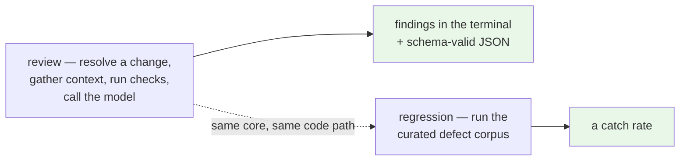
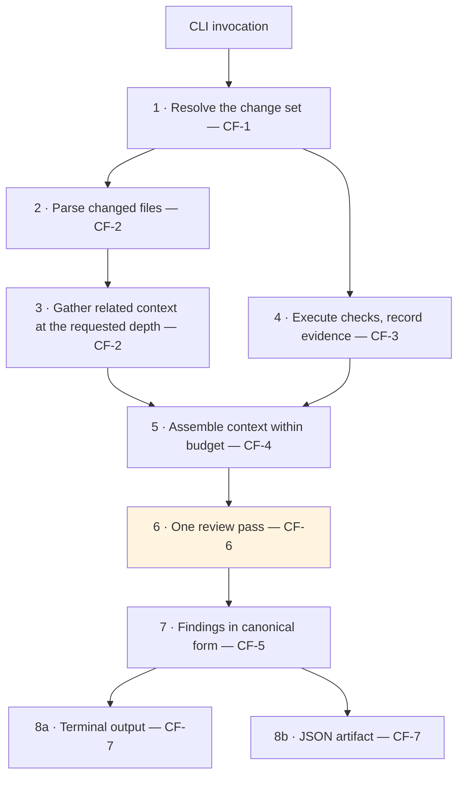
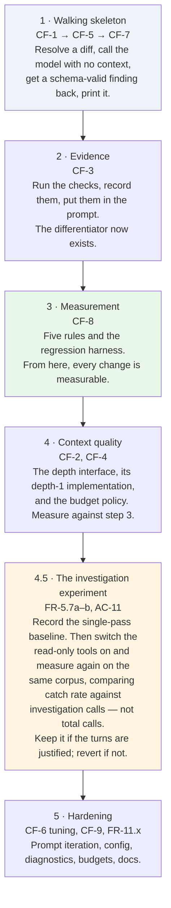

# Software Requirements Specification — Agentic Code Review v1

**Status:** Baselined · **Version:** 1.1 · **Date:** 2026-09-14
**Scope:** Local command-line reviewer for TypeScript/JavaScript
**Audience:** Contributors building v1, and reviewers verifying that a change meets it

---

## 0. About this document

This is the **authoritative specification for the version being built**. It is self-contained: everything required to implement and verify v1 is here.

It was derived from the analysis in [`Draft/mvp-scope.md`](./Draft/mvp-scope.md), which selected this subset from the larger requirement catalogue in [`Draft/agentic-code-review-srs.md`](./Draft/agentic-code-review-srs.md). Those documents remain as the record of *why* — the rationale, the options weighed, and the requirements deferred. **Where they disagree with this document, this document wins.**

| Document | Role |
|---|---|
| **This document** | What v1 is. Normative. |
| [`technical_stack.md`](./technical_stack.md) | What v1 is **built with** — libraries, protocols, layout. Subordinate to this document: a technology choice never relaxes a requirement. |
| [`adr/`](./adr/) | Architecture decisions and their reasoning. Normative where cited below. |
| [`Draft/agentic-code-review-srs.md`](./Draft/agentic-code-review-srs.md) | The full requirement catalogue across v1–v3 and beyond. Historical and forward-looking; not the build target. |
| [`Draft/mvp-scope.md`](./Draft/mvp-scope.md) | The analysis that selected this scope. Explains every inclusion and every cut. |
| [`Draft/agent-harness-design.md`](./Draft/agent-harness-design.md) | Plain-language design guide for the harness layer. |
| [`Draft/`](./Draft/) (remainder) | Problem definition, competitive landscape, tool reference, feature inventory. Background. |

**Requirement identifiers are inherited unchanged** from the catalogue, so every cross-reference in the ADRs and design documents stays valid. Requirements introduced by this baseline are marked **(new in v1)**.

### Revision history

| Version | Date | Change |
|---|---|---|
| 1.0 | 2026-09-08 | Baselined from [`Draft/mvp-scope.md`](./Draft/mvp-scope.md) |
| **1.1** | **2026-09-14** | **Design-review corrections.** Resolves fifteen items raised in [`../DESIGN_BLOCKERS.md`](../DESIGN_BLOCKERS.md) during design milestones M0–M3. No requirement was renumbered and no behaviour was removed. Two kinds of change: **contradictions fixed** (the tool-call ceiling could not coexist with tool-call-only findings; §1.2 both included and excluded the tool loop; a rejected finding had no correction path) and **mechanism withdrawn** (a library name, a language-specific interface declaration, and internal identifiers left the normative text for the design and stack documents, which is where the project's own conventions put them). Summarised in §10. |

---

## 1. Introduction

### 1.1 Purpose

v1 delivers a reviewing engine that a developer runs from a terminal against their own uncommitted work, and an instrument that measures how good that engine is. It is an **engineering milestone, not the product**: the product claim — reducing a reviewer's queue on pull requests — is made in v3, when the same core reaches GitHub.

Two commands constitute the deliverable:

### 1.2 Scope

**In scope for v1**

- A local CLI reviewing a working tree, staged changes, or a branch range in a TS/JS repository
- Syntax-tree parsing and related-context retrieval behind a depth-parameterised interface, with the parser-backed implementation serving depths 0 and 1
- Execution of the project's tests and type-check, with a recorded evidence trail
- A review agent isolated from any code-writing agent, grounded in that evidence and in a pattern library — a single pass by default, with read-only investigation tools available once a baseline has been measured (FR-5.7a, FR-5.7b)
- A canonical finding model with a versioned schema, terminal rendering, and JSON output
- A pattern library and a runnable regression harness reporting a catch rate
- Configuration, credential handling, and diagnosable failure messages

**Deliberately not in v1** — §7 lists these with their destination version. In summary: GitHub integration of any kind (v3), context depths 2 and above, risk triage, cross-run de-duplication, and fix-patch generation.

*The investigation loop is **in** v1 and off by default (FR-5.7a, FR-5.7b), scheduled at Appendix A step 4.5. Version 1.0 of this document listed it in both lists.*

### 1.3 Definitions

| Term | Definition |
|---|---|
| **Change set** | The resolved answer to "what am I reviewing?": a list of changed files and diff hunks. |
| **Context depth** | How far from the changed code the system reaches when gathering related source. Defined as a ladder in §4.2.1. |
| **Context unit** | One piece of related source included in the review context, carrying why it was included and how far away it is. |
| **Core** | The surface-independent reviewing engine. In v1 the CLI is its only caller. |
| **Adapter** | A layer translating between a surface and the core. It resolves what to review, renders findings, and stores state; **it never decides what counts as a finding**. |
| **Evidence record** | The structured outcome of executing checks: per check, whether it ran, was skipped, or errored, plus its result and captured output. |
| **Finding** | One review observation: file, line or range, severity, category, rationale, and optionally a matched rule identifier. |
| **Finding model** | The single canonical typed structure for findings (FR-0), from which all outputs are derived. |
| **Pattern rule** | A "wrong vs. correct" example with an identifier, applied by the agent when producing findings. |
| **Regression harness** | A runnable test over a curated corpus of known defects, reporting how many the reviewer caught. |
| **Host language** | The language the system itself is written in — Python ([ADR-0007](./adr/0007-python-harness-typescript-target.md)). Distinct from the **target language**, TypeScript/JavaScript, which is the language of the code being reviewed. |
| **Resolver sidecar** | A bundled helper process, in the target language's own toolchain, that answers "which file does this import specifier refer to?". Private to CF-2 (FR-2.6f). |
| **Must / Should** | **Must** = required for v1 to be complete. **Should** = required if time allows; its absence does not block release. |

### 1.4 References

- Architecture decisions: [`adr/`](./adr/) — particularly [ADR-0001](./adr/0001-fixed-pipeline-with-bounded-agency.md) (pipeline and step ceiling), [ADR-0004](./adr/0004-findings-emitted-as-tool-calls.md) (findings as tool calls), [ADR-0006](./adr/0006-local-cli-core-action-as-adapter.md) (CLI core, Action as adapter), [ADR-0007](./adr/0007-python-harness-typescript-target.md) (Python harness, TypeScript target), [ADR-0008](./adr/0008-agent-runtime-tool-registry-and-termination.md) (what the ceiling counts, termination, the tool registry)
- Design: [`design/`](./design/) — how the requirements below are put together. Subordinate to this document
- Technology selection: [`technical_stack.md`](./technical_stack.md) — libraries, the resolver-sidecar protocol, repository layout, and the import contracts that enforce AC-10
- Scope derivation: [`Draft/mvp-scope.md`](./Draft/mvp-scope.md)
- Full catalogue: [`Draft/agentic-code-review-srs.md`](./Draft/agentic-code-review-srs.md)
- Non-functional requirements: deferred to a dedicated pass (§8)

---

## 2. Overall Description

### 2.1 Product Perspective

The system is a self-contained command-line program. It runs on a developer's machine, reads a git repository, executes that repository's own test commands, and makes HTTPS calls to one external model provider. It operates no server, holds no remote state, and requires no account beyond a provider API key.

Internally it is **one core behind a thin adapter**, per [ADR-0006](./adr/0006-local-cli-core-action-as-adapter.md). v1 builds one adapter (the CLI). The constraint that adapters never decide what counts as a finding binds from the first line of code, because it is what allows v3 to add the GitHub Action without a rewrite.

Orchestration is a **fixed pipeline** owned by our code, per [ADR-0001](./adr/0001-fixed-pipeline-with-bounded-agency.md):

Step 6 is the only step involving a model. In v1 it is a **single pass**: the investigation tools are switched off by default (FR-5.7a), so the model is called once, emits its findings, and stops. The tool-call ceiling (FR-5.7) bounds the total cost of that step; it is not what keeps the step single-pass.

**The pipeline's steps are plain Python; the order between them is declared as a graph** ([ADR-0009](./adr/0009-pipeline-as-declared-graph.md)). Every step above is a node, including the deterministic ones and the ones not yet built, and each node is a thin adapter over a core function that imports no framework and is callable on its own. The pipeline graph is acyclic. Step 6 is the only step in which a cycle may occur, and it is the only step where a framework has anything to orchestrate — which is what makes FR-5.7's promise, that raising the ceiling is configuration rather than restructuring, true by construction: at ceiling zero the review step is a graph with one node, and above zero it is the same graph with an edge back to it. See [ADR-0007](./adr/0007-python-harness-typescript-target.md).

*Amended in v1.2. Up to v1.1 this paragraph read "the pipeline is plain Python" and FR-5.8 confined the framework to step 6 alone. The steps are still plain Python — that is the part FR-5.8 was protecting and it is unchanged. What moved is where the order between them is written: from statements inside one function to a declared topology, so that the shape the diagram above describes is an object a test can check rather than prose a reader must trust. [ADR-0009](./adr/0009-pipeline-as-declared-graph.md) records why, including the two branches this diagram specifies that the code does not yet have.*

### 2.2 Users

| User | Need v1 serves |
|---|---|
| **The developer author** | A review of their own work before they push it |
| **The contributor building this system** | A fast iteration loop and a measurable engine |
| **The maintainer** | Evidence that a change to prompts, context, or rules improved or worsened the reviewer |

Note that v1's primary user is the **author**, not the reviewer named as the primary persona in [`Draft/Agentic_Code_Review_Problem_Definition_v1.md`](./Draft/Agentic_Code_Review_Problem_Definition_v1.md). This is a known and accepted consequence of sequencing GitHub integration into v3 (§9, R-5).

### 2.3 Operating Environment

The system is written in a different language from the code it reviews. That split is decided in [ADR-0007](./adr/0007-python-harness-typescript-target.md) and it is the reason this section distinguishes three environments that earlier drafts treated as one.

| | |
|---|---|
| **Platform** | A developer workstation — Linux, macOS, or Windows |
| **Host runtime** | Python, with the parser named in [`technical_stack.md`](./technical_stack.md) §2 running in-process as a native extension (FR-2.2) |
| **Agent libraries** | LangChain for the provider interface, tool binding, and structured output; LangGraph for the review step and the pipeline orchestrator, and for no core-function package (FR-5.8, amended in v1.2) |
| **Resolver sidecar** | A bundled Node.js script over the TypeScript compiler API, used for depth-1 module resolution (FR-2.6f). Node is a **runtime prerequisite for authoritative depth 1, never for installation** — its absence degrades and reports (FR-2.6g) |
| **Repository under review** | A TypeScript/JavaScript project with a runnable test script, under git. Its checks run through **its own** toolchain, in a separate process (FR-4.7) |
| **Distribution** | A PyPI package with a console entry point, installed with `uv tool install` or `pipx`. The bundled resolver ships as package data |
| **External dependency** | One AI model provider reachable over HTTPS (NVIDIA NIM free tier as the default), accessed through an OpenAI-compatible client so that FR-0.3 reduces to a base URL and a model name |
| **Credentials** | A provider API key supplied through the environment or user-level configuration |

### 2.4 Assumptions and Constraints

- **Budget:** free provider tiers, or a single plan around $20/month. No paid inference infrastructure.
- **Binding constraint is latency, not runner minutes.** On a local surface the scarce resource is the developer's waiting time rather than continuous-integration minutes ([ADR-0006](./adr/0006-local-cli-core-action-as-adapter.md)). Cost is borne per invocation and is visible to the user.
- **How long is too long is not known, and is deliberately not stated.** *(v1.1)* Versions of this document up to v1.0 carried a figure of roughly 10–30 seconds. It was an estimate that nobody measured, and by v1.1 it had been cited in four documents as though it were a finding — sizing a resolver's process model, a tool-call ceiling, and a concurrency decision. **An unmeasured number that several decisions depend on is worse than an acknowledged unknown**, because it cannot be argued with. The threshold will be established by observing real users of the MVP, and is carried as **TBD-2** in §8 until then.
- **Value depends on a runnable test suite.** Execution-backed review adds nothing to a repository whose tests cannot run; the system must say so rather than degrade silently (FR-9.3).
- **The provider must support tool calling for at least one call per review.** v1 requires exactly one reliable `emit_finding` call, not a multi-step loop — this is the documented fallback configuration in [ADR-0001](./adr/0001-fixed-pipeline-with-bounded-agency.md) and materially reduces the free-tier dependency risk.
- **The system and the repository under review share no runtime.** Checks are executed through the project's own toolchain as subprocesses (FR-4.7); the system never imports the project's dependencies and never asks the project to install its own. This removes a class of version-conflict failure that a shared runtime would have carried.
- **Node.js is optional at install time and required only for authoritative depth-1 resolution** (FR-2.6f, FR-2.6g). In practice the target user has it, because they have a TypeScript repository; the degrade path exists so that its absence is reported rather than fatal.
- **The host language is not the target language, and this costs something in CF-2.** Syntax is fully served in-process; module resolution is not, which is why the sidecar exists. See [ADR-0007](./adr/0007-python-harness-typescript-target.md) and §9, R-7.
- Single provider and single language are deliberate scoping decisions, not technical limitations.

### 2.5 What v1 deliberately is not

v1 **demonstrates that the pipeline works end to end. It does not yet demonstrate the project's thesis.** At context depth 1 the system can judge whether a change is internally sound and consistent with stated rules; it cannot judge whether the change violates an assumption held by a caller it never looked at. Inbound call sites arrive at depth 2, in v2.

This is stated here rather than buried because it governs how v1 should be demonstrated and described. See §9, R-1.

---

## 3. Core Functions

The requirements in §4 are organised around nine function blocks. Each requirement belongs to exactly one.

| # | Core function | Responsibility |
|---|---|---|
| **CF-1** | Change-set resolution | Turn an invocation into a concrete list of changed files and hunks |
| **CF-2** | Parsing and related context | Syntax trees, and related source retrieved at a requested depth |
| **CF-3** | Execution and evidence | Run the project's checks; record what happened |
| **CF-4** | Context assembly | Fit diff, related context, evidence, and rules into the model window |
| **CF-5** | Finding model and provider interface | The canonical structure, its schema, and the provider-independent interface a model client implements |
| **CF-6** | The review agent | A grounded, isolated review pass — single by default, with a corpus-gated route to a bounded loop |
| **CF-7** | Output | Terminal rendering, JSON artifact, exit status |
| **CF-8** | Pattern library and regression harness | Rules, rule attribution, and measurement |
| **CF-9** | Configuration and diagnostics | Config, credentials, and legible failure |

---

## 4. Functional Requirements

Written as testable "the system shall…" statements. Identifiers are inherited from the catalogue except where marked **(new in v1)**.

### 4.1 CF-1 — Change-Set Resolution

- **FR-10.3a (Must)** The system shall resolve the change scope from an explicit selection among: uncommitted working-tree changes, staged changes only, or a comparison against a named branch or commit.
- **FR-10.3b (Must)** The system shall apply a documented default change scope when none is specified, and shall state the resolved scope in its output.
- **FR-10.3c (Must) (new in v1)** The resolved change set shall be expressed as a list of changed files and diff hunks, in a structure independent of how it was resolved.

*FR-10.3c is the seam that lets the v3 Action adapter substitute "PR head against base" (FR-2.1) with no downstream change.*

### 4.2 CF-2 — Parsing and Related Context

- **FR-2.2 (Must)** The system shall build a syntax tree for changed TS/JS files **in the host process, without invoking the target language's toolchain**, and shall tolerate a parse failure on any single file by reporting it rather than failing the invocation.

*Amended in v1.1. The original text named the parsing library. The convention this project adopted — behaviour and technology are separate documents, and a library that cannot satisfy a requirement is the wrong library — does not survive a requirement that names one, because the library then cannot be wrong. The parser is selected in [`technical_stack.md`](./technical_stack.md) §2, which is where [ADR-0007](./adr/0007-python-harness-typescript-target.md) put it. What is normative here is unchanged: in-process, no dependency on the reviewed project's toolchain.*
- **FR-2.4 (Should)** The system shall include relevant surrounding context — function, class, and type boundaries — rather than raw line windows.
- **FR-2.3d (Must)** The system shall record which related files were included and why, for traceability.

#### 4.2.1 The context depth ladder

Related context is retrieved at a **depth**, defined by this ladder. v1 implements depths 0 and 1.

| Depth | What it includes | Resolvable by | Version |
|---|---|---|---|
| **0** | Changed hunks, expanded to enclosing function, class, or type boundaries | Parsing the changed files | **v1** |
| **1** | What the changed code reaches outward to: definitions of symbols it imports and calls | Parsing the changed files, then the files their imports name | **v1** |
| **2** | What reaches inward: files importing a changed symbol, direct call sites of a changed function | A reverse index over the repository | v2 |
| **3** | Transitive neighbours | The same index, traversed further | v2+ |

The ladder is ordered by **cost of resolution**, not purely by graph distance. A file's imports are inside the file; who depends on it is not.

#### 4.2.2 The related-context interface

- **FR-2.6a (Must) (new in v1)** The system shall expose related-context retrieval through a single interface parameterised by depth, with the implementation selected at run time.
- **FR-2.6b (Must) (new in v1)** v1 shall provide a parser-backed implementation serving depths 0 and 1 without requiring any repository-wide index.
- **FR-2.6c (Must) (new in v1)** Every returned context unit shall carry the relation by which it was included (`imports`, `calls`, `imported-by`, `called-by`) and its distance from the change.
- **FR-2.6d (Must) (new in v1)** A retrieval result shall state the depth actually achieved and, where that is lower than requested, **every** reason it was lower. The system shall not silently downgrade.
- **FR-2.6e (Must) (new in v1)** No consumer of the interface shall branch on which implementation served the request.
- **FR-2.6f (Must) (new in v1)** Depth-1 module-specifier resolution shall use the **target language's own resolution algorithm**, so that path aliases, directory index files, package export maps, and workspace links resolve as that language's toolchain resolves them. The resolver shall be shipped with the package rather than fetched at review time, shall not be observable outside CF-2 (FR-2.6e), and shall consume no more than the share of the review latency budget set in §8 (**TBD-1**).
- **FR-2.6g (Must) (new in v1)** Where authoritative resolution is unavailable or fails, the system shall fall back to heuristic path resolution, mark the retrieval result degraded with a **machine-readable reason distinguishing unresolved imports from successful resolution**, and complete the review. The absence of the resolver shall never fail an invocation (FR-11.2).
- **FR-2.6h (Must) (new in v1.1)** Where more than one condition degrades a retrieval, the result shall carry **all** of them. A result shall not be able to report only one of several simultaneous degradations.

*FR-2.6f buys authoritative resolution from the target language's own implementation rather than from a reimplementation of it. FR-2.6g stops that from becoming a hard dependency. The pair is reasoned in [ADR-0007](./adr/0007-python-harness-typescript-target.md).*

*Amended in v1.1. FR-2.6f previously specified the mechanism — "a bundled resolver process… started at most once per invocation" — and the commentary conceded that the clause was "a latency requirement, not an implementation note". A latency requirement should state the budget; §8 defers the number, so **TBD-1** now names it explicitly. Specifying the process model instead had a concrete cost: [`technical_stack.md`](./technical_stack.md) §7 records a persistent daemon as the fallback if boot time dominates, and that fallback violated FR-2.6f as originally written — a measured improvement forbidden by a requirement standing in for an unmeasured number.*

*FR-2.6g previously fixed the literal string a degraded result must carry. Acceptance criteria then asserted spelling rather than behaviour. FR-2.6h is new, and fixes a modelling error: the original result structure held one degradation reason where three can occur together — requesting depth 2 on a machine without the resolver produces two at once.*

#### 4.2.3 What the interface must guarantee

Version 1.0 stated this interface as a TypeScript declaration. The host language is Python ([ADR-0007](./adr/0007-python-harness-typescript-target.md)), and the declaration carried three things nobody decided: an asynchronous return type, a set of serialised field names, and a single-valued degradation field. The **obligations** are normative and are listed here; the **declaration** belongs to design, where a modelling error is a design fix rather than a specification change.

| # | Obligation | From |
|---|---|---|
| 1 | Retrieval is requested at a depth, and depth is a request rather than a guarantee | FR-2.6a |
| 2 | Every returned unit carries the relation that included it and its distance from the change | FR-2.6c |
| 3 | Every result states the depth actually achieved | FR-2.6d |
| 4 | A lower-than-requested depth is reported with every reason for it | FR-2.6d, FR-2.6h |
| 5 | No consumer branches on which implementation answered | FR-2.6e |
| 6 | Each implementation declares the maximum depth it can serve | FR-2.6a |

Relation values are `imports`, `calls`, `imported-by`, `called-by`. Whether retrieval is synchronous or concurrent is **not** specified here; it is a design decision to be made against the latency budget (§8, TBD-2).

The concrete signatures are in [`design/02-domain-model.md`](./design/02-domain-model.md) and [`design/04-contracts.md`](./design/04-contracts.md).

| Implementation | `maxDepth` | Requires | Version |
|---|---|---|---|
| `ParserContextProvider` | 1 | Nothing beyond the changed files at depth 0; the resolver sidecar for authoritative depth 1, degrading without it (FR-2.6g) | **v1** |
| `IndexContextProvider` | 3 | A built reverse index | v2 |

FR-2.6e is the requirement that makes v2 a new implementation rather than a change to CF-4, CF-6, and CF-7. It is the highest-value structural constraint in this document.

It also absorbs the resolver sidecar entirely. The sidecar is `ParserContextProvider`'s private business: it changes the *quality* of what the interface returns and is reported through `degraded`, but no consumer learns of its existence, and no signature above changes because of it.

### 4.3 CF-3 — Execution and Evidence

- **FR-4.1 (Must)** The system shall run the project's test suite on the developer's machine and capture pass/fail results and output.
- **FR-4.2 (Must)** The system shall run build/type checks (e.g. `tsc`) and capture results.
- **FR-4.4a (Must)** The system shall enforce a configurable time budget on the execution phase and terminate execution when it is exceeded.
- **FR-4.4b (Must)** On termination due to timeout, the system shall mark execution as `timed-out`, skip remaining checks, and continue to produce a review reporting the timeout.
- **FR-4.5a (Must)** The system shall record, for each check, whether it was run, skipped, or errored.
- **FR-4.5b (Must)** The system shall record each executed check's pass/fail result and captured output.
- **FR-4.5c (Must)** The system shall make this execution record available to the review agent and include it in the structured output.
- **FR-4.6 (Must) (new in v1)** The review agent shall not be able to trigger check execution. Execution occurs once per invocation, before the review pass.
- **FR-4.7 (Must) (new in v1)** Checks shall be executed as subprocesses invoking the reviewed project's own toolchain and package manager, discovered from its manifest or named in configuration. The system shall not import the reviewed project's dependencies into the host runtime, and shall not require the reviewed project to install anything belonging to the system.

*FR-4.7 is the one consequence CF-3 takes from the host language being different from the target language ([ADR-0007](./adr/0007-python-harness-typescript-target.md)). It is close to free: the system was always going to shell out to `npm test` and `tsc`, and it now has no mechanism to do anything else. What the requirement adds is the second half — that the reviewer never contaminates the project it is reviewing, in either direction. A version conflict between reviewer and reviewed is not a bug that can be introduced.*

*FR-4.6 states for v1 the decision in [ADR-0002](./adr/0002-pipeline-initiates-test-execution.md). That record notes the prohibition relaxes on a local surface where a targeted run costs seconds; v1 nonetheless keeps it, because the single-pass agent (FR-5.7) has no loop in which to call such a tool. Both may be revisited together in v2.*

### 4.4 CF-4 — Context Assembly

- **FR-2.3c (Must)** The system shall include the source of related definitions and call sites in the review context passed to the agent, up to the context cap.
- **FR-2.5 (Must)** The system shall cap context size to stay within model token limits, degrading gracefully when exceeded.
- **FR-2.5a (Must) (new in v1)** Context shall be budgeted per section — instructions and rules, the diff, related context, and evidence — so that no section can starve another.
- **FR-2.5b (Must) (new in v1)** When the budget is exceeded, the system shall evict context units in descending order of `distance`, and shall never truncate the diff itself.
- **FR-2.5c (Must) (new in v1)** Captured check output shall be reduced to failing test names, assertion messages, and stack frames referring to changed files before entering the context. Full output is retained for the structured output only.

*FR-2.5c prevents the largest accidental context sink in the design: a failing suite can emit megabytes.*

### 4.5 CF-5 — Finding Model and Provider Interface

- **FR-0.1 (Must)** The system shall define a provider-independent internal finding representation — "the finding model" — as the single canonical structure for all review findings.
- **FR-0.2 (Must)** All model output shall be converted into the finding model before any downstream use; no component shall consume raw provider responses directly.
- **FR-0.3 (Must)** A new provider shall be integratable by mapping its output to the finding model without changes to downstream components. The system shall define this as a **provider-independent interface**; the client implementing it may live in CF-6, so that FR-5.8's confinement of the agent framework is not breached by CF-5.
- **FR-0.4 (Must)** The finding model shall have a documented, versioned schema carrying a schema-version field.
- **FR-5.2 (Must)** Each finding shall contain: file path, line or line-range, severity, category, rationale, and optionally the identifier of a matched pattern rule.
- **FR-5.2a (Must) (new in v1.1)** Severity shall be one of **`blocking`**, **`important`**, **`nit`**. `blocking` carries the blocking/non-blocking distinction deferred as FR-5.4 until that requirement lands, and is the only value that affects exit status (FR-10.4c).
- **FR-5.2b (Must) (new in v1.1)** Category shall be one of: **`correctness`**, **`error-handling`**, **`interface-contract`**, **`test-evidence`**, **`security`**, **`performance`**, **`maintainability`**. The set is **closed**, so that a category can be counted, filtered, and compared across runs; it is fixed in the finding-model schema and changing it is a schema change (FR-0.4).

*Seven values, chosen to be **few enough that a model can hold them all** and distinct enough that two reviewers would file the same finding the same way. `test-evidence` exists because this project's differentiator is execution evidence, and a finding that exists because a test failed should be countable as such.*
- **FR-5.2c (Must) (new in v1.1)** Each finding shall carry an **evidence reference** identifying what supports it — a recorded check result, a related-context unit, or the change itself — **or** shall be explicitly marked **unverified**, with a reason. A finding shall not be emitted carrying neither.

*FR-5.2c adopts AC-A3 from [`Draft/agentic-architecture-review.md`](./Draft/agentic-architecture-review.md) §6, which reached it by a different route: that analysis declined a hypothesis-tracking machinery as unaffordable and unmeasurable at this scale, but identified this single discipline as the valuable kernel inside it — "the agent shall not emit a finding requiring evidence until the required evidence has been obtained, or explicitly records that the evidence could not be obtained".*

*It costs one field and it is enforced where findings already enter the system (FR-5.6a), which is the reason to take it now rather than after the schema is in use. What it buys is that **a guess declares itself**. Without it, a finding grounded in a failing type-check and a finding grounded in the model's impression are the same shape, and a reader has no way to tell them apart — which quietly undoes the evidence-grounding claim that distinguishes this project from a text-only reviewer.*

*FR-5.2a and FR-5.2b are new in v1.1 because FR-5.2 required both fields and enumerated neither. These are the words the tool says to a user — a product vocabulary, not a structural choice — so they belong here rather than in a design document that this specification is entitled to overrule.*
- **FR-5.6 (Must)** The agent's output shall conform to the finding model; all outputs shall be derived from it, not produced independently by the model.
- **FR-5.6a (Must) (new in v1)** Findings shall enter the system exclusively through an `emit_finding` tool call validated against the finding-model schema at the call boundary. Prose the model produces shall not be parsed for findings.
- **FR-5.6b (Should) (new in v1)** Where the provider cannot perform tool calls, the system shall fall back to schema-validated structured output with a documented retry cap, and shall report which path was used.
- **FR-5.6c (Must) (new in v1.1)** Where an `emit_finding` call fails validation, the system shall return the offending field to the model and permit **one repair turn** per review. A repair turn is not an investigation and does not consume the tool-call ceiling (FR-5.7). Where the repair turn also fails validation, the run shall record that the model's output could not be validated, and that run shall be **distinguishable in both outputs from a run that found nothing**.

*FR-5.6c is new in v1.1 and completes a mechanism [ADR-0004](./adr/0004-findings-emitted-as-tool-calls.md) specified but the baseline left unreachable. That record's argument for validating at the call boundary is that corrections are precise and cheap — "the model is told exactly which field is wrong" — which requires a second turn that v1.0 did not permit. Without it a single malformed call produced zero findings and read exactly like a clean review, which is AC-7's failure mode arriving through a door AC-7 does not watch.*

*FR-5.6a states [ADR-0004](./adr/0004-findings-emitted-as-tool-calls.md) normatively.*

### 4.6 CF-6 — The Review Agent

- **FR-5.1 (Must)** The review agent shall operate in a context isolated from any code-writing agent — no shared history or state.
- **FR-5.3 (Must)** The agent shall incorporate execution results (CF-3) and pattern-library rules (CF-8) into its findings.
- **FR-5.7 (Must) (amended in v1.1)** The review step shall enforce a **tool-call ceiling**: a configuration value bounding the total number of tool calls the model may make in one review, **counted as an agent runtime counts them — every call, `emit_finding` included**. Its documented default shall be a positive number sized to stop a runaway agent without truncating a review a reader would have wanted. Reaching the ceiling shall be reported, and findings emitted before it was reached shall be retained.
- **FR-5.7a (Should) (amended in v1.1)** Whether **investigation tools** are exposed to the model shall be a **separate configuration value from the ceiling**, defaulting to **off**. When they are enabled, every such tool shall be **read-only, free of side effects, and unable to trigger check execution** (FR-4.6). The tools exposed shall be a documented, versioned list.
- **FR-5.7b (Must) (amended in v1.1)** Investigation tools shall not be enabled until a single-pass baseline catch rate has been recorded on the regression corpus (FR-6.2d). Any subsequent configuration shall be justified by a measured comparison against that baseline.
- **FR-5.7c (Should) (amended in v1.1)** When investigation tools are enabled, each model turn shall be told how many tool calls remain, and the review shall report whether it ended because the agent finished or because the ceiling was reached.
- **FR-5.7d (Should) (new in v1)** Findings shall have the same structure and meaning at every ceiling value. A change of ceiling shall change how much is found, never what a finding is.

*Amended in v1.1, because FR-5.7 and FR-5.6a contradicted each other. FR-5.6a admits findings **exclusively** through a tool call; FR-5.7 set the **tool-call** ceiling to **zero**. Read together, v1 could never produce a finding.*

*The fix keeps the literal, agent-standard meaning of a tool call and separates the two ideas that a ceiling of zero had been made to carry at once:*

| Setting | Bounds | Default |
|---|---|---|
| **Tool-call ceiling** (FR-5.7) | What the review may cost | A positive number |
| **Investigation tools** (FR-5.7a) | Whether the model may look around at all | **Off** |

*These are independent questions and were only ever joined because zero happened to answer both. The separation puts FR-5.7b's gate on the switch it is actually about: the baseline must exist before the model may investigate, regardless of what the cost ceiling is set to.*

*FR-5.7a no longer names the tools or fixes their number. Naming them made adding a fourth — should measurement at Appendix A step 4.5 show one earns its turn — a specification change rather than a configuration change. The properties are what matter and they are unchanged: read-only, no side effects, no check execution. The list belongs in the versioned tool registry.*
- **FR-5.8 (Must) (new in v1) (amended in v1.2)** The agent framework shall be confined to CF-6 and the pipeline orchestrator. **No core-function package shall import it**, and every pipeline step outside CF-6 shall be callable as an ordinary function without it. Where the orchestrator expresses the fixed order as a graph, each node shall be a thin adapter over a core function that holds no orchestration logic of its own, and the orchestrator's graph shall be acyclic — CF-6 remains the only step in which a cycle may occur.

*Amended in v1.2 by [ADR-0009](./adr/0009-pipeline-as-declared-graph.md). The original text confined the framework to CF-6, which defended two things at once: that our code owns orchestration ([ADR-0001](./adr/0001-fixed-pipeline-with-bounded-agency.md)), and that the core functions stay ordinary and testable without a framework fixture. Only the second needed the confinement. A graph whose topology we author statically, whose nodes are all our own functions, and whose only cycle is inside CF-6 gives the model no more say over what runs next than a sequence of statements does. What is unchanged, and is the substantive clause, is that **no core-function package may import the framework**: CF-1 through CF-9 remain callable as ordinary functions.*
- **FR-5.9 (Must) (new in v1.1)** Every tool result returned to the model shall be a **structured observation** carrying a status — at minimum *ok*, *error*, and *denied* — and, where the status is not *ok*, a reason. A refused call shall be returned as **denied**, distinct from an error, so that the model can choose a different action rather than retrying the same one.
- **FR-5.10 (Must) (new in v1.1)** The system shall not oblige the model to make a tool call. A reply containing **no** tool call is the model's termination signal and shall be accepted as one. Where such a reply produces no findings, the run shall record that no tool call was made, so that a review which found nothing is distinguishable from one in which the model never used the tool.

*FR-5.9 adopts the observation type from [`Draft/agentic-architecture-review.md`](./Draft/agentic-architecture-review.md) §3. FR-11.2 already requires a structured way to say "this was refused" rather than failing silently; this gives it one shape instead of one invented per call site. The `denied` status has no producer in v1, where the only tool is `emit_finding` and nothing may refuse it — it is defined now because it is a **model-visible contract**, and contracts are cheap to set and expensive to change.*

*FR-5.10 exists because a proposal to add a `finish_review` tool was considered and **declined** in v1.1. Its stated justification — that without an explicit termination signal a bounded loop can only stop at its ceiling — does not hold for a tool-calling provider, where a reply with no tool call **is** the stop signal. The failure it describes occurs only where the harness compels a tool call every turn, so the correct remedy is a rule forbidding that, which is what FR-5.10 states. The second half of FR-5.10 recovers, for free, the one genuine benefit `finish_review` offered: telling "reviewed and clean" apart from "never called the tool". Reconsider `finish_review` if and when a measured loop shows the model failing to terminate on its own.*

*This is [ADR-0001](./adr/0001-fixed-pipeline-with-bounded-agency.md) with the ceiling pinned to its documented fallback, plus a stated route off it.*

*FR-5.8 keeps ADR-0001 true now that a framework is in the repository. That record's decision was that **our code owns orchestration** and the model's agency lives in one step; adopting an agent framework is the most natural way to give that away by accident, one convenient node at a time. Confining it to CF-6 costs nothing — the fixed steps have no loops, no branching on model output, and nothing for a graph to orchestrate — and it keeps CF-1 through CF-5 and CF-7 unit-testable without a framework in the fixture. It is checkable by import list, which is why it joins AC-10 rather than needing an acceptance criterion of its own.*

**Why investigation is off by default, and why switching it on is a v1 activity rather than a v2 feature.** The candidate tools are read-only over data v1 already has — no security surface and no runner minutes. Neither capability nor safety is the obstacle. **Sequencing is.** The single-pass run is the control arm for the only question that matters here — *does letting the model investigate improve catch rate enough to justify the extra turns?* — and that question cannot be answered without a no-investigation baseline measured on the same corpus. FR-5.7b encodes that ordering as a requirement rather than an intention.

Three tools considered and currently excluded, recorded so the reasoning is not relitigated: **`get_check_result`**, because distilled evidence is small and needed in every review, so preloading beats a turn spent fetching it; **`lookup_pattern_rule`**, because v1 ships five rules (FR-6.3a) and preloading all five beats a lookup; and **`find_references`**, which is tool-shaped but requires the reverse index deferred to v2 (FR-2.3a, FR-2.3b). The first two earn tool status at larger scale. None of this is normative — the registry named in FR-5.7a is.

### 4.7 CF-7 — Output

- **FR-8.1b (Must)** The terminal summary shall state the resolved change scope, the checks run and their results, the count of findings by severity, and an overall verdict.
- **FR-8.2a (Must)** The system shall serialize the review's result to JSON as a machine-readable artifact.
- **FR-8.2b (Must) (amended in v1.1)** The artifact shall conform to a documented, versioned **review-report schema** containing the findings, the evidence record, and the run metadata of FR-8.2c. The finding model (FR-0.1) is the findings portion of that schema and nothing more: the report is a wider structure that **embeds** it. Both are versioned together, and the `emit_finding` tool schema (FR-5.6a) equals the finding model alone — a model is never bound to a schema containing run metadata it cannot know.

*Amended in v1.1. FR-8.2b previously required the artifact to conform to "the finding model's versioned schema, including… the evidence record" — but a finding is one observation and contains no evidence record and no run metadata. Left as written, the "one definition, not two" rule in §5 either forces run metadata into the tool schema or is quietly broken.*
- **FR-8.4 (Should)** The structured output schema shall be documented and versioned.
- **FR-10.4a (Must)** The system shall render findings to the terminal, derived from the finding model and not produced independently.
- **FR-10.4b (Must)** The system shall provide machine-readable output on request, conforming to the schema in FR-8.2b.
- **FR-10.4c (Must) (raised from Should in v1.1)** The system shall exit with a status code reflecting the review outcome, documented and stable across versions. The codes shall distinguish at least four outcomes: **a review that completed**; **a review that completed and found a `blocking` finding**; **a review that could not be produced** because the model was unreachable or its output could not be validated; and **an invocation that could not start** because a prerequisite was missing. A review that completed in a degraded state shall report as **completed**, because a degraded review is still a review (FR-11.2).

*Raised to Must in v1.1 and given a floor. On a local surface the exit code is how a script learns what happened, and the distinction FR-4.5a and AC-7 insist on for humans — "found nothing" versus "never looked" — is worthless if both exit zero. The specific numbers are a design decision; the four outcomes are not. A degraded run exiting non-zero would make every machine without the optional resolver look like a failed review, which is the confusion AC-12 exists to prevent.*
- **FR-8.2c (Must) (amended in v1.1)** The structured output shall record the requested and achieved context depth; the tool-call ceiling in force and whether investigation tools were enabled; the completion status (FR-5.7c); the model and schema versions used; and the resolved change scope — so a run can be reproduced and compared.
- **FR-8.2d (Must) (new in v1.1)** The structured output shall record tool calls as **both** a total and a breakdown by purpose — at minimum the total, the number spent emitting findings, the number spent investigating, and the number of repair turns (FR-5.6c). A single total shall not be the only figure reported.
- **FR-8.2e (Must) (new in v1.1)** The structured output shall record **every degradation** that occurred during the run, each identifying the stage that raised it and a machine-readable reason. This is the record FR-11.2's reporting obligation is discharged into.

*FR-8.2c is what makes the depth comparison in §6 possible after the fact rather than only in a controlled harness run.*

*FR-8.2d is new in v1.1 and follows from FR-5.7's counting rule. Because every tool call counts — including emissions — a single total moves with **how many defects a change happened to contain**, not with **how hard the agent looked**. Both are worth knowing and neither substitutes for the other: the total is what the latency and token budgets are actually spent against, and the investigation count is the variable AC-11's experiment is trying to price. Reporting only one loses something real.*

*FR-8.2e is new in v1.1 because FR-11.2 required degradations to be reported and no requirement said where they land. An obligation with no destination is the kind that is satisfied in the terminal and forgotten in the artifact.*

### 4.8 CF-8 — Pattern Library and Regression Harness

- **FR-6.1 (Must)** The system shall load a configurable pattern library of "wrong vs. correct" examples and project standards.
- **FR-6.2a (Must)** When a finding is generated from a pattern-library rule, the finding shall reference the identifier of the matched rule.
- **FR-6.2b (Must)** The system shall support a regression set of pattern examples with expected outcomes, runnable as a test, so pattern-matching behaviour can be verified and monitored across changes.
- **FR-6.2d (Must) (new in v1)** The regression harness shall report a catch rate over the corpus, and shall accept both a context depth and a tool-call ceiling so that results at different settings are directly comparable.
- **FR-6.2e (Should) (new in v1)** Regression runs shall pin the settings that affect reproducibility — depth, ceiling, model, and sampling parameters — and record them with the result, so that measurement runs stay comparable even where production runs vary.
- **FR-6.2f (Must) (new in v1.1)** The harness shall apply a **documented rule for deciding when an emitted finding counts as catching an expected defect**, and that rule shall be **independent of line numbers**, so that an unrelated edit shifting a file does not change the score. The corpus shall include cases containing **no** defect, and the harness shall report a false-positive figure alongside the catch rate.
- **FR-6.3a (Must) (new in v1)** v1 shall ship at least five pattern rules, each with a wrong example, a correct example, and at least one corresponding regression case.

*FR-6.2f is new in v1.1. FR-6.2b, FR-6.2d, AC-5, AC-6 and AC-11 all rest on a catch rate, and nothing said when a finding counted as a catch. Same file? The exact line? Within a few lines? The same rule identifier? Each choice produces a different number, so two runs were not comparable and the project's primary instrument had no defined unit.*

*The line-independence clause exists because the obvious matcher is the wrong one: a reviewer that points at the call rather than the declaration has still found the defect, and a matcher keyed to position re-scores itself whenever an unrelated edit moves the file. [ADR-0005](./adr/0005-cross-run-memory-as-hidden-comment-ledger.md) reached the same conclusion for a different purpose, and its reasoning applies here unchanged.*

*The clean-case clause exists because catch rate alone is trivially gamed: a reviewer that flags every line catches every defect. A recall figure with no precision figure beside it can improve while the tool gets worse.*

*Five rules is a floor that proves the mechanism, not a product-grade rule set. Breadth is v2 (FR-6.3).*

### 4.9 CF-9 — Configuration and Diagnostics

- **FR-1.2a (Must)** The system shall read configuration from `.agentic-review.yml` at the repository root when present.
- **FR-1.2b (Must)** When the file is absent, the system shall apply a documented built-in default configuration.
- **FR-1.2c (Must)** When the file is present but a field is missing, the system shall apply that field's documented default value.
- **FR-1.2d (Must)** When the file is present but malformed, the system shall fail with an error message identifying the offending field, and shall not fall back silently.
- **FR-1.3a (Must)** The system shall read the model provider credential from the local environment or user-level configuration, never from a hard-coded key and never from a file committed to the repository.
- **FR-3.5 (Must) (new in v1)** The system shall exclude configured generated, vendored, and build-output paths from review, using a documented default exclusion list. The exclusion shall be applied **when the change set is resolved** (CF-1), so that no later stage parses, executes against, or budgets for a file that was never going to be reviewed, and the resolved change set shall record what was excluded so that the stated scope (FR-10.3b) is true.
- **FR-9.1 (Must)** The system shall ship with README, LICENSE, and CLI usage documentation.
- **FR-9.3 (Must)** The system shall provide clear failure messages when prerequisites — a test script, a provider key, a git repository, a parseable tree — are missing or unusable.

*FR-3.5 is v1's substitute for risk triage (FR-3.1–FR-3.4, deferred). It captures most of the benefit — not wasting a review on generated code — at a fraction of the cost. FR-9.3 is raised from Should to Must here: on a local surface a silent failure is indistinguishable from a clean review.*

### 4.10 Cross-cutting

- **FR-10.1 (Must)** The system shall provide a command-line interface that reviews a local change set without requiring GitHub API access or repository credentials.
- **FR-10.2 (Must)** No adapter shall contain logic that determines whether something is a finding.
- **FR-9.2a (Must)** The system shall complete an end-to-end review of a public TS/JS repository on a developer machine, using only a free model provider tier.
- **FR-11.1 (Must) (new in v1)** The system shall enforce a token and call budget per invocation and stop cleanly when it is reached, reporting that it did so.
- **FR-11.2 (Must) (new in v1)** The system shall produce a review under every failure mode — checks unrunnable, context over budget, provider error, budget exhausted — reporting the degradation rather than exiting silently.
- **FR-11.3 (Should) (new in v1)** The system shall record a trace of the invocation — resolved scope, achieved depth, checks executed, tokens spent — sufficient to explain why a finding was produced.

*FR-11.2 generalises the timeout rule (FR-4.4b) to every failure mode; it is the single requirement most likely to be quietly violated under schedule pressure.*

---

## 5. Interface Summary

| Interface | Defined in | Stability |
|---|---|---|
| Change set (files + hunks) | FR-10.3c | Frozen — the v3 adapter substitutes its producer |
| Related-context provider **obligations** | §4.2.3 | Frozen — v2 adds an implementation, not an obligation. The concrete signature is design's and may change |
| Module resolution mechanism | FR-2.6f | Internal to CF-2. Free to change — no consumer may observe it (FR-2.6e) |
| Check invocation (project toolchain) | FR-4.7 | A subprocess boundary, not a linked one; the host runtime and the project's runtime stay separate |
| Finding model + schema | FR-0.1, FR-0.4 | Versioned; changes require a schema-version bump |
| `emit_finding` tool schema | FR-5.6a | Equals the finding model — **not** the review report (FR-8.2b). One definition, not two |
| Review report schema | FR-8.2b–e | Embeds the finding model; versioned with it |
| Provider interface | FR-0.3 | A new provider is a new implementation behind it. The implementing client may live in CF-6 (FR-5.8) |
| Investigation tool registry | FR-5.7a | Documented and versioned; adding a tool is a registry change, not a specification change |
| CLI flags and exit codes | FR-10.3a, FR-10.4c | Documented and stable across v1 patch releases |

---

## 6. Acceptance Criteria

v1 is complete when all of the following hold. Each is verifiable by execution, not inspection.

| # | Criterion | Verifies |
|---|---|---|
| **AC-1** | A single command reviews a public TS/JS repository end to end and prints findings, using only a free provider tier | FR-9.2a, FR-10.1 |
| **AC-2** | At least one finding in that run cites a real test or type-check result rather than text inference | FR-4.5c, FR-5.3 |
| **AC-3** | The JSON output validates against the published schema, and records depth, model, and resolved scope | FR-8.2b, FR-8.2c |
| **AC-4** | Findings originating from a pattern rule name that rule | FR-6.2a |
| **AC-5** | The regression harness runs as a test and reports a catch rate over the corpus | FR-6.2b, FR-6.2d |
| **AC-6** | The harness produces comparable catch rates when run at depth 0 and depth 1 | FR-6.2d, FR-2.6a |
| **AC-7** | A run where the tests could not execute says so, and is distinguishable in both outputs from a run that found nothing | FR-4.5a, FR-11.2 |
| **AC-8** | Requesting depth 2 reports an achieved depth of 1 with a machine-readable reason naming the absent index, and completes the review | FR-2.6d |
| **AC-9** | A malformed config fails with the offending field named; a missing provider key fails with a message saying so; neither costs a check execution first | FR-1.2d, FR-9.3 |
| **AC-10** | No module outside CF-7 imports a terminal-rendering dependency; no module outside CF-1 resolves a change scope; **no core-function package imports the agent framework** — only CF-6 and the pipeline orchestrator may (FR-5.8, amended in v1.2); **no module outside CF-2 names a concrete related-context implementation or references the resolver** | FR-10.2, FR-2.6e, FR-5.8 |
| **AC-11** | A single-pass baseline catch rate is recorded on the corpus before investigation tools are enabled, and the harness can report catch rate, **total** tool calls and **investigation** tool calls at two settings on that same corpus | FR-5.7b, FR-6.2d, FR-6.2e, FR-8.2d |
| **AC-12** | With authoritative resolution made unavailable, a review of the same repository still completes and reports the degradation, distinguishably from a run where every import resolved | FR-2.6f, FR-2.6g, FR-11.2 |
| **AC-13** | A run whose sole `emit_finding` call is malformed produces a repair turn; where that also fails, the output is distinguishable from a run that found nothing | FR-5.6c |
| **AC-14** | Requesting depth 2 on a machine without authoritative resolution reports **both** degradations, not one | FR-2.6h, FR-8.2e |
| **AC-15** | **Every** finding in a run either cites a specific evidence reference or is marked unverified with a reason. No finding carries neither | FR-5.2c |
| **AC-16** | A run in which the model made no tool call is distinguishable in both outputs from a run that reviewed the change and found nothing | FR-5.10 |

*AC-8, AC-11 and AC-12 were reworded in v1.1. They previously asserted literal field names and values — `achievedDepth: 1`, `degraded: 'unresolvable-imports'` — which made renaming an internal identifier a test failure. They now assert the behaviour the identifier carries. AC-10 gains the clause that tests FR-2.6e, which §4.2.2 calls the highest-value structural constraint in this document and which nothing previously checked. AC-13 and AC-14 are new, and verify the two contradictions v1.1 fixed.*

**AC-5 and AC-7 are the two to defend under schedule pressure.** Without measurement there is no way to know whether the reviewer improved. Without the skipped/errored distinction, "no findings" silently means both "clean" and "broken".

**AC-8, AC-10, AC-12 and AC-14 are structural.** They verify that v2 and v3 are additions rather than rewrites, and that an optional prerequisite stayed optional. All are cheap to check — AC-10 is an import list; the others are one run each with a capability removed.

---

## 7. Excluded from v1

Full reasoning for each is in [`Draft/mvp-scope.md`](./Draft/mvp-scope.md) §4.

| Excluded | Requirements | Destination |
|---|---|---|
| Context depths 2 and above — importers, call sites, transitive | FR-2.3a, FR-2.3b | **v2** — a new implementation behind §4.2.2 |
| Risk triage and depth routing | FR-3.1–FR-3.4 | **v2** — the depth parameter of §4.2.2 is what a tier will set |
| `find_references` and `get_definition` in the reverse direction | *(depends on FR-2.3a, FR-2.3b)* | **v2** — tool-shaped, but no index to back them |
| `get_check_result`, `lookup_pattern_rule` as tools | — | **Not planned.** Preloaded instead; they fail the tool test at v1 scale and earn it only at larger rule counts |
| Dependency audit | FR-4.3 | v2 |
| Blocking vs. non-blocking distinction | FR-5.4 | v2 — severity carries this for now |
| Cross-run de-duplication and local state | FR-5.5, FR-10.5 | v2 — weak locally; essential in v3 |
| Pattern coverage reporting | FR-6.2c | v2 |
| A broad default rule set | FR-6.3 | v2 — v1 ships five (FR-6.3a) |
| Fix snippets and evidence links | FR-7.1a, FR-7.3 | v2 |
| Platform support matrix, prebuilt binaries, containerised distribution | FR-10.6 | v2 — v1 ships a PyPI wheel and documents what it was tested on; a formal matrix, standalone binaries, and an image are later work ([ADR-0007](./adr/0007-python-harness-typescript-target.md)) |
| Tolerating unparseable working trees | FR-10.7 | v2 — v1 requires a parseable tree and says so |
| **All GitHub integration** — Action trigger, PR comments, suggested-change blocks, status checks, example workflow, untrusted-code isolation, comment ledger | FR-1.1, FR-1.3, FR-1.4, FR-2.1, FR-7.1, FR-8.1a, FR-8.1c, FR-8.3, FR-9.2; [ADR-0003](./adr/0003-untrusted-code-isolation-and-fork-triggers.md), [ADR-0005](./adr/0005-cross-run-memory-as-hidden-comment-ledger.md) | **v3** |

FR-7.2 — suggestions are advisory, with no commit, push, or auto-apply — is satisfied trivially in v1: the system has no write path. It remains binding.

---

## 8. Non-Functional Requirements

Deferred to a dedicated pass. **Numbered in v1.1, because requirements now point at them** — an unidentified deferral cannot be cited, and a requirement that cannot cite its budget ends up specifying a mechanism instead (see the note under FR-2.6f).

| # | Open item | Cited by |
|---|---|---|
| **TBD-1** | The share of review latency module resolution may consume | FR-2.6f |
| **TBD-2** | **The latency a developer will actually tolerate**, to be established by observing real users of the MVP rather than estimated — and therefore the end-to-end budget, and whether stages may overlap | §2.4, FR-4.4a |
| **TBD-3** | Context token cap, and the per-section split within it | FR-2.5, FR-2.5a |
| **TBD-4** | Default execution time budget | FR-4.4a |
| **TBD-5** | Maximum change-set size handled | FR-10.3c |
| **TBD-6** | Quantitative catch-rate and false-positive targets | FR-6.2f, AC-5 |
| **TBD-7** | Cost target per invocation, and the model-selection policy that meets it | §2.4 |
| **TBD-8** | Tool-call ceiling default, once measured | FR-5.7 |

### Placeholders in force until those numbers exist

A system cannot run on an unknown. Each value below is a **deliberate placeholder chosen for a stated reason, not a measurement**, and must be labelled as one wherever it is documented. Replacing one is a configuration change, not a specification change.

| For | Placeholder | Chosen because |
|---|---|---|
| **TBD-8** — tool-call ceiling | **25** | The ceiling exists to stop a runaway agent, not to ration findings. Twenty-five findings on one change set is already past the point a reader would keep going, so this cap never truncates a review anyone would have read |
| **TBD-3** — context token cap | **Whatever the configured model's window allows, less a stated reserve for the reply**, split by section: rules and instructions, the diff, related context, evidence | Derived from the model rather than guessed. The **split** is what FR-2.5a actually requires — no section may starve another — and it holds at any window size |
| **TBD-4** — execution time budget | **Documented default, reported when exceeded** | Cannot be chosen before TBD-2. What matters meanwhile is FR-4.4b: exceeding it degrades the review rather than failing it |

> **The rule that keeps these honest:** no requirement, acceptance criterion or design decision may be justified by one of these numbers. A decision that needs a real value is waiting on its TBD and must say so.

Also carried, without a citing requirement:

- Supported operating systems and Python versions, and whether the resolver's Node requirement gets a documented minimum version (FR-10.6, deferred to v2)
- Execution isolation and the untrusted-code security model — **a v3 concern**; v1 executes only the developer's own code on their own machine

> **TBD-2 cannot be estimated, and v1.1 stopped trying.** It is the one open item whose answer comes from **users of the shipped MVP**, not from a drafting session — which is a reason to ship and watch, not a reason to guess. Until it is answered, two rules hold:
>
> 1. **No design decision may cite a latency threshold as justification.** A decision that needs one is a decision waiting on TBD-2, and should say so.
> 2. **Every stage records its own duration on every run** (FR-8.2c, FR-11.3), so that when real users are observed, the measurements that explain their behaviour already exist.
>
> **TBD-4 inherits this.** FR-4.1 runs the project's test suite, whose cost grows with the project rather than with the change, so check execution can dominate a review on a large repository. Whether that is acceptable is exactly what TBD-2 will settle. Until then the execution timeout is configurable with a stated default, and the default is explicitly a **placeholder, not a finding**.

---

## 9. Known Risks

| # | Risk | Severity | Response |
|---|---|---|---|
| **R-1** | **The thesis is unproven at v1.** At depth 1, defects depending on a caller's assumptions may go uncaught. | High | Stated in §2.5. The depth interface plus the regression harness turn it into a controlled experiment in v2: same corpus, depth 1 vs depth 2, one variable (AC-6). |
| **R-2** | **A single pass may be too shallow.** | Medium | Investigation is configuration (FR-5.7a), and v1 contains the route to it: baseline first, then read-only tools, then a measured comparison (FR-5.7a–b, AC-11). Shipping with it off also buys real de-risking — v1 needs the provider to make reliable tool calls in one turn, not to sustain a fifteen-step investigation. |
| **R-2a** | **Enabling investigation may not pay for itself.** More turns is a certain cost; better findings is a hypothesis. A loop can also re-read the same file and re-emit the same finding at several times the price. | Medium | This is precisely why FR-5.7b exists. The experiment is cheap and reversible: one configuration value, read-only tools, and a corpus that can price the answer. Switching it back off costs nothing, and FR-8.2d keeps the two cost figures separable so the comparison is not confounded by how many defects a change happened to contain. |
| **R-3** | **The depth interface is designed against one implementation.** | Medium | Confined by FR-2.6e to a single consumer boundary; a wrong guess costs one module. |
| **R-4** | **Prompt and context tuning has unbounded effort.** | High | The reason the CLI surface was chosen ([ADR-0006](./adr/0006-local-cli-core-action-as-adapter.md)): iteration runs in seconds. AC-5 gives the work a stopping condition. |
| **R-5** | **v1 does not address the stated problem.** It helps an author before they push, not a reviewer clearing a queue. | High | Structural, inherited from sequencing GitHub to v3. Stated in §1.1 and §2.2, and to be restated whenever v1 is demonstrated so it is not mistaken for the product. |
| **R-6** | **Five rules is not a product.** | Medium | Accepted (FR-6.3a). v1 proves the mechanism; breadth is authoring work that should not gate a first release. |
| **R-7** | **The host language is not the target language.** Python has no native understanding of TypeScript, so depth-1 quality rests on a sidecar that may be absent, and findings needing a type checker's view rather than a resolver's stay out of reach. | Medium | Confined to CF-2 and reported, never silent (FR-2.6f, FR-2.6g, AC-12). The corpus can price the degraded path directly, since FR-6.2e already pins the settings a run was measured at. Growing the sidecar's role beyond resolution would be a new decision, not a refactor. |
| **R-8** | **The target user may not have Python.** A TypeScript developer has Node; "install Python to review your TypeScript" is adoption friction the npm route did not have. | Medium | Accepted for v1, whose users are the people building the system (§2.2). Revisit before wide release — the standalone-binary and container options are recorded in [ADR-0007](./adr/0007-python-harness-typescript-target.md), and prebuilt distribution is already a v2 item (FR-10.6, §7). |

---

## 10. What changed in v1.1

Fifteen items from [`../DESIGN_BLOCKERS.md`](../DESIGN_BLOCKERS.md), in two groups. **No identifier was renumbered, and nothing v1 was going to do was removed.**

### Contradictions fixed

| # | The problem | Fix |
|---|---|---|
| 1 | **A tool-call ceiling of zero forbade the only tool the system has.** FR-5.6a admits findings exclusively by tool call; FR-5.7 set the tool-call ceiling to zero. v1 could never produce a finding | FR-5.7, FR-5.7a–c — the ceiling keeps its literal meaning, and investigation becomes a separate switch |
| 2 | **§1.2 both included and excluded the investigation loop** | §1.2 — it is in v1, off by default |
| 3 | **A rejected finding had no correction path.** ADR-0004's argument for boundary validation needs a second turn; FR-5.7 allowed one | FR-5.6c — one repair turn, outside the ceiling |
| 4 | **The "finding model schema" was asked to carry an evidence record**, which a finding does not have | FR-8.2b — the report embeds the finding model; the tool schema equals the finding model alone |
| 5 | **CF-5 owned a provider client FR-5.8 forbade it to implement** | §3, FR-0.3 — CF-5 owns the interface; the client may live in CF-6 |
| 6 | **One degradation field, three simultaneous degradations** | FR-2.6h, FR-8.2e |

### Mechanism withdrawn, property stated

| # | Was specified | Now specified | Why |
|---|---|---|---|
| 7 | A parsing library, by name | In-process parsing, no target toolchain | A named library cannot be the wrong library |
| 8 | A TypeScript interface declaration | Six obligations in §4.2.3 | It smuggled in async, field names, and a modelling bug |
| 9 | Three tools, by name, and "exactly three" | Read-only, no side effects, no execution, versioned registry | A fourth tool should not need a specification change |
| 10 | A resolver process and its lifetime | Authoritative resolution, within TBD-1 | The commentary admitted this was a latency requirement |
| 11 | Literal degradation strings in AC-8 and AC-12 | The behaviour those strings carry | An acceptance criterion should not test spelling |

### Gaps closed

| # | Was missing | Now |
|---|---|---|
| 12 | Severity and category vocabularies | FR-5.2a, FR-5.2b |
| 13 | What counts as a "catch" | FR-6.2f, with line-independence and clean cases |
| 14 | Where FR-11.2's degradations are recorded | FR-8.2e |
| 15 | A test for FR-2.6e, the "highest-value structural constraint" | AC-10, fourth clause |
| 17 | **Nothing distinguished an evidenced finding from a guess** | FR-5.2c, AC-15 — every finding cites its support or marks itself unverified |
| 18 | **No shape for telling the model a call was refused** | FR-5.9 — a structured observation with an `ok`/`error`/`denied` status |
| 19 | **Nothing said the model may stop by not calling a tool** | FR-5.10 — and a run where it called nothing is now distinguishable from a clean one |

### Considered and declined

| Proposal | Why not |
|---|---|
| **`finish_review` as a tool** | Recommended by [`Draft/agentic-architecture-review.md`](./Draft/agentic-architecture-review.md) §3 as "the best single idea in the review". Its justification — that a bounded loop without an explicit termination signal can only stop at its ceiling — does not hold for a tool-calling provider, where a reply with no tool call is already the stop signal. The failure it describes requires a harness that compels a tool call every turn; FR-5.10 forbids that instead, and recovers the one real benefit at no cost. Adding a second tool would also spend a ceiling slot and put more weight on the provider capability the stack document names as its highest risk (S-1). **Reconsider if a measured loop shows the model failing to terminate on its own.** |

### Withdrawn

| # | Withdrawn | Why |
|---|---|---|
| 16 | **The 10–30 second latency threshold** (§2.4) | An unmeasured estimate that four documents had begun citing as a finding. It will be established by observing real users of the MVP (TBD-2). Nothing about *latency being the binding constraint* is withdrawn — only the number |

> **Where the figure survives.** It also appears in [ADR-0006](./adr/0006-local-cli-core-action-as-adapter.md) and [ADR-0007](./adr/0007-python-harness-typescript-target.md), which are **append-only** and are therefore not edited. Those records remain accurate accounts of what was believed on 2026-09-08. Where they cite the figure, **this document supersedes them**, per the authority order in §0. The ADR index should carry a note to that effect.

### Still open

Not fixable in this pass, because they need measurement rather than drafting:

- **The latency threshold (TBD-2)**, and the execution budget (TBD-4) that depends on it. This is now an explicit unknown rather than an unexamined number, and it is answered by shipping and watching
- **The tool-call ceiling default (TBD-8).** Set deliberately, then measured against the corpus
- **The category set's contents** — FR-5.2b requires a closed set; the values are a product decision

---

## Appendix A — Delivery sequence

Not normative; the recommended order of construction.

Measurement is third, not last, on purpose: after step 3 every subsequent change can be evaluated instead of argued about, and step 4 can be assessed at depth 0 versus depth 1 on a fixed corpus.

The stack falls in the same order. **Step 1 needs neither `tree-sitter` nor the resolver sidecar** — the walking skeleton is a CLI entry point, a schema, and one model call, and it should be standing before either is installed. `tree-sitter` arrives at step 4 with depth 0; the sidecar arrives immediately after it with depth 1, at which point AC-12's degraded path becomes measurable — depth 1 with and without the resolver is a second comparison the corpus can price, on the same axis as depth 0 versus depth 1.

Step 4.5 exists for the same reason and is the one step that may end in a revert. It is deliberately placed **after** the baseline it needs and **before** prompt tuning, so that tuning happens against whichever ceiling the measurement selected rather than being redone afterwards.

## Appendix B — Traceability

| Requirement | Core function | Verified by |
|---|---|---|
| FR-0.1, FR-0.2, FR-0.3, FR-0.4 | CF-5 | AC-3 |
| FR-1.2a–d, FR-1.3a | CF-9 | AC-9 |
| FR-2.2, FR-2.3d, FR-2.4 | CF-2 | AC-1 |
| FR-2.6a–h | CF-2 | AC-8, AC-10, AC-12, AC-14 |
| FR-2.3c, FR-2.5, FR-2.5a–c | CF-4 | AC-1, AC-3 |
| FR-3.5 | CF-9 | AC-1 |
| FR-4.1, FR-4.2, FR-4.4a–b, FR-4.5a–c, FR-4.6, FR-4.7 | CF-3 | AC-1, AC-2, AC-7 |
| FR-5.1, FR-5.3, FR-5.7, FR-5.7a–d, FR-5.8, FR-5.9, FR-5.10 | CF-6 | AC-2, AC-10, AC-11, AC-16 |
| FR-5.2, FR-5.2a–c, FR-5.6, FR-5.6a–c | CF-5 | AC-3, AC-13, AC-15 |
| FR-6.1, FR-6.2a, FR-6.2b, FR-6.2d, FR-6.2e, FR-6.2f, FR-6.3a | CF-8 | AC-4, AC-5, AC-6, AC-11 |
| FR-7.2 | — | Satisfied by absence of a write path |
| FR-8.1b, FR-8.2a–e, FR-8.4, FR-10.4a–c | CF-7 | AC-1, AC-3, AC-7, AC-14 |
| FR-9.1, FR-9.3 | CF-9 | AC-9 |
| FR-9.2a, FR-10.1 | Cross-cutting | AC-1 |
| FR-10.2 | Cross-cutting | AC-10 |
| FR-10.3a–c | CF-1 | AC-1 |
| FR-11.1, FR-11.2, FR-11.3 | Cross-cutting | AC-7 |
