# Software Requirements Specification — Agentic Code Review v2

**Status:** Draft · **Version:** 2.0 · **Date:** 2026-09-29
**Scope:** The smallest set of requirements that fits the high-level requirements (HLRs)
**Built from:** [`agentic-code-review-srs-v1.md`](./agentic-code-review-srs-v1.md) (v1.4) and [`design/Component-design/srs-alignment.md`](./design/Component-design/srs-alignment.md)

---

## 0. About this document

### 0.1 What this is

v1 has 82 functional requirements. The component diagrams on the [HLR page](./design/Component-design/README.md) only ask for part of that. **v2 keeps the requirements that match a box or arrow in those diagrams and leaves everything else out.**

The [alignment report](./design/Component-design/srs-alignment.md) sorted every v1 requirement into four groups. v2 keeps two of them:

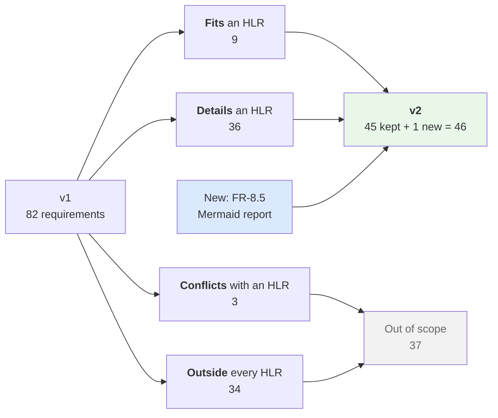

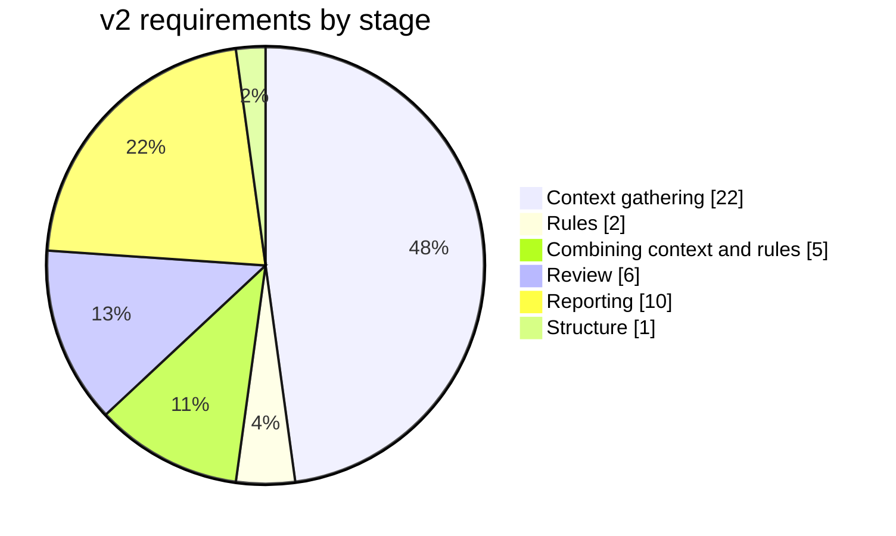

v2 also makes five changes to the HLRs themselves (see §3.2):

- two new level-3 components, **type-check** (HLR-24) and **related context** (HLR-25)
- HLR-3 now says "change diff" instead of "Git diff"
- HLR-9 now mentions the five built-in rules
- HLR-20 (the Mermaid report) is now in scope

### 0.2 Rules this document follows

| Rule | Meaning |
|---|---|
| **IDs never change** | A requirement kept from v1 keeps its v1 ID. New ones are marked **(new in v2)**. |
| **Plain wording** | The requirement text is reworded in simpler terms. **The meaning is the same as v1** unless the requirement is marked **(amended in v2)**, and each amendment says what changed. |
| **Must / Should** | **Must** = required for v2 to be complete. **Should** = included if time allows. |
| **Out of scope ≠ forbidden** | "Out of scope" means v2 **doesn't require** it. It doesn't forbid it, and the design may keep doing it. |
| **"v2" names this document** | Where v1 said something was "deferred to v2" (for example depth 2 and the reverse index), that isn't what this document means by v2. Those items are still out of scope (§7.3). |

### 0.3 Before this becomes the build target

*2026-10-27: v1's revision 1.6 adopted this document's five amendments (FR-5.7, FR-6.3a, FR-8.2b, FR-8.2c, FR-8.2d), the amended AC-2, FR-8.5 and AC-17. Its cut — the 37 requirements it moves out of scope, including FR-5.6a and FR-11.2 — was not adopted, so what follows still applies to that.*

Until this draft is accepted, **v1 stays the normative build target.** Two things have to happen first:

1. **An ADR.** v2 removes two of the constraints that [`CLAUDE.md`](../CLAUDE.md) calls load-bearing: **FR-5.6a**, which says findings enter only through a validated tool call, and **FR-11.2**, which says every failure is reported. The project rule is that dropping one of these needs an ADR.
2. **Updating the authority tables.** [`CLAUDE.md`](../CLAUDE.md), [`README.md`](./README.md) and [`adr/README.md`](./adr/README.md) name v1 as the normative document.

### 0.4 Revision history

| Version | Date | Change |
|---|---|---|
| 2.0 | 2026-09-29 | Cut down to the HLRs. Kept the 45 v1 requirements that fit or detail an HLR, and amended 5 of them where they pointed at something now out of scope. Added FR-8.5 (HLR-20), HLR-24 and HLR-25, and reworded HLR-3 and HLR-9. Moved 37 requirements out of scope |

---

## 1. Words used

| Word | Meaning |
|---|---|
| **Change set** | What is being reviewed: a list of changed files and their diff hunks |
| **Context** | Everything the reviewer reads besides the rules: the diff, the code around it, and the check results |
| **Related context** | Source code outside the changed lines that helps judge them, such as the definitions the changed code imports and calls |
| **Context depth** | How far from the changed code related context reaches. See the ladder in §4.1.3 |
| **Context unit** | One piece of related context. It records why it was included and how far it is from the change |
| **Check** | A command from the project's own toolchain that the system runs: the test suite or the type-check |
| **Evidence record** | What happened to each check: whether it ran, was skipped, or errored, and its result and output |
| **Finding** | One thing the review points out: file, line or range, severity, category, the reason, and optionally the matched rule |
| **Finding model** | The one shared structure all findings are stored in. Every report is built from it. *(v2 keeps this definition but no longer fixes its fields. See §9, gap 1.)* |
| **Pattern rule** | A "wrong vs. correct" example with an ID, which the reviewer applies |
| **Core** | The part of the system that does the reviewing. It doesn't depend on how it was started or where results are shown |
| **Adapter** | A thin layer between a surface (such as a terminal) and the core. It shows results but **never decides what counts as a finding** |
| **Graph layer** | The packages that declare the pipeline and the review step as graphs. They're the only place the agent framework is allowed |
| **Resolver sidecar** | A small helper bundled with the system that answers "which file does this import point to?" using TypeScript's own rules |
| **Host / target language** | The system is written in Python (host). The code it reviews is TypeScript/JavaScript (target) |

---

## 2. The system at a glance

### 2.1 The component diagrams

These diagrams are copied from the [HLR page](./design/Component-design/README.md). Levels 1 and 2 are redrawn from [`level-1.svg`](./design/Component-design/level-1.svg) and [`level-2.svg`](./design/Component-design/level-2.svg). Each level keeps the one above it and adds detail inside its boxes.

**Level 1 — the four blocks**

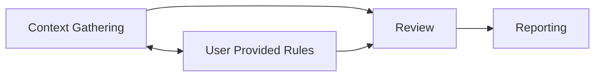

**Level 2 — context splits into static and runtime**

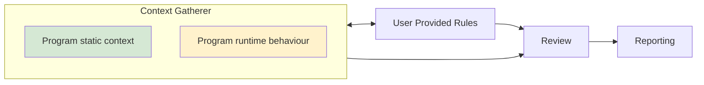

**Level 3 — the components, as of v2**

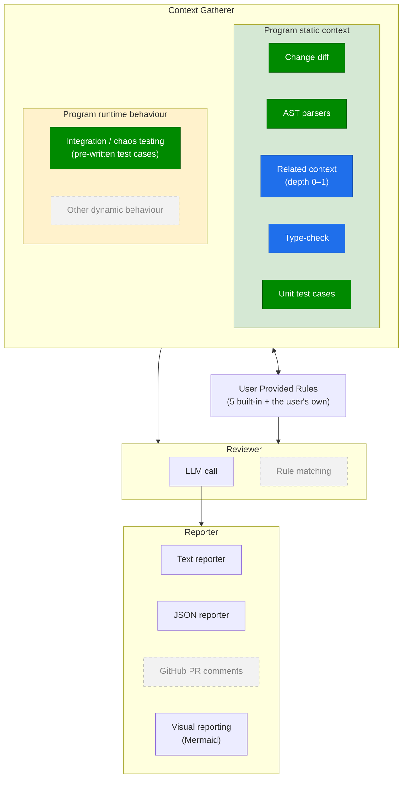

| Colour | Meaning |
|---|---|
| Dark green | A decided component, as on the HLR page |
| Blue | **Added in v2**: type-check (HLR-24) and related context (HLR-25) |
| Grey, dashed | Out of scope in v2: other dynamic behaviour, rule matching, GitHub PR comments |

**What v2 changed in the level-3 diagram**

| Change | Why |
|---|---|
| "Git change diff" is now **"Change diff"** | The change set shouldn't depend on Git (FR-10.3c). Git is how v2 finds the diff, not what the stage needs |
| **Related context** added to static context | Related context is the thing the v1 SRS calls its most important structural constraint (FR-2.6e), and the original diagrams had no box for it |
| **Type-check** added to static context | Tests and the type-check are the two sources of evidence (FR-4.1, FR-4.2), and the original diagrams only drew tests. A type-check reads the code without running it, so it goes in the static box |
| Rules box mentions the **5 built-in rules** | The system ships its own rules (FR-6.3a), not only the user's |
| **Visual reporting** is in scope | HLR-20 is kept, and FR-8.5 is new |

**What the arrows mean**

- **Context → Review** and **Rules → Review**: the reviewer reads both.
- **Review → Reporting**: the findings are handed to the reporters.
- **Context ↔ Rules**: the two-way arrow stays in the diagram, but no requirement uses it. The HLR page withdrew HLR-10.
- **No arrow from Review back to Context.** The reviewer never asks for more (HLR-15).

### 2.2 How one review runs

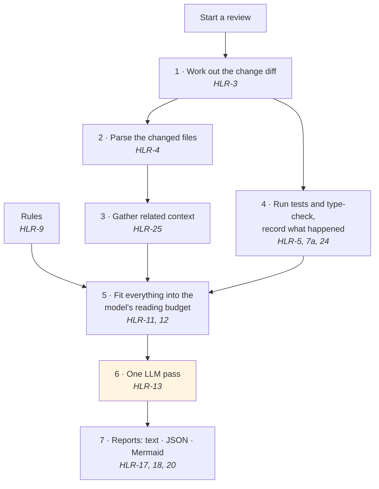

Step 6 is the only step that uses a model. Our code decides the order of the steps, not the model (HLR-22).

### 2.3 Where it runs

| | |
|---|---|
| **Machine** | A developer's computer: Linux, macOS or Windows |
| **The system** | Python. It parses TypeScript inside its own process (FR-2.2) |
| **Resolver helper** | A bundled Node.js script (FR-2.6f). **Optional**: without Node the review still runs, with a lower-quality depth 1 (FR-2.6g) |
| **Project being reviewed** | TypeScript/JavaScript, under git, with a test script. Its checks run with **its own** tools, in a separate process (FR-4.7) |
| **Outside service** | One LLM provider over HTTPS, reached through a provider-independent interface (FR-0.3) |

---

## 3. High-level requirements

### 3.1 All HLRs and their v2 status

The requirement wording comes from the [HLR page](./design/Component-design/README.md) §3. **Bold** marks what v2 changed.

| HLR | Requirement | v2 | Covered by |
|---|---|---|---|
| HLR-1 | The system shall gather context about a code change before reviewing it | In | All of §4.1 |
| HLR-2 | Static context is gathered separately from runtime behaviour | In | The level-2 split in §2.1. No requirement of its own |
| HLR-3 | Static context shall include the **change diff** | In, **reworded** | FR-10.3a, 10.3b, 10.3c, FR-3.5 |
| HLR-4 | Static context shall include syntax trees of the affected code | In | FR-2.2, FR-2.4, FR-2.6b |
| HLR-5 | Context shall include the results of the project's existing unit tests | In | FR-4.1, 4.4a, 4.4b, 4.5a, 4.5b, 4.5c, 4.7, FR-2.5c |
| HLR-6 | Gather runtime behaviour by running the program | Out | — |
| HLR-7a | Context shall include the results of the project's pre-written integration tests | In | FR-4.1 and the same execution requirements as HLR-5 |
| HLR-7b | Context shall include the results of pre-written chaos tests | Out | Not required. If the project's test script runs chaos tests, FR-4.1 runs them too |
| HLR-8 | Open to other kinds of dynamic behaviour | Out | — |
| HLR-9 | The system shall accept review rules supplied by the user, **and ship five built-in rules** | In, **reworded** | FR-6.1, FR-6.3a |
| HLR-10 | *(withdrawn on the HLR page)* | — | — |
| HLR-11 | The review takes the rules as a direct input | In | FR-2.5a |
| HLR-12 | The review uses both the gathered context and the rules | In | FR-5.3, FR-2.3c, 2.5, 2.5b, FR-6.2a |
| HLR-13 | The review is produced by an LLM call | In | FR-0.3, FR-5.7, FR-5.10 |
| HLR-14 | A rule-matching component separate from the LLM | Out | — |
| HLR-15 | The reviewer doesn't request further context | In | FR-4.6. **It now holds with no exceptions**, because the investigation tools (FR-5.7a–c) are out |
| HLR-16 | Reporting is a separate stage from the review | In | FR-10.2, FR-10.4a |
| HLR-17 | A human-readable text report | In | FR-10.4a, FR-8.1b |
| HLR-18 | A machine-readable JSON report | In | FR-8.2a, 8.2b, 8.2c, 8.2d, FR-8.4, FR-10.4b, FR-4.5c |
| HLR-19 | Publish findings as GitHub PR comments | Out | — |
| HLR-20 | A visual report as a Mermaid diagram | **In** | **FR-8.5 (new in v2)** |
| HLR-21 | Several interchangeable report channels behind one stage | In | FR-10.2. Three channels: text, JSON, Mermaid |
| HLR-22 | A fixed forward pipeline: gather → review → report | In | FR-5.8 |
| HLR-23 | Stages can be broken into parts without changing the arrows between stages | In | FR-5.8, FR-2.6e |
| **HLR-24** | **Static context shall include the results of the project's type-check** *(new in v2)* | **In** | FR-4.2 |
| **HLR-25** | **Static context shall include related source around the change, gathered at a requested depth through one interface** *(new in v2)* | **In** | FR-2.3d, FR-2.6a–g |

### 3.2 HLR changes in v2

| HLR | Before | After |
|---|---|---|
| HLR-3 | "Static context shall include the **Git diff** of the change" | "…the **change diff**…" |
| HLR-9 | "…review rules **supplied by the user**…" | "…supplied by the user, **and ship five built-in rules**" |
| HLR-20 | In the HLR list, but no v1 requirement and no version | **In scope**, backed by FR-8.5 |
| HLR-24 | — | New: type-check results |
| HLR-25 | — | New: related context |

Neither new HLR adds new work. FR-4.2 and FR-2.6a–g were already in v1. The HLRs just give them a box in the diagram.

### 3.3 Map from HLRs to requirements

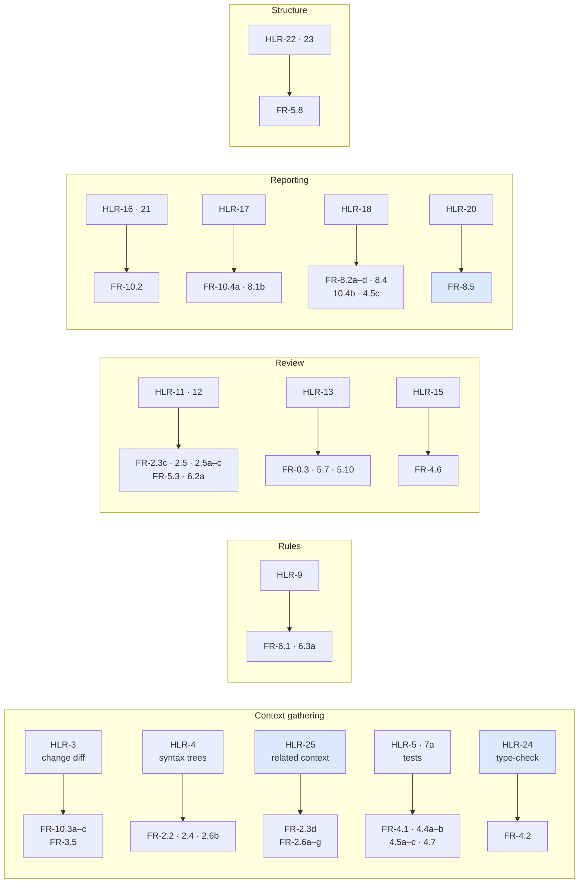

---

## 4. Functional requirements

Each table gives the requirement's ID, Must/Should, the v1 core function (CF) it belongs to, and the requirement itself.

### 4.1 Context gathering

#### 4.1.1 The change diff — HLR-3

| ID | M/S | CF | Requirement |
|---|---|---|---|
| FR-10.3a | M | CF-1 | The system shall let the user choose what to review: uncommitted changes in the working tree, staged changes only, or a comparison against a named branch or commit. |
| FR-10.3b | M | CF-1 | When the user doesn't choose, the system shall use a documented default, and shall say in its output which scope it used. |
| FR-10.3c | M | CF-1 | The change set shall be a list of changed files and their diff hunks, and its shape shall not depend on how it was worked out. |
| FR-3.5 | M | CF-9 | The system shall leave generated, vendored and build-output files out of the review, using a documented default list. Files shall be left out **when the change set is worked out**, so no later step parses, runs or budgets for them. The change set shall record what was left out, so the stated scope (FR-10.3b) is true. |

*Why FR-10.3c matters: a later GitHub version can supply "the PR's changes" in the same shape, and nothing after this step has to change.*

#### 4.1.2 Syntax trees — HLR-4

| ID | M/S | CF | Requirement |
|---|---|---|---|
| FR-2.2 | M | CF-2 | The system shall build a syntax tree for each changed TS/JS file **inside its own process, without calling the reviewed project's tools**. If one file can't be parsed, the system shall report that file and carry on. |
| FR-2.4 | S | CF-2 | The system shall include whole functions, classes and types around a change, rather than a fixed number of lines. |

#### 4.1.3 Related context — HLR-25

Related context is fetched at a **depth**. The ladder is ordered by how hard each step is to work out, not just by distance. A file's imports are written inside the file. Who depends on it isn't.

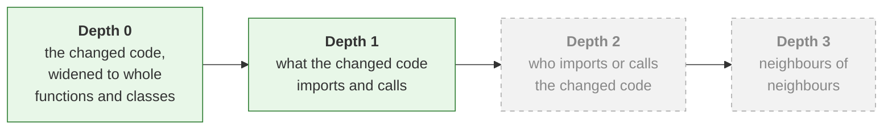

v2 serves depths 0 and 1. Depths 2 and 3 need an index over the whole repository and are out of scope (§7.3).

| ID | M/S | CF | Requirement |
|---|---|---|---|
| FR-2.3d | M | CF-2 | The system shall record which related files it included, and why. |
| FR-2.6a | M | CF-2 | Related context shall be fetched through **one interface that takes a depth**. Which implementation answers is chosen at run time. |
| FR-2.6b | M | CF-2 | v2 shall provide a parser-based implementation that serves depths 0 and 1 without needing an index of the whole repository. |
| FR-2.6c | M | CF-2 | Each piece of related context shall say how it relates to the change (`imports`, `calls`, `imported-by`, `called-by`) and how far away it is. |
| FR-2.6d | M | CF-2 | Each result shall state the depth actually reached. If that's lower than requested, it shall give **every** reason why. The system shall never lower the depth silently. |
| FR-2.6e | M | CF-2 | No code that uses the interface shall behave differently depending on which implementation answered. |
| FR-2.6f | M | CF-2 | At depth 1, import paths shall be resolved with **TypeScript's own resolution rules**, so path aliases, index files, package export maps and workspace links resolve the way the project's own tools resolve them. The resolver ships with the package and is never downloaded during a review. Nothing outside CF-2 can see it (FR-2.6e). It shall stay within its share of the time budget (TBD-1). |
| FR-2.6g | M | CF-2 | If that resolver is missing or fails, the system shall fall back to a simpler guess, mark the result as degraded with a machine-readable reason that tells unresolved imports apart from resolved ones, and finish the review. **A missing resolver shall never make a run fail.** |

**What the interface promises.** These come straight from the requirements above. The exact code signature is a design decision ([`design/04-contracts.md`](./design/04-contracts.md)).

| # | Promise | From |
|---|---|---|
| 1 | You ask for a depth. You may get less | FR-2.6a |
| 2 | Every piece says how it relates to the change and how far away it is | FR-2.6c |
| 3 | Every result says what depth it actually reached | FR-2.6d |
| 4 | A lower depth comes with every reason for it | FR-2.6d |
| 5 | Callers can't tell which implementation answered | FR-2.6e |
| 6 | Each implementation says the deepest level it can serve | FR-2.6a |

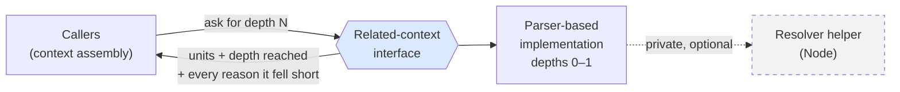

#### 4.1.4 Tests and type-check — HLR-5, HLR-7a, HLR-24

| ID | M/S | CF | Requirement |
|---|---|---|---|
| FR-4.1 | M | CF-3 | The system shall run the project's test suite on the developer's machine and capture pass/fail results and output. *This covers unit tests (HLR-5) and integration tests (HLR-7a), meaning whatever the project's test script runs.* |
| FR-4.2 | M | CF-3 | The system shall run the project's type-check (for example `tsc`) and capture its results. |
| FR-4.4a | M | CF-3 | The system shall give the checks a time budget the user can change, and stop them when the budget runs out. |
| FR-4.4b | M | CF-3 | When checks are stopped for time, the system shall mark execution `timed-out`, skip the checks not yet run, and **still produce a review** that reports the timeout. |
| FR-4.5a | M | CF-3 | For each check, the system shall record whether it **ran**, was **skipped**, or **errored**. |
| FR-4.5b | M | CF-3 | For each check that ran, the system shall record pass/fail and its output. |
| FR-4.5c | M | CF-3 | The system shall give this record to the reviewer and include it in the JSON report. |
| FR-4.7 | M | CF-3 | Checks shall run as **separate processes** using the project's own toolchain and package manager, found from its manifest or named in settings. The system shall not load the project's dependencies into itself, and shall not ask the project to install anything of the system's. |

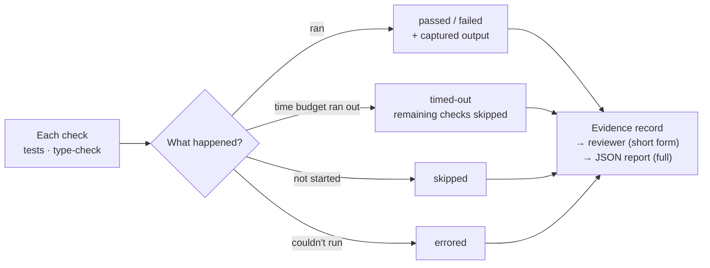

*Why the ran/skipped/errored split matters: without it, "no findings" could mean the change is clean or that the tests never ran.*

### 4.2 Rules — HLR-9

| ID | M/S | CF | Requirement |
|---|---|---|---|
| FR-6.1 | M | CF-8 | The system shall load a pattern library the user can configure, made of "wrong vs. correct" examples and project standards. |
| FR-6.3a | M | CF-8 | v2 shall ship **at least five built-in pattern rules**, each with a wrong example and a correct example. **(amended in v2)** |

*FR-6.3a amendment: v1 also required a regression test case for every rule. The regression harness is out of scope (§7.1).*

### 4.3 Combining context and rules — HLR-11, HLR-12

The model can only read so much. These requirements decide what goes in when there's too much.

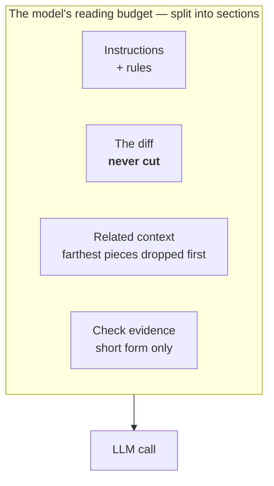

| ID | M/S | CF | Requirement |
|---|---|---|---|
| FR-2.3c | M | CF-4 | The system shall put the source of related definitions and call sites into what the reviewer reads, up to the context cap. |
| FR-2.5 | M | CF-4 | The system shall cap the context size to fit the model's token limit, and handle an overflow gracefully. |
| FR-2.5a | M | CF-4 | The budget shall be split into sections (instructions and rules, the diff, related context, evidence) so **no section can crowd out another**. |
| FR-2.5b | M | CF-4 | When over budget, the system shall drop the related context farthest from the change first, and shall **never cut the diff**. |
| FR-2.5c | M | CF-4 | Check output shall be shortened to failing test names, assertion messages, and stack frames that point at changed files before the reviewer sees it. The full output is kept for the JSON report only. |

*FR-2.5a is what makes the rules a direct input (HLR-11): they have their own share of the budget, so nothing else can push them out. FR-2.5c exists because a failing test suite can print megabytes.*

### 4.4 Review — HLR-12, HLR-13, HLR-15

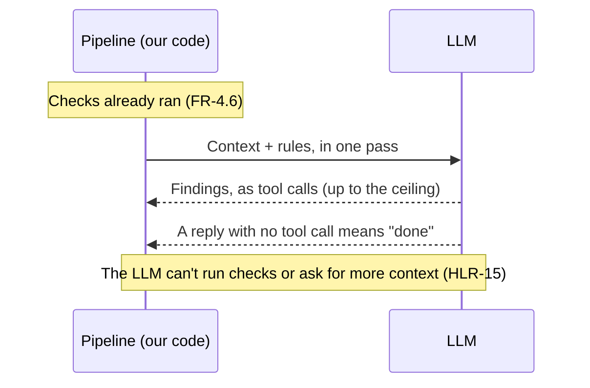

| ID | M/S | CF | Requirement |
|---|---|---|---|
| FR-5.3 | M | CF-6 | The reviewer shall use the check results and the pattern rules when producing findings. |
| FR-6.2a | M | CF-8 | When a finding comes from a pattern rule, it shall name that rule's ID. |
| FR-4.6 | M | CF-3 | The reviewer shall **not** be able to start checks. Checks run once per run, before the review. |
| FR-0.3 | M | CF-5 | The LLM shall be reached through a **provider-independent interface**, so a new provider is added by mapping its output to the finding model, with no change to anything downstream. The client that implements it may live in the graph layer (FR-5.8). |
| FR-5.7 | M | CF-6 | The review step shall enforce a **tool-call ceiling**: a setting that caps the total number of tool calls the model may make in one review, counting every call, **including the calls that hand over findings**. The documented default shall be a positive number, big enough never to cut short a review someone would read and small enough to stop a runaway model. Reaching the ceiling shall be reported, and findings made before it shall be kept. **(amended in v2)** |
| FR-5.10 | M | CF-6 | The system shall not force the model to call a tool. A reply with no tool call means the model is done. If that reply leaves no findings, the run shall record that no tool call was made, so that "reviewed and found nothing" can be told apart from "never used the tool". |

*FR-5.7 amendment: v1 named the `emit_finding` tool here. How findings are handed over (FR-5.6a) is out of scope in v2, so the ceiling counts "the calls that hand over findings", whatever the design calls them.*

### 4.5 Reporting — HLR-16, 17, 18, 20, 21

Every report is built from the same list of findings. A reporter shows findings and never decides what one is.

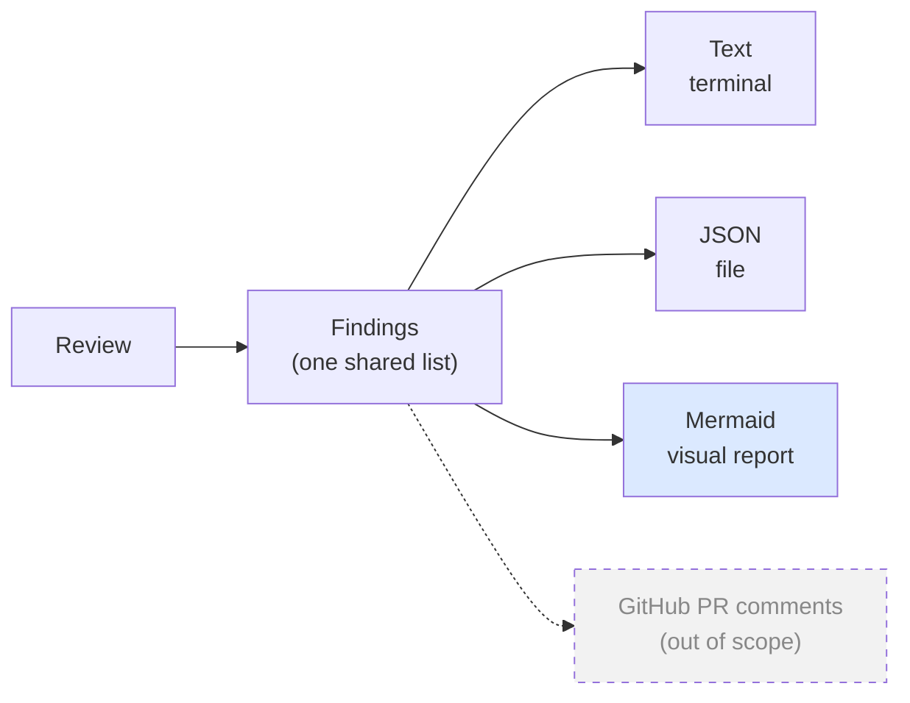

| ID | M/S | CF | Requirement |
|---|---|---|---|
| FR-10.2 | M | — | No adapter shall contain logic that decides whether something is a finding. |
| FR-10.4a | M | CF-7 | The system shall show findings in the terminal, built from the finding model and not produced separately. |
| FR-8.1b | M | CF-7 | The terminal summary shall state the resolved change scope, the checks run and their results, the number of findings by severity, and an overall verdict. |
| FR-8.2a | M | CF-7 | The system shall write the review's result as a JSON file. |
| FR-8.2b | M | CF-7 | The JSON shall follow a documented, versioned **report schema** containing the findings, the evidence record and the run details of FR-8.2c. The findings part is the finding model, and the report wraps around it. **(amended in v2)** |
| FR-8.2c | M | CF-7 | The JSON shall record the requested and reached context depth, the tool-call ceiling in force and whether it was reached, the model and schema versions, and the resolved change scope, so a run can be repeated and compared. **(amended in v2)** |
| FR-8.2d | M | CF-7 | The JSON shall record tool calls both as a total and broken down by purpose. At minimum it shall give the total and the number spent handing over findings. A single total shall not be the only figure. **(amended in v2)** |
| FR-8.4 | S | CF-7 | The JSON schema shall be documented and versioned. |
| FR-10.4b | M | CF-7 | The system shall produce the JSON on request, following the schema in FR-8.2b. |
| **FR-8.5** | M | CF-7 | On request, the system shall produce a **visual report of the review as a Mermaid diagram**. It shall be built from the same findings as the text and JSON reports, and shall be valid Mermaid that renders. What the diagram shows is a design decision. **(new in v2)** |

**What the amendments removed**

| FR | Removed | Because |
|---|---|---|
| FR-8.2b | The rule that the `emit_finding` tool schema equals the finding model | FR-5.6a is out of scope |
| FR-8.2c | "Whether investigation tools were enabled" and the completion status of FR-5.7c | FR-5.7a–c are out of scope. "Whether the ceiling was reached" replaces the completion status, and FR-5.7 already requires it to be reported |
| FR-8.2d | The investigation and repair-turn counts | FR-5.7a and FR-5.6c are out of scope. Today the two remaining figures are usually equal. The breakdown stays so that any future kind of tool call gets counted separately |

### 4.6 Structure — HLR-22, HLR-23

| ID | M/S | CF | Requirement |
|---|---|---|---|
| FR-5.8 | M | CF-6 | The agent framework shall live **only in the graph layer**: the pipeline order, the review step, and the code that builds the LLM client. **No core package shall import it**, and every step outside the review step shall be callable as a plain function. Each graph node shall be a thin wrapper over one core function, with no ordering logic of its own. The pipeline graph shall have **no loops**. The review step is the only place a loop may appear. |

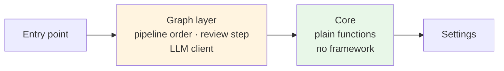

*This is what keeps "our code decides the order, not the model" (HLR-22) true. It's checked with an import list (AC-10).*

---

## 5. Interfaces

| Interface | Defined in | Can it change? |
|---|---|---|
| Change set (files + hunks) | FR-10.3c | **Frozen.** A future adapter replaces what produces it, not its shape |
| Related-context interface promises | §4.1.3 | **Frozen.** New implementations may be added. The code signature belongs to design |
| How imports are resolved | FR-2.6f | Private to CF-2. Free to change |
| Running checks | FR-4.7 | A process boundary. The system and the project never share a runtime |
| LLM provider interface | FR-0.3 | A new provider is a new implementation behind it |
| JSON report schema | FR-8.2b | Versioned |
| Mermaid report | FR-8.5 | Its content is a design decision |

---

## 6. Acceptance criteria

v2 is complete when all of these hold. Each one is checked by **running** the system, not by reading the code. AC IDs are kept from v1. The new one is AC-17.

| # | Criterion | Checks |
|---|---|---|
| **AC-2** | A review of a TS/JS project whose change breaks a test or the type-check produces at least one finding that cites that result, rather than guessing from the text. **(amended in v2)** | FR-4.5c, FR-5.3, FR-4.2 |
| **AC-3** | The JSON validates against the published schema, and records depth, model and resolved scope | FR-8.2b, FR-8.2c |
| **AC-4** | A finding that comes from a pattern rule names that rule | FR-6.2a |
| **AC-7** | A run where the tests couldn't run says so, and can be told apart in both text and JSON from a run that found nothing | FR-4.5a, FR-4.5c |
| **AC-8** | Asking for depth 2 reports depth 1 reached, with a machine-readable reason naming the missing index, and the review still finishes | FR-2.6d |
| **AC-10** | No module outside CF-7 imports a terminal-rendering library. No module outside CF-1 works out a change scope. **No core package imports the agent framework.** No module outside CF-2 names a concrete related-context implementation or mentions the resolver | FR-10.2, FR-2.6e, FR-5.8 |
| **AC-12** | With the resolver made unavailable, a review of the same project still finishes and reports the degradation, and can be told apart from a run where every import resolved | FR-2.6f, FR-2.6g |
| **AC-16** | A run where the model made no tool call can be told apart, in both outputs, from a run that reviewed the change and found nothing | FR-5.10 |
| **AC-17** | Asking for the visual report produces Mermaid that renders without error and shows the same findings as the JSON report. **(new in v2)** | FR-8.5 |

*AC-2 amendment: v1 tied it to AC-1's run of a public repository. AC-1 checked FR-9.2a and FR-10.1, which are both out of scope, so AC-2 now describes its own run.*

**Dropped:** AC-1, 5, 6, 9, 11, 13, 14 and 15. Every requirement they checked is out of scope. See §9, gap 8 for what that leaves unchecked.

**AC-7 is the one to defend under schedule pressure.** Without it, "no findings" can mean both "clean" and "broken".

---

## 7. Out of scope

Out of scope means **not required by v2**. It doesn't mean forbidden.

### 7.1 v1 requirements not carried into v2 (37)

| Group | Requirements | In simple terms |
|---|---|---|
| **Finding shape** | FR-0.1, 0.2, 0.4, 5.2, 5.2a, 5.2b, 5.2c, 5.6, 5.7d | The fields a finding must have, the severity and category words, the schema version, and the link to the evidence behind it |
| **How findings leave the LLM** | FR-5.6a, 5.6b, 5.6c, 5.9 | Findings only through a checked tool call, a fallback for providers without tools, one repair try, and the ok/error/denied reply format |
| **Investigation tools** | FR-5.7a, 5.7b, 5.7c | Letting the model read more files during the review. This was the conflict with HLR-15 |
| **Reporting failures** | FR-2.6h, 8.2e, 11.2 | Always producing a review and listing every problem that occurred |
| **Settings and diagnostics** | FR-1.2a, 1.2b, 1.2c, 1.2d, 1.3a, 9.1, 9.3 | The settings file, its defaults, loud errors on a bad file, where the API key comes from, docs, and error messages |
| **Measurement** | FR-6.2b, 6.2d, 6.2e, 6.2f | The regression command, catch rate and false positives |
| **Entry point and exit codes** | FR-10.1, 10.4c, 9.2a | The CLI, exit codes, and "works end to end on a free tier" |
| **Budgets and trace** | FR-11.1, 11.3 | A token and call budget per run, and a trace of the run |
| **Isolation and write path** | FR-5.1, 7.2 | Keeping the reviewer apart from any code-writing agent, and "suggestions only, never commits". The system still has no way to write, but it's no longer required |

### 7.2 HLRs out of scope

| HLR | What | Note |
|---|---|---|
| HLR-6 | General runtime observation of the program | The only runtime evidence comes from the project's own tests |
| HLR-7b | Chaos tests | Not required. They run only if they're part of the project's test script |
| HLR-8 | Other dynamic behaviour | — |
| HLR-14 | Rule matching separate from the LLM | The LLM applies the rules and names them (FR-6.2a) |
| HLR-19 | GitHub PR comments | Needs a GitHub adapter. FR-10.3c keeps the way open |

### 7.3 Still excluded, as in v1 §7

Context depth 2 and above, and the reverse index behind it · risk triage and depth routing · dependency audit · cross-run de-duplication · pattern coverage reporting · a broad default rule set · fix snippets · a platform support matrix and prebuilt binaries · tolerating unparseable working trees · **all GitHub integration**.

---

## 8. Numbers not yet decided

Only the open numbers that a kept requirement points to are carried over. Each placeholder is **a deliberate stand-in, not a measurement**. No decision may use one of these numbers as its justification.

| # | Open question | Pointed to by | Placeholder until measured |
|---|---|---|---|
| TBD-1 | How much of the review time import resolution may use | FR-2.6f | — |
| TBD-2 | How long a developer will actually wait. To be learned by watching real users, not guessed | FR-4.4a | — |
| TBD-3 | The context size cap, and how it's split between sections | FR-2.5, FR-2.5a | The model's window minus room for its reply, split into the four sections |
| TBD-4 | Default time budget for checks | FR-4.4a | A documented default, reported when exceeded |
| TBD-5 | The largest change set handled | FR-10.3c | — |
| TBD-8 | Default tool-call ceiling | FR-5.7 | **25** |

Every stage records how long it took on every run, so the measurements exist when real users are observed.

---

## 9. What this cut leaves open

These are consequences of the scope above, stated plainly so nobody discovers them later.

| # | Gap | What it means in practice | Caused by dropping |
|---|---|---|---|
| 1 | **Findings have no fixed shape** | Kept requirements still say "finding", "severity" and "finding model", so §1 keeps those words. But v2 no longer fixes a finding's fields, the severity and category words, or a schema version, and a finding doesn't have to say what evidence backs it | FR-0.1, 0.2, 0.4, 5.2, 5.2a–c, 5.6 |
| 2 | **No rule on how findings leave the LLM** | Nothing stops the system from reading findings out of the model's free text. Nothing checks a finding when it arrives, and a malformed one gets no second try. **Load-bearing in v1.** | FR-5.6a–c, 5.9 |
| 3 | **Failures don't have to be reported** | A broken run could look like a clean one. Some protection is left: the timeout (FR-4.4b), the ran/skipped/errored record (FR-4.5a), the depth-reached reasons (FR-2.6d, 2.6g), and the no-tool-call record (FR-5.10). **Load-bearing in v1.** | FR-11.2, 2.6h, 8.2e |
| 4 | **"Configurable" with no settings rules** | FR-4.4a, 6.1, 3.5 and 5.7 all mention a setting, but v2 doesn't say where settings come from or that a bad settings file must fail loudly. It also doesn't say the API key must never be hard-coded or committed | FR-1.2a–d, 1.3a |
| 5 | **No required entry point or exit codes** | v2 doesn't require a CLI, and a script can't tell "found a blocker" from "couldn't run" by exit code | FR-10.1, 10.4c, 9.1, 9.3 |
| 6 | **No way to measure quality** | No test corpus and no catch rate, so there's no way to show that a change made the reviewer better. The ceiling default (TBD-8) is meant to be "measured", but nothing measures it | FR-6.2b, 6.2d–f |
| 7 | **No isolation, budget or trace** | The reviewer isn't required to be kept apart from a code-writing agent. A run isn't capped by tokens, and can't be explained after the fact | FR-5.1, 11.1, 11.3 |
| 8 | **Some kept requirements have no acceptance criterion** | AC-1 was the only check for FR-10.3a–c, FR-2.2, 2.3d, 2.4 and FR-3.5. With AC-1 gone, nothing runs to verify them | AC-1 (FR-9.2a, 10.1) |

**Risks kept from v1**

| # | Risk | Response |
|---|---|---|
| R-1 | **At depth 1, the reviewer can't see callers.** It can judge whether a change is sound on its own, but not whether it breaks an assumption held by code that calls it | The depth interface (§4.1.3) lets depth 2 be added later as a new implementation, without a rewrite |
| R-5 | **The system helps the author, not the reviewer.** It reviews your own work before you push. It doesn't clear a reviewer's queue of pull requests | Say so whenever it's demonstrated. GitHub support (HLR-19) is out of scope |
| R-7 | **Python reviewing TypeScript.** Depth 1 quality depends on an optional Node helper | Kept private to CF-2 and reported when missing (FR-2.6f, FR-2.6g, AC-12) |
