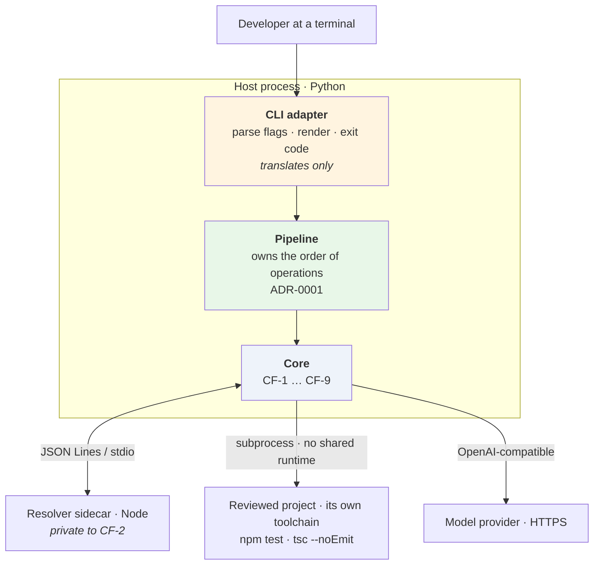
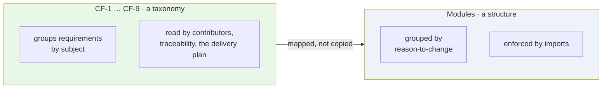
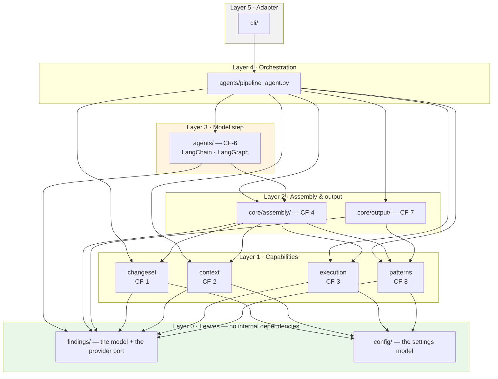
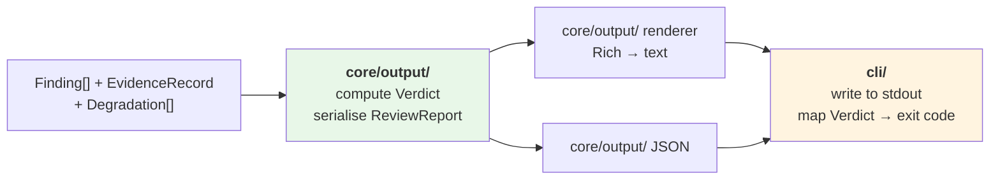
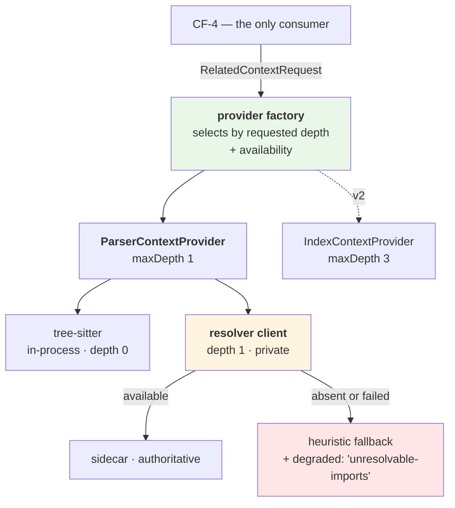
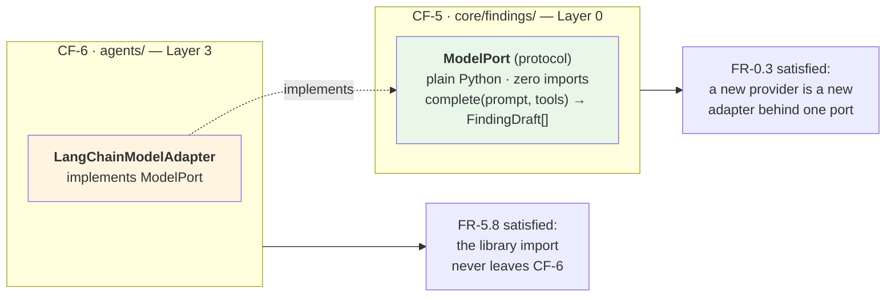
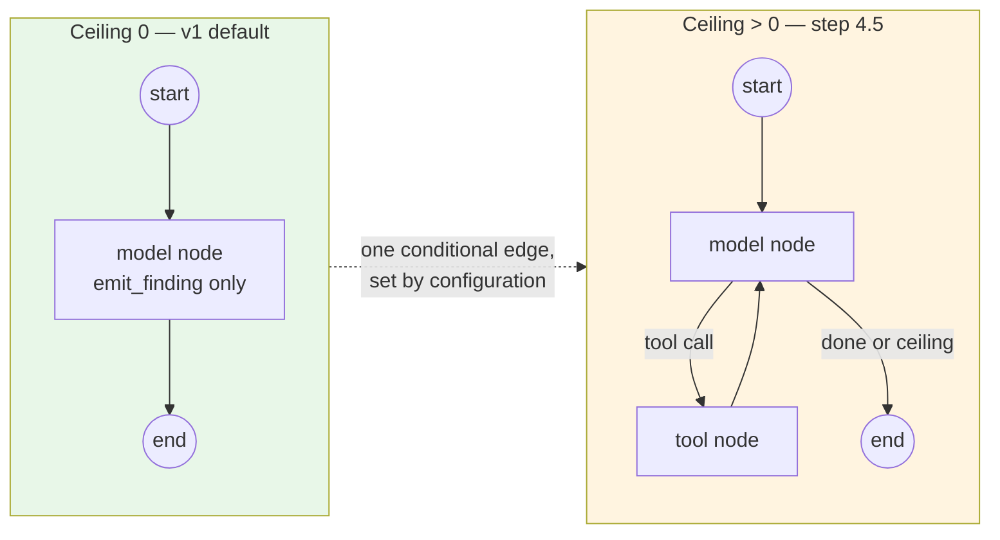
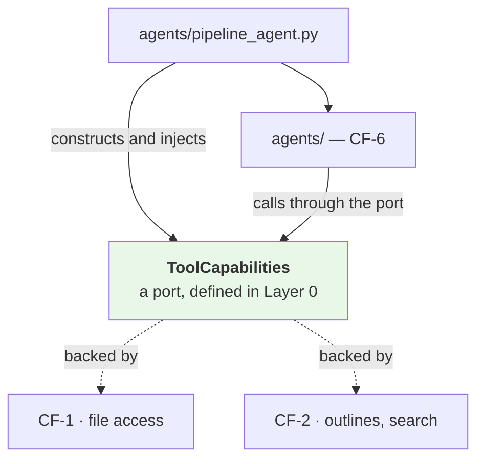

# M1 · Logical Architecture

**Status:** Draft for verification · **Date:** 2026-09-14 · **Milestone:** M1 (third in sequence)
**Serves:** [`../agentic-code-review-srs-v1.md`](../agentic-code-review-srs-v1.md) §3, §4.10 · **Builds on:** [`02-domain-model.md`](./02-domain-model.md)

---

## 0 · What this decides

**Who the components are, and who may call whom.** Not the types (M2), not the signatures (M4).

The repository layout is not design's to choose — [`../technical_stack.md`](../technical_stack.md) §4 owns it. This document maps the nine core functions onto it, names the two places it is incomplete, and specifies the dependency rules that make the SRS's structural claims checkable rather than aspirational.

---

## 1 · The system in one view

**Three boundaries, three different kinds of trust:**

| Boundary | Kind | Rule |
|---|---|---|
| CLI ↔ core | In-process | The adapter may translate. It may **never** decide what counts as a finding (FR-10.2) |
| Core ↔ sidecar | Process, ours | Private to CF-2. Nothing outside CF-2 may know it exists (FR-2.6f) |
| Core ↔ project | Process, theirs | Subprocess only. No import in either direction (FR-4.7) |

---

## 2 · Core functions → modules

### 2.1 A core function is not a module

[`../technical_stack.md`](../technical_stack.md) §4 maps CF-1…CF-9 onto nine directories, one for one. **Design does not adopt that mapping**, for the reasons in [DO-5](../../DESIGN_BLOCKERS.md#do-5).

The nine core functions are a good way to *group requirements*, and Appendix B's traceability rests on them. They are a poor way to *draw module boundaries*, because they were drawn along subject matter rather than along reasons-to-change:

**Both are kept. Neither is derived from the other by copying.** CF-1…CF-9 stay as the traceability axis; modules are derived from responsibility; the table below is the mapping, and it is not one-to-one in three places.

### 2.2 The mapping

| CF | Responsibility | Module(s) | 1:1? |
|---|---|---|---|
| — | **Order of operations** | `agents/pipeline_agent.py` | ⚠️ No CF owns it — [DB-16](../../DESIGN_BLOCKERS.md#db-16), §6.1 |
| CF-1 | Change-set resolution | `core/changeset/` | ✅ |
| CF-2 | Parsing and related context | `core/context/` + `core/context/resolver/` | ✅ Sidecar client is a sub-package, not a peer |
| CF-3 | Execution and evidence | `core/execution/` | ✅ |
| CF-4 | Context assembly | `core/assembly/` | ✅ Sole owner of the token budget — [DB-05](../../DESIGN_BLOCKERS.md#db-05) |
| **CF-5** | Finding model **and** provider client | `core/findings/` (model + port) · adapter in `agents/review_port.py` | ❌ **Two reasons to change, and FR-5.8 forbids one package** — §6.2 |
| CF-6 | The review agent | `agents/review_reporting_agent.py` · accounting in `core/review/` | ✅ The graph lives in the only package importing the agent framework (ADR-0010) |
| **CF-7** | Output | `core/output/` (verdict, serialise, render) · `cli/` (write, exit) | ❌ **Spans the core/adapter seam** — §4 |
| CF-8 | Pattern library and regression harness | `core/patterns/` + `tests/corpus/` | ✅ |
| **CF-9** | Configuration and diagnostics | `core/config/` — but FR-3.5 **executes** in `core/changeset/` | ❌ [DB-12](../../DESIGN_BLOCKERS.md#db-12) |

> **The three mismatches are not design being fussy.** CF-5's is a live contradiction that a one-to-one layout turned into a directory that cannot legally exist (§6.2). CF-7's is the seam ADR-0006 says must never blur. CF-9's silently makes four components do work on files nobody asked to review.

---

## 3 · The dependency rule

**Dependencies point down. Never up, never sideways within a layer.**

| Rule | Why |
|---|---|
| **Layer 0 imports nothing of ours** | The finding model is what every layer agrees on. A leaf cannot create a cycle. |
| **Capabilities never call each other** | CF-2 does not call CF-3. If two capabilities need to combine, that is CF-4's job or the pipeline's. This is what keeps each one unit-testable alone. |
| **Only the pipeline knows the order** | ADR-0001's decision, expressed as an import rule instead of a convention. |
| **CF-7 renders; it never computes a verdict** | §4 |
| **Nothing imports `cli/`** | It is the outermost ring. If core needed it, the seam has already failed. |

> **Revised 2026-09-17 — where the published types live** ([spec 001](../../specs/001-walking-skeleton/data-model.md#1--where-each-type-lives) D-8). The report embeds types that Layer-1 capabilities produce (`ChangeSummary` from CF-1, later `EvidenceRecord` from CF-3), yet `core/output/` may import only `findings/` and `patterns/`. So **every type in the published report schema is defined in `core/findings/`**, and capabilities produce values of those types without owning them. `ChangeSet`, which carries diff text and never reaches the report, stays in `core/changeset/`. The layering above is unchanged; this is what keeps it acyclic.

> **The rule that costs something.** CF-6 depends on CF-4's *output*, not on CF-1, CF-2, CF-3 or CF-8. The agent does not get to reach for context — it is handed an assembled prompt. That is ADR-0001's "our code owns orchestration" restated as a dependency, and it is what stops the step-4.5 tool loop from turning into a general capability grab (§7).

---

## 4 · The core/adapter seam inside CF-7

CF-7 is one core function spanning both sides of the boundary, which makes it the easiest place to breach FR-10.2 by accident.

| Decision | Rationale |
|---|---|
| **The verdict is computed in core**, not in the CLI | FR-10.4c's exit code "reflects the review outcome". If the adapter decided which findings matter, it would be deciding what a finding *means* — FR-10.2's line, one step removed |
| The CLI maps `Verdict → int` and nothing else | A surface detail. The v3 Action maps the same verdict onto a check-run conclusion |
| Rich is imported by `core/output/` **and** `cli/` | Per the stack's contract. Both are CF-7; nothing else may |

**Proposed verdict policy** (severity was settled 2026-09-14):

| Verdict | When | Exit |
|---|---|---|
| `clean` | Checks ran, no findings | 0 |
| `findings` | No `blocking` finding | 0 |
| `blocking` | At least one `blocking` finding | 1 |
| `degraded` | Any `Degradation` present, whatever was found | 0, **and the terminal says so** |

`degraded` exiting 0 is deliberate: a degraded review is a *real* review (FR-11.2). Exiting non-zero would make every missing-Node run look like a failed review to a script, which is precisely the confusion AC-7 and AC-12 exist to prevent.

> **Revised 2026-09-17 — the verdict vocabulary** (spec 001, D-8). The proposed table above is superseded, for two reasons. A `degraded` verdict hides whether a blocking finding exists, and [`03-behaviour.md`](./03-behaviour.md) §4 had already split "no judgement made" off with its own exit code. Degradation is now **orthogonal** to the verdict and reported beside it:
>
> | Verdict | When | Exit |
> |---|---|---|
> | `findings` | Reviewed, no `blocking` finding | 0 |
> | `blocking` | Reviewed, at least one `blocking` finding | 1 |
> | `no-findings` | Reviewed, zero findings. **Not called `clean`**: with investigation off, zero findings is indistinguishable from a model that never used the tool (D-5) | 0 |
> | `nothing-to-review` | The change set had nothing reviewable; no model call | 0 |
> | `no-judgement` | Provider error, output that could not be validated with no finding accepted, or the diff alone over the budget | 2 |
>
> Any of the first four may carry degradations and still exit as shown.

---

## 5 · CF-2 internals, and the two things it hides

**Two things are hidden, at two different depths:**

| Hidden | From | By |
|---|---|---|
| Which *provider implementation* answered | CF-4, CF-6, CF-7 | FR-2.6e — the factory is the only thing that knows |
| That a *sidecar* exists at all | Everything including CF-4 | FR-2.6f — it is `ParserContextProvider`'s private business |

The factory exists because FR-2.6e forbids consumers from branching on the implementation — so **something** must choose, and it must not be the caller. One module knows; v2 adds a branch inside it and nothing else changes. That is the whole of the SRS's claim that v2 is an addition rather than a rewrite, reduced to a single function.

---

## 6 · Where the specification did design's job

Three cases. In each one design proceeds against **the requirement underneath**, not the mechanism written over it — and records the objection rather than inheriting it silently.

### 6.0 ⚠️ The provider interface, as declared

SRS §4.2.2 declares `RelatedContextProvider` in TypeScript, returning a `Promise`. Design keeps every one of its five normative behaviours and **declines the declaration** ([DO-2](../../DESIGN_BLOCKERS.md#do-2)):

| Kept — normative | Declined — design's |
|---|---|
| Retrieval parameterised by depth | `Promise<>`, i.e. an async requirement nobody argued for |
| Provenance on every unit (relation, distance) | `camelCase` as published field names |
| The achieved depth is stated | A single-valued `degraded`, which is a modelling bug ([DB-04](../../DESIGN_BLOCKERS.md#db-04)) |
| A lower depth is reported with a reason, never silent | TypeScript syntax, in a Python system |
| No consumer branches on the implementation | |

**v1 is synchronous.** The pipeline is a sequence; nothing in the requirements asks for concurrency; the one place it might pay — overlapping CF-2 with CF-3 — is unmeasured by the stack's own admission and blocked on [DB-07](../../DESIGN_BLOCKERS.md#db-07). Async is an optimisation to be earned against a number, not a default inherited from a code sample.

### 6.1 ⚠️ The pipeline has no module

`../technical_stack.md` §4 lists nine packages under `core/`. None of them is the pipeline.

This matters more than a missing folder. ADR-0001's entire decision is *"our code owns orchestration"*, and AC-10 checks that claim by import list. A pipeline that lives nowhere ends up living **in the CLI** — the one place ADR-0006 says orchestration must not be, because then the Action adapter in v3 would have to reimplement it and the two surfaces would drift.

**Design adds a pipeline module** (since ADR-0010: `agents/pipeline_agent.py`), above the capabilities and below the adapter. Raised as [DB-16](../../DESIGN_BLOCKERS.md#db-16) so the stack document can record it.

### 6.2 ⚠️ CF-5's provider client cannot exist where CF-5 lives

| Document | Says |
|---|---|
| SRS §3 | CF-5 = "Finding model **and provider client**" |
| FR-0.3 | A new provider is integrated by mapping its output to the finding model — CF-5's requirement |
| FR-5.8 | "The agent framework shall be confined to the agents package; no core package shall import it" |
| stack §4 | Contract: "No package under `core/` may import LangChain, LangGraph or openai — only `agents/` may" |

The provider client **is** the LangChain client. So CF-5 owns a responsibility it is forbidden to implement.

**Design's resolution — port and adapter:**

Both requirements hold, and neither is bent. Raised as [DB-15](../../DESIGN_BLOCKERS.md#db-15) because it reinterprets a responsibility line in §3.

---

## 7 · CF-6 and the loop seam

Per the DB-01 decision: the loop **is** in v1, at *Should*, gated by FR-5.7b.

**The seam is built now; the edge is not wired.** That is what makes FR-5.7's promise — *configuration, not restructuring* — literally true.

**Where the three tools live, and why it is not obvious.** `read_file`, `get_outline` and `search_repo` read the working tree and parse source. If CF-6 implemented them, CF-6 would import tree-sitter and git — and Layer 3 would reach into Layer 1, breaking §3's rule.

The agent calls a port it was handed. It never reaches for a capability, and the pipeline decides what is in the port — which is FR-5.7a's "exactly three tools, no side effects" enforced by construction rather than by prompt.

---

## 8 · Structural enforcement

AC-10 names three import contracts. Design specifies **five**, for the reasons in [DB-10](../../DESIGN_BLOCKERS.md#db-10).

| # | Contract | Defends | In AC-10? |
|---|---|---|---|
| 1 | Only `core/output/` and `cli/` may import Rich | FR-10.4a | ✅ |
| 2 | Only `core/changeset/` may import the git layer | CF-1 encapsulation | ✅ |
| 3 | **No package under `core/` may import LangChain, LangGraph or openai** — only `agents/` may ([ADR-0010](../adr/0010-agents-package-separate-from-core.md)) | FR-5.8 | ✅ |
| 4 | Only `core/context/resolver/` may reference the sidecar bundle path | FR-2.6f | ❌ — stack §4 proposes it; no criterion names it |
| 5 | **No module outside `core/context/` may name a concrete provider class** | **FR-2.6e** | ❌ — **nothing currently checks the SRS's highest-value constraint** |
| 6 | Nothing imports `cli/`; capabilities do not import each other | §3 | ❌ — new |

Contract 5 is the one worth insisting on. The SRS calls FR-2.6e *"the highest-value structural constraint in this document"*, and it is currently the only structural claim with no test behind it. A grep for the class name is a cheap thing to be right about.

---

## 9 · What M1 decided, and what it did not

| Decided | |
|---|---|
| **Modules are derived from responsibility, not copied from CF-1…CF-9** | The taxonomy stays for traceability; three of nine blocks fail as modules ([DO-5](../../DESIGN_BLOCKERS.md#do-5)) |
| **v1 is synchronous** | Async was inherited from a TypeScript code sample, not required ([DO-2](../../DESIGN_BLOCKERS.md#do-2)) |
| Six layers, dependencies downward only | Makes ADR-0001's orchestration claim an import rule, not a habit |
| Capabilities never call each other | CF-2 has no idea CF-3 exists; each is testable alone |
| The verdict is core, the exit code is the adapter | FR-10.4c without breaching FR-10.2 |
| `degraded` exits 0 | A degraded review is a real review (FR-11.2) |
| A provider factory inside CF-2 | The single function that makes v2 an addition |
| `ModelPort` in CF-5, adapter in CF-6 | Resolves the CF-5 / FR-5.8 collision without bending either |
| `ToolCapabilities` as an injected port | The agent cannot reach for a capability it was not given |
| Five import contracts, not three | FR-2.6e finally gets a test |

### All four open items closed, 2026-09-14

| Was open | Now |
|---|---|
| the pipeline module absent from the stack layout | ✅ [`technical_stack.md`](../technical_stack.md) §4, with import contract 6 keeping it out of the adapter |
| CF-5's provider client vs FR-5.8 | ✅ **FR-0.3** — CF-5 owns the interface; the implementing client may live in CF-6. Port and adapter, as designed in §6.2 |
| Who owns the token budget | ✅ **CF-4, solely.** The `budget` parameter that granted CF-2 authority left the specification with the TypeScript declaration ([DO-2](../../DESIGN_BLOCKERS.md#do-2)) |
| Where FR-3.5's exclusion is applied | ✅ **FR-3.5** now says: at change-set resolution, recorded in the change set so the stated scope is true |

Two further things this milestone raised are now recorded outside design: the five-then-six import contracts are in [`technical_stack.md`](../technical_stack.md) §4 — **AC-10 gained the clause that tests FR-2.6e** — and the CF-versus-module distinction argued in §2.1 is recorded there too, so the layout no longer mirrors the taxonomy.
