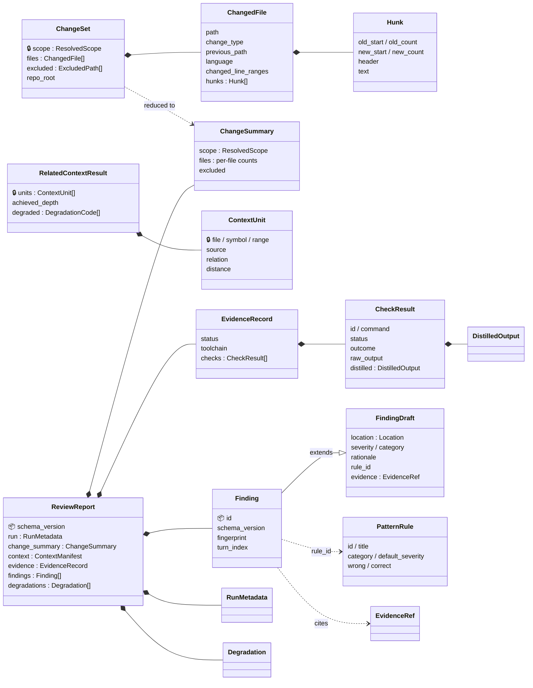
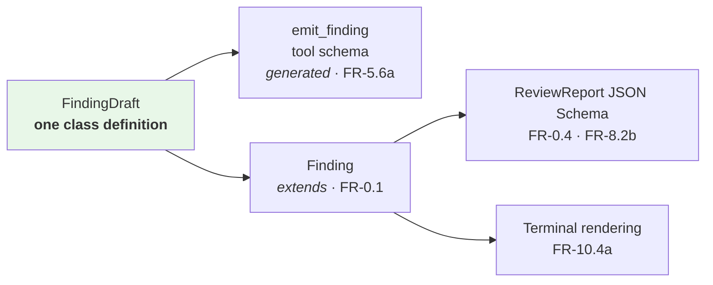

# M2 · Domain Model

**Status:** Draft for verification · **Date:** 2026-09-14 · **Milestone:** M2 (first in sequence)
**Serves:** [`../agentic-code-review-srs-v1.md`](../agentic-code-review-srs-v1.md) §4, §5 · **Open items:** [`DESIGN_BLOCKERS.md`](../../DESIGN_BLOCKERS.md)

---

## 0 · How to read this

This document defines **the things the system passes around**. Not the components — that is M1. Not the wire formats — that is M4.

| Convention | |
|---|---|
| **Naming** | Fields are `snake_case` in code, serialised as `camelCase` in JSON ([DB-11](../../DESIGN_BLOCKERS.md#db-11)). Enum **values** are written exactly as the SRS writes them — `'unresolvable-imports'`, not `UNRESOLVABLE_IMPORTS` — so AC-8 and AC-12 read literally against the output. Design honours those literals while objecting to acceptance criteria that test spelling ([DO-3](../../DESIGN_BLOCKERS.md#do-3)). |
| **Frozen** | 🔒 marks a type the SRS §5 freezes. Changing it is a specification change, not a refactor. |
| **Versioned** | 📦 marks a type inside the published schema. Changing it bumps `schema_version`. |
| **Proposed** | ⚠️ marks a field that exists only because of a design proposal awaiting analysis sign-off. Each names its blocker. |

---

## 1 · The map



**Two types carry bulk, and neither reaches the report whole.** `RelatedContextResult.units` carry source text and `ChangeSet` carries the diff. The report keeps a **manifest** of the first (§3.7) and a **summary** of the second (§3.1) — provenance without payload, in both cases.

---

## 2 · Who makes what

```mermaid
flowchart LR
    CF1["CF-1"] -->|ChangeSet 🔒| CF2["CF-2"]
    CF1 -->|ChangeSet| CF3["CF-3"]
    CF2 -->|RelatedContextResult 🔒| CF4["CF-4"]
    CF3 -->|EvidenceRecord| CF4
    CF8["CF-8"] -->|PatternRule[]| CF4
    CF4 -->|ReviewContext| CF6["CF-6"]
    CF6 -->|FindingDraft| CF5["CF-5"]
    CF5 -->|Finding 📦| CF7["CF-7"]
    CF9["CF-9"] -.->|Config| CF1 & CF2 & CF3 & CF4 & CF6

    style CF6 fill:#fff4e0
    style CF5 fill:#e8f7e8
```

| Type | Produced by | Consumed by | Status |
|---|---|---|---|
| `ChangeSet` | CF-1 | CF-2, CF-3, CF-4 | 🔒 FR-10.3c — the v3 adapter substitutes its **producer**, nothing else |
| `ChangeSummary` | CF-1 | CF-7 | 📦 FR-10.3b, FR-8.2c — the diff itself does not belong in the artifact |
| `RelatedContextResult` | CF-2 | CF-4 only | 🔒 §4.2.2 — one consumer, by design (FR-2.6e) |
| `EvidenceRecord` | CF-3 | CF-4, CF-7 | 📦 FR-4.5c |
| `PatternRule` | CF-8 | CF-4 (preloaded), CF-7 (attribution) | — |
| `FindingDraft` | the model, via `emit_finding` | CF-5 | 🔒 FR-5.6a — the only door in |
| `Finding` | CF-5 | CF-7 | 📦 FR-0.1 |
| `ReviewReport` | CF-7 | the user, the corpus | 📦 FR-8.2b |

---

## 3 · The types

### 3.1 `ChangeSet` 🔒 — CF-1

> FR-10.3c: *"a list of changed files and diff hunks, in a structure independent of how it was resolved."*

| Field | Type | Notes |
|---|---|---|
| `repo_root` | path | Absolute. Every other path in the system is relative to it. |
| `scope` | `ResolvedScope` | What was reviewed, and whether the user chose it |
| `files` | `ChangedFile[]` | |
| `excluded` | `ExcludedPath[]` ⚠️ | Paths dropped by FR-3.5. [DB-12](../../DESIGN_BLOCKERS.md#db-12) |

**`ResolvedScope`** — FR-10.3a, FR-10.3b

| Field | Type | Notes |
|---|---|---|
| `kind` | `working-tree \| staged \| range` | The three FR-10.3a options |
| `base_ref` / `head_ref` | str? | Populated for `range` |
| `was_defaulted` | bool | True when the user named no scope. FR-10.3b requires *stating* the resolved scope; a reader needs to know it was inferred. |
| `description` | str | One line for FR-8.1b: `"uncommitted changes in the working tree (default)"` |

> **Revised 2026-09-17 — what each scope compares** ([spec 001](../../specs/001-walking-skeleton/plan.md#design-gaps-raised-by-this-plan) D-7).
>
> FR-10.3a names the three scopes; it does not say what git comparison each one is. Decided:
>
> | `kind` | Compares | Why |
> |---|---|---|
> | `working-tree` | `HEAD` ↔ working tree, **plus untracked files that are not ignored**, each as `added` | "Uncommitted changes" includes a new file not yet `git add`-ed. Leaving it out would silently skip the most common new-file case |
> | `staged` | `HEAD` ↔ index | |
> | `range` | merge-base(`base`, `HEAD`) ↔ `HEAD` — `base...HEAD` | What the branch changed since it left `base`: the comparison a pull request makes, and so the seam the v3 adapter substitutes (FR-10.3c). Two-dot would review commits merged into `base` after the branch point as the developer's work |
>
> A repository with no commits compares `working-tree` and `staged` against git's empty tree. `range` against an unborn `HEAD` cannot start.

**`ChangedFile`**

| Field | Type | Notes |
|---|---|---|
| `path` | str | Repo-relative, **POSIX separators always** — the host runs on Windows, the JSON is compared across machines, and the corpus must match on Linux |
| `change_type` | `added \| modified \| deleted \| renamed` | |
| `previous_path` | str? | `renamed` only |
| `language` | `ts \| tsx \| js \| jsx \| other` | Selects the tree-sitter grammar (stack §3.2) |
| `is_binary` | bool | No hunks, no AST, no review — but it is still part of what changed |
| `changed_line_ranges` | `[int, int][]` | **New-file coordinates.** The one fact derived at resolution time, because two components need it and neither should re-derive it |
| `hunks` | `Hunk[]` | Empty for `deleted`, `is_binary`, and `other` |

**`Hunk`** — `old_start`, `old_count`, `new_start`, `new_count`, `header`, `text`.
`text` is the hunk body **exactly as git produced it**, prefix characters and all.

> **Revised 2026-09-14 — the diff is stored as text, not as a line graph.**
>
> The first draft modelled every diff line as an object with an origin marker and both line numbers. That was wrong on three counts:
>
> ```mermaid
> flowchart LR
>     subgraph Old["❌ DiffLine[]"]
>         O1["one object per line"]
>         O2["re-rendered into the prompt<br/>→ what we store and what<br/>the model sees can differ"]
>         O3["old-side line numbers<br/>nobody reads"]
>     end
>     subgraph New["✅ raw hunk text + derived ranges"]
>         N1["one string per hunk"]
>         N2["passed through verbatim<br/>→ stored == sent"]
>         N3["changed_line_ranges:<br/>the single derived fact"]
>     end
>     Old -.->|"revised"| New
>
>     style Old fill:#ffe6e6
>     style New fill:#e8f7e8
> ```
>
> **The re-rendering point is the substantive one.** FR-2.5b says the diff is never truncated, and FR-11.3 wants a trace explaining why a finding was produced. If the prompt is *re-rendered* from a parsed structure, the thing the model read is a reconstruction of the thing we recorded, and the two can drift. Storing the patch text means the bytes we hold are the bytes the model saw.
>
> Everything the line graph was there to serve is served without it: CF-2 needs *which new-file lines changed* → `changed_line_ranges`; CF-4 needs *how many tokens the diff costs* → measure `text`; CF-7 renders from the working tree, not from the diff. Old-side line numbers had no reader at all.

**Deleted files carry no hunks and no AST.** They still belong in the change set — a deletion is reviewable — but CF-2 must skip them rather than fail on them.

#### `ChangeSummary` 📦 — what reaches the report

The first draft put the whole `ChangeSet` in `ReviewReport`, which would serialise every diff line of every changed file into the JSON artifact. FR-8.2c asks the artifact to record **the resolved change scope** — not the change itself. The reader already has the diff; they are sitting in the repository.

So the same rule that produced `ContextManifest` applies here, and for the same reason:

| | Pipeline carries | Report carries |
|---|---|---|
| Related context | `ContextUnit` **with** `source` | `ContextManifest` — provenance, no source |
| The change | `ChangeSet` **with** hunk text | `ChangeSummary` — provenance, no diff |

`ChangeSummary` = `scope: ResolvedScope` + `excluded` + per file `{ path, change_type, previous_path?, language, is_binary, reviewed, not_reviewed_reason?, hunk_count, added_lines, removed_lines }`.

*Revised 2026-09-17 (spec 001, D-8): `is_binary`, `reviewed` and `not_reviewed_reason` (`deleted | binary | not-typescript-or-javascript`) added, so a changed file that was listed but not reviewed can be read as such from the report without re-deriving the rule. Still no diff text.*

That is enough to reproduce the run (FR-8.2c), enough to state the scope honestly (FR-10.3b, FR-8.1b), and enough for the corpus to check that it reviewed what it meant to — at a size that does not scale with the diff.

---

### 3.2 `RelatedContextResult` 🔒 — CF-2

SRS §4.2.2 states this type as a **TypeScript declaration**. Design keeps its five normative behaviours and declines the declaration — see [DO-2](../../DESIGN_BLOCKERS.md#do-2) and [`01-logical-architecture.md`](./01-logical-architecture.md) §6.0. Two things change as a result, and neither alters what the system does.

| Field | As declared | As designed | Why |
|---|---|---|---|
| `units` | `ContextUnit[]` | unchanged | |
| `achieved_depth` | int | unchanged | FR-2.6d |
| `degraded` | one optional value | ⚠️ **a list** | [DB-04](../../DESIGN_BLOCKERS.md#db-04) — `--depth 2` on a machine without Node produces `no-index` **and** `unresolvable-imports` in the same run. The single-valued field is a modelling error that a normative code sample made expensive to fix |
| *return type* | `Promise<...>` | **synchronous** | Nothing in the requirements asks for concurrency. Async arrived as syntax, not as a decision |

`ContextUnit` is unchanged: `file`, `symbol?`, `range`, `source`, `relation`, `distance`.

> **A field deliberately *not* added.** CF-4 needs a token estimate per unit to run its budget. Putting `token_estimate` on `ContextUnit` would modify a frozen interface for the convenience of one consumer — so CF-4 keeps estimates in its own table, keyed by `(file, range)`. The interface stays as specified; see [DB-05](../../DESIGN_BLOCKERS.md#db-05) for who owns the budget.

---

### 3.3 `EvidenceRecord` 📦 — CF-3

The type AC-7 lives or dies on.

| Field | Type | Notes |
|---|---|---|
| `status` | `completed \| timed-out \| not-attempted` | FR-4.4b |
| `toolchain` | `{ package_manager, command_source: 'manifest' \| 'config' }` | FR-4.7 — and FR-9.3 needs to say *where* a bad command came from |
| `checks` | `CheckResult[]` | |
| `total_duration_ms` | int | Feeds the latency accounting, [DB-07](../../DESIGN_BLOCKERS.md#db-07) |

**`CheckResult`**

| Field | Type | Notes |
|---|---|---|
| `id` | `tests \| typecheck` | v1's two. `audit` is v2 (FR-4.3) — the enum is open for extension, the report is not |
| `command` | `str[]` | **argv, never a shell string.** No shell means no quoting bug and no injection from a manifest field |
| `status` | `ran \| skipped \| errored \| timed-out` | FR-4.5a |
| `outcome` | `passed \| failed \| unknown` | FR-4.5b |
| `reason` | str? | Why it was skipped or what errored — FR-9.3 |
| `exit_code` | int? | |
| `duration_ms` | int | |
| `raw_output` | str | **Report only. Never reaches the model** (FR-2.5c) |
| `distilled` | `DistilledOutput` | What reaches the model |

> **`status` and `outcome` are two fields on purpose.** This is the whole of AC-7. A check that was *skipped* has no outcome; a check that *ran and failed* is not the same as a check that *errored*. Collapse them into one field and "no findings" silently means both "clean" and "we never looked" — the failure the SRS calls out as the one most likely to be violated under schedule pressure.

**`DistilledOutput`** — FR-2.5c

| Field | Type | |
|---|---|---|
| `failing_tests` | `{ name, message, file?, line? }[]` | |
| `diagnostics` | `{ file, line, code, message }[]` | `tsc` output |
| `stack_frames` | `{ file, line, symbol? }[]` | **Only frames whose file is in the change set** |
| `omitted_counts` | `{ failing_tests, diagnostics, frames }` | So the prompt can say *"and 37 more"* instead of lying by omission |

---

### 3.4 `FindingDraft` and `Finding` 🔒📦 — CF-5

This is the sharp one, because §5 demands the `emit_finding` schema **equal** the finding model — *"one definition, not two"* — while the finding model also needs fields the model must not author.

**`FindingDraft` — exactly what the model emits.** Nothing else.

| Field | Type | Requirement |
|---|---|---|
| `location` | `{ file, start_line, end_line }` | FR-5.2. One shape covers "line or line-range": a single line is `start == end`. Rendering collapses it; the schema does not branch. |
| `severity` | `blocking \| important \| nit` | FR-5.2 — ✅ decided 2026-09-14. `blocking` is the only value that drives a non-zero exit code (FR-10.4c), and carries FR-5.4's deferred meaning until v2 |
| `category` | `Category` ⚠️ | FR-5.2 — [DB-08](../../DESIGN_BLOCKERS.md#db-08), proposed set below |
| `rationale` | str | FR-5.2 |
| `rule_id` | str? | FR-6.2a — set when a pattern rule fired |
| `evidence` | `EvidenceRef` | **FR-5.2c** — ✅ adopted into the specification 2026-09-14, verified by AC-15 |

**`Finding` = `FindingDraft` + fields the system assigns.**

| Field | Type | Why the model must not set it |
|---|---|---|
| `id` | str | Unique within a run; assigned on acceptance |
| `schema_version` | str | A model that can write the version can lie about it |
| `turn_index` | int | Which model turn emitted it — needed for FR-5.7c and the trace |
| `fingerprint` | str | Position-independent, per ADR-0005. v1 does not dedupe (FR-5.5 is v2) but the corpus matcher needs it — see [DB-06](../../DESIGN_BLOCKERS.md#db-06) and [DB-14](../../DESIGN_BLOCKERS.md#db-14) |



> **"One definition, not two" survives.** The tool schema is *generated from* `FindingDraft`; `Finding` *extends* it; the JSON Schema is generated from `Finding`. Nothing is retyped anywhere, so nothing can drift. What the split buys is that the model is bound to a schema containing **only what a model can truthfully know** — which is a correctness property, not a convenience.

**`EvidenceRef`** — a tagged union. Required by **FR-5.2c**

| Kind | Payload | Means |
|---|---|---|
| `check` | `check_id`, `failing_test?` | "The type-check says so" — this is what AC-2 verifies |
| `context` | `file`, `range` | "This related definition says so" |
| `diff` | `file`, `hunk_index` | "The change itself says so" |
| `unverified` | `reason` | "I could not confirm this, and here is why" |

The `unverified` arm is the point. It makes an unevidenced finding **declare itself** rather than look identical to an evidenced one. AC-15 checks that no finding escapes carrying neither.

> **Revised 2026-09-17 — references are validated against the run, not only against the schema** ([spec 001](../../specs/001-walking-skeleton/spec.md#design-gaps-raised-by-this-spec) D-1).
>
> Schema validation checks a draft's **shape**. On its own it would accept a finding citing a test result in a run where no tests ran, and that finding would look evidenced, undoing AC-15's intent. So a call is also checked against **what this run actually gave the model**, and a dangling reference is a validation error that goes to the repair turn (FR-5.6c):
>
> | Field | Must refer to |
> |---|---|
> | `location.file` | A file that was reviewed in this run |
> | `location.end_line` | A line inside that file's reviewed version, with `start_line ≤ end_line` |
> | `evidence` `diff` | A reviewed file, and an existing hunk when `hunk_index` is given |
> | `evidence` `check` | A check that was recorded in this run |
> | `evidence` `context` | A context unit that was included in this run |
> | `rule_id` | A rule that was loaded in this run |
>
> The run's material (reviewed files and their line and hunk counts, check IDs, included context, loaded rule IDs) is handed to validation alongside the review context. The exact rejection reasons are in [`04-contracts.md`](./04-contracts.md) §4.1.

### 3.4a `ToolObservation` — FR-5.9

Every tool result handed back to the model has one shape, whatever the tool.

| Field | Type | |
|---|---|---|
| `status` | `ok \| error \| denied` | `denied` is a **refusal**, not a failure — the call was understood and not permitted |
| `reason` | str? | Required whenever status is not `ok`. Field-precise where it comes from validation |
| `content` | str? | The result, when there is one |

> **Why `denied` exists with nothing to produce it.** At v1 the only tool is `emit_finding` and no policy may refuse it, so the arm is unreachable. It is defined now because this is a **model-visible contract** — the shape the model learns to read. Adding a third status later means the model has been trained on two-thirds of a vocabulary, and every call site that switched on the old shape needs revisiting. Contracts are cheap to set and expensive to change; this one costs an enum member.
>
> It also gives FR-11.2 a shape it otherwise has to invent per call site: the requirement already demands a structured way to report a refusal rather than failing silently.
>
> **Revised 2026-09-17 — `denied` has a v1 producer after all** (spec 001, D-10). A call beyond the tool-call ceiling is understood and not permitted, which is exactly `denied`. Such calls are not processed and receive `denied` with the ceiling as the reason. The paragraph above remains true of every *policy* refusal, which still has no producer until v2.

**`Category`** — closed, seven values, **FR-5.2b**:
`correctness` · `error-handling` · `interface-contract` · `test-evidence` · `security` · `performance` · `maintainability`

> **Both vocabularies now live in the specification, which is where they belong.** `severity` and `category` are the words the tool *says to a user* — a domain vocabulary, not a structural choice — and FR-5.2 originally required both fields while enumerating neither.
>
> Design set them on 2026-09-14 to unblock this milestone, flagged that doing so was itself a boundary breach, and both were **back-ported into FR-5.2a and FR-5.2b the same day**. This section now records what the specification says rather than proposing it.

---

### 3.5 `Degradation` ⚠️📦 — cross-cutting

FR-11.2 requires a review under **every** failure mode, "reporting the degradation". FR-8.2c's list of what the JSON must record does not include one. This type is the missing landing place ([DB-04](../../DESIGN_BLOCKERS.md#db-04)).

| Field | Type |
|---|---|
| `source` | `CF-1 … CF-9` |
| `code` | `DegradationCode` |
| `detail` | str — human-readable, names the file or command involved |

| `code` | Source | Required by |
|---|---|---|
| `no-index` | CF-2 | AC-8 |
| `unresolvable-imports` | CF-2 | FR-2.6g, AC-12 |
| `parse-error` | CF-2 | stack §3.2 — v1 reports it; FR-10.7 tolerance is v2 |
| `budget-exhausted` | CF-4 | FR-2.5, FR-11.1 |
| `checks-unrunnable` | CF-3 | FR-11.2, AC-7 |
| `execution-timed-out` | CF-3 | FR-4.4b |
| `provider-error` | CF-6 | FR-11.2 |
| `invalid-model-output` | CF-6 | [DB-17](../../DESIGN_BLOCKERS.md#db-17) — the repair turn also failed validation. Without this code, a malformed response is indistinguishable from a clean review |
| `no-tool-call` | CF-6 | **FR-5.10**, AC-16 — the model replied without calling anything. Legitimate termination, but a run with no findings *and* no call is not a clean review |
| `tool-budget-exhausted` | CF-6 | [DB-18](../../DESIGN_BLOCKERS.md#db-18) — the ceiling was reached mid-emission, so findings the model had left to report were never received |

> **Revised 2026-09-17 — what `no-tool-call` can and cannot tell apart** (spec 001, D-5).
>
> While `emit_finding` is the model's **only** tool (investigation off, the v1 default), a model that reviewed the change and found nothing replies exactly as a model that never used the tool does: with no tool call. At that setting **every zero-finding run is a `no-tool-call` run.** The degradation records a fact the run can observe. It cannot record that the change was clean, and the outputs must say so rather than present the run as clean. The distinction FR-5.10 describes becomes observable only once investigation tools exist, because only then can a model use tools and still emit nothing. Decided by rewording spec 001's acceptance scenarios; ADR-0008 is not reopened. Recorded in [`DESIGN_BLOCKERS.md`](../../DESIGN_BLOCKERS.md#response-log).

**Not degradations** — these are *outcomes*, and live in `RunMetadata`: the ceiling being reached (FR-5.7c) and the structured-output fallback being used (FR-5.6b). A review that used its whole allowance and finished is not a damaged review.

---

### 3.6 `RunMetadata` 📦 — CF-7

Everything FR-8.2c names, plus what FR-6.2e needs to make two runs comparable.

| Group | Fields |
|---|---|
| **Context** | `requested_depth`, `achieved_depth` — `null` when related context was not gathered at all *(revised 2026-09-17, D-8)* |
| **Agency** | `ceiling_in_force`, `investigation_tools_enabled`, `completion_status: emitted \| nothing-to-review \| no-tool-call \| ceiling-reached \| budget-exhausted \| provider-error \| invalid-model-output` |
| **Call counters** | `tool_calls_total` · `tool_calls_emission` · `tool_calls_investigation` · `repair_turns` — four numbers, not one. See the note below |
| **Model** | `model_id`, `provider`, `sampling: { temperature, seed? }`, `emit_path: tool-call \| structured-output` |
| **Budget** | `tokens_in`, `tokens_out`, `budget_limit`, `budget_hit: bool` (FR-11.1) |
| **Versions** | `schema_version`, `tool_version` |
| **Timing** | `started_at`, `duration_ms`, per-stage durations |

> **Why four call counters instead of FR-8.2c's one** ([DB-18](../../DESIGN_BLOCKERS.md#db-18), decided 2026-09-14).
>
> **Tool calls are counted the way an agent runtime counts them** — every call the model makes, `emit_finding` included — and the ceiling bounds that total. That is the number the latency and token budgets are actually spent against.
>
> The investigation count is reported **alongside** it, not instead of it. Both answer real questions and neither substitutes for the other:
>
> | | Answers |
> |---|---|
> | `tool_calls_total` | What did this run cost? |
> | `tool_calls_investigation` | How hard did it have to look? |
> | `tool_calls_emission` | How much did it have to say? |
> | `repair_turns` | How often was its output unusable? |
>
> Report only the total and a change with eight defects looks like an expensive agent at zero investigation. Report only the investigation figure and the run's real cost disappears. AC-11 reads both — investigation to isolate its variable, total to price the answer.
>
> `repair_turns` sits outside the ceiling because a repair is a **turn**, not a call ([DB-17](../../DESIGN_BLOCKERS.md#db-17)).

> **One field may never appear here, or in the trace, or in any log: the provider credential** (FR-1.3a). Stated as a property of the type, not as a coding habit.

The resolved scope is **not** duplicated here — it is `report.change_summary.scope`. FR-8.2c asks for it to be recorded, not recorded twice.

> **Revised 2026-09-17 — two completion statuses added** (spec 001, D-3). Without `nothing-to-review`, an empty change set and a reviewed change produced identical reports. Without `no-tool-call`, the FR-5.10 outcome had no status of its own. The report also carries a `verdict` computed in core — `findings | blocking | no-findings | no-judgement | nothing-to-review` — whose mapping to exit codes is in [`01-logical-architecture.md`](./01-logical-architecture.md) §4 and [`03-behaviour.md`](./03-behaviour.md) §4.

---

### 3.7 `ContextManifest` 📦 — CF-7

FR-2.3d requires recording which related files were included and why. The report carries `ContextUnit` **without `source`**:

`{ file, symbol?, range, relation, distance, included: bool, evicted_reason? }`

Traceability at a few hundred bytes instead of a few megabytes — and `evicted_reason` makes CF-4's budget decisions auditable, which is what FR-11.3 asks for.

---

### 3.8 `PatternRule` and `CorpusCase` — CF-8

**`PatternRule`** — `id` (stable slug, e.g. `no-unawaited-promise`), `title`, `category`, `default_severity`, `wrong`, `correct`, `applies_when`.

**`CorpusCase`** — `id`, `fixture_path`, `expected: ExpectedDefect[]`, `is_clean: bool`.
**`ExpectedDefect`** — `file`, `symbol`, `category`, `rule_id?`, `description`.

`is_clean` exists because **catch rate alone is gameable**: a reviewer that flags every line catches every defect. Clean cases are how precision gets measured. The predicate that decides whether a `Finding` *matches* an `ExpectedDefect` is [DB-06](../../DESIGN_BLOCKERS.md#db-06) — answered in M6: same file, same enclosing symbol, same category, and the same rule when both carry one ([`06-verification.md`](./06-verification.md) §1.2). Its targets remain TBD-6.

---

## 4 · Versioning

One version stream, one field, stamped on `ReviewReport` and on every `Finding`.

| Change | Bump | Consumer effect |
|---|---|---|
| Add an optional field | **minor** | Old consumers keep working |
| Add an enum value | **minor** | Only if consumers ignore unknowns — stated as a rule below |
| Remove or rename a field | **major** | Breaks |
| Remove an enum value, or change a field's meaning | **major** | Breaks silently, which is worse |

**Two rules that make the table true:**

1. **Consumers must ignore unknown fields.** Written into the schema documentation, because otherwise every additive change is breaking.
2. `schema_version` is **hand-set, never derived from the package version** (stack §3.5). A patch release must not renumber the schema.

---

## 5 · What this milestone decided, and what it did not

| Decided here | |
|---|---|
| `location` as one `{file, start_line, end_line}` rather than a line/range union | Simpler schema, no branch for the model to get wrong |
| `status` **and** `outcome` on `CheckResult` | The mechanism behind AC-7 |
| `FindingDraft` ⊂ `Finding`, tool schema generated from the draft | Keeps §5's "one definition" while denying the model system fields |
| `raw_output` in the report, `distilled` in the prompt | FR-2.5c, and the largest context sink in the design |
| Manifest in the report, `source` only in the pipeline | FR-2.3d without megabytes |
| Raw hunk text + `changed_line_ranges`, **not** a per-line graph | What we store is what the model saw; no re-rendering step to drift |
| `ChangeSummary` in the report, `ChangeSet` only in the pipeline | FR-8.2c asks for the scope, not the diff |
| `RelatedContextProvider` is **synchronous** | Async was inherited from a TypeScript sample in §4.2.2, never argued for ([DO-2](../../DESIGN_BLOCKERS.md#do-2)) |

| Refused | |
|---|---|
| The §4.2.2 declaration as a normative artifact | Its five behaviours are kept; its syntax, async return and single-valued `degraded` are not ([DO-2](../../DESIGN_BLOCKERS.md#do-2)) |
| Defining the user-facing vocabulary in a design document | Severity and category belong in FR-5.2. Design set them under protest to unblock M2 ([DO-6](../../DESIGN_BLOCKERS.md#do-6)) |
| No `token_estimate` on `ContextUnit` | Refused to widen a frozen interface for one consumer |
| POSIX paths everywhere | The host is cross-platform; the corpus is not |

### Confirmed since this milestone was drafted

Every ⚠️ in the original draft has since landed in the specification. Nothing in this document is now a proposal awaiting an answer.

| Was proposed here | Now |
|---|---|
| `severity` and `category` vocabularies | **FR-5.2a, FR-5.2b** |
| `evidence` on a finding, with an `unverified` arm | **FR-5.2c**, verified by **AC-15** |
| `degraded` as a list, and a run-level degradation record | **FR-2.6h, FR-8.2e**, verified by **AC-14** |
| `Finding` and `ReviewReport` as two schemas on one version | **FR-8.2b** |
| Four call counters rather than one | **FR-8.2d** |
| `ToolObservation` with a `denied` status | **FR-5.9** |
| camelCase JSON; synchronous interface | **DB-11**, settled; §4.2.3 leaves concurrency to design, the stack records none in v1 |

| Still open | Where it lands |
|---|---|
| The catch-match predicate — the *requirement* now exists (**FR-6.2f**), line-independence and clean cases included | **M6**. Its targets are TBD-6 |
| The context token cap the budget policy divides | **M5**, against SRS §8's placeholder for TBD-3 |
