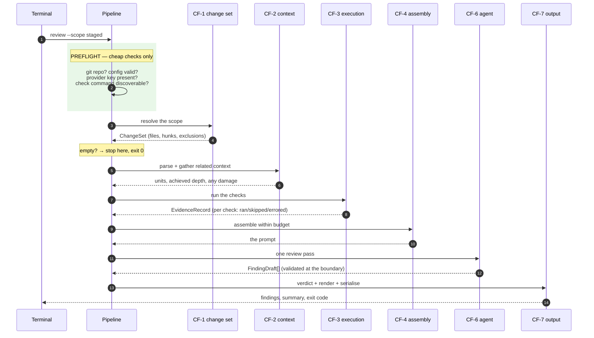
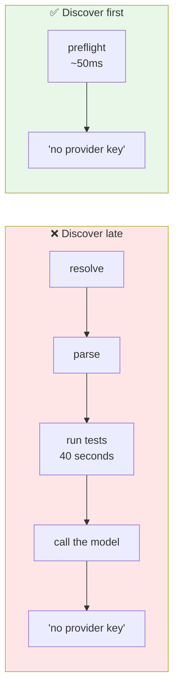
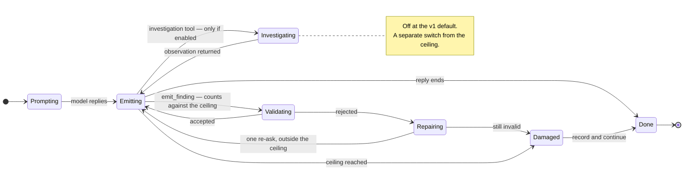
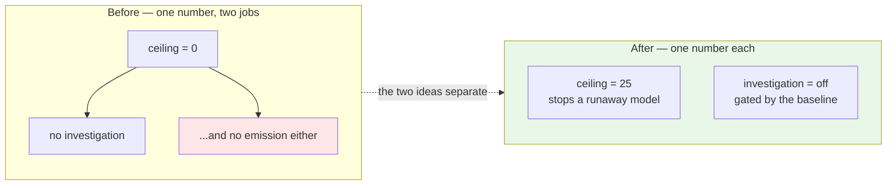
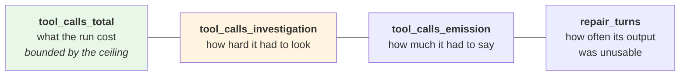
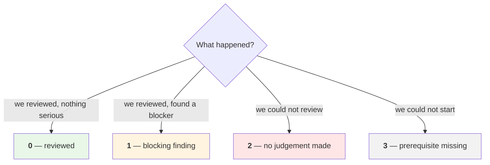
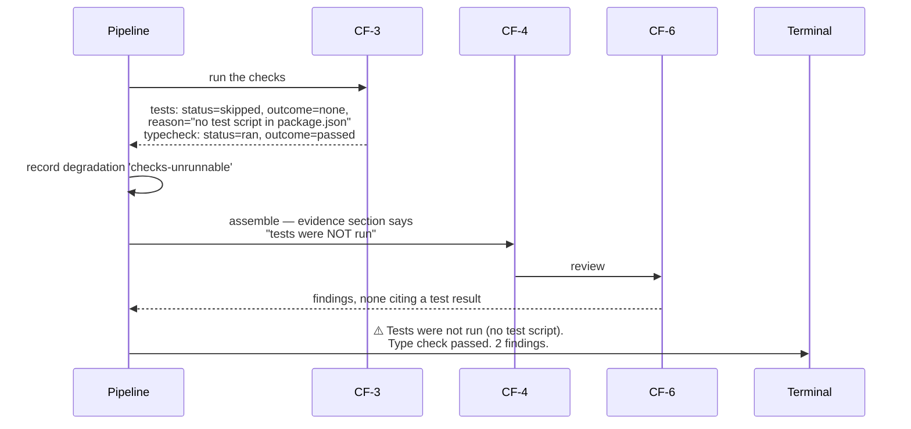
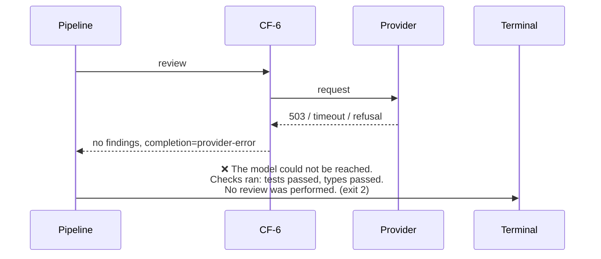
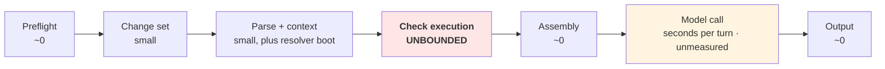

# M3 · Behaviour

**Status:** Draft for verification · **Date:** 2026-09-14 · **Milestone:** M3 (fourth in sequence)
**Serves:** [`../agentic-code-review-srs-v1.md`](../agentic-code-review-srs-v1.md) §2.1, §4.10 · **Builds on:** [`01-logical-architecture.md`](./01-logical-architecture.md)

---

## 0 · What this decides

**What happens, in what order, and what happens when something breaks.**

The requirements document says a review must be produced under *every* failure mode, reporting the damage rather than exiting quietly (FR-11.2). It calls that the requirement most likely to be quietly violated under schedule pressure. So this document spends more space on the broken paths than on the working one.

---

## 1 · The normal run

### Why preflight exists, and why it is first

Nothing in the requirements asks for a preflight stage. It follows from FR-9.3 — *clear failure messages when a prerequisite is missing* — plus one observation that needs no number attached to it:

**Without preflight, a developer with a mistyped key waits through the whole test suite to be told their key is mistyped.**

That is worth fixing whether the tolerable wait turns out to be five seconds or five minutes, which is why this design does not depend on SRS TBD-2 being answered.

Every preflight check is a lookup, not an execution: does the directory have a `.git`; does the config file parse; is the key in the environment; does the project manifest name a test script. **Discovering that the test command exists is not the same as running it** — the first costs a file read, the second costs the latency budget.

This is what makes AC-9 pass by construction rather than by remembering.

### Why context comes before execution

The requirements document draws parsing and execution as two branches that rejoin (§2.1), which leaves the order open. Design runs them in sequence ([`01-logical-architecture.md`](./01-logical-architecture.md) §6.0 — v1 is synchronous), so an order has to be chosen.

**Context first**, because its failures are cheap and its cost is small. An unparseable tree or an empty change set should stop the run before forty seconds of tests are spent on it. The reverse order pays the expensive thing first and learns nothing by doing so.

---

## 2 · The stages

| # | Stage | Cost | What it can do to the run |
|---|---|---|---|
| 0 | **Preflight** | Negligible | **Stops the run.** The only stage allowed to |
| 1 | Change set | Small | Empty set → stop, exit 0, no model call |
| 2 | Parse + context | Small–medium | Damage only. Never stops |
| 3 | Check execution | **The long pole** | Damage only. Bounded by a timeout |
| 4 | Assembly | Small | Damage only |
| 5 | Review pass | Medium | Damage only |
| 6 | Output | Negligible | Reports whatever happened |

> **One rule covers all of it: after preflight, nothing stops the run.** Stages 1–6 may only record damage and continue. That single rule is the whole of FR-11.2, and stating it as a property of the pipeline is cheaper than remembering it at seven call sites.

---

## 3 · The review step

**One model turn can carry many findings.** The model replies once and may make several `emit_finding` calls in that single reply. Each is validated on arrival and accumulates — so a run cut short keeps everything already emitted (ADR-0004).

### Two counters, two switches

[DB-18](../../DESIGN_BLOCKERS.md#db-18) and [DB-17](../../DESIGN_BLOCKERS.md#db-17) were decided on 2026-09-14, and together they change the shape of this step.

| | Governs | v1 default |
|---|---|---|
| `tool_call_ceiling` | **Every** call the review may make — emissions included | 25 |
| `investigation_tools` | Whether the three read-only tools are bound at all | **off** |
| `repair_turns` | One re-ask after a failed validation. A *turn*, not a call — outside the ceiling | max 1 |

**This is the better shape, and it arrived by accident.** Tool *exposure* and call *budget* are genuinely independent questions, and the old wording only joined them because zero happened to mean both. FR-5.7b's gate — no investigation until a baseline exists — now sits on the switch it is actually about.

### What the run reports

Counting follows agent-runtime convention: **a tool call is a tool call**, `emit_finding` included, and the ceiling bounds the total the way any agent runtime bounds its iterations. Alongside that total, the run records what the calls were *for* — and both are kept, because they answer different questions.

Neither headline number stands in for the other. The **total** is what the latency and token budgets are spent against — the real cost of the agent. The **investigation** figure is what the step-4.5 experiment is trying to price, and it must not move just because a change set happened to contain eight defects instead of two. AC-11 reads both: investigation to isolate its variable, total to price the answer ([`02-domain-model.md`](./02-domain-model.md) §3.6).

---

## 4 · The failure matrix

Every way a run can be damaged, what the user sees, and how it ends.

| Trigger | Stage | Run continues? | Recorded as | Exit |
|---|---|---|---|---|
| Not a git repository | Preflight | ❌ stops | Message naming the problem | 3 |
| Config malformed | Preflight | ❌ stops | Message naming the **offending field** (FR-1.2d) | 3 |
| No provider key | Preflight | ❌ stops | Message saying so (AC-9) | 3 |
| No test command found | Preflight | ✅ continues | `checks-unrunnable` | 0 |
| Nothing changed, or nothing reviewable | Stage 1 | ❌ stops, cleanly | completion `nothing-to-review`; report still written on request | 0 |
| A file will not parse | Stage 2 | ✅ | `parse-error`, that file only | 0 |
| Depth 2 requested | Stage 2 | ✅ | `no-index`, achieved depth 1 (AC-8) | 0 |
| Node absent / resolver fails | Stage 2 | ✅ | `unresolvable-imports` (AC-12) | 0 |
| Tests exceed the time budget | Stage 3 | ✅ | `execution-timed-out`, remaining checks skipped (FR-4.4b) | 0 |
| A check errors (not fails) | Stage 3 | ✅ | status `errored`, outcome `unknown` (AC-7) | 0 |
| Context over budget | Stage 4 | ✅ | `budget-exhausted`, most distant units dropped first | 0 |
| **The diff alone exceeds the budget** | Stage 4 | ✅ review skipped | `budget-exhausted` **with nothing reviewed** — no partial diff is sent | **2** |
| Provider unreachable or refuses | Stage 5 | ✅ | `provider-error` — **report produced, no judgement made** | **2** |
| A finding fails validation — shape **or** a reference the run does not contain | Stage 5 | ✅ | One repair turn; if it succeeds, nothing is reported | 0 |
| The repair turn also fails, **no finding accepted** | Stage 5 | ✅ | `invalid-model-output` — **must not read as clean** | **2** |
| The repair turn also fails, **other findings accepted** | Stage 5 | ✅ | `invalid-model-output`; accepted findings kept; completed | 0 / 1 |
| **The model makes no tool call** | Stage 5 | ✅ | `no-tool-call`, completion `no-tool-call` — never presented as clean | 0 |
| Tool-call ceiling reached mid-reply | Stage 5 | ✅ | `tool-budget-exhausted`, findings so far kept; calls beyond it answered `denied` | 0 / 1 |
| Token budget reached | Stage 5 | ✅ | `budget-exhausted`, findings so far kept (FR-11.1) | 0 |
| Everything worked, a blocking finding | Stage 6 | — | — | **1** |

> **Revised 2026-09-17** (spec 001, D-2 to D-4). Four rows were added or split:
> - **The diff alone over the budget.** [`05-cross-cutting.md`](./05-cross-cutting.md) §1.1 already called it "`budget-exhausted` with nothing reviewed", but the only `budget-exhausted` row exited 0. Nothing was reviewed, so it exits 2.
> - **No tool call.** This row was missing entirely, although FR-5.10 names the case.
> - **Repair failure.** The row said "exit 2" without saying what happens when other findings in the same run were valid. A review with validated findings *was* produced, so it completes (FR-10.4c).
> - **Validation.** A finding citing a file, check, context unit or rule this run did not have is rejected like a malformed one ([`02-domain-model.md`](./02-domain-model.md) §3.4).

### The exit codes

The requirements ask for an exit code that reflects the outcome and stays stable (FR-10.4c) without saying what the codes are — so design sets them, and the shape matters more than the numbers.

**The line between 0 and 2 is the whole point.** A damaged review that still produced judgement exits **0** — a missing resolver makes the review weaker, not absent, and a script that treats it as failure would make every machine without Node look broken. A review where the model never answered exits **2**, because "found nothing" and "never looked" must not be the same signal to a script. That is AC-7's rule, applied to the exit code rather than only to the text.

This refines the verdict table in [`01-logical-architecture.md`](./01-logical-architecture.md) §4, which had one code where there are two.

---

## 5 · Two failure paths worth walking through

### 5.1 Tests cannot run (AC-7)

The prompt is told the tests did not run. Without that, the model sees no failures and can reasonably infer the suite is green — inventing evidence the run never gathered.

### 5.2 The model never answers

A report is still written, with the evidence record intact and an empty findings list — satisfying FR-11.2 — but the wording and the exit code both say **no review happened**, never "clean".

---

## 6 · Where the time goes

**There is no latency budget, and v1.1 of the specification deliberately stopped pretending there was one** — the figure it used to carry was an estimate, withdrawn on 2026-09-14 and rescheduled as an observation of real MVP users (SRS §8, TBD-2).

That is a better position than it sounds. Design cannot divide a total it does not have, but it can say **where the time goes and which slice is dangerous** — and it can make sure the measurement exists when the question is finally asked.

| Slice | Behaviour | Controlled by |
|---|---|---|
| Everything except checks and the model | Milliseconds to low seconds | — |
| Resolver boot | Fixed, paid once, only when depth 1 is asked for | Lazy start |
| **Check execution** | **Grows with the project, not with the change** | The only real dial: FR-4.4a's timeout |
| Model call | Seconds per turn — **unmeasured**; recorded per run as the `review` stage duration *(revised 2026-09-17: an earlier "2–5 s" figure was an estimate, and was removed for the reason in §6 rule 1)* | The ceiling |

**One stage can consume the entire review on its own, and it is the one whose cost we do not control.** Check execution grows with the size of the *project*, not the size of the *change*.

Two rules follow, and both are design's to keep without waiting on anyone:

| Rule | |
|---|---|
| **No design decision cites a latency threshold as justification** | A decision that needs one is waiting on TBD-2 and should say so. Two earlier design choices were quietly leaning on the withdrawn figure; both have been rewritten |
| **Every stage records its own duration, every run** | So that when real users are watched, the measurements explaining their behaviour already exist. The instrument is built before the question is asked — the same discipline the delivery sequence applies to catch rate |

The execution timeout ships as a **stated placeholder**, labelled as one, rather than a number presented as a finding.

---

## 7 · Two contradictions this milestone found — both now settled

Both were resolved on 2026-09-14. They are kept here because **two requirements still have to be amended**, and the amendments are owed by the analysis team, not by design.

### 7.1 A ceiling of zero forbids the only tool the system has → ✅ settled

| Requirement | Says |
|---|---|
| FR-5.6a | Findings enter the system **exclusively** through an `emit_finding` **tool call** |
| FR-5.7 | The **tool-call ceiling** has a documented default of **zero** |

Read literally: zero tool calls permitted, findings only arrive by tool call. **No review can ever produce a finding.**

**Decided: the literal reading stands.** Every tool call counts, emissions included. That makes the ceiling one clean budget and one clean guard against a runaway model — and it forces two requirements to change:

| ⚠️ Owed by analysis | Why |
|---|---|
| **FR-5.7's default must stop being zero.** Design proposes **25** | Zero now permits no output at all |
| **FR-5.7a's trigger must be split from the ceiling** | It reads "when the ceiling is above zero, expose the three tools". The ceiling is now *always* above zero, so investigation would switch itself on — which FR-5.7b forbids until a baseline exists |

Design has already built to the settled shape (§3). The requirements text is the part still outstanding.

### 7.2 A malformed finding at ceiling zero has nowhere to go → ✅ settled

The tool-call design says a rejected call goes back to the model with the offending field named. That needs a second turn. FR-5.7 permits one. So a malformed call yielded **zero findings, indistinguishable from a clean review** — AC-7's confusion through a different door.

**Decided: one repair turn**, capped at one, carrying only the validation error, counted as `repair_turns` and sitting outside the ceiling because it is a turn rather than a call.

If the repair also fails, the run records `invalid-model-output` and **exits 2** — because "the model's answer was unusable" is a kind of *not reviewed*, not a kind of *clean*.

---

## 8 · What M3 decided, and what it did not

| Decided | |
|---|---|
| **Ceiling counts every call; investigation is a separate switch** | [DB-18](../../DESIGN_BLOCKERS.md#db-18). Two independent questions stop sharing one number |
| **One repair turn, outside the ceiling** | [DB-17](../../DESIGN_BLOCKERS.md#db-17). Completes the correction mechanism ADR-0004 half-specified |
| **Four call counters in the run record, not one** | Agent-standard total for cost, investigation count for the experiment. Both reported; neither substitutes for the other |
| A preflight stage, before anything expensive | Makes AC-9 structural, and stops a mistyped key costing 40 seconds |
| **Only preflight may stop the run** | FR-11.2 as one pipeline property instead of seven reminders |
| Context before execution | Cheap failures first; the expensive stage teaches nothing by going early |
| Empty change set stops cleanly, with no model call | Not covered by any requirement, and the most common no-op |
| Four exit codes, with 0 and 2 separated | "Damaged review" and "no review" must not look alike to a script |
| Per-stage durations recorded every run | The measurement DB-07 needs is collected before the answer arrives |

| Open | Blocker |
|---|---|
| The total latency budget, and therefore the default timeout | [DB-07](../../DESIGN_BLOCKERS.md#db-07) |
| Whether degradations are reportable at all | [DB-04](../../DESIGN_BLOCKERS.md#db-04) — this whole document assumes they are |
| ⚠️ Two requirement edits owed: FR-5.7's default, FR-5.7a's trigger | [DB-18](../../DESIGN_BLOCKERS.md#db-18) — design has built to the decision; the text has not caught up |
