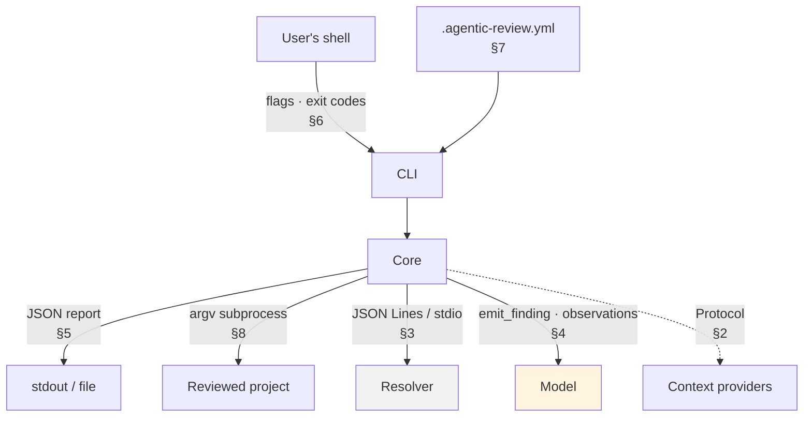

# M4 · Contracts

**Status:** Draft for verification · **Date:** 2026-09-15 · **Milestone:** M4 (fifth in sequence)
**Serves:** [`../agentic-code-review-srs-v1.md`](../agentic-code-review-srs-v1.md) §5 · **Builds on:** [`02-domain-model.md`](./02-domain-model.md), [`01-logical-architecture.md`](./01-logical-architecture.md)

---

## 0 · What this decides

**The exact shapes at every boundary.** M2 said what the types are; this says what the signatures, wire formats, flags and exit codes are.

A contract is worth writing down when **someone on the other side of it cannot be changed by us** — a model, a user's script, a future adapter, a separate process. Everything else is ordinary code and belongs in the source, not here.

| Boundary | Other side | Can we change both sides at once? |
|---|---|---|
| `emit_finding` | The model | ❌ It has been prompted with the schema |
| The JSON report | The user's scripts | ❌ |
| CLI flags and exit codes | The user's fingers and shell | ❌ |
| `.agentic-review.yml` | The user's repository | ❌ |
| Related-context provider | v2's second implementation | ❌ Frozen by §5 |
| Check invocation | The reviewed project's toolchain | ❌ |
| Resolver wire protocol | Our own bundled process | ✅ **Free to change** |

---

## 1 · The map



---

## 2 · The related-context provider

SRS §4.2.3 states six obligations and deliberately leaves the declaration to design ([DO-2](../../DESIGN_BLOCKERS.md#do-2)). This is it.

```python
Relation = Literal["imports", "calls", "imported-by", "called-by"]

@dataclass(frozen=True)
class ContextUnit:
    file: str                    # repo-relative, POSIX separators
    range: tuple[int, int]       # 1-based, inclusive, new-file coordinates
    source: str
    relation: Relation           # obligation 2
    distance: int                # obligation 2 - drives eviction in CF-4
    symbol: str | None = None

@dataclass(frozen=True)
class RelatedContextRequest:
    change_set: ChangeSet
    depth: int                   # requested, never guaranteed
    retrieval_cap: RetrievalCap  # a guard, NOT a budget - see M5

@dataclass(frozen=True)
class RelatedContextResult:
    units: tuple[ContextUnit, ...]         # ordered by distance, then relevance
    achieved_depth: int                    # obligation 3
    degraded: tuple[Degradation, ...] = () # obligation 4 - ALL reasons

class RelatedContextProvider(Protocol):
    max_depth: int                         # obligation 6
    def resolve(self, req: RelatedContextRequest) -> RelatedContextResult: ...
```

**Four things to notice.**

| | |
|---|---|
| **Synchronous** | No `async`. Nothing in the requirements asks for concurrency, and the budget that would justify it is unmeasured (TBD-2). Making it async later changes one signature and its one caller |
| **`degraded` is a tuple, not an optional** | FR-2.6h. `()` means clean. There is no shape in which a second simultaneous degradation is unrepresentable |
| **`retrieval_cap`, not `budget`** | CF-4 owns the budget ([DB-05](../../DESIGN_BLOCKERS.md#db-05)). This is a stop-gathering guard so CF-2 cannot pull a 50 MB dependency tree, and the only thing that can raise `budget-exhausted` here |
| **Frozen dataclasses** | A provider hands back a value nobody downstream can edit. Cheap immutability at a boundary §5 calls frozen |

**Construction goes through a factory, and nothing else may name an implementation** (FR-2.6e, enforced by import contract 5):

```python
def build_provider(cfg: ContextConfig, repo: RepoPaths) -> RelatedContextProvider: ...
```

One function knows that `ParserContextProvider` exists. v2 adds a branch inside it. That is the whole of "v2 is an addition, not a rewrite".

---

## 3 · The resolver wire protocol

**The one contract in the system with no external consumer.** FR-2.6f forbids anything outside CF-2 from observing it, so it may change without a version bump — which is exactly why it should stay small.

**JSON Lines over stdio.** One JSON object per line, no length framing. Three methods, and adding a fourth should require an argument.

```jsonc
// handshake - first line, both directions
--> {"id":0,"method":"hello","params":{"protocol":1}}
<-- {"id":0,"ok":true,"result":{"protocol":1,"typescript":"5.4.5"}}

// resolve - ONE call carrying every specifier in the change set
--> {"id":1,"method":"resolve","params":{"tsconfig":"tsconfig.json","requests":[
      {"from":"src/auth/login.ts","specifiers":["./session","@app/db","node:crypto"]},
      {"from":"src/api/user.ts","specifiers":["../auth/login"]}]}}
<-- {"id":1,"ok":true,"result":{"resolved":[
      {"from":"src/auth/login.ts","specifier":"./session","path":"src/auth/session.ts"},
      {"from":"src/auth/login.ts","specifier":"@app/db","path":"packages/db/src/index.ts"},
      {"from":"src/auth/login.ts","specifier":"node:crypto","path":null,"reason":"builtin"},
      {"from":"src/api/user.ts","specifier":"../auth/login","path":"src/auth/login.ts"}]}}

// shutdown - then close stdin
--> {"id":2,"method":"shutdown"}
<-- {"id":2,"ok":true}
```

| Rule | Why |
|---|---|
| **One `resolve` per review**, carrying every specifier | The process boot is a fixed cost. Batching makes it constant rather than per-import |
| Paths out are **repo-relative, POSIX separators** | The host may be Windows; the corpus is compared across machines |
| `path: null` is a **result**, not an error | Builtins and unresolvable specifiers are normal. `reason` says which |
| A protocol mismatch at handshake **fails loudly** | The bundle ships inside the wheel, so a mismatch means a broken install, not a degraded environment |
| Any other failure → heuristic fallback, `unresolvable-imports`, review completes | FR-2.6g, AC-12 |
| Lazy spawn | A depth-0 run and `--help` never pay the boot cost |

**The protocol is deliberately not a bridge to the TypeScript compiler.** Every method added is a method CF-2 must degrade gracefully without.

---

## 4 · The model-facing contracts

### 4.1 `emit_finding`

The tool schema **is** the finding model, generated from it — not written beside it (§5, "one definition, not two"). The model sees only fields a model can truthfully know: no id, no schema version, no fingerprint ([`02-domain-model.md`](./02-domain-model.md) §3.4).

```jsonc
{
  "name": "emit_finding",
  "description": "Report one review finding. This is the ONLY way a finding is recorded; prose is discarded.",
  "parameters": {
    "type": "object",
    "additionalProperties": false,
    "required": ["file","startLine","endLine","severity","category","rationale","evidence"],
    "properties": {
      "file":      {"type": "string", "description": "Repo-relative path, forward slashes"},
      "startLine": {"type": "integer", "minimum": 1},
      "endLine":   {"type": "integer", "minimum": 1, "description": "Equal to startLine for a single line"},
      "severity":  {"enum": ["blocking", "important", "nit"]},
      "category":  {"enum": ["correctness","error-handling","interface-contract",
                             "test-evidence","security","performance","maintainability"]},
      "rationale": {"type": "string", "minLength": 1},
      "ruleId":    {"type": "string", "description": "Identifier of the pattern rule, when one fired"},
      "evidence":  {"oneOf": [
        {"type":"object","required":["kind","checkId"],
         "properties":{"kind":{"const":"check"},"checkId":{"enum":["tests","typecheck"]},
                       "failingTest":{"type":"string"}}},
        {"type":"object","required":["kind","file","startLine","endLine"],
         "properties":{"kind":{"const":"context"},"file":{"type":"string"},
                       "startLine":{"type":"integer"},"endLine":{"type":"integer"}}},
        {"type":"object","required":["kind","file"],
         "properties":{"kind":{"const":"diff"},"file":{"type":"string"},
                       "hunkIndex":{"type":"integer"}}},
        {"type":"object","required":["kind","reason"],
         "properties":{"kind":{"const":"unverified"},"reason":{"type":"string"}}}]}
    }
  }
}
```

`evidence` is **required** (FR-5.2c). A model with nothing to cite must say `unverified` and why — which is the point: a guess has to declare itself. AC-15 checks that none escape.

**Revised 2026-09-17 — a valid shape is not enough** ([spec 001](../../specs/001-walking-skeleton/contracts/emit-finding.md#rejection-reasons) D-1). A call is also validated against what the run actually contained ([`02-domain-model.md`](./02-domain-model.md) §3.4). A reference the run cannot back is an `error` observation, and goes to the repair turn like any other validation failure:

| Condition | `reason` |
|---|---|
| File not reviewed | `file: '<file>' was not part of this review; reviewed files: <a>, <b>` |
| End beyond file | `endLine: <n> is past the end of '<file>' (<count> lines)` |
| Diff evidence names an unreviewed file | `evidence.file: '<file>' was not part of this review` |
| Hunk out of range | `evidence.hunkIndex: '<file>' has hunks 0–<k>` |
| Check evidence, no checks recorded | `evidence.kind: no checks were run in this review; cite the diff or mark the finding unverified` |
| Context evidence, no context included | `evidence.kind: no related context was gathered in this review; cite the diff or mark the finding unverified` |
| Rule named that is not among the loaded rules | `ruleId: '<id>' is not a loaded rule` |

**Revised 2026-10-09 — a `ruleId` with no rules loaded is discarded, not rejected** ([spec 001](../../specs/001-walking-skeleton/contracts/emit-finding.md#discarded-fields)). The finding is accepted without it and the `ok` observation says so. Unlike the rows above, the label backs no claim in the finding, and with no rules loaded there is nothing a repair turn could correct it to.

### 4.2 `ToolObservation` — what comes back

```jsonc
{"status": "ok" | "error" | "denied", "reason": "...", "content": "..."}
```

| Status | Means | v1 producer |
|---|---|---|
| `ok` | Accepted | A valid `emit_finding` |
| `error` | Understood, failed | Schema validation failure → triggers the one repair turn (FR-5.6c) |
| `denied` | Understood, **not permitted** | A call beyond the tool-call ceiling, which is not processed *(revised 2026-09-17, spec 001 D-10; previously "none")*. Policy refusals arrive in v2 |

On a validation failure the reason is field-precise, because that is the correction signal ADR-0004 chose tool calls for:

```jsonc
{"status":"error","reason":"severity: 'high' is not one of ['blocking','important','nit']"}
```

### 4.3 Three rules about calling the model

| Rule | Requirement |
|---|---|
| **Never set a required tool choice.** A reply with no tool call is termination | FR-5.10, [ADR-0008](../adr/0008-agent-runtime-tool-registry-and-termination.md) |
| One turn may carry many `emit_finding` calls. Each is validated on arrival and accumulates | ADR-0004 |
| Every call counts against the ceiling, emissions included | FR-5.7 |

### 4.4 The tool registry

FR-5.7a requires the tool list to be a documented, versioned artifact, so that adding one is a registry change rather than a specification change.

| Tool | Since | Read-only | Counts | v1 default |
|---|---|---|---|---|
| `emit_finding` | 1 | — | ✅ | **bound** |
| `read_file` | 1 | ✅ | ✅ | not bound |
| `get_outline` | 1 | ✅ | ✅ | not bound |
| `search_repo` | 1 | ✅ | ✅ | not bound |

The last three are **defined but not bound** at the v1 default — `investigationTools: false`. They are bound at delivery step 4.5, after the baseline exists (FR-5.7b). Every entry must be read-only, side-effect free, and unable to trigger check execution.

---

## 5 · The JSON report

One artifact, one versioned schema (FR-8.2b). The finding model is **nested inside** it, not equal to it.

```jsonc
{
  "schemaVersion": "1.0",
  "run": {
    "startedAt": "2026-09-15T10:04:11Z",
    "durationMs": 21840,
    "stageDurationsMs": {"preflight":41,"changeSet":180,"context":1320,
                         "execution":16900,"assembly":95,"review":3210,"output":12},
    "requestedDepth": 1, "achievedDepth": 1,
    "toolCallCeiling": 25, "investigationToolsEnabled": false,
    "toolCallsTotal": 3, "toolCallsEmission": 3,
    "toolCallsInvestigation": 0, "repairTurns": 0,
    "completionStatus": "emitted",
    "emitPath": "tool-call",
    "model": "...", "provider": "...",
    "sampling": {"temperature": 0, "seed": null},
    "tokensIn": 8130, "tokensOut": 420, "budgetLimit": 20000, "budgetHit": false,
    "toolVersion": "0.1.0"
  },
  "changeSummary": {
    "scope": {"kind":"staged","wasDefaulted":false,"description":"staged changes (2 files)"},
    "excluded": [{"path":"dist/bundle.js","rule":"default:build-output"}],
    "files": [{"path":"src/auth/login.ts","changeType":"modified","language":"ts",
               "hunkCount":2,"addedLines":14,"removedLines":3}]
  },
  "context": [{"file":"src/auth/session.ts","symbol":"createSession",
               "range":[12,40],"relation":"imports","distance":1,"included":true}],
  "evidence": {
    "status": "completed",
    "toolchain": {"packageManager":"npm","commandSource":"manifest"},
    "checks": [
      {"id":"tests","command":["npm","test"],
       "status":"ran","outcome":"failed","exitCode":1,"durationMs":16420,
       "distilled":{"failingTests":[{"name":"login rejects expired token",
                                     "message":"expected 401, got 500",
                                     "file":"src/auth/login.test.ts","line":88}],
                    "diagnostics":[],"stackFrames":[],
                    "omittedCounts":{"failingTests":0,"diagnostics":0,"frames":0}},
       "rawOutput":"..."},
      {"id":"typecheck","command":["npx","tsc","--noEmit"],
       "status":"ran","outcome":"passed","exitCode":0,"durationMs":4210,
       "distilled":{"failingTests":[],"diagnostics":[],"stackFrames":[],
                    "omittedCounts":{"failingTests":0,"diagnostics":0,"frames":0}},
       "rawOutput":"..."}
    ]
  },
  "findings": [
    {"id":"f-1","schemaVersion":"1.0","fingerprint":"a3f19c","turnIndex":0,
     "file":"src/auth/login.ts","startLine":42,"endLine":47,
     "severity":"blocking","category":"error-handling",
     "rationale":"An expired token takes the unhandled branch and surfaces as a 500.",
     "ruleId":"missing-error-branch",
     "evidence":{"kind":"check","checkId":"tests",
                 "failingTest":"login rejects expired token"}}
  ],
  "degradations": [],
  "verdict": "blocking"
}
```

| Decision | |
|---|---|
| **camelCase** | The consumers are tooling in the *target* language's ecosystem. The host's convention stops at the host's boundary ([DB-11](../../DESIGN_BLOCKERS.md#db-11)) |
| `changeSummary`, not the change set | FR-8.2c asks for the scope, not the diff. The reader is standing in the repository |
| `context` carries no `source` | FR-2.3d traceability at a few hundred bytes |
| `rawOutput` here, `distilled` in the prompt | FR-2.5c — the largest accidental context sink in the design |
| `degradations: []` is meaningful | An empty array asserts a clean run. A missing key would assert nothing |
| **Consumers must ignore unknown fields** | Documented, and the thing that makes additive changes non-breaking |

**Revised 2026-09-17 — values the example above did not fix** ([spec 001](../../specs/001-walking-skeleton/contracts/review-report.md) D-3, D-8):

| Field | Values | |
|---|---|---|
| `run.completionStatus` | `emitted` · `nothing-to-review` · `no-tool-call` · `ceiling-reached` · `budget-exhausted` · `provider-error` · `invalid-model-output` | The two middle values are new: without them an empty change set, and a model that never called the tool, produced reports identical to a completed review |
| `verdict` | `findings` · `blocking` · `no-findings` · `no-judgement` · `nothing-to-review` | Computed in core; exit mapping in [`01-logical-architecture.md`](./01-logical-architecture.md) §4 |
| `run.requestedDepth`, `run.achievedDepth` | integer, or `null` | `null` means related context was **not gathered**, as in a build without CF-2. Never `0`, which would claim depth 0 was served |
| `changeSummary.files[]` | adds `isBinary`, `reviewed`, `notReviewedReason` | So a file that was listed but not reviewed can be read as such ([`02-domain-model.md`](./02-domain-model.md) §3.1) |
| `evidence`, `context` | `{"status": "not-attempted", "checks": []}` and `[]` when the capability is not built | The shape is kept; emptiness is stated, never omitted |

---

## 6 · The command-line surface

```
agentic-review review [OPTIONS]
agentic-review regression [OPTIONS]
agentic-review schema          # print the JSON schema and exit
```

### `review`

| Flag | Default | |
|---|---|---|
| `--scope {working-tree,staged,range,commit}` | `working-tree` | FR-10.3a. The default is stated in the output and flagged `wasDefaulted` |
| `--base REF` | — | Required for `range`. With `--pr`, the branch the pull request targets (default: the repository's default branch) |
| `--head REF` | `HEAD` | `range` only: the ref to review instead of the current head |
| `--pr URL` | — | Selects the `pull-request` scope on its own: a public GitHub pull request, read without a checkout (FR-10.3d, ADR-0011). Needs no local repository. Rejected with `--scope` or `--head` |
| `--commit REF` | — | Selects the `commit` scope on its own; required for it, and rejected with any other scope |
| `--depth N` | `1` | A request, not a guarantee. `--depth 2` reports `no-index` and completes (AC-8) |
| `--json [PATH]` | off | No path ⇒ stdout. FR-10.4b |
| `--config PATH` | `./.agentic-review.yml` | |
| `--no-checks` | off | Skips execution, recorded as `skipped` — never as passed |
| `--ceiling N` | from config | |
| `--investigate / --no-investigate` | `--no-investigate` | FR-5.7a. Refuses to run without a recorded baseline (FR-5.7b) |

### `regression`

| Flag | Default | |
|---|---|---|
| `--depth N` · `--ceiling N` · `--investigate` | config | FR-6.2d — the settings being compared |
| `--seed N` | `0` | FR-6.2e |
| `--repeat N` | `3` | Model output varies; a single sample is not a measurement |
| `--out PATH` | — | Results, plus the settings that produced them |

### Exit codes

FR-10.4c requires four outcomes to be distinguishable. These are the numbers.

| Code | Meaning | |
|---|---|---|
| **0** | Reviewed. Nothing blocking — **including a degraded review** | A review missing its optional resolver is still a review |
| **1** | Reviewed, at least one `blocking` finding | |
| **2** | **No judgement was made** — model unreachable, output unusable after the repair turn with no finding accepted, or the diff alone over the budget *(last two clauses revised 2026-09-17, spec 001 D-2, D-4)* | "Found nothing" and "never looked" must not be one signal |
| **3** | Could not start — no git repository, malformed config, missing key | AC-9 |

The **verdict is computed in core**; the CLI only maps it to an integer. If the adapter decided which findings mattered, it would be deciding what a finding means (FR-10.2).

---

## 7 · The configuration file

```yaml
schemaVersion: 1

scope: working-tree                  # working-tree | staged | range (commit and pull-request are flags only)
exclude:                             # FR-3.5 - MERGED with the documented defaults
  - "**/*.generated.ts"

context:
  depth: 1
  node: node                         # resolver discovery; overridable (FR-9.3)

checks:
  tests:
    command: ["npm", "test"]         # omitted => discovered from the manifest
    timeoutSeconds: 120              # PLACEHOLDER, not a finding - SRS section 8, TBD-4
  typecheck:
    command: ["npx", "tsc", "--noEmit"]

agent:
  toolCallCeiling: 25                # PLACEHOLDER - SRS section 8, TBD-8
  investigationTools: false          # FR-5.7a; gated by FR-5.7b
  model: "..."
  baseUrl: "..."
  temperature: 0
  requestTimeoutSeconds: 60          # PLACEHOLDER, not a finding - added 2026-09-17 (spec 001, D-9)

budget:
  maxTokens: 20000                   # PLACEHOLDER - SRS section 8, TBD-3
```

| Rule | Requirement |
|---|---|
| Absent file ⇒ documented defaults | FR-1.2b |
| Absent field ⇒ that field's default | FR-1.2c |
| Malformed ⇒ **fail naming the offending field**, never fall back silently | FR-1.2d, AC-9 |
| `exclude` **merges with** the defaults rather than replacing them | Otherwise setting one pattern silently un-excludes `node_modules` |
| **No credential key exists in this file's schema** | FR-1.3a. Not "do not put it here" — there is nowhere to put it |
| Every placeholder is commented as one | SRS §8 — no decision may be justified by a placeholder |

**The credential** comes from the environment (`AGENTIC_REVIEW_API_KEY`) or user-level configuration outside the repository. It never appears in the report, the trace, or any log line.

---

## 8 · Check invocation

```python
subprocess.run(argv, cwd=repo_root, env=project_env,
               capture_output=True, timeout=cfg.timeout_seconds, shell=False)
```

| Rule | Requirement |
|---|---|
| **argv list, never a shell string**, `shell=False` | No quoting bug, and no injection from a manifest field |
| Discovered from the manifest, or named in config | FR-4.7 |
| The host never imports the project's dependencies; the project is never asked to install ours | FR-4.7 — with a Python host there is no mechanism by which it could |
| Timeout ⇒ `timed-out`, remaining checks `skipped`, review continues | FR-4.4b |
| `status` and `outcome` recorded separately | AC-7. A skipped check has no outcome |

---

## 9 · What is frozen, and what is not

| Contract | Stability |
|---|---|
| `RelatedContextProvider` | 🔒 **Frozen.** v2 adds an implementation, not a signature |
| Change set | 🔒 **Frozen.** The v3 adapter substitutes its producer |
| `emit_finding` | 📦 Versioned with the finding model. A change is provider-visible |
| JSON report | 📦 Versioned. Consumers must ignore unknown fields |
| CLI flags, exit codes | 📦 Stable across v1 patch releases |
| Config schema | 📦 Versioned by `schemaVersion` |
| Check invocation | 🔒 A subprocess boundary, not a linked one |
| **Resolver wire protocol** | ♻️ **Free.** No consumer may observe it (FR-2.6e) |

---

## 10 · What M4 decided

| | |
|---|---|
| Synchronous `Protocol`, frozen dataclasses, `degraded` as a tuple | §4.2.3's obligations without the async and the single-value bug the code sample carried |
| `retrieval_cap` rather than `budget` on the request | Keeps CF-4 the only budget authority |
| `evidence` **required** in the tool schema | A guess cannot be emitted as though it were evidenced |
| Never set a required tool choice | The termination contract, FR-5.10 |
| Four exit codes, 0 and 2 separated | A degraded review is a review; an absent one is not |
| No credential field in the config schema | Prevention by absence rather than by instruction |
| argv + `shell=False` | Removes a class of quoting and injection bug outright |
| Three sidecar methods, and adding a fourth needs an argument | Every method is one CF-2 must degrade without |

**Open:** nothing blocking. TBD-3, TBD-4 and TBD-8 appear as labelled placeholders; replacing one is a configuration change.
