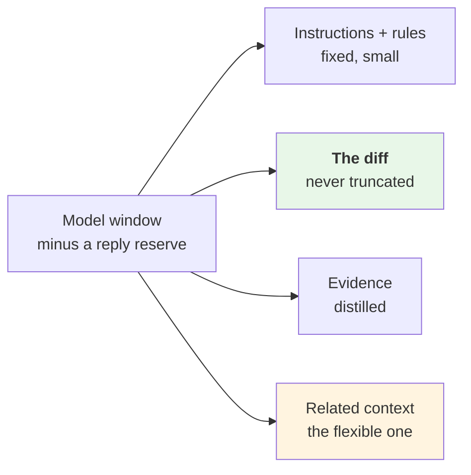
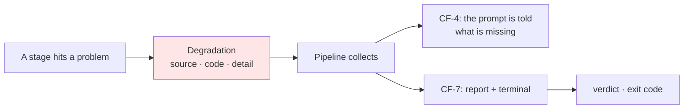
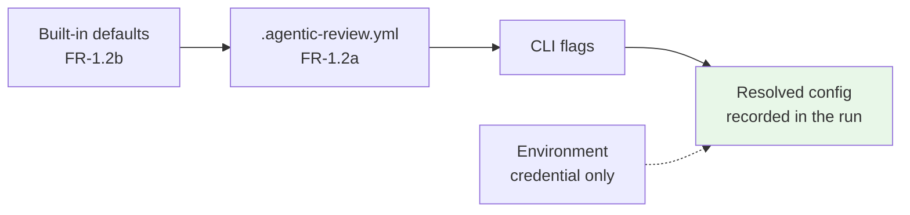

# M5 · Cross-Cutting

**Status:** Draft for verification · **Date:** 2026-09-15 · **Milestone:** M5 (sixth in sequence)
**Serves:** [`../agentic-code-review-srs-v1.md`](../agentic-code-review-srs-v1.md) §4.4, §4.9, §4.10 · **Builds on:** [`03-behaviour.md`](./03-behaviour.md), [`04-contracts.md`](./04-contracts.md)

---

## 0 · What this decides

The four concerns that belong to **no single component**, and are therefore the ones most likely to be implemented four different ways:

| | Requirement | The failure it prevents |
|---|---|---|
| **The token budget** | FR-2.5, FR-2.5a–c, FR-11.1 | One section starving another; the diff being truncated |
| **Degradation** | FR-11.2, FR-8.2e | A damaged review reading as a clean one |
| **The trace** | FR-11.3 | A finding nobody can explain |
| **Configuration and credentials** | FR-1.2a–d, FR-1.3a, FR-9.3 | A silent fallback; a leaked key |

---

## 1 · The token budget

**CF-4 is the sole budget authority** ([DB-05](../../DESIGN_BLOCKERS.md#db-05)). CF-2 has a stop-gathering guard; nothing else counts tokens.

### 1.1 Sections, and why they are budgeted separately

FR-2.5a: *no section can starve another.* Four sections, in priority order:



| Section | Claim | Behaviour when space is short |
|---|---|---|
| Instructions and rules | Fixed | Five rules preload; small, and needed every time |
| **The diff** | **All of it** | **Never truncated** (FR-2.5b). It is the thing being reviewed |
| Evidence | Distilled, capped | Already reduced to failing names, messages, and frames touching changed files (FR-2.5c) |
| Related context | Whatever is left | **The only section that yields** |

> **The diff cannot be the thing that gets dropped.** A reviewer that reviewed most of a change without saying which part it skipped is worse than one that declined. If the diff alone exceeds the window, that is not an eviction problem — it is `budget-exhausted` with nothing reviewed, reported as such.

### 1.2 The eviction order

FR-2.5b evicts by descending `distance` — one number, rather than a rule per relation type:

```
distance 2+  ->  dropped first   (v2 only; nothing at distance 2 exists in v1)
distance 1   ->  imported definitions
distance 0   ->  the enclosing function or class of a changed hunk
```

Every evicted unit stays in the report's context manifest with `included: false` and a reason, so the omission is visible rather than silent.

### 1.3 Two guards, one budget

| | Owner | What it limits |
|---|---|---|
| **Retrieval cap** | CF-2 | Stops *gathering*. Prevents pulling a 50 MB dependency tree into memory before anyone counts it |
| **Token budget** | CF-4 | Decides what survives *into the prompt* |

Different kinds of limit, and confusing them is what produced the original conflict. The cap is about memory and time; the budget is about the window.

### 1.4 The numbers

| | Value | Status |
|---|---|---|
| Window | The configured model's window | Derived, not guessed |
| Reply reserve | A stated fraction of it | Placeholder |
| Section priority | Diff, then evidence, then context | **The policy — holds at any window size** |
| `budget.maxTokens` | Config default | **SRS §8, TBD-3 placeholder** |

**The split is the design; the numbers are configuration.** FR-2.5a's requirement — that no section starves another — is satisfied by the priority ordering at 8k tokens or at 200k.

---

## 2 · Degradation

FR-11.2 is the requirement the specification itself calls the one most likely to be quietly violated. This is the machinery that makes violating it take effort.

### 2.1 One rule

> **After preflight, nothing stops the run.** Stages 1–6 may record damage and continue; only preflight may halt.

Stated once as a property of the pipeline, rather than remembered at seven call sites.

### 2.2 How a degradation travels



**Three destinations, and the first is the one that gets forgotten.** If the tests did not run, *the model must be told*. Otherwise it sees no failures and may reasonably infer the suite is green — inventing evidence the run never gathered.

### 2.3 The catalogue

| Code | Stage | Reaches the prompt? | Exit |
|---|---|---|---|
| `checks-unrunnable` | CF-3 | ✅ "tests were NOT run" | 0 |
| `execution-timed-out` | CF-3 | ✅ | 0 |
| `parse-error` | CF-2 | ✅ per file | 0 |
| `no-index` | CF-2 | — the depth is stated anyway | 0 |
| `unresolvable-imports` | CF-2 | ✅ "some imports unresolved" | 0 |
| `budget-exhausted` | CF-4 | ✅ "context was truncated" | 0 — **2 when the diff alone does not fit**, because nothing was reviewed (§1.1) |
| `provider-error` | CF-6 | n/a | **2** — 0/1 if findings were already accepted before it |
| `invalid-model-output` | CF-6 | n/a | **2** when no finding was accepted; 0/1 otherwise |
| `no-tool-call` | CF-6 | n/a | 0. Raised only when the run has no findings, and **never presented as clean**: with investigation off, it is also how a model reports finding nothing |

*Revised 2026-09-17 (spec 001, D-2 to D-5): exit codes aligned with [`03-behaviour.md`](./03-behaviour.md) §4.*

### 2.4 The line that matters

| Kind | Exit | Reasoning |
|---|---|---|
| **Quality reduced, judgement made** | **0** | A review without the optional resolver is weaker, not absent. Non-zero would make every machine lacking Node look broken |
| **No judgement made** | **2** | "Found nothing" and "never looked" must never be one signal to a script |

`degradations: []` in the report is an assertion, not an absence. A missing key would assert nothing.

---

## 3 · The trace

FR-11.3: a record *sufficient to explain why a finding was produced.*

### 3.1 The test it has to pass

Point at any finding and answer, without re-running: **what did the model see, and why that and not more?**

| Question | Answered by |
|---|---|
| What changed? | `changeSummary` — scope, files, exclusions |
| What else did it see? | `context` manifest — every unit, `included` true or false |
| What was left out, and why? | The same, with `evictedReason` |
| What did the checks say? | `evidence` — status, outcome, distilled, raw |
| What backs *this* finding? | `evidence` on the finding (FR-5.2c) |
| What was damaged? | `degradations` |
| What did it cost? | Four call counters, tokens, per-stage durations |
| Could it be reproduced? | Depth, ceiling, model, sampling, seed, versions |

**Every one is already a field in the report** ([`04-contracts.md`](./04-contracts.md) §5). The trace is not a second artifact — it is the report, designed so that it doubles as one.

> **Why not a hosted tracing service.** The stack document rules one out as *load-bearing*: FR-11.3 requires our own record. A hosted tool may sit alongside it and cannot replace it — an explanation that needs a third-party login, a network round trip and a retention window is not an explanation the user owns.

### 3.2 Two things the trace never contains

| Never | Why |
|---|---|
| The provider credential | FR-1.3a — not in the report, the trace, or any log line |
| The full prompt text | Reconstructible from its parts, and storing it doubles the artifact for no new information |

---

## 4 · Configuration

### 4.1 Resolution order



**Later wins, one field at a time.** A file setting `context.depth` and nothing else keeps every other default (FR-1.2c) — the merge is per-field, never whole-section replacement.

**One deliberate exception: `exclude` merges rather than overrides.** Replacement semantics would mean a user adding one pattern silently un-excludes `node_modules`, which is not a default anyone means to switch off.

### 4.2 Failing loudly

FR-1.2d requires the offending field to be named; AC-9 verifies it. Validation is the settings model's own, so the message is field-precise by construction rather than by hand-written checking:

```
Error in .agentic-review.yml
  checks.tests.timeoutSeconds: expected an integer, got "two minutes"
Nothing was reviewed. Fix the field above and re-run.
```

Three properties: it names the **file**, names the **path to the field**, and states that **nothing happened**. Exit 3.

### 4.3 The credential

| Rule | |
|---|---|
| Read from the environment, or user-level config outside the repository | FR-1.3a |
| **The repository config schema has no field for it** | Prevention by absence — a user cannot put a key where the schema will not hold one |
| Never in the report, the trace, or a log line | FR-1.3a |
| Absent ⇒ preflight fails with a message saying so | FR-9.3, AC-9 |

### 4.4 Diagnosable failure

FR-9.3 was raised to Must because *on a local surface a silent failure is indistinguishable from a clean review.* Every preflight message says three things — **what is missing, where it was looked for, and that nothing was reviewed**:

| Missing | The message names |
|---|---|
| Git repository | The directory that was checked |
| Provider key | The environment variable, and the user-config path |
| Test script | The manifest inspected, and how to name one in config |
| Node, at depth 1 | That the review **will still run**, degraded — this one warns, it does not stop |

---

## 5 · Where the time goes

There is no latency budget. SRS v1.1 withdrew the estimate rather than keep an unmeasured number that decisions had begun to lean on (TBD-2).

| Slice | Behaviour |
|---|---|
| Preflight, change set, assembly, output | Milliseconds |
| Context | Small, plus a one-off resolver boot at depth 1 |
| **Check execution** | **Grows with the project, not the change. The only unbounded slice** |
| Model call | Seconds per turn |

Two rules hold until TBD-2 is answered:

1. **No design decision may cite a latency threshold as justification.** One that needs a number is waiting on TBD-2 and says so.
2. **Every stage records its own duration, every run** (`stageDurationsMs`). When real users are finally observed, the measurements explaining their behaviour already exist.

The second is the discipline the delivery sequence already applies to catch rate: build the instrument before the question is asked.

---

## 6 · What M5 decided

| | |
|---|---|
| Priority-ordered sections, not fixed percentages | Satisfies FR-2.5a at any window size; survives a model change |
| The diff is never the thing dropped — if it alone overflows, that is reported, not trimmed | A partly-reviewed change that does not say so is worse than a declined one |
| Retrieval cap and token budget are different limits with different owners | The confusion that produced DB-05 |
| Degradations reach the **prompt**, not only the report | A model told nothing about a skipped suite will assume it passed |
| The trace **is** the report | One artifact, no second format to keep in step, no hosted dependency |
| Config merges per field; `exclude` merges rather than replaces | Stops a one-line config silently un-excluding `node_modules` |
| The credential has no config field at all | Prevention by absence rather than by instruction |
| Stage durations recorded from day one | The measurement TBD-2 needs, collected before it is asked for |

**Open:** TBD-3's number. The policy above holds without it.
