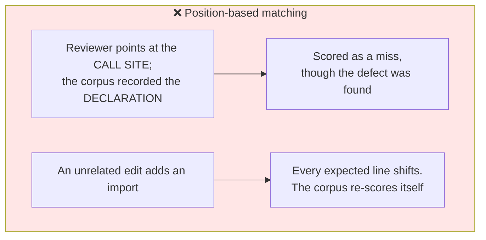
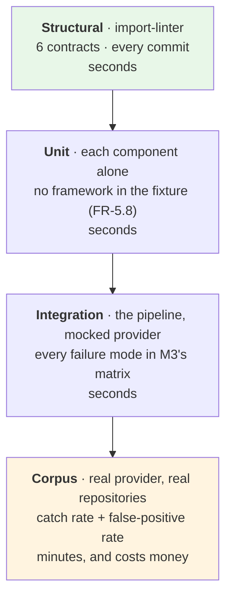

# M6 · Verification

**Status:** Draft for verification · **Date:** 2026-09-15 · **Milestone:** M6 (last in sequence)
**Serves:** [`../agentic-code-review-srs-v1.md`](../agentic-code-review-srs-v1.md) §6, Appendix B · **Builds on:** all prior milestones

---

## 0 · What this decides

Two things:

1. **Does every acceptance criterion have a mechanism?** Sixteen criteria, sixteen answers — or the design is not finished. *SRS v1.6 added AC-17 (the Mermaid report, FR-8.5); its mechanism is not designed yet, so this question is open again for that one criterion.*
2. **What counts as a catch?** FR-6.2f requires a documented, line-independent rule. Writing it is design's job, and it is the single most consequential thing in this document, because the catch rate is the project's primary instrument.

---

## 1 · The catch predicate

### 1.1 Why the obvious answer is wrong

An expected defect and an emitted finding must be matched somehow. The tempting rule — *same file, same line* — fails on the two cases that matter most:



[ADR-0005](../adr/0005-cross-run-memory-as-hidden-comment-ledger.md) reached the same conclusion for deduplication, and its reasoning transfers without change: **anything keyed to a line number invalidates itself constantly and fails silently.**

### 1.2 The rule

A finding **matches** an expected defect when **all** hold:

| # | Condition | |
|---|---|---|
| 1 | Same `file`, compared as a normalised POSIX path | Cheap, and never ambiguous |
| 2 | Same **enclosing symbol** — the function, class or type the finding's range falls inside, resolved through CF-2 | **The position-independent anchor.** Immune to line drift; tolerant of pointing at a call rather than a declaration within the same symbol |
| 3 | Same `category` | Stops "a nit about naming" scoring as "the missing error branch" |
| 4 | If **both** carry a `ruleId`, they are equal | A rule-derived finding must name the right rule (FR-6.2a) |

**Each expected defect is matched at most once**, and each finding consumes at most one expectation. Ties resolve by severity, then by document order — so a shotgun of eight findings inside one function cannot score eight catches.

### 1.3 The metrics

| Metric | Over | Definition |
|---|---|---|
| **Catch rate** | Defect cases | matched expectations ÷ total expectations |
| **False-positive rate** | **Clean cases** | findings emitted per clean case |
| Mean tool calls — total | All cases | The cost of the run |
| Mean tool calls — investigation | All cases | The variable the step-4.5 experiment isolates |

> **Catch rate is never reported alone.** A reviewer that flags every line catches every defect. `is_clean` corpus cases exist precisely so recall has a counterweight, and FR-6.2f requires both.

### 1.4 Repetition

Model output varies between runs. A single sample is an anecdote:

| Setting | Value | |
|---|---|---|
| `--repeat` | 3 | Report the **median** catch rate, and the spread |
| `temperature` | 0 | FR-6.2e |
| `seed` | pinned when the provider supports it | FR-6.2e |

Every result is recorded **with the settings that produced it** — depth, ceiling, investigation on/off, model, sampling. A catch rate without its configuration is not a measurement.

**Targets remain open (TBD-6).** The instrument is design's; the bar is analysis's.

---

## 2 · The corpus

```
tests/corpus/
    cases/
        missing-error-branch-01/
            case.yml          # expected defects, or is_clean: true
            before/           # the repository state
            change.patch      # the change under review
        naming-nit-01/
        clean-refactor-01/    # is_clean: true
    rules/                    # the five pattern rules (FR-6.3a)
```

| Property | Requirement |
|---|---|
| ≥ 5 rules, each with a wrong example, a correct example, and ≥ 1 case | FR-6.3a |
| **Clean cases included** | FR-6.2f — otherwise precision is unmeasurable |
| Runs as an ordinary test | AC-5 |
| Depth and ceiling are parameters | FR-6.2d |

**The corpus is built at delivery step 3, before context quality and before prompt tuning** — that ordering is the specification's, and it is what turns every later change from an argument into a measurement.

---

## 3 · Every acceptance criterion, and what verifies it

| # | Criterion | Mechanism | Where the design provides it |
|---|---|---|---|
| **AC-1** | End-to-end review of a public repository, free tier | Integration test against a pinned public repository | M3 §1 pipeline |
| **AC-2** | A change that breaks a test or the type-check yields a finding citing that result *(amended in SRS v1.6)* | Assert ≥ 1 finding with `evidence.kind == "check"` | M2 §3.4 `EvidenceRef` |
| **AC-3** | JSON validates; records depth, model, scope | Schema validation in the test | M4 §5 |
| **AC-4** | Rule-derived findings name the rule | Assert `ruleId` present for rule-matched cases | M4 §4.1 |
| **AC-5** | Harness runs as a test, reports a catch rate | The corpus test | §1, §2 |
| **AC-6** | Comparable catch rates at depth 0 and depth 1 | Parametrised over depth | §1.4 |
| **AC-7** | Unrunnable tests are distinguishable from nothing found | `status` **and** `outcome` are separate fields | M2 §3.3 |
| **AC-8** | Depth 2 ⇒ achieved 1, reason `no-index`, completes | One run with `--depth 2` | M4 §2 |
| **AC-9** | Malformed config names the field; missing key says so | Preflight, exit 3 | M5 §4.2 |
| **AC-10** | Four structural constraints hold | **import-linter, 6 contracts** | Stack §4 |
| **AC-11** | Baseline before investigation; both metrics at two settings | The corpus, with four counters | §1.3 |
| **AC-12** | No resolver ⇒ completes, reports the degradation | One run with Node hidden | M4 §3 |
| **AC-13** | Malformed emit ⇒ repair turn; if that fails, distinguishable | Mocked provider returning an invalid call | M3 §3 |
| **AC-14** | Depth 2 **and** no resolver ⇒ **both** degradations | One run, both capabilities removed | M2 §3.5 |
| **AC-15** | Every finding cites evidence or is marked unverified | `evidence` is **required** in the tool schema | M4 §4.1 |
| **AC-16** | No tool call ⇒ distinguishable from a clean review | `no-tool-call` degradation | M2 §3.5 |
| **AC-17** | The visual report is Mermaid that renders and shows the JSON report's findings *(new in SRS v1.6)* | **Not designed yet** — what the diagram shows is a design decision (FR-8.5) | — |

**All sixteen designed so far are executable.** None requires reading the code to decide whether it passed. AC-17 has no mechanism yet.

### The two cheapest, and the two most valuable

| | |
|---|---|
| **Cheapest: AC-10** | Six import-linter contracts, running on every commit. It defends the v2 and v3 seams — including FR-2.6e, which until SRS v1.1 was the only structural claim with no test behind it |
| **Most valuable: AC-5 and AC-7** | The specification names these as the two to defend under schedule pressure. Without measurement there is no way to know the reviewer improved; without the skipped/errored distinction, "no findings" means both "clean" and "broken" |

---

## 4 · Test layers



| Layer | Property it defends |
|---|---|
| **Structural** | That v2 and v3 stay additions rather than rewrites |
| **Unit** | That each capability is testable alone — which FR-5.8 exists to preserve by keeping the framework out of CF-1…CF-5 and CF-7 |
| **Integration** | **Every row of M3's failure matrix**, with a mocked provider. This is where FR-11.2 is actually defended: a review is produced under each failure mode |
| **Corpus** | Whether the reviewer is any good |

> **The first three run offline, in seconds, with no API key.** Only the corpus needs a provider. That split is what makes the iteration loop ADR-0006 was chosen for actually fast — and it is a property to protect, because a test suite that needs a paid key to run gets run rarely.

---

## 5 · Requirement coverage

Appendix B of the specification maps requirement → core function → acceptance criterion, and remains the record. This is the design-side check: **does every core function have a home, and every criterion a mechanism?**

| CF | Module | Verified through |
|---|---|---|
| — | `core/pipeline/` | Integration, every failure row |
| CF-1 | `core/changeset/` | AC-1, unit tests per scope kind |
| CF-2 | `core/context/` + `resolver/` | AC-8, AC-12, AC-14, AC-10 (contracts 4–5) |
| CF-3 | `core/execution/` | AC-2, **AC-7** |
| CF-4 | `core/assembly/` | AC-1, AC-3; budget policy by unit test |
| CF-5 | `core/findings/` | AC-3, AC-13, **AC-15** |
| CF-6 | `agents/` *(was `core/agent/`; moved by ADR-0010)* | AC-2, AC-11, AC-13, AC-16, AC-10 (contract 3) |
| CF-7 | `core/output/` + `cli/` | AC-1, AC-3, AC-9, AC-10 (contract 1), AC-17 |
| CF-8 | `core/patterns/` + `tests/corpus/` | AC-4, AC-5, AC-6, AC-11 |
| CF-9 | `core/config/` | **AC-9** |

No module is unverified, and no criterion lacks a mechanism.

---

## 6 · What cannot be verified yet, and why that is acceptable

| Not verifiable | Needs | Consequence |
|---|---|---|
| Whether the catch rate is **good enough** | TBD-6 | The instrument works; the bar is unset |
| Whether the review is **fast enough** | TBD-2 | Withdrawn deliberately; `stageDurationsMs` is collecting the evidence |
| Whether the provider **reliably calls one tool** | **S-1** | The assumption everything downstream of ADR-0004 rests on |
| Whether investigation **pays for itself** | The baseline, then step 4.5 | Sequencing, exactly as FR-5.7b requires |
| That adapters never decide what is a finding (FR-10.2) | A second adapter, in v3 | One adapter cannot demonstrate surface-independence |

> **S-1 should be run before more design, not after.** Fifty runs of a fixed prompt, counting malformed and missing tool calls. If the free-tier model cannot reliably make one `emit_finding` call, the structured-output fallback (FR-5.6b) becomes the **primary** path — and §4.1's tool schema, the repair-turn design, and the four call counters all look different. It is the cheapest test in the plan and it gates the most.

---

## 7 · What M6 decided

| | |
|---|---|
| **The catch predicate: file + enclosing symbol + category, never a line number** | The instrument re-scoring itself on unrelated edits was the failure to design out |
| Each expectation matched at most once, ties by severity | A shotgun of findings in one function cannot score eight catches |
| Catch rate is **never reported without** a false-positive figure | Recall alone is gamed by flagging everything |
| Three repeats, median reported | A single sample from a non-deterministic model is an anecdote |
| Four test layers; three run offline in seconds | Protects the iteration speed ADR-0006 was chosen for |
| Sixteen criteria, sixteen mechanisms, all executable (AC-17, added in SRS v1.6, still needs one) | The design is checkable, not just describable |

**Open:** TBD-6's targets, and S-1's result.
