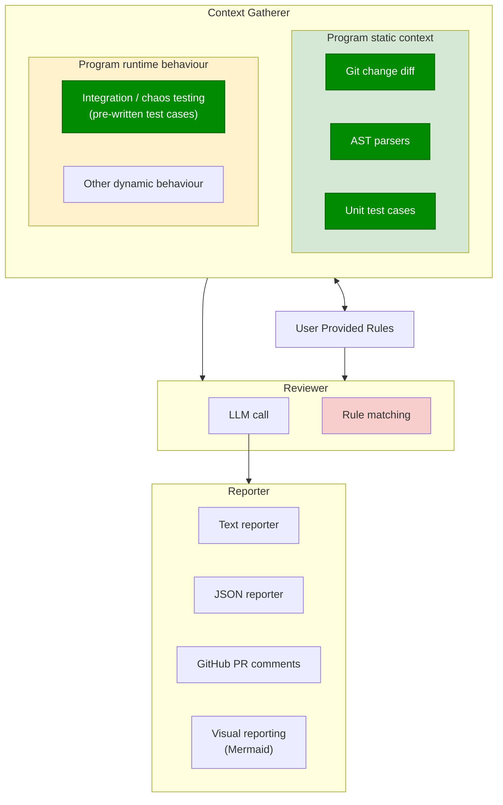

# Component Design — Requirements Extracted from the Diagrams

**Status:** Non-normative extraction · **Date:** 2026-09-28 · **Sources:** [`level-1.svg`](./level-1.svg), [`level-2.svg`](./level-2.svg), [`level-3.svg`](./level-3.svg) · **Subordinate to:** [`../../agentic-code-review-srs-v1.md`](../../agentic-code-review-srs-v1.md)

This page states in words what the three component diagrams show: the system they describe, and the high-level requirements (HLR) you can read off them. It adds nothing the diagrams don't show. Where a diagram is ambiguous, the ambiguity is listed in [§5](#5--open-questions-the-diagrams-leave) and not settled here.

The diagrams are not a requirements source. Where this page and the SRS disagree, the SRS wins. [§4](#4--relationship-to-the-v1-srs) lists the disagreements.

---

## 1 · System description

The system reviews a code change. It works in four stages:

1. **Context gathering** collects what is needed to judge the change, from two kinds of source:
   - **Static context** comes from the program text: the Git change diff, parsed ASTs of the affected code, and the existing unit test cases.
   - **Runtime behaviour** comes from running the program: the project's own pre-written integration and chaos tests, plus other dynamic behaviour that isn't named yet.
2. **User-provided rules** are the reviewing team's own standards. They are supplied from outside the system and exchange information with context gathering in both directions.
3. **Review** combines the gathered context with the rules. Two components do this: an **LLM call**, and a separate **rule-matching** component.
4. **Reporting** turns the review result into output for a consumer outside the system. There are four channels: plain text, JSON, GitHub PR comments, and a visual report.

The three levels refine one another. Each level keeps the one above it and adds detail inside its boxes:

| Level | What it adds |
|---|---|
| 1 | The four top-level blocks and how data flows between them |
| 2 | Context gathering splits into **static context** and **runtime behaviour** |
| 3 | Concrete sources inside each context kind, the components inside Review, and the reporter channels |

### 1.1 Level 3, redrawn

The colours match the source diagram: light green for static context, yellow for runtime behaviour, red for rule matching. **Dark green marks a decided component**: Git diff, AST parsers, unit tests, and integration/chaos testing. Level 3 draws no edge from Rule Matching to anything, and neither does this redraw. HLR-14 puts Rule Matching out of scope.

Level 1 of the source diagram also draws an output edge leaving Reporting. That edge is removed from the design, so this redraw and the requirements below don't include it.

---

## 2 · Data flow between the top-level blocks

| From | To | Meaning | Levels |
|---|---|---|---|
| Context Gathering | User Provided Rules | **Both directions.** It is the only two-way edge in the diagrams | 1, 2, 3 |
| Context Gathering | Review | Gathered context feeds the review | 1, 2, 3 |
| User Provided Rules | Review | Rules feed the review | 1, 2, 3 |
| Review | Reporting | Review results are reported. At level 3 the edge starts at **LLM call** specifically | 1, 2, 3 |

Two things aren't connected at all:

- **Review has no edge back to Context Gathering.** The reviewer consumes context but never asks for more.
- **No edge feeds into Context Gathering.** Where the change comes from, such as a commit range or a PR, isn't drawn.

---

## 3 · High-level requirements

Each requirement below comes from one element or edge of the diagrams. The *Source* column names that element.

Requirement identifiers are stable. A withdrawn requirement leaves a gap (HLR-10), and a split requirement keeps its number with a letter suffix (HLR-7a, HLR-7b). Requirements marked **Out of scope** stay listed so the traceability to the diagrams isn't lost, but nothing is built for them. Requirements marked **Decided** trace to a component filled dark green in the level-3 diagram, which means that component's design is settled.

### 3.1 Context gathering

| ID | Requirement | Source |
|---|---|---|
| HLR-1 | The system shall gather context about a code change before reviewing it. | L1 *Context Gathering* |
| HLR-2 | The system shall gather **static context** from the program text, separately from runtime behaviour. | L2 *Program Static context* |
| HLR-3 | **Decided.** Static context shall include the **Git diff** of the change. | L3 *Git Change diff* |
| HLR-4 | **Decided.** Static context shall include **syntax trees** of the affected code, produced by AST parsers. | L3 *AST Parsers* |
| HLR-5 | **Decided.** Context shall include the **results of the project's existing unit test cases**. | L3 *Unit test cases* |
| HLR-6 | **Out of scope.** The system shall gather **runtime behaviour** evidence by running the program. | L2 *Program Runtime behavior* |
| HLR-7a | **Decided.** Context shall include the results of the project's **pre-written integration tests**. The system runs existing tests; it does not write them. | L3 *Integration / chaos testing (pre-written test cases)* |
| HLR-7b | **Decided.** Context shall include the results of the project's **pre-written chaos tests**. The system runs existing tests; it does not write them. | L3 *Integration / chaos testing (pre-written test cases)* |
| HLR-8 | **Out of scope.** Runtime evidence gathering shall be **open to further kinds of dynamic behaviour** beyond tests. | L3 *Other Dynamic behavior* |

### 3.2 User-provided rules

| ID | Requirement | Source |
|---|---|---|
| HLR-9 | The system shall accept **review rules supplied by the user**, as an input separate from the gathered context. | L1 *User Provided Rules* |
| HLR-11 | The review shall take the user-provided rules as a **direct input**, not only by way of context gathering. | L1–L3 *Rules → Review* |

### 3.3 Review

| ID | Requirement | Source |
|---|---|---|
| HLR-12 | The system shall review the change using **both** the gathered context and the user-provided rules. | L1 edges into *Review* |
| HLR-13 | The review shall be produced by an **LLM call**. | L3 *LLM CALL* |
| HLR-14 | **Out of scope.** The review shall include a **rule-matching** component that is separate from the LLM call. | L3 *Rule Matching* |
| HLR-15 | The reviewer shall **not** request further context. Context flows into review in one direction only. | Absence of a *Review → Context* edge |

### 3.4 Reporting

| ID | Requirement | Source |
|---|---|---|
| HLR-16 | The system shall report review results through a reporting stage that is separate from the review. | L1 *Reporting* |
| HLR-17 | The system shall produce a **human-readable text** report. | L3 *Text Reporter* |
| HLR-18 | The system shall produce a **machine-readable JSON** report. | L3 *JSON reporter* |
| HLR-19 | The system shall be able to publish findings as **GitHub PR comments**. | L3 *Github PR Comments* |
| HLR-20 | The system shall be able to produce a **visual report as a Mermaid diagram**. | L3 *Visual Reporting* |
| HLR-21 | Reporting shall support **several interchangeable channels** behind one reporter stage. | L3 four peers inside *Reporter* |

### 3.5 Structure

| ID | Requirement | Source |
|---|---|---|
| HLR-22 | The system shall be organised as a **fixed forward pipeline**: gather → review → report. Data never flows backward. | L1 edge directions |
| HLR-23 | Each stage shall be decomposable into sub-components **without changing the edges between stages**. Levels 2 and 3 refine the blocks and keep every level-1 edge. | L1 → L3 refinement |

---

## 4 · Relationship to the v1 SRS

The diagrams describe the whole product, not just v1. Most of what they show is already in the v1 SRS. The rest is either planned for a later version or appears in no requirement at all.

| HLR | In the v1 SRS? | Notes |
|---|---|---|
| HLR-1, 3, 4 | **Yes.** CF-1, CF-2 | Change-set resolution and parsing |
| HLR-5 | **Yes.** CF-3 | FR-4.1: unit tests are executed and their results captured. The diagram still draws them in the **static** box |
| HLR-6 | *Out of scope* | General runtime observation of the program. v1 gets runtime evidence only from the project's own checks (FR-4.1, FR-4.2) |
| HLR-7a | **Partly** | The SRS runs "the project's test suite" (FR-4.1) and doesn't name integration tests separately |
| HLR-7b | **No** | No SRS requirement names chaos testing |
| HLR-8 | *Out of scope* | Open-ended. No SRS requirement covers it |
| HLR-9, 11, 12 | **Yes.** CF-8, CF-4, CF-6 | Pattern library (FR-6.1), which the agent applies (FR-5.3), within a per-section budget (FR-2.5a) |
| HLR-13 | **Yes.** CF-6 | A single model pass (FR-5.7) |
| HLR-14 | *Out of scope* | Consistent with the SRS: the **agent** applies rules and cites the rule identifier (FR-5.3, FR-6.2a), with no rule matcher separate from the model |
| HLR-15 | **Yes** | FR-4.6: the agent cannot trigger checks. At step ceiling zero it has no investigation tools either (FR-5.7) |
| HLR-16, 17, 18 | **Yes.** CF-7 | FR-8.1b (terminal summary), FR-8.2a (JSON) |
| HLR-19 | **v3** | All GitHub integration is deferred to v3 (SRS §7, ADR-0006) |
| HLR-20 | **No** | No SRS requirement covers a Mermaid report, so it has no version assigned |
| HLR-21 | **Yes, in spirit** | Adapters render findings but never decide what is a finding (FR-10.2) |
| HLR-22 | **Yes** | ADR-0001: our code owns orchestration, not the model |
| HLR-23 | **Yes** | CF-1 … CF-9 block structure |

Four things the SRS treats as load-bearing appear nowhere in the diagrams:

- how findings enter the system (`emit_finding`, FR-5.6a)
- the finding model itself (CF-5)
- reporting of degraded runs (FR-11.2)
- config and diagnostics (CF-9)

This is expected at this level of abstraction, but anyone reading the diagrams alone won't learn about any of them.

---

## 5 · Open questions the diagrams leave

| # | Question | Why it matters |
|---|---|---|
| Q-1 | ~~Are **unit tests** static context or runtime evidence?~~ **Resolved:** their *results* are the context (HLR-5), so they are executed. | Unit tests are handled by CF-3 (execution), not CF-2 |
| Q-2 | ~~What crosses the **two-way edge between rules and context**?~~ **Withdrawn** along with HLR-10. The edge stays in the diagrams, but no requirement is built on it. | — |
| Q-3 | ~~Is **Rule Matching** a deterministic check that produces its own findings?~~ **Moot:** HLR-14 is out of scope. | Findings keep a single entry point, `emit_finding` (FR-5.6a) |
| Q-4 | ~~What does the **dark green fill** mean?~~ **Resolved:** dark green marks a **decided** component. | HLR-3, 4, 5, 7a and 7b are marked Decided |
| Q-5 | ~~Who consumes Reporting's **output edge** in level 1?~~ **Resolved:** the edge is removed from the design. | The consumer isn't drawn. The v1 persona gap in SRS §2.5 and R-5 still applies |
| Q-6 | ~~What is **Visual Reporting**?~~ **Resolved:** a report made as a **Mermaid** diagram, as in the earlier sketch in [`../../system-design-block.md`](../../system-design-block.md). | HLR-20 now says so. It still has no SRS requirement or version |
