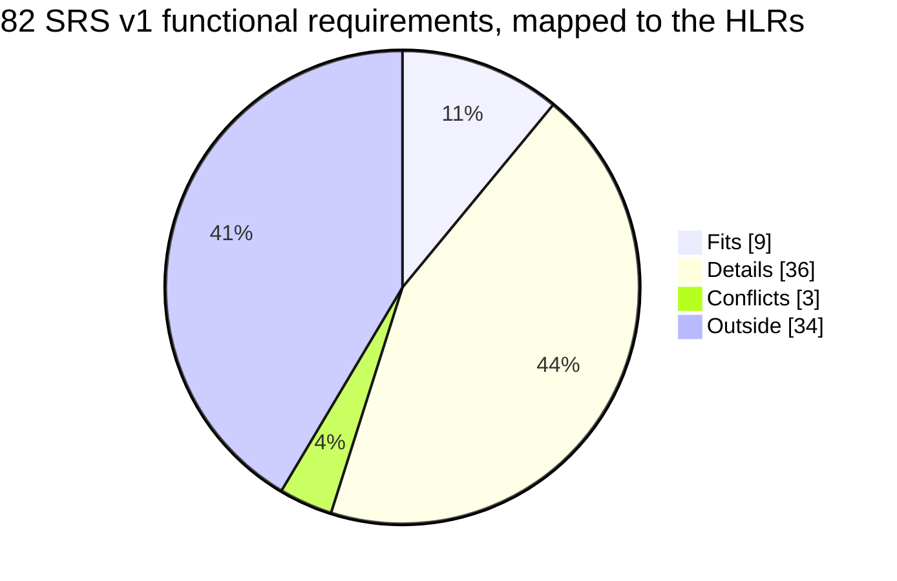

# SRS v1 → HLR Alignment

**Status:** Non-normative analysis · **Date:** 2026-09-29 · **Maps:** every requirement in [`../../agentic-code-review-srs-v1.md`](../../agentic-code-review-srs-v1.md) §4 **onto** the high-level requirements in [`README.md`](./README.md) §3

[`README.md`](./README.md) §4 already maps each HLR to the SRS. This page runs the other way: it starts from each of the SRS's 82 functional requirements and asks which HLR, if any, can hold it. That direction shows what the component diagrams leave out, which the HLR-first table can't show.

Where the two documents disagree, the SRS wins. This page proposes HLR edits. It doesn't propose SRS edits.

---

## Classification

| Class | Meaning |
|---|---|
| **Fits** | The FR states the HLR's obligation at about the same level. Satisfying the FR satisfies the HLR. |
| **Details** | The FR refines an HLR. It says *how*, *how much*, or *what happens on failure*, and the HLR says nothing about that. |
| **Conflicts** | The FR allows something an HLR forbids. |
| **Outside** | No HLR can hold the FR. The diagrams have no element for it. |

A Details row marked **HLR-1 only** refines nothing below the root "gather context" requirement. That means the level-3 diagram has no component for it.

---

## 1 · Summary

### What fits the HLRs (9)

These FRs state the diagrams' own obligations.

| HLR | FR | Why it's a fit |
|---|---|---|
| HLR-4 (syntax trees) | FR-2.2 | Builds syntax trees of the changed files |
| HLR-5, HLR-7a (test results) | FR-4.1 | Runs the project's test suite and captures the results |
| HLR-5 (results are context) | FR-4.5c | The execution record is passed to the agent |
| HLR-9 (user rules) | FR-6.1 | A configurable pattern library |
| HLR-12 (context + rules) | FR-5.3 | The agent uses both execution results and pattern rules |
| HLR-15 (one-way context) | FR-4.6 | The agent can't trigger check execution |
| HLR-16 (reporting is separate) | FR-10.2 | No adapter decides what counts as a finding |
| HLR-17 (text) | FR-10.4a | Terminal rendering, derived from the finding model |
| HLR-18 (JSON) | FR-8.2a | The JSON artifact |

### What details the HLRs (36)

Most of the SRS lives here. The HLRs name a component and the SRS says how it behaves.

| HLR | Refined by | What the SRS adds |
|---|---|---|
| HLR-1 (gather context) | FR-2.3d, FR-2.6a, 2.6b, 2.6c, 2.6d, 2.6e, 2.6f, 2.6g, FR-4.2 | The whole depth ladder and the resolver sidecar, plus the type-check. **Eight of these have no level-3 component** (see §3, findings 4 and 5) |
| HLR-3 (Git diff) | FR-10.3a, 10.3b, 10.3c, FR-3.5 | Which diff (working tree, staged, or branch), the default scope, a files-and-hunks shape that doesn't depend on Git, and path exclusions |
| HLR-4 (syntax trees) | FR-2.4, FR-2.6b | Context cut at function, class, and type boundaries. Depths 0 and 1 are served by the parser |
| HLR-5, 7a (test results) | FR-4.4a, 4.4b, 4.5a, 4.5b, 4.7, FR-2.5c | The time budget and timeout, the ran/skipped/errored record, the project's own toolchain, and distilled output |
| HLR-11 (rules are a direct input) | FR-2.5a | Rules get their own budgeted section, so other context can't starve them |
| HLR-12 (review uses both) | FR-2.3c, 2.5, 2.5b, FR-6.2a | A context cap, eviction by distance, a diff that is never truncated, and rule attribution |
| HLR-13 (LLM call) | FR-0.3, FR-5.7, FR-5.10 | A provider-independent interface, a tool-call ceiling, and a reply with no tool call counts as termination |
| HLR-18 (JSON) | FR-8.2b, 8.2c, 8.2d, 8.4, 10.4b | A versioned report schema, run metadata, and tool-call counts |
| HLR-17 (text) | FR-8.1b | What the terminal summary must state |
| HLR-9 (user rules) | FR-6.3a | Five rules shipped with the system |
| HLR-22, 23 (fixed pipeline, stable edges) | FR-5.8 | The framework stays in the graph layer, the pipeline is acyclic, and nodes are thin |

### What conflicts (3)

| FR | HLR | The conflict |
|---|---|---|
| FR-5.7a, 5.7b, 5.7c | **HLR-15** | FR-5.7a lets investigation tools be switched on. The registry in [`../04-contracts.md`](../04-contracts.md) §4.4 already defines them: `read_file`, `get_outline`, `search_repo`. That *is* the reviewer requesting more context, which HLR-15 forbids. HLR-15 holds only while they're off, which is the v1 default. FR-5.7b's gate (delivery step 4.5) is the point where it stops holding. See §3, finding 1 |

### What is outside the HLRs (34)

These fall into seven groups. [`README.md`](./README.md) §4 names four of them. The last three are new here.

| Group | FRs | Count |
|---|---|---|
| **Finding model and how findings enter** | FR-0.1, 0.2, 0.4, 5.2, 5.2a, 5.2b, 5.2c, 5.6, 5.6a, 5.6b, 5.6c, 5.7d, 5.9 | 13 |
| **Degradation reporting** | FR-2.6h, 8.2e, 11.2 | 3 |
| **Configuration and diagnostics** | FR-1.2a, 1.2b, 1.2c, 1.2d, 1.3a, 9.1, 9.3 | 7 |
| **The regression command** *(new)* | FR-6.2b, 6.2d, 6.2e, 6.2f | 4 |
| **Invocation surface and exit status** *(new)* | FR-10.1, 10.4c, 9.2a | 3 |
| **Run budgets and trace** *(new)* | FR-11.1, 11.3 | 2 |
| **Agent isolation and the no-write-path rule** *(new)* | FR-5.1, 7.2 | 2 |

The biggest of these is the **regression command**. The SRS names two commands as v1's deliverable (§1.1), and the diagrams show only one. Measurement (CF-8), which Appendix A places third in the build order, has no block at any level.

---

## 2 · Requirement-by-requirement

Every FR in SRS §4 appears exactly once. M/S means Must or Should.

### CF-1 — Change-set resolution

| FR | M/S | Class | HLR | Note |
|---|---|---|---|---|
| FR-10.3a | M | Details | HLR-3 | Chooses which diff. This also fills the gap in [`README.md`](./README.md) §2 that "no edge feeds into Context Gathering" |
| FR-10.3b | M | Details | HLR-3, HLR-17 | Default scope, stated in the output |
| FR-10.3c | M | Details | HLR-3 | Files and hunks, independent of Git. This is the seam HLR-19 (v3) plugs into |

### CF-2 — Parsing and related context

| FR | M/S | Class | HLR | Note |
|---|---|---|---|---|
| FR-2.2 | M | **Fits** | HLR-4 | Adds tolerance of a parse failure in a single file |
| FR-2.4 | S | Details | HLR-4 | Boundaries come from the syntax tree |
| FR-2.3d | M | Details | HLR-1 only | Records what related context was included, and why |
| FR-2.6a | M | Details | HLR-1 only | Retrieval is parameterised by depth |
| FR-2.6b | M | Details | HLR-1, HLR-4 | A parser-backed provider serves depths 0 and 1 |
| FR-2.6c | M | Details | HLR-1 only | Each unit carries its relation and distance |
| FR-2.6d | M | Details | HLR-1 only | Achieved depth, with every reason it fell short |
| FR-2.6e | M | Details | HLR-1 only | No consumer branches on the implementation. This is HLR-23's idea applied inside a stage |
| FR-2.6f | M | Details | HLR-1 only | The resolver sidecar. It has no component in any diagram |
| FR-2.6g | M | Details | HLR-1 only | Heuristic fallback, and the review still completes |
| FR-2.6h | M | Outside | — | Carries every degradation, not just one |

### CF-3 — Execution and evidence

| FR | M/S | Class | HLR | Note |
|---|---|---|---|---|
| FR-4.1 | M | **Fits** | HLR-5, HLR-7a | "The project's test suite" covers unit and integration tests alike. It doesn't name them separately |
| FR-4.2 | M | Details | HLR-1 only | The type-check. It has no component at level 3, yet AC-2 relies on it |
| FR-4.4a | M | Details | HLR-5, 7a | Time budget |
| FR-4.4b | M | Details | HLR-5, 7a | Timeout. The review continues |
| FR-4.5a | M | Details | HLR-5 | Ran, skipped, or errored |
| FR-4.5b | M | Details | HLR-5 | Pass/fail and captured output |
| FR-4.5c | M | **Fits** | HLR-5, HLR-18 | Passed to the agent and included in the JSON |
| FR-4.6 | M | **Fits** | HLR-15 | The agent can't trigger checks |
| FR-4.7 | M | Details | HLR-5, 7a | Runs the project's own toolchain as a subprocess. Matches "runs existing tests; does not write them" |

### CF-4 — Context assembly

| FR | M/S | Class | HLR | Note |
|---|---|---|---|---|
| FR-2.3c | M | Details | HLR-12 | Related source goes into the review context |
| FR-2.5 | M | Details | HLR-12 | Context cap |
| FR-2.5a | M | Details | HLR-11 | Rules are a separate section that can't be starved |
| FR-2.5b | M | Details | HLR-12, HLR-3 | Evicts by distance. The diff is never truncated |
| FR-2.5c | M | Details | HLR-5 | Test output is distilled before it enters the context |

### CF-5 — Finding model and provider interface

| FR | M/S | Class | HLR | Note |
|---|---|---|---|---|
| FR-0.1 | M | Outside | — | The finding model |
| FR-0.2 | M | Outside | — | Model output is converted to it before any use |
| FR-0.3 | M | Details | HLR-13 | The LLM call sits behind a provider-independent interface |
| FR-0.4 | M | Outside | — | Versioned schema |
| FR-5.2 | M | Outside | — | Finding fields |
| FR-5.2a | M | Outside | — | Severity vocabulary |
| FR-5.2b | M | Outside | — | Category vocabulary |
| FR-5.2c | M | Outside | — | Evidence reference, or marked unverified |
| FR-5.6 | M | Outside | — | All outputs are derived from the finding model |
| FR-5.6a | M | Outside | — | `emit_finding` is the only way in. This is also why HLR-14 can stay out of scope |
| FR-5.6b | S | Outside | — | Structured-output fallback |
| FR-5.6c | M | Outside | — | One repair turn. It's a cycle *inside* Review, so it doesn't breach HLR-22 |

### CF-6 — The review agent

| FR | M/S | Class | HLR | Note |
|---|---|---|---|---|
| FR-5.1 | M | Outside | — | Isolated from any code-writing agent |
| FR-5.3 | M | **Fits** | HLR-12 | Uses execution results and rules |
| FR-5.7 | M | Details | HLR-13 | Tool-call ceiling. The placeholder is 25, which is positive, not zero |
| FR-5.7a | S | **Conflicts** | HLR-15 | Investigation tools (read-only) |
| FR-5.7b | M | **Conflicts** | HLR-15 | The gate that decides when the conflict becomes real |
| FR-5.7c | S | **Conflicts** | HLR-15 | Only applies once tools are on |
| FR-5.7d | S | Outside | — | A finding means the same thing at every ceiling |
| FR-5.8 | M | Details | HLR-22, HLR-23 | Framework confinement and an acyclic pipeline |
| FR-5.9 | M | Outside | — | Structured tool observation: `ok`, `error`, or `denied` |
| FR-5.10 | M | Details | HLR-13 | No compulsory tool call. A run with no tool call is recorded as such |

### CF-7 — Output

| FR | M/S | Class | HLR | Note |
|---|---|---|---|---|
| FR-8.1b | M | Details | HLR-17 | What the summary must state |
| FR-8.2a | M | **Fits** | HLR-18 | |
| FR-8.2b | M | Details | HLR-18 | The report schema embeds the finding model |
| FR-8.2c | M | Details | HLR-18 | Run metadata |
| FR-8.2d | M | Details | HLR-18 | Tool-call breakdown |
| FR-8.2e | M | Outside | — | Where degradations are recorded |
| FR-8.4 | S | Details | HLR-18 | Documented, versioned |
| FR-10.4a | M | **Fits** | HLR-17, HLR-16 | |
| FR-10.4b | M | Details | HLR-18 | JSON on request |
| FR-10.4c | M | Outside | — | Exit codes. HLR-21 could take this as a fifth channel |

### CF-8 — Pattern library and regression harness

| FR | M/S | Class | HLR | Note |
|---|---|---|---|---|
| FR-6.1 | M | **Fits** | HLR-9 | |
| FR-6.2a | M | Details | HLR-12 | Rule attribution, done by the agent, not by a separate matcher (HLR-14) |
| FR-6.2b | M | Outside | — | Regression set runnable as a test |
| FR-6.2d | M | Outside | — | Catch rate at a given depth and ceiling |
| FR-6.2e | S | Outside | — | Pinned settings |
| FR-6.2f | M | Outside | — | Matching rule and false-positive figure |
| FR-6.3a | M | Details | HLR-9 | Five rules shipped **by the system**. HLR-9 only says "supplied by the user". The regression-case clause is Outside |

### CF-9 — Configuration and diagnostics

| FR | M/S | Class | HLR | Note |
|---|---|---|---|---|
| FR-1.2a–d | M | Outside | — | Config file, defaults, and loud failure (4 FRs) |
| FR-1.3a | M | Outside | — | Credential source |
| FR-3.5 | M | Details | HLR-3 | Exclusions applied when the change set is resolved |
| FR-9.1 | M | Outside | — | README, LICENSE, usage docs |
| FR-9.3 | M | Outside | — | Failure messages for missing prerequisites |

### Cross-cutting

| FR | M/S | Class | HLR | Note |
|---|---|---|---|---|
| FR-10.1 | M | Outside | — | The CLI. No diagram draws an entry point |
| FR-10.2 | M | **Fits** | HLR-16, HLR-21 | |
| FR-9.2a | M | Outside | — | End to end on a free tier |
| FR-11.1 | M | Outside | — | Token and call budget per invocation |
| FR-11.2 | M | Outside | — | A review is produced under every failure mode |
| FR-11.3 | S | Outside | — | Trace |
| FR-7.2 | M | Outside | — | No write path. This is consistent with HLR-19 being v3 |

---

## 3 · Findings for the HLR page

In order of consequence.

| # | Finding | Proposed HLR change |
|---|---|---|
| 1 | **HLR-15 conflicts with FR-5.7a.** [`README.md`](./README.md) §4 justifies HLR-15 with "at step ceiling zero it has no investigation tools". That reasoning is stale. SRS v1.1 made the ceiling a positive number and turned investigation into a separate switch, and three read-only tools are already registered for delivery step 4.5. | Split it, following the page's own convention. **HLR-15a**: the reviewer can't trigger check execution (always true, FR-4.6). **HLR-15b**: the reviewer doesn't request further context. This holds by default and is lifted by the FR-5.7b gate. Also fix the §4 note |
| 2 | **HLR-6 is Out of scope, but its children HLR-7a and 7b are Decided.** Running the project's tests *is* gathering runtime behaviour. | Reword HLR-6 to cover runtime observation **beyond** the project's pre-written tests. That also makes it the same thing as HLR-8 |
| 3 | **HLR-7b (chaos tests) is Decided, but no SRS requirement names it.** FR-4.1 runs whatever the project's test script runs. Chaos tests get covered only if they're part of that script, and nothing tells them apart. | Mark HLR-7b as satisfied by FR-4.1 *if* the chaos tests are in the test script. The alternative is to raise it in [`DESIGN_BLOCKERS.md`](../../../DESIGN_BLOCKERS.md) Part A, because design can't add behaviour (design README, rule 1). HLR-7a has the same problem in a milder form |
| 4 | **The type-check (FR-4.2) has no component.** AC-2 accepts "a real test **or type-check** result", so it's a first-class evidence source. | Add *Type-check* to level 3, with a new HLR |
| 5 | **Related context has no component.** The depth ladder (FR-2.6a–h) holds what SRS §4.2.2 calls "the highest-value structural constraint in this document". Level 3's static context shows only the diff, the syntax trees, and unit tests. | Add *Related context (depth 0–1)* to level 3. Its requirement should state the one-interface property (FR-2.6e). The resolver can stay undrawn, because it's private to CF-2 |
| 6 | **The regression command is missing.** It's one of v1's two deliverables. | Add a measurement block, or state on the HLR page that the diagrams cover the `review` command only |
| 7 | **HLR-9 says rules are "supplied by the user".** The SRS ships five of its own (FR-6.3a). The two don't contradict each other, but the HLR is incomplete. | "Built-in rules, extendable by the user" |
| 8 | **HLR-3 names Git.** FR-10.3c deliberately keeps the change set independent of how it was resolved, because that's the v3 seam. | "The change diff". Git is how v1 resolves it, not what the stage requires |
| 9 | **HLR-20 (Mermaid) has no SRS home** and no version. | Mark it Out of scope, or raise it as a v2 candidate in `DESIGN_BLOCKERS.md` Part A |

No SRS requirement is contradicted by an HLR that is **in scope**, except HLR-15. Every other gap is something the diagrams leave out, not something they get wrong.
