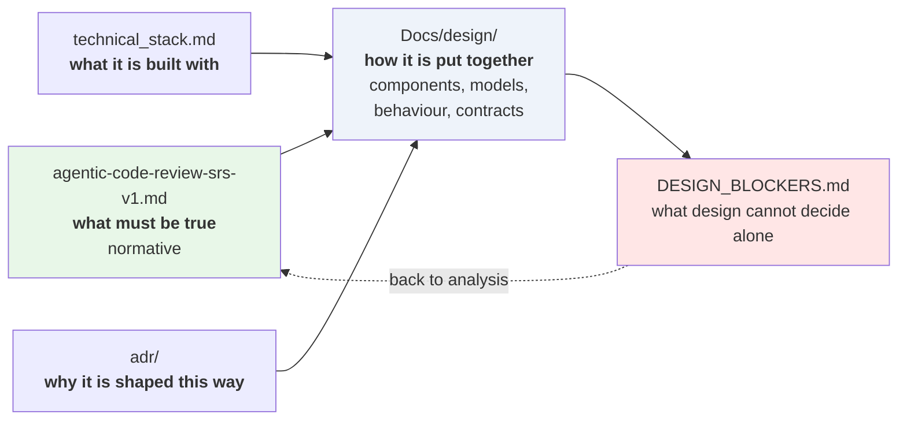
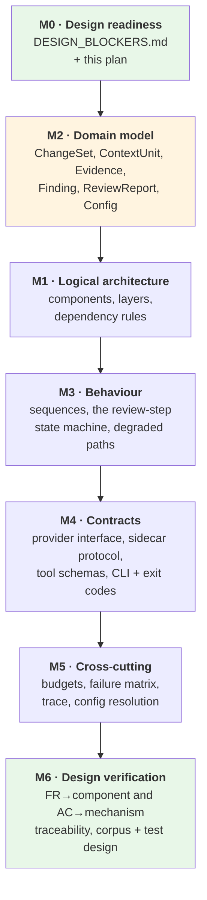
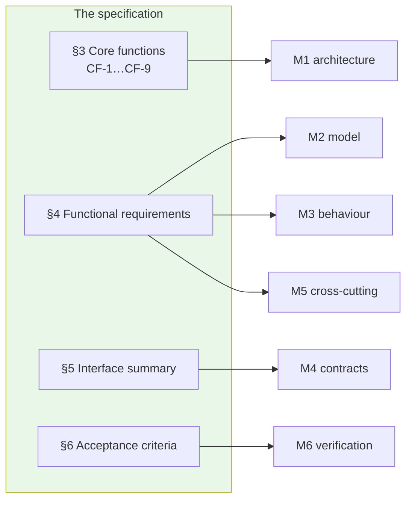

# Design — v1

**Status:** Complete — all six milestones delivered · **Date:** 2026-09-15 · **Serves:** [`../agentic-code-review-srs-v1.md`](../agentic-code-review-srs-v1.md)

---

## Where design sits

Design answers **how the system is put together**. It does not decide what the system must do, and it does not pick libraries.

**Four rules, inherited from the document hierarchy:**

1. The SRS wins **on behaviour**. If a design cannot satisfy a requirement, *the design is wrong* — changing the requirement is an analysis change, raised in [`DESIGN_BLOCKERS.md`](../../DESIGN_BLOCKERS.md) Part A.
2. **The SRS does not win on design.** Where a requirement specifies a mechanism rather than a property — a library, a process model, an interface declaration, an algorithm, an internal identifier — design proceeds against the **property underneath** and records the objection in [Part B](../../DESIGN_BLOCKERS.md#part-b--design-objections). This is not a licence to change behaviour: every objection so far leaves the system doing exactly what it does today.
3. Design never introduces a technology. That is [`technical_stack.md`](../technical_stack.md)'s job.
4. A design decision that **reverses** an ADR needs a new ADR, not a design document.

Rule 2 exists because the project already adopted the standard it enforces — *"Behaviour and technology are separate documents… if a library cannot satisfy a requirement, the library is wrong"* ([`../README.md`](../README.md)). That rule only holds if requirements do not name libraries. Six places, they do.

---

## Milestones

Each milestone produces one artifact and ends at a verification gate. Nothing downstream starts until the gate is passed.

**Milestone identifiers are stable; the sequence is not.** M2 was moved ahead of M1 on 2026-09-14 — the types are the spine every component passes around, and the schema decisions behind them (DB-02, DB-04, DB-08, DB-09) are the most expensive in the design to change later.

| Order | # | Artifact | Answers | Blocked by |
|---|---|---|---|---|
| 1 | **M0** | [`../../DESIGN_BLOCKERS.md`](../../DESIGN_BLOCKERS.md) · this file | What did analysis leave unsettled? | — |
| 2 | **M2** | [`02-domain-model.md`](./02-domain-model.md) | What are the types, what is versioned, what is frozen? | DB-02, DB-04, DB-08, DB-09 |
| 3 | **M1** | [`01-logical-architecture.md`](./01-logical-architecture.md) | What are the components, who may call whom, where is the core/adapter seam, what does the import-linter enforce? | ✅ none |
| 4 | **M3** | [`03-behaviour.md`](./03-behaviour.md) | What happens on the happy path, and on each of FR-11.2's four failure modes? | ✅ none |
| 5 | **M4** | [`04-contracts.md`](./04-contracts.md) | What are the exact signatures, wire formats, flags and exit codes? | ✅ none — TBD-8 has a placeholder |
| 6 | **M5** | [`05-cross-cutting.md`](./05-cross-cutting.md) | How are the token budget and degradation reporting work, what is in the trace? | ✅ none — TBD-3 has a placeholder |
| 7 | **M6** | [`06-verification.md`](./06-verification.md) | Does every requirement have a home and every acceptance criterion a mechanism? | ✅ none — TBD-6 targets pending |

## Status

**All 24 items raised in [`DESIGN_BLOCKERS.md`](../../DESIGN_BLOCKERS.md) are closed** as of 2026-09-14 — 17 in SRS v1.1, one as [ADR-0008](../adr/0008-agent-runtime-tool-registry-and-termination.md), two as ADR notes, two in the stack document, two settled here.

**All six milestones are delivered.** What remains is not design work: eight numbered unknowns needing measurement (SRS §8, each with a labelled placeholder) and three untested stack assumptions — **S-1 first**, because it gates the most and costs the least.

## Decisions taken

| # | Decision | Date | Source |
|---|---|---|---|
| **DB-01** | The agent tool loop **is** in v1, *Should*, gated by FR-5.7b. Design the seam now (one-node graph, unwired conditional edge); the three tools are a step-4.5 contract. | 2026-09-14 | [`DESIGN_BLOCKERS.md`](../../DESIGN_BLOCKERS.md#db-01) |
| **DB-08** | Severity is `blocking \| important \| nit`; `blocking` alone drives a non-zero exit. Category set closed at seven values. Both back-ported into FR-5.2a and FR-5.2b. | 2026-09-14 | [`…#db-08`](../../DESIGN_BLOCKERS.md#db-08) |
| **DB-17** | One repair turn per review, capped, counted separately, outside the ceiling. | 2026-09-14 | [`…#db-17`](../../DESIGN_BLOCKERS.md#db-17) |
| **DB-18** | Agent-standard counting: every tool call counts against the ceiling, emissions included. Total **and** investigation both reported. Investigation becomes its own switch. Both requirement edits landed in SRS v1.1. | 2026-09-14 | [`…#db-18`](../../DESIGN_BLOCKERS.md#db-18) |
| **DB-07** | The 10–30s latency figure is **withdrawn as unproven**, not replaced — to be observed on real MVP users (TBD-2). No design decision may cite a latency threshold until then. | 2026-09-14 | [`…#db-07`](../../DESIGN_BLOCKERS.md#db-07) |
| **DB-02** | Evidence reference and `ToolObservation.denied` **adopted** (FR-5.2c, FR-5.9). `finish_review` **declined** — its premise fails for tool-calling models; FR-5.10 substitutes. | 2026-09-14 | [`…#db-02`](../../DESIGN_BLOCKERS.md#db-02) |
| **001/D-1…D-5, D-7…D-10** | Gaps found while specifying and planning feature 001, written back into M1–M5: references are validated against the run (02, 04); the diff alone over the budget exits 2, a run with no tool call has its own row, and a failed repair exits 2 only when no finding was accepted (03, 05); two completion statuses and a verdict vocabulary are added (01, 02, 04); zero findings with investigation off is `no-tool-call`, never clean (02, 05); scope comparisons are defined (02); `agent.requestTimeoutSeconds` is added (04); calls beyond the ceiling get `denied` (02, 04). D-6 is out of scope for 001. | 2026-09-17 | [`specs/001-walking-skeleton/plan.md`](../../specs/001-walking-skeleton/plan.md#design-gaps-raised-by-this-plan) |

**Blocked by** means the artifact records an open question rather than a decision until that blocker is answered. It does not stop the milestone — design proceeds on the proposals recorded in `DESIGN_BLOCKERS.md`, and marks every place a proposal is load-bearing.

---

## How the milestones map to the specification

The nine core functions are kept as the decomposition axis, deliberately. [`../Draft/agentic-architecture-review.md`](../Draft/agentic-architecture-review.md) §8 argued against replacing them with a capability list, and that reasoning holds at design time too: **core functions say who builds which module; capabilities say what the agent may do at run time.** They are different axes, and the design needs both.

---

## What design will not do

| Not doing | Because |
|---|---|
| Re-open the fixed pipeline | ADR-0001 is the decision; the architecture review already tested it and it survived |
| Re-open Python / TypeScript / LangGraph | ADR-0007, Accepted |
| Choose libraries | [`../technical_stack.md`](../technical_stack.md) |
| Design the GitHub Action | v3. The only v1 obligation is that the seams (FR-10.3c, FR-10.2) survive |
| Set non-functional numbers | SRS §8 deferred them. Design will state *where* each number is spent and flag what it needs — see DB-07 |
