# Schemas and Contracts

**Status:** Reference · **Date:** 2026-09-26 · **Covers:** v1 design, with feature 001 as built at `f4b8d55`

**Summarises (and never overrides):** [`02-domain-model.md`](./02-domain-model.md) · [`04-contracts.md`](./04-contracts.md) · [`../../specs/001-walking-skeleton/data-model.md`](../../specs/001-walking-skeleton/data-model.md) · [`../../specs/001-walking-skeleton/contracts/`](../../specs/001-walking-skeleton/contracts/)

---

## 0 · How to read this

This document puts every schema and contract in the project on one page, and draws each one. **It adds no decisions.** Every table and diagram here is a picture of the documents listed above. Where it disagrees with them, they win. Where the code has moved ahead of them, §13 says so.

| Mark | Means |
|---|---|
| 🔒 | **Frozen interface.** A later version adds an implementation, never a signature (SRS §5) |
| 📦 | **Published and versioned.** Part of a contract with someone we cannot change at the same time as our code |
| ♻️ | **Free to change.** No consumer may observe it |
| ✅ | Built. The code is in `src/agentic_review/` |
| 🟡 | Specified for feature 001, not built yet |
| ⚪ | Designed for v1 and owned by a later feature (002, 003, 004, 005) |

**Rendering the diagrams:** mermaid blocks render on GitHub and in any mermaid-enabled Markdown preview. PlantUML blocks (`plantuml`) render in VS Code with the PlantUML extension, the same one [`uc_overview.puml`](../Draft/system-analysis/assets/uc_overview.puml) uses. GitHub shows PlantUML blocks as source.

**Naming:** fields are `snake_case` in Python and `camelCase` on the wire. Enum values are kebab-case literals. The class diagrams use Python names and the JSON diagrams use wire names.

---

## 1 · The contract map

A contract is worth writing down when **someone on the other side of it cannot be changed together with our code** ([04 §0](./04-contracts.md#0--what-this-decides)).

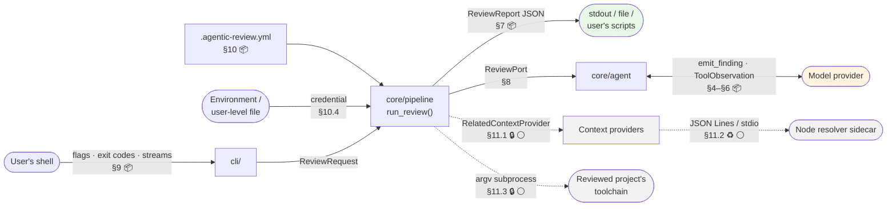

Dashed edges belong to later features.

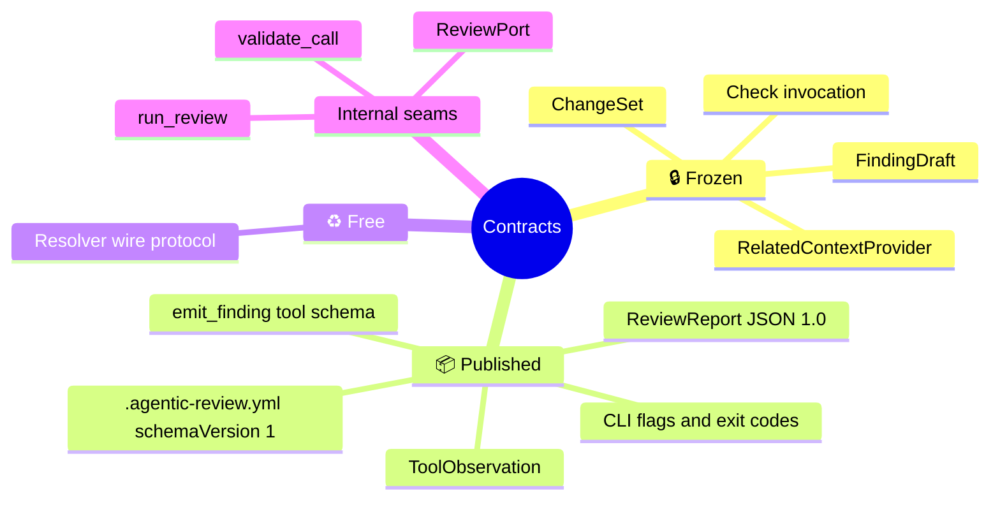

| Contract | Other side | Stability | Source of truth | Status |
|---|---|---|---|---|
| `emit_finding` tool schema | The model | 📦 versioned with the finding model | generated from `FindingDraft` | ✅ |
| `ToolObservation` | The model | 📦 | `ToolObservation` | ✅ type · 🟡 producer |
| Review report JSON | The user's scripts | 📦 schema `1.0` | generated from `ReviewReport` | ✅ types · 🟡 builder |
| CLI flags, streams, exit codes | The user's shell | 📦 stable across v1 patch releases | [contracts/cli.md](../../specs/001-walking-skeleton/contracts/cli.md) | 🟡 |
| `.agentic-review.yml` | The user's repository | 📦 `schemaVersion: 1` | [contracts/config.md](../../specs/001-walking-skeleton/contracts/config.md) | 🟡 |
| `ChangeSet` | v3's Action adapter | 🔒 | [02 §3.1](./02-domain-model.md) | 🟡 |
| `RelatedContextProvider` | v2's index-backed provider | 🔒 | [04 §2](./04-contracts.md#2--the-related-context-provider) | ⚪ 004 |
| Check invocation | The reviewed project | 🔒 subprocess boundary | [04 §8](./04-contracts.md#8--check-invocation) | ⚪ 002 |
| Resolver wire protocol | Our own bundled process | ♻️ | [04 §3](./04-contracts.md#3--the-resolver-wire-protocol) | ⚪ 004 |

---

## 2 · Where each type lives

Every 📦 type lives in `core/findings/`, so the published schema has one home and `core/output/` can build the report while importing only `findings/` ([data-model §1](../../specs/001-walking-skeleton/data-model.md#1--where-each-type-lives)).

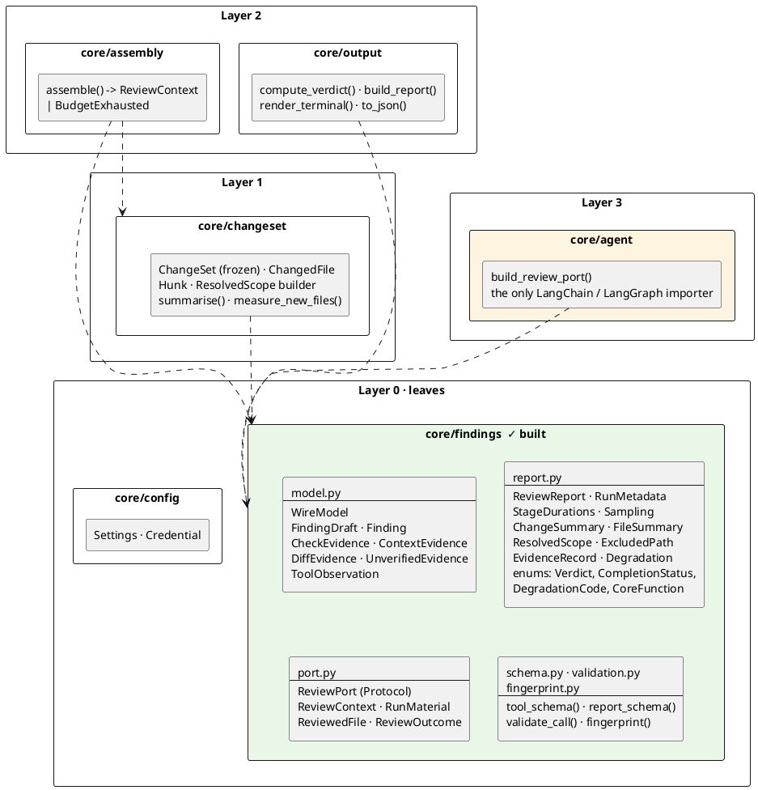

`ChangeSet` stays out of `core/findings/` on purpose. It carries diff text, and diff text never reaches the report.

---

## 3 · How one change set becomes every other type

The frozen `ChangeSet` is the **single source** for everything else a review needs. The three types that look like duplicates of one another (`FileSummary`, `ReviewedFile`, and the `[hunk i]` blocks in the prompt) are three separate projections of the same `ChangedFile`, each for a different reader.

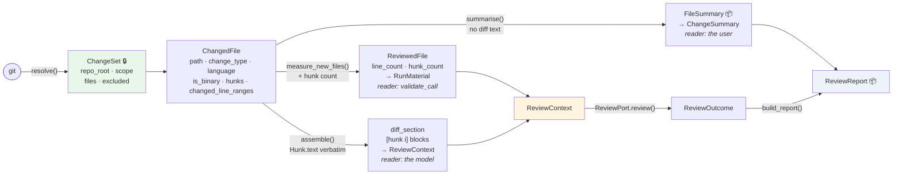

| Projection | Carries | Never carries | Why it is separate |
|---|---|---|---|
| `FileSummary` 📦 | change type, language, reviewed-or-why-not, hunk and line counts | diff text, new-file line count | Published. A field here is a promise to the user's scripts |
| `ReviewedFile` | new-file `line_count`, `hunk_count` | anything about why a file was listed | The minimum `validate_call` needs to check `endLine` and `hunkIndex` |
| `diff_section` | `Hunk.text` exactly as git produced it | counts | What is stored is what is sent (02 §3.1) |

---

## 4 · The finding model — CF-5 ✅

### 4.1 The class diagram

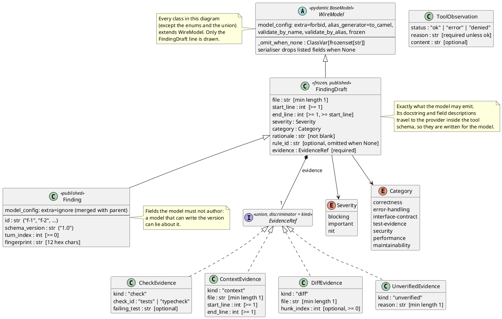

### 4.2 One definition, not two (SRS §5)

The tool schema, the validator and the report schema are all **generated** from the same Pydantic classes. Nothing is typed out a second time, so nothing can drift.

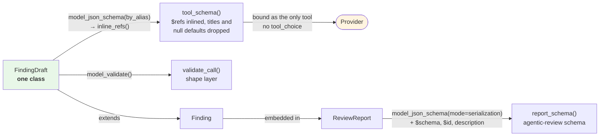

**Test obligations** ([test_schema.py](../../tests/unit/findings/test_schema.py)): `tool_schema()` equals `inline_refs(FindingDraft.model_json_schema(by_alias=True))`, contains no `$ref`, `$defs` or `title`, and every property and evidence arm carries a description.

### 4.3 The tool schema as the model sees it 📦

A **shape view** of the generated parameters. Descriptions are left out, and every evidence arm also carries `"additionalProperties": false` and `"type": "object"`. The highlighted paths are the ones that make a guess declare itself: `evidence` is required, and it is a closed union.

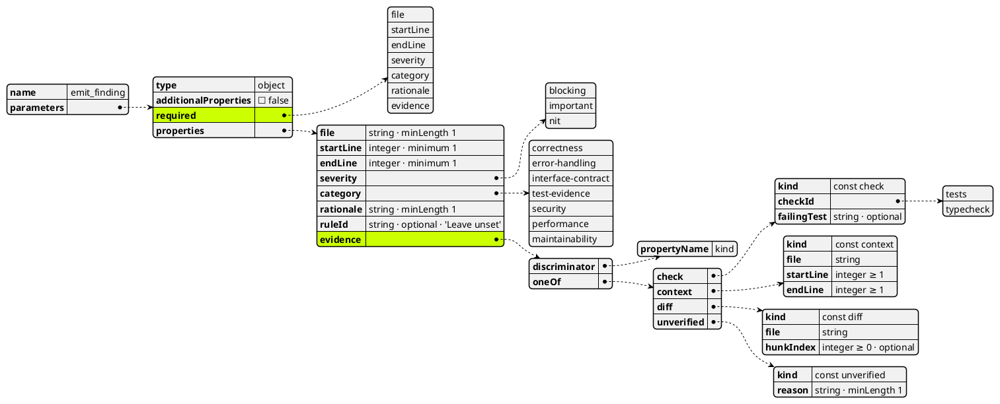

### 4.4 The four evidence arms

All four arms are in schema 1.0 today, so features 002 and 004 **start accepting** shapes that already exist rather than adding new ones.

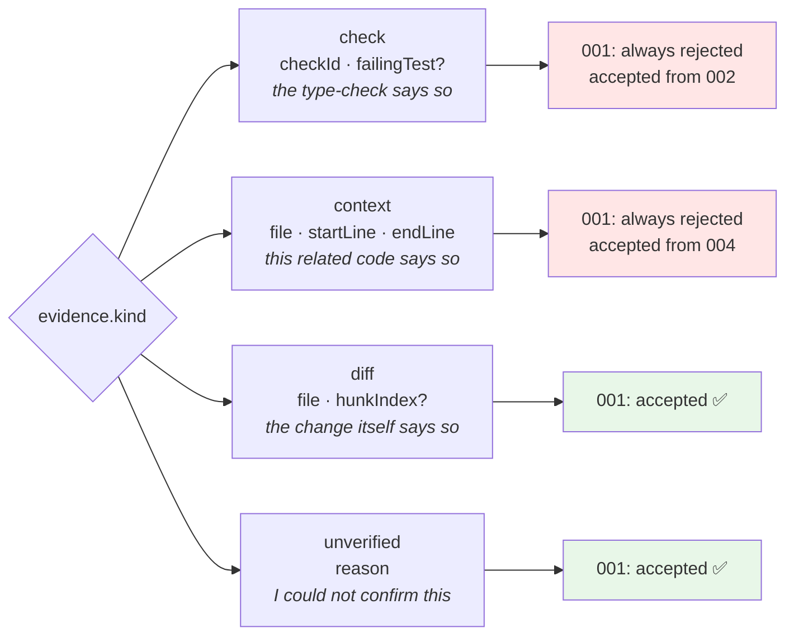

### 4.5 The fingerprint

Position-independent by design (ADR-0005, research R-23). The `fp1` prefix versions the algorithm. Feature 004 adds the enclosing symbol and moves to `fp2`.

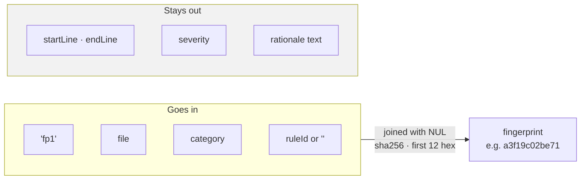

Without a symbol, two findings of the same category in one file share a fingerprint. v1 does not deduplicate (FR-5.5 is v2), so that is acceptable, and it is stated rather than hidden.

---

## 5 · Validating one `emit_finding` call ✅

### 5.1 The two layers

`validate_call(name, args, material)` is a pure function with no I/O ([validation.py](../../src/agentic_review/core/findings/validation.py)). **Shape** is checked first. **References** are checked only against a draft whose shape is valid. Every problem in a layer is reported, joined with `; `, and each is prefixed with its dotted JSON path.

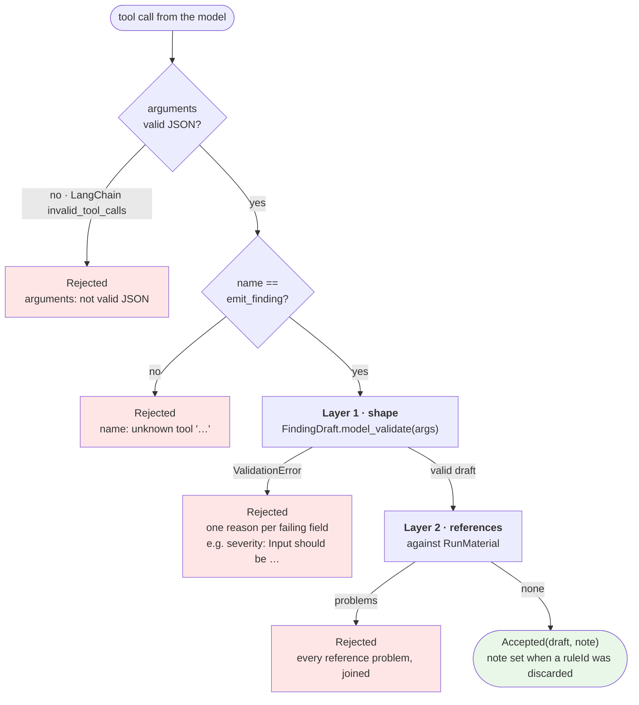

### 5.2 What the reference layer checks

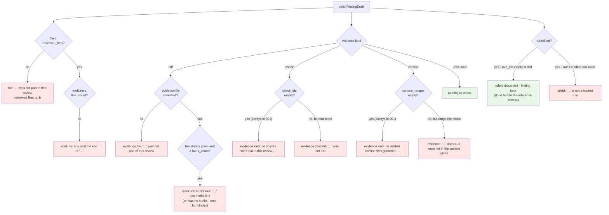

### 5.3 Rejection reasons 📦

These strings are part of the contract with the model. They are fixed so the model can act on them and the tests can assert them exactly.

| Condition | `reason` |
|---|---|
| Unknown tool name | `name: unknown tool '<name>'; the only tool is emit_finding` |
| Arguments not valid JSON | `arguments: not valid JSON` |
| Shape failure | `<json.path>: <Pydantic message>`, e.g. `severity: Input should be 'blocking', 'important' or 'nit'` |
| File not reviewed | `file: '<file>' was not part of this review; reviewed files: <a>, <b>` |
| End beyond file | `endLine: <n> is past the end of '<file>' (<count> lines)` |
| End before start | `endLine: must be greater than or equal to startLine` |
| Diff evidence names an unreviewed file | `evidence.file: '<file>' was not part of this review` |
| Hunk out of range | `evidence.hunkIndex: '<file>' has hunks 0–<k>` |
| Hunk cited in a file with no hunks | `evidence.hunkIndex: '<file>' has no hunks; omit hunkIndex` *(code only — see §13)* |
| Check evidence, no checks ran | `evidence.kind: no checks were run in this review; cite the diff or mark the finding unverified` |
| Context evidence, none gathered | `evidence.kind: no related context was gathered in this review; cite the diff or mark the finding unverified` |
| Rule named, rules loaded, not one of them | `ruleId: '<id>' is not a loaded rule` |

A rule named when **none** is loaded is not a rejection *(since 2026-10-09)*: the `ruleId` is discarded, the finding is accepted, and the `ok` observation reads `accepted as f-1; ruleId discarded: no pattern rules are loaded in this review`.

### 5.4 `ToolObservation` — what goes back for every call 📦

Every tool call, valid or not, receives exactly one `ToolMessage` whose content is one of these. The OpenAI-compatible protocol requires one per `tool_call_id` before the next assistant turn.

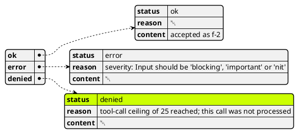

| Status | Means | Producer in v1 |
|---|---|---|
| `ok` | Accepted | A valid `emit_finding` |
| `error` | Understood, and failed validation | Either layer of §5.1. Triggers the one repair turn |
| `denied` | Understood, **and not permitted** | A call beyond the tool-call ceiling (spec 001 D-10). Policy refusals arrive in v2 |

---

## 6 · The `emit_finding` conversation 🟡

### 6.1 One review, with a repair turn

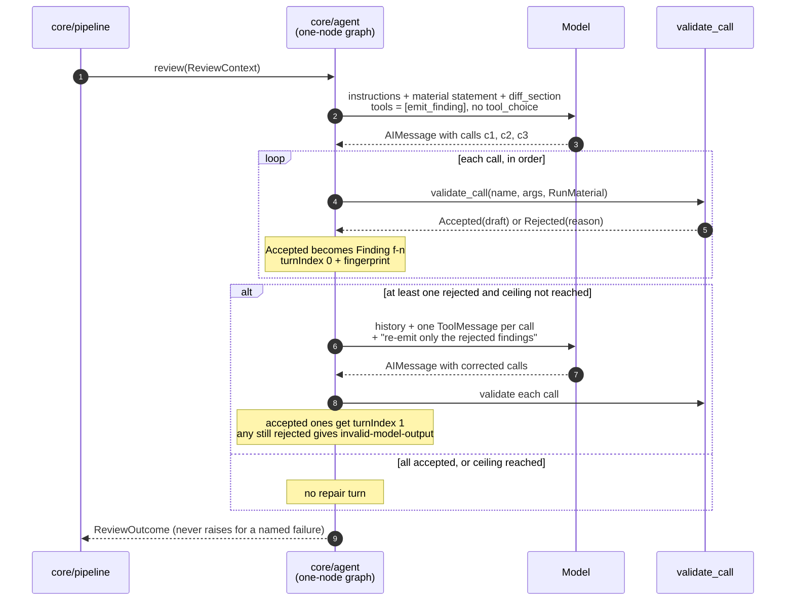

| Binding rule | Requirement |
|---|---|
| `emit_finding` is the **only** tool bound | FR-011, FR-5.7 |
| **No `tool_choice`** is ever set. A reply without a tool call ends the review | FR-018, FR-5.10, ADR-0008 |
| A reply may carry many calls. Each is validated on arrival and accumulates | ADR-0004 |
| Prose (`AIMessage.content`) is discarded unread | FR-013, FR-5.6a |
| At most **one** repair turn. It uses no ceiling slot, but the calls inside it do | FR-016, DB-17, R-13 |

### 6.2 The review-step state machine

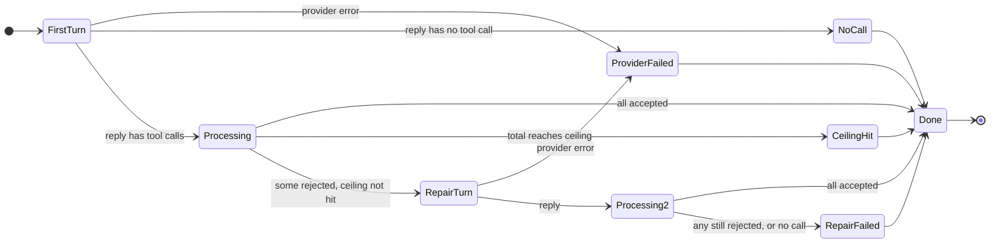

### 6.3 Counting against the ceiling (R-13)

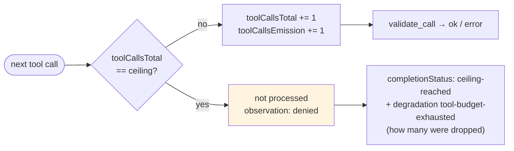

`toolCallsInvestigation` is always 0 in 001. `repairTurns` counts **turns**, never calls.

---

## 7 · The review report — schema 1.0 📦

### 7.1 The class diagram

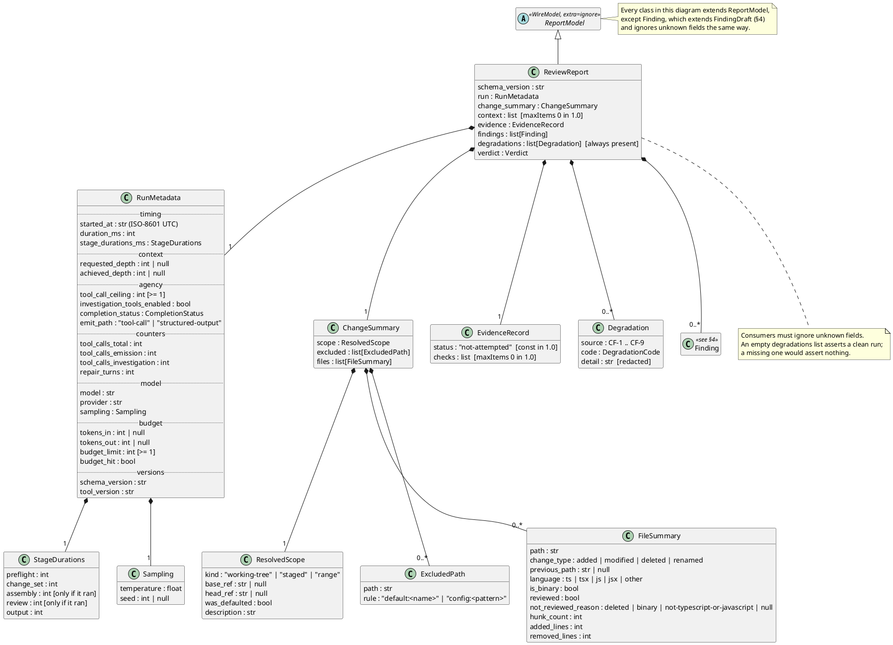

### 7.2 The vocabularies

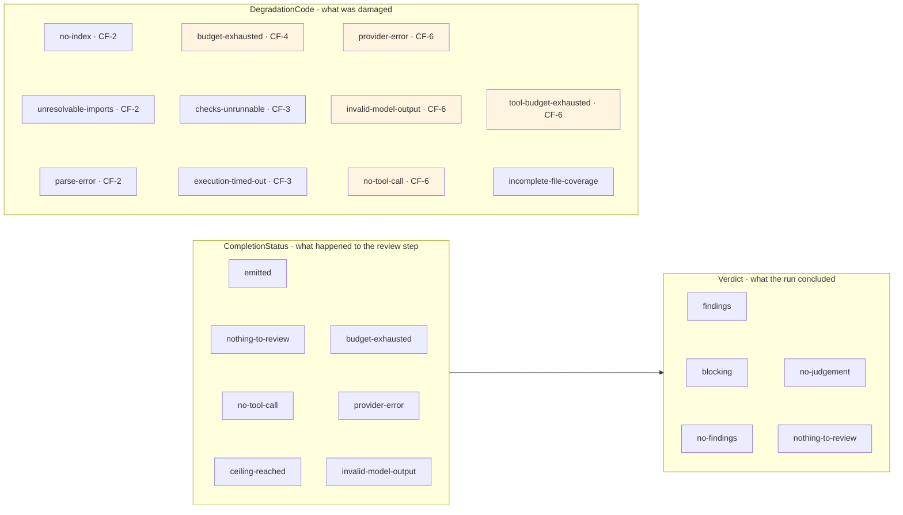

The five highlighted codes are the ones reachable in 001. The schema lists all eleven, because adding an enum value later is only non-breaking if consumers were told to expect unknown ones.

**Outcome, not damage:** reaching the ceiling is a `completionStatus`, not a degradation. A review that used its whole allowance and finished is not a damaged review. It becomes a degradation (`tool-budget-exhausted`) only when calls were **dropped**.

### 7.3 A complete report

The contract example ([review-report.md](../../specs/001-walking-skeleton/contracts/review-report.md)): one blocking finding, corrected in the repair turn.

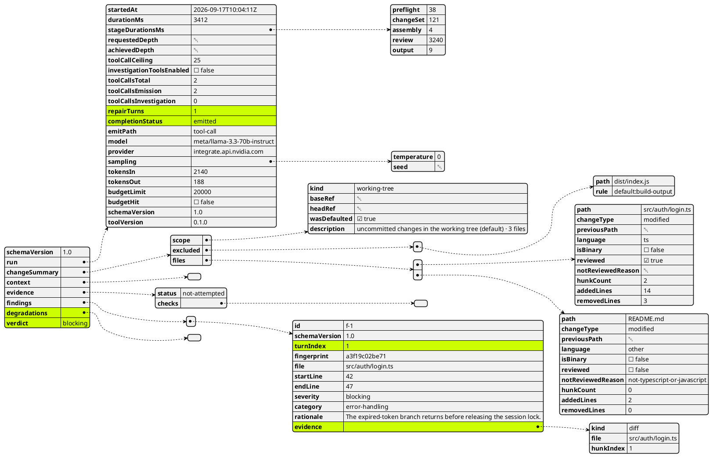

### 7.4 Where `RunMetadata`'s values come from

`RunMetadata` is **not** a copy of `ReviewOutcome`. It combines four sources, and for two completion statuses (`nothing-to-review` and `budget-exhausted`) the review step never runs, so no `ReviewOutcome` exists at all.

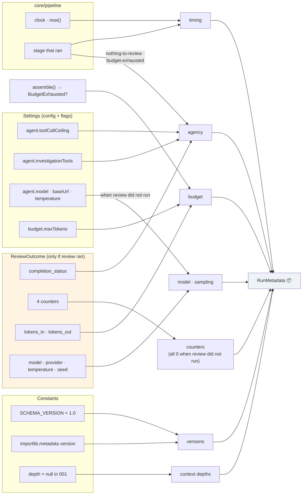

The field-by-field mapping from `ReviewOutcome` is written once, in `build_report()` (🟡).

### 7.5 From outcome to exit code

The verdict is computed in core (`compute_verdict`). The CLI only maps a verdict to an integer.

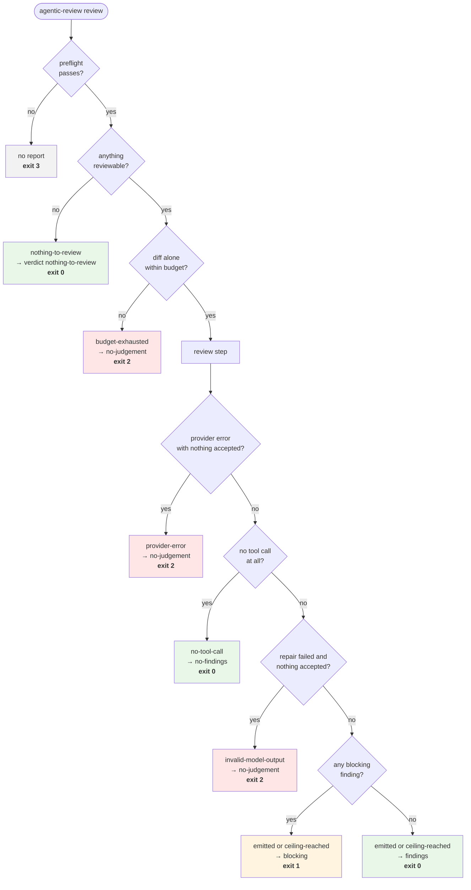

| Exit | Meaning | Verdicts |
|---|---|---|
| **0** | Reviewed, nothing blocking, **including degraded runs and nothing-to-review** | `findings` · `no-findings` · `nothing-to-review` |
| **1** | Reviewed, at least one `blocking` finding | `blocking` |
| **2** | **No judgement was made**, or an unexpected internal error after preflight | `no-judgement` |
| **3** | Could not start. No report is written | — |

A partial success (findings accepted, then the repair turn failed or the provider failed) is still a judgement: `emitted` plus a degradation, exit 0 or 1 (R-14, R-17).

### 7.6 Invariants the tests assert

```mermaid
flowchart LR
    I1["verdict == blocking<br/>⇔ some finding is blocking"]
    I2["verdict == no-judgement<br/>⇔ completionStatus ∈<br/>provider-error · invalid-model-output ·<br/>budget-exhausted"]
    I3["nothing-to-review<br/>⇒ findings == [ ]<br/>and no review duration"]
    I4["toolCallsTotal ==<br/>emission + investigation<br/>≤ toolCallCeiling"]
    I5["repairTurns ≤ 1"]
    I6["every finding.file ∈<br/>changeSummary.files<br/>where reviewed"]
    I7["every finding<br/>has evidence (AC-15)"]
```

---

## 8 · The internal seams 🟡

These are not user-facing. They are the Python boundaries that the structural constraints (FR-5.8, FR-10.2, FR-10.3c) depend on. Signatures may be refined. **The direction of each dependency, and what crosses each seam, may not** ([internal-seams.md](../../specs/001-walking-skeleton/contracts/internal-seams.md)).

### 8.1 Components and who may call whom

```plantuml
@startuml seams
skinparam shadowing false
skinparam componentStyle rectangle

actor Developer
component "cli/\n(translation only,\nnothing imports it)" as cli
component "core/pipeline\nrun_review()\n(the only owner of order)" as pipe
component "core/config\nSettings · Credential" as cfg
component "core/changeset\n(the only package running git)" as cs
component "core/assembly\n(the only budget owner)" as asm
component "core/agent\n(the only LangChain / LangGraph importer)" as agent #FFF4E0
component "core/output\ncompute_verdict · build_report\nrender_terminal · to_json" as out
component "core/findings\nvalidate_call · tool_schema\nfingerprint" as fnd #E8F7E8
interface "ReviewPort" as RP
database "git" as git
cloud "Model provider\n(OpenAI-compatible)" as prov

Developer --> cli : flags
cli --> pipe : ReviewRequest
pipe --> cli : PreflightFailure | Reviewed
pipe --> cfg : load
pipe --> cs : resolve · summarise · measure
cs --> git : subprocess
pipe --> asm : ChangeSet + line counts
pipe --> RP : review(ReviewContext)
RP -- agent
agent --> fnd : validate_call
agent --> prov : HTTPS
pipe --> out : build_report
@enduml
```

### 8.2 `run_review` — a fixed order, with two short-circuits

```mermaid
flowchart LR
    RQ(["ReviewRequest"]) --> PF["preflight<br/>repo · config · scope ·<br/>credential · base ref"]
    PF -->|"fails"| PFF(["PreflightFailure<br/>message already redacted"])
    PF --> CS["change set<br/>resolve()"]
    CS -->|"nothing reviewable"| OUT
    CS --> AS["assembly<br/>assemble()"]
    AS -->|"BudgetExhausted"| OUT
    AS -->|"ReviewContext"| RV["review<br/>ReviewPort.review()"]
    RV -->|"ReviewOutcome"| OUT["output<br/>build_report()"]
    OUT --> RD(["Reviewed<br/>report + ignored_settings"])

    style PFF fill:#ffe6e6
    style RD fill:#e8f7e8
```

After preflight **nothing raises** (FR-11.2). Every stage that runs is timed, and only stages that ran appear in `stageDurationsMs`.

### 8.3 The port types ✅

```plantuml
@startuml port
skinparam shadowing false
skinparam classAttributeIconSize 0
hide empty members

interface ReviewPort <<Protocol>> {
  review(context : ReviewContext) : ReviewOutcome
}
note right of ReviewPort
  Never raises for a failure the spec names.
  Those come back inside the outcome.
end note

class ReviewContext <<frozen dataclass>> {
  instructions : str
  material_statement : str
  diff_section : str
  estimated_tokens : int
  material : RunMaterial
}
class RunMaterial <<frozen dataclass>> {
  reviewed_files : Mapping[str, ReviewedFile]
  check_ids : frozenset[str]  [empty in 001]
  context_ranges : tuple[(file, start, end)]  [empty in 001]
  rule_ids : frozenset[str]  [empty in 001]
}
class ReviewedFile <<frozen dataclass>> {
  line_count : int
  hunk_count : int
}
class ReviewOutcome <<frozen dataclass>> {
  findings : tuple[Finding, ...]
  completion_status : CompletionStatus
  degradations : tuple[Degradation, ...]
  tool_calls_total : int
  tool_calls_emission : int
  tool_calls_investigation : int
  repair_turns : int
  tokens_in : int | None
  tokens_out : int | None
  model : str
  provider : str
  temperature : float
  seed : int | None
  notes : tuple[str, ...]
}
class BudgetExhausted <<planned>> {
  estimated_tokens : int
  limit : int
}

ReviewPort ..> ReviewContext
ReviewPort ..> ReviewOutcome
ReviewContext *-- RunMaterial
RunMaterial *-- "0..*" ReviewedFile
note bottom of BudgetExhausted
  assemble() returns
  ReviewContext | BudgetExhausted
end note
@enduml
```

`RunMaterial` is the answer to "what did this run actually show the model?" Validation checks every reference against it, which is what keeps a finding from citing a test that never ran.

---

## 9 · The command line 📦 🟡

### 9.1 Commands and streams

```mermaid
flowchart TD
    AR(["agentic-review"]) --> RV["review [OPTIONS]"]
    AR --> SC["schema<br/>prints report_schema() · exit 0<br/>needs no repo, config or credential"]
    AR --> VE["--version<br/>agentic-review X (report schema 1.0)"]
    AR -.-> RG["regression<br/>⚪ feature 003"]

    RV --> J{"--json ?"}
    J -->|"absent"| A1["stdout: terminal summary<br/>stderr: notices"]
    J -->|"bare, or -"| A2["stdout: exactly one JSON document<br/>stderr: summary + notices"]
    J -->|"PATH"| A3["file: the JSON report<br/>stdout: summary · stderr: notices"]
    RV -->|"preflight fails"| A4["stdout: nothing<br/>stderr: the message · exit 3"]

    style A2 fill:#eef3fa
    style A4 fill:#ffe6e6
```

| Option | Value | Default | Rule |
|---|---|---|---|
| `--scope` | `working-tree \| staged \| range` | config `scope`, else `working-tree` | `wasDefaulted` is true only when neither the flag nor the config named it |
| `--base REF` | git ref | — | Required for `range`, rejected otherwise |
| `--json [PATH]` | optional path | off | A bare `--json` is rewritten to `--json -` before Typer sees it (R-18) |
| `--config PATH` | file | `<repo>/.agentic-review.yml` | An explicit path that does not exist exits 3 |
| `--ceiling N` | int ≥ 1 | `agent.toolCallCeiling` | |

**Not offered in 001** (they are not accepted and then ignored; they do not exist): `--depth`, `--no-checks` (⚪ 002/004), `--investigate` (⚪ 005).

### 9.2 Preflight — the order is part of the contract

```plantuml
@startuml preflight
skinparam shadowing false
start
:Locate the git repository from cwd;
if (Inside a repository?) then (no)
  #FFE6E6:exit 3 · names the directory checked;
  stop
endif
:Load .agentic-review.yml (or --config);
if (Absent, or valid?) then (no)
  #FFE6E6:exit 3 · names the file, dotted field path, problem;
  stop
endif
:Check scope arguments;
if (range <=> --base?) then (no)
  #FFE6E6:exit 3 · names the option;
  stop
endif
:Resolve the credential;
if (Found outside the repository?) then (no)
  #FFE6E6:exit 3 · names AGENTIC_REVIEW_API_KEY and the user-level file path;
  stop
endif
if (scope is range?) then (yes)
  if (Base ref exists and HEAD is born?) then (no)
    #FFE6E6:exit 3 · names the ref;
    stop
  endif
endif
#E8F7E8:Preflight passed · from here nothing raises;
stop
@enduml
```

Every message says **what** is wrong, **where it was looked for**, and that **nothing was reviewed**. The model is never called.

### 9.3 What the terminal summary must say (FR-024)

```mermaid
flowchart TD
    L1["1 · scope line, with (default) if defaulted"] --> L2["2 · files reviewed, and files listed but not reviewed, with reasons"]
    L2 --> L3["3 · excluded paths with their rule<br/>(collapsed to a count beyond 10)"]
    L3 --> L4["4 · 'No checks were run in this build.'"]
    L4 --> L5["5 · 'No related context was gathered in this build.'"]
    L5 --> L6["6 · each finding: path:start-end · severity · category · rationale · evidence · rule"]
    L6 --> L7["7 · counts: blocking / important / nit"]
    L7 --> L8["8 · each degradation: source · code · detail"]
    L8 --> L9["9 · verdict line<br/>no-judgement says 'No review was performed', never 'no findings'"]
```

`render_terminal` and `to_json` take the **same** `ReviewReport`. Neither recomputes anything.

---

## 10 · Configuration and the credential 📦 🟡

### 10.1 The file

Every field is optional. Highlighted values are **placeholders** from SRS §8, not findings. No decision may be justified by one.

```plantuml
@startyaml config
#highlight "checks" / "tests" / "timeoutSeconds"
#highlight "agent" / "toolCallCeiling"
#highlight "agent" / "model"
#highlight "agent" / "requestTimeoutSeconds"
#highlight "budget" / "maxTokens"
schemaVersion: 1
scope: working-tree
exclude:
  - "**/*.generated.ts"
context:
  depth: 1
  node: node
checks:
  tests:
    command:
      - npm
      - test
    timeoutSeconds: 120
  typecheck:
    command:
      - npx
      - tsc
      - --noEmit
agent:
  toolCallCeiling: 25
  investigationTools: false
  model: meta/llama-3.3-70b-instruct
  baseUrl: https://integrate.api.nvidia.com/v1
  temperature: 0
  requestTimeoutSeconds: 60
budget:
  maxTokens: 20000
@endyaml
```

| Path | Type · default | Effect in 001 |
|---|---|---|
| `schemaVersion` | `Literal[1]` · `1` | Validated |
| `scope` | enum · `working-tree` | ✅ |
| `exclude` | `list[str]` · `[]` | ✅ **added to** the defaults, never replacing them |
| `context.depth` · `context.node` | `int ≥ 0` · `1`, `str` · `node` | ⚪ validated, ignored, reported |
| `checks.*.command` · `checks.*.timeoutSeconds` | non-empty `list[str]` · `int ≥ 1` | ⚪ validated, ignored, reported |
| `agent.toolCallCeiling` | `int ≥ 1` · `25` (TBD-8) | ✅ |
| `agent.investigationTools` | `bool` · `false` | ⚪ `true` is ignored and reported |
| `agent.model` · `agent.baseUrl` | `str` · pending S-1, NIM endpoint | ✅ |
| `agent.temperature` | `float` in `[0, 2]` · `0` | ✅ |
| `agent.requestTimeoutSeconds` | `int ≥ 1` · `60` (placeholder, D-9) | ✅ |
| `budget.maxTokens` | `int ≥ 1` · `20000` (TBD-3) | ✅ |

**There is no credential field.** `apiKey` anywhere in this file is an unknown field, so it exits 3. That is prevention by absence, not by instruction.

### 10.2 How a setting is resolved

```mermaid
flowchart LR
    D["Built-in defaults"] -->|"overridden per field<br/>never whole sections"| F[".agentic-review.yml"]
    F -->|"overridden by"| C["CLI flags"]
    C --> S(["Settings"])
    F -.->|"invalid value · unknown field ·<br/>duplicate key · YAML syntax error"| X3["exit 3<br/>file + dotted path<br/>(or line and column)"]
    F -.->|"setting for an unbuilt capability"| N["one stderr notice<br/>listing the dotted paths"]

    style X3 fill:#ffe6e6
    style N fill:#fff4e0
```

### 10.3 Exclusion rules

```mermaid
mindmap
  root((excluded paths))
    default:dependencies
      node_modules/**
      **/node_modules/**
      vendor/**
      bower_components/**
    default:build-output
      dist/** · build/** · out/**
      coverage/** · .next/** · .nuxt/** · .turbo/**
    default:generated
      **/*.generated.*
      **/*.gen.ts
      **/__generated__/**
    default:minified
      **/*.min.js · **/*.min.mjs
      **/*.map
    default:lockfile
      package-lock.json · yarn.lock
      pnpm-lock.yaml · bun.lockb
    config:pattern
      added from exclude, after the defaults
```

Defaults are applied first, so a path that matches both records the `default:` rule.

### 10.4 Finding the credential

```mermaid
flowchart TD
    S(["preflight step 4"]) --> E{"AGENTIC_REVIEW_API_KEY<br/>set?"}
    E -->|yes| OK(["Credential<br/>source: environment"])
    E -->|no| U["user-level file<br/>Windows: %APPDATA%/agentic-review/credentials.yml<br/>else: $XDG_CONFIG_HOME/… or ~/.config/…"]
    U --> IN{"resolves inside<br/>the repository?"}
    IN -->|yes| R1["refused · exit 3<br/>FR-1.3a forbids reading it from the repo"]
    IN -->|no| EX{"file exists with apiKey?"}
    EX -->|yes| OK2(["Credential<br/>source: user-config"])
    EX -->|no| R2["exit 3<br/>names both locations"]

    style OK fill:#e8f7e8
    style OK2 fill:#e8f7e8
    style R1 fill:#ffe6e6
    style R2 fill:#ffe6e6
```

`Credential` is an opaque wrapper with a masked `__repr__` and `__str__`. It records where it was found (the variable name or the file path), never the value. The value never appears in stdout, stderr, the report, a log record, or a message shown to the user (SC-007). The tests plant a canary value to check this.

---

## 11 · Designed v1 contracts owned by later features ⚪

### 11.1 The related-context provider 🔒 — feature 004

```plantuml
@startuml context-provider
skinparam shadowing false
skinparam classAttributeIconSize 0
hide empty members

interface RelatedContextProvider <<Protocol, frozen>> {
  max_depth : int
  resolve(req : RelatedContextRequest) : RelatedContextResult
}
class RelatedContextRequest <<frozen dataclass>> {
  change_set : ChangeSet
  depth : int  [requested, never guaranteed]
  retrieval_cap : RetrievalCap  [a guard, not a budget]
}
class RelatedContextResult <<frozen dataclass>> {
  units : tuple[ContextUnit, ...]  [by distance, then relevance]
  achieved_depth : int
  degraded : tuple[Degradation, ...]  [() means clean]
}
class ContextUnit <<frozen dataclass>> {
  file : str
  range : (int, int)
  source : str
  relation : imports | calls | imported-by | called-by
  distance : int
  symbol : str | None
}
class ParserContextProvider <<v1 · depths 0-1>>
class IndexContextProvider <<v2 · deeper>>
class "build_provider(cfg, repo)" as factory <<the only code that names an implementation>>

RelatedContextProvider ..> RelatedContextRequest
RelatedContextProvider ..> RelatedContextResult
RelatedContextResult *-- "0..*" ContextUnit
RelatedContextProvider <|.. ParserContextProvider
RelatedContextProvider <|.. IndexContextProvider
factory ..> ParserContextProvider : constructs
factory ..> IndexContextProvider : constructs (v2)

note bottom of RelatedContextProvider
  FR-2.6e: no consumer branches on which
  implementation served a request.
  Synchronous on purpose.
end note
@enduml
```

In the report, a context unit appears **without `source`**, plus `included` and `evictedReason?` (02 §3.7), so CF-4's budget decisions can be audited.

### 11.2 The resolver sidecar protocol ♻️ — feature 004

The one contract with no external consumer. JSON Lines over stdio, three methods, and adding a fourth should need an argument.

```mermaid
sequenceDiagram
    autonumber
    participant CF2 as CF-2 (parser provider)
    participant N as Node resolver sidecar

    Note over CF2,N: spawned lazily, at most once per review
    CF2->>N: {"id":0,"method":"hello","params":{"protocol":1}}
    N-->>CF2: {"id":0,"ok":true,"result":{"protocol":1,"typescript":"5.4.5"}}
    alt protocol mismatch
        Note over CF2: fail loudly: a broken install, not a degraded environment
    end
    CF2->>N: resolve · ONE call with every specifier in the change set
    N-->>CF2: resolved[] with path, or path null plus reason (builtin, unresolvable)
    CF2->>N: {"id":2,"method":"shutdown"}
    N-->>CF2: {"id":2,"ok":true}
    Note over CF2,N: any other failure: heuristic fallback,<br/>degradation unresolvable-imports, review completes (FR-2.6g)
```

### 11.3 Check invocation and results 🔒 — feature 002

Checks run as `subprocess.run(argv, cwd=repo_root, shell=False, timeout=…)`: an argv list, never a shell string. **`status` and `outcome` are two fields on purpose.** That is the whole of AC-7: a check that was skipped has no outcome, and "no findings" must never mean both "clean" and "we never looked".

```mermaid
flowchart LR
    CMD(["check: tests or typecheck<br/>argv from manifest or config"]) --> ST{"status"}
    ST -->|ran| OUTC{"outcome"}
    OUTC --> P["passed"]
    OUTC --> F["failed"]
    OUTC --> UK["unknown"]
    ST -->|skipped| NO1["no outcome<br/>reason says why"]
    ST -->|errored| NO2["no outcome<br/>reason says what"]
    ST -->|timed-out| NO3["no outcome<br/>remaining checks skipped<br/>execution-timed-out"]

    style F fill:#ffe6e6
    style P fill:#e8f7e8
    style NO1 fill:#f2f2f2
    style NO2 fill:#f2f2f2
    style NO3 fill:#fff4e0
```

```plantuml
@startuml evidence-v1
skinparam shadowing false
skinparam classAttributeIconSize 0
hide empty members

class EvidenceRecord <<published, widened in 002>> {
  status : completed | timed-out | not-attempted
  toolchain : {package_manager, command_source: manifest | config}
  checks : list[CheckResult]
  total_duration_ms : int
}
class CheckResult {
  id : tests | typecheck
  command : list[str]  [argv]
  status : ran | skipped | errored | timed-out
  outcome : passed | failed | unknown  [only when ran]
  reason : str | None
  exit_code : int | None
  duration_ms : int
  raw_output : str  [report only, never sent to the model]
  distilled : DistilledOutput
}
class DistilledOutput <<what the model sees>> {
  failing_tests : list[{name, message, file?, line?}]
  diagnostics : list[{file, line, code, message}]
  stack_frames : list[{file, line, symbol?}]  [change-set files only]
  omitted_counts : {failing_tests, diagnostics, frames}
}
EvidenceRecord *-- "0..*" CheckResult
CheckResult *-- "1" DistilledOutput
@enduml
```

### 11.4 The tool registry — feature 005

| Tool | Read-only | Counts against the ceiling | v1 default |
|---|---|---|---|
| `emit_finding` | — | ✅ | **bound** |
| `read_file` | ✅ | ✅ | defined, not bound |
| `get_outline` | ✅ | ✅ | defined, not bound |
| `search_repo` | ✅ | ✅ | defined, not bound |

Each entry must be read-only, free of side effects, and unable to trigger check execution (FR-4.6). They are bound only with `investigationTools: true`, which FR-5.7b gates on a recorded baseline.

---

## 12 · Versioning

```mermaid
flowchart TD
    CH(["a change to a 📦 contract"]) --> Q1{"removes or renames a field,<br/>removes an enum value,<br/>or changes a meaning?"}
    Q1 -->|yes| MAJ["<b>major</b> · breaks consumers<br/>a changed meaning breaks them silently"]
    Q1 -->|no| Q2{"adds an optional field<br/>or an enum value?"}
    Q2 -->|yes| MIN["<b>minor</b><br/>safe only because consumers<br/>must ignore unknown fields"]
    Q2 -->|no| Q3{"relaxes an existing constraint?<br/>(maxItems 0, a const)"}
    Q3 -->|yes| OPEN["⚠️ not covered by the rules<br/>see §13.1"]
    Q3 -->|no| NONE["no bump"]

    style MAJ fill:#ffe6e6
    style MIN fill:#e8f7e8
    style OPEN fill:#fff4e0
```

| Version stream | Current | Where it is set | Rule |
|---|---|---|---|
| Report and finding schema | `1.0` | `SCHEMA_VERSION` in [schema.py](../../src/agentic_review/core/findings/schema.py) | Hand-set. A patch release must not renumber it |
| Report schema `$id` | `https://agentic-review.invalid/schemas/review-report/1.0.json` | `REPORT_SCHEMA_ID` | Carries the version |
| Config file | `schemaVersion: 1` | `Settings` | |
| Fingerprint algorithm | `fp1` | `ALGORITHM` in [fingerprint.py](../../src/agentic_review/core/findings/fingerprint.py) | `fp2` arrives with feature 004's enclosing symbol |
| Resolver protocol | `1` | handshake | ♻️ free, never published |
| Tool version | package version | `importlib.metadata` | Independent of the schema |

---

## 13 · Open points found while drawing this

These were found by putting the documents and the code side by side. None of them is decided here. Each one belongs in the document named.

### 13.1 Widening an empty section is not an additive change

Schema 1.0 constrains `context` and `evidence.checks` to `maxItems: 0`, and `evidence.status` to the constant `not-attempted`. [R-22](../../specs/001-walking-skeleton/research.md#r-22--schema-versioning-and-the-empty-sections) plans to widen these in features 002 and 004 "with a minor bump". Relaxing a constraint is not adding a field. A consumer that validates reports against the pinned 1.0 schema will **reject** a 1.1 report that contains a check, and "ignore unknown fields" does not help, because the field is not unknown.

There are two ways out:
- **State the rule:** add "a minor version may relax a constraint" to 02 §4 and the published schema description.
- **Type the items now:** give `checks` and `context` their real item types in 1.0 and keep them empty by behaviour instead of by schema.

This belongs in 02 §4 and R-22, and it should be settled before anyone consumes reports.

### 13.2 The code has moved ahead of the `emit_finding` contract

| | [contracts/emit-finding.md](../../specs/001-walking-skeleton/contracts/emit-finding.md) | Code |
|---|---|---|
| Tool description | "Report one review finding. This is the ONLY way a finding is recorded; prose is discarded." | `TOOL_DESCRIPTION` also says to call once per problem, and that each call is validated against the change and a rejected call records nothing |
| Hunk cited in a file with no hunks | not listed | `evidence.hunkIndex: '<file>' has no hunks; omit hunkIndex` |
| Field descriptions | not shown | every property and arm carries model-facing instructions, and a test enforces it |

The code's versions are better: they tell the model more. The contract should be updated to match, because this is the one contract whose other side cannot be changed together with our code.

### 13.3 `ReviewOutcome` and `RunMetadata` overlap by design

The two share nine fields (§7.4). They are kept apart because `RunMetadata` is published and flat, while `ReviewOutcome` is an internal port type that does not exist for two of the seven completion statuses. The mapping is written once, in `build_report()`. Two small tidy-ups are worth making when that function is written:
- `ReviewOutcome` can carry `sampling: Sampling` instead of `temperature` and `seed`.
- `tool_calls_total` can become a property computed from the other two counters, which makes invariant 4 true by construction.

### 13.4 `context_ranges` is an unnamed tuple

`RunMaterial.context_ranges : tuple[tuple[str, int, int], ...]` is empty until feature 004. When 004 fills it, a small `NamedTuple` makes the reference check readable. It should not share a class with `ContextEvidence`: that would nest a `range` object inside the tool schema and change what the model sees.
