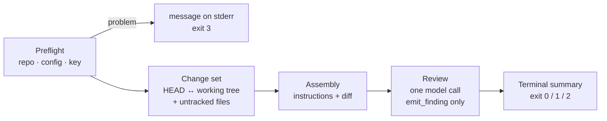

# Operation Guidelines

How to install, configure, run, and troubleshoot `agentic-review`, and how to work on it.

**Written against:** branch `001-walking-skeleton`, feature 001 through User Story 1 (the MVP). This guide describes
what the code **does today**, not what the specification promises. Sections for later user stories are marked
*not yet available*. Update this file when a story lands.

**Authority:** this is an operating guide, not a normative document. Behaviour is defined by
[`agentic-code-review-srs-v1.md`](./agentic-code-review-srs-v1.md); command-line contracts by
[`specs/001-walking-skeleton/contracts/`](../specs/001-walking-skeleton/contracts/). Where this guide disagrees
with them, this guide is wrong.

---

## Contents

1. [What works today](#1-what-works-today)
2. [Install](#2-install)
3. [Set up the provider key](#3-set-up-the-provider-key)
4. [Run a review](#4-run-a-review)
5. [Choose the model](#5-choose-the-model)
6. [Configure a repository](#6-configure-a-repository)
7. [Read the result](#7-read-the-result)
8. [Troubleshooting](#8-troubleshooting)
9. [Develop and verify](#9-develop-and-verify)
10. [Run the S-1 probe](#10-run-the-s-1-probe)
11. [Not yet available](#11-not-yet-available)

---

## 1. What works today



| Available | Not yet |
|---|---|
| `agentic-review review` with no options | `--scope`, `--base`, `--config`, `--ceiling`, `--json` |
| Reviewing **uncommitted** changes (staged + unstaged + untracked) | Staged-only and range scopes |
| Default and configured exclusions | "Nothing to review" short-circuit |
| One model pass; findings only through `emit_finding`, validated | Repair turn, tool-call ceiling, diff-size refusal |
| Terminal summary, verdict, exit codes 0 / 1 / 2 / 3 | `schema` and `--version` commands |
| Preflight: repository, config file, credential | A report when the **provider fails** (today it crashes) |

---

## 2. Install

### Prerequisites

| Tool | Version | Check |
|---|---|---|
| git | any recent | `git --version` |
| uv | ≥ 0.11 | `uv --version` |
| CPython | 3.12 or 3.13 | `uv python list --only-installed` |

Node and `tree-sitter` are **not** needed yet.

### Set up the environment

From the project root:

```powershell
uv python install 3.12   # only if no 3.12 is listed
uv sync                  # creates .venv from uv.lock, dev dependencies included
```

`uv sync` installs the exact versions in `uv.lock`. They are also recorded in
[`technical_stack.md` §7](./technical_stack.md#7-to-verify-before-pinning).

> **Windows note.** If a stray `VIRTUAL_ENV` points somewhere else, uv prints
> `VIRTUAL_ENV=... does not match the project environment path .venv and will be ignored`. This is harmless: `uv run`
> uses the project's `.venv`.

---

## 3. Set up the provider key

The tool needs an NVIDIA NIM API key for any review that reaches the model. Get one at
[build.nvidia.com](https://build.nvidia.com). The key is read from **two places only**, in this order:

| Order | Source | Location |
|---|---|---|
| 1 | Environment variable | `AGENTIC_REVIEW_API_KEY` |
| 2 | User-level file | Windows `%APPDATA%\agentic-review\credentials.yml` · Linux/macOS `$XDG_CONFIG_HOME/agentic-review/credentials.yml`, else `~/.config/agentic-review/credentials.yml` |

The repository configuration file has **no** key field, and a user-level file that sits inside the reviewed
repository is refused (FR-1.3a).

### Option A: a `.env` file loaded by uv (recommended for development)

```powershell
Copy-Item .env.example .env
# edit .env and set AGENTIC_REVIEW_API_KEY=nvapi-...
uv run --env-file .env agentic-review review
```

`.env` is git-ignored; `.env.example` is committed. The tool itself never reads `.env`: `uv --env-file` puts its
values into the environment, and the tool reads the environment.

### Option B: the current shell

```powershell
$env:AGENTIC_REVIEW_API_KEY = "nvapi-..."      # PowerShell, this session only
```

```bash
export AGENTIC_REVIEW_API_KEY="nvapi-..."      # bash
```

### Option C: the user-level file (works from any directory, any shell)

```powershell
New-Item -ItemType Directory -Force "$env:APPDATA\agentic-review" | Out-Null
Set-Content -Encoding utf8 "$env:APPDATA\agentic-review\credentials.yml" "apiKey: nvapi-..."
```

### Keep the key safe

- Never commit a key, and never put it in `.agentic-review.yml` (an `apiKey` field there is rejected).
- The tool never prints the key. Error messages pass through redaction, and the test suite checks every output for a
  planted fake key.
- If a key is ever pasted into a chat, an issue, a log or a commit, **revoke it** at build.nvidia.com and create a new one.

---

## 4. Run a review

A review needs:

- a git repository with **at least one commit** or an unborn `HEAD` (both work),
- **uncommitted changes** to at least one `.ts`, `.mts`, `.cts`, `.tsx`, `.js`, `.mjs`, `.cjs` or `.jsx` file,
- a key (section 3) and a model that is still served (section 5).

### Review this project's own working tree

```powershell
uv run --env-file .env agentic-review review
```

### Review another repository

Run from **inside** that repository, and point uv at this project. The paths below are this machine's; adjust them.

```powershell
$AR = "D:\Projects\DEPI-industry-project\Pull request Reviewer"
cd C:\path\to\some-typescript-repo
uv run --project $AR --env-file "$AR\.env" agentic-review review
```

```bash
AR="/d/Projects/DEPI-industry-project/Pull request Reviewer"
cd /path/to/some-typescript-repo
uv run --project "$AR" --env-file "$AR/.env" agentic-review review
```

Running from any subdirectory of the repository works; all paths in the output are repository-relative.

### Try it on the demo repository (recommended first run)

`scripts/make_review_demo.py` builds a small repository with a clean first commit and uncommitted edits that
plant six known defects: a missing `await`, an off-by-one, a removed guard, SQL injection, swallowed errors and an
unused variable. The change also contains an excluded build file, a Markdown file, a deleted file and an untracked
new file, so every part of the summary shows up.

```powershell
$AR = "D:\Projects\DEPI-industry-project\Pull request Reviewer"
uv run --project $AR python "$AR\scripts\make_review_demo.py"     # creates ..\review-demo next to the project
cd "$AR\..\review-demo"
uv run --project $AR --env-file "$AR\.env" agentic-review review
```

Compare the findings with `PLANTED_DEFECTS.md` in the demo repository. Rebuild it with `--force`, or put it elsewhere
with `--dest`. **Keep it outside this project's directory:** git lists a nested repository as an untracked directory,
which the current build does not handle.

### Make a minimal demo repository by hand

```powershell
mkdir review-demo; cd review-demo
git init -q -b main
New-Item -ItemType Directory src | Out-Null
Set-Content -Encoding utf8 src\user.ts @'
export async function loadUser(id: string) {
  try {
    return await fetchUser(id);
  } catch (error) {
    return null;
  }
}
'@
git add -A; git commit -qm init
# plant a defect: without await, a rejected promise escapes the try/catch
(Get-Content src\user.ts) -replace 'return await fetchUser', 'return fetchUser' | Set-Content -Encoding utf8 src\user.ts
uv run --project $AR --env-file "$AR\.env" agentic-review review
```

### Use it in a script

The exit code is the contract; the terminal text is not.

```powershell
uv run --env-file .env agentic-review review
switch ($LASTEXITCODE) {
  0 { "reviewed, nothing blocking" }
  1 { "blocking finding" }
  2 { "no judgement made" }
  3 { "could not start" }
}
```

---

## 5. Choose the model

### Where the default comes from

The default model is a single constant, labelled as a placeholder until test S-1 chooses one:

- [`src/agentic_review/core/config/settings.py`](../src/agentic_review/core/config/settings.py): `DEFAULT_MODEL`
  and `DEFAULT_BASE_URL`, used as the defaults of `AgentSettings.model` and `AgentSettings.base_url`.

Nothing else in the product chooses a model. The same name also appears in tests that assert the default, in
the S-1 script's usage example, and in the feature 001 contracts and research notes.

### Override it without changing code

Put `.agentic-review.yml` at the **root of the repository being reviewed**:

```yaml
agent:
  model: "nvidia/llama-3.1-nemotron-70b-instruct"   # any model your endpoint serves that supports tool calling
```

Other `agent` fields keep their defaults (fields are merged one by one). There is no command-line flag or
environment variable for the model yet.

### See which models the endpoint lists

The model list is public; this sends no key:

```powershell
curl.exe -s https://integrate.api.nvidia.com/v1/models | uv run python -c "import sys,json; print('\n'.join(sorted(m['id'] for m in json.load(sys.stdin)['data'])))"
```

A listed model is not necessarily one that **calls tools**. The tool depends on the model calling `emit_finding`.
A model that never calls it produces `no-tool-call` on every run. That is exactly what S-1 measures (section 10).

### When a model is retired

NVIDIA retires models. A retired model fails with:

```
APIStatusError: Error code: 410 - {... 'title': 'Gone', ... "The model '<name>' has reached its end of life ..."}
```

Set `agent.model` to a served model (above). Until User Story 2 lands, this failure is a traceback, not a report.

### Use another OpenAI-compatible provider

```yaml
agent:
  baseUrl: "https://api.example.com/v1"
  model: "provider/model-name"
```

The key is still read from `AGENTIC_REVIEW_API_KEY`.

---

## 6. Configure a repository

`.agentic-review.yml` at the repository root. Every field is optional. A misspelt field, an invalid value, a
duplicate key or a YAML syntax error **stops the run** with exit 3 and names the field. It never falls back to a
default silently.

```yaml
schemaVersion: 1

scope: working-tree            # only working-tree works today; staged and range arrive with User Story 4
exclude:                       # ADDED to the default list, never replacing it
  - "**/*.stories.tsx"
  - "src/legacy/**"

agent:
  model: "nvidia/llama-3.1-nemotron-70b-instruct"
  baseUrl: "https://integrate.api.nvidia.com/v1"
  temperature: 0               # 0 to 2
  requestTimeoutSeconds: 60    # PLACEHOLDER
  toolCallCeiling: 25          # PLACEHOLDER (TBD-8); validated, not enforced until User Story 2
  investigationTools: false    # true is accepted but has no effect until feature 005

budget:
  maxTokens: 20000             # PLACEHOLDER (TBD-3); validated, not enforced until User Story 2

context:                       # validated, no effect until feature 004
  depth: 1
  node: node

checks:                        # validated, no effect until feature 002
  tests:
    command: ["npm", "test"]
    timeoutSeconds: 120
  typecheck:
    command: ["npx", "tsc", "--noEmit"]
```

### Exclusion patterns

Glob patterns over repository-relative paths with forward slashes:

| Pattern | Meaning |
|---|---|
| `**` | zero or more whole path segments |
| `*`, `?` | any characters / one character, within one segment |
| no `/` in the pattern | matches at any depth (`yarn.lock` matches `packages/a/yarn.lock`) |

Default exclusions, always applied first:

| Rule shown in output | Patterns |
|---|---|
| `default:dependencies` | `node_modules/**`, `**/node_modules/**`, `vendor/**`, `bower_components/**` |
| `default:build-output` | `dist/**`, `build/**`, `out/**`, `coverage/**`, `.next/**`, `.nuxt/**`, `.turbo/**` |
| `default:generated` | `**/*.generated.*`, `**/*.gen.ts`, `**/__generated__/**` |
| `default:minified` | `**/*.min.js`, `**/*.min.mjs`, `**/*.map` |
| `default:lockfile` | `package-lock.json`, `yarn.lock`, `pnpm-lock.yaml`, `bun.lockb` |

A configured pattern is shown as `config:<pattern>`. If a path matches both, the default rule is shown.

---

## 7. Read the result

### The terminal summary

In this order:

1. **Scope**: what was reviewed, and `(default)` when no flag or config chose it.
2. **Reviewed** files, then files **listed, not reviewed**, each with a reason: deleted, binary, or not TypeScript/JavaScript.
3. **Excluded** paths with the rule that excluded them (collapsed to a count beyond 10).
4. `No checks were run in this build.` and `No related context was gathered in this build.` These are true
   statements about this build, not errors.
5. Each **finding**: `path:start-end  severity  category`, then the rationale, then the evidence
   (`diff hunk i`, or `unverified: <reason>`).
6. **Counts**: `N blocking / N important / N nit`.
7. **Degradations**: anything that went wrong, as `[source] code: detail`.
8. The **verdict**.

### Verdicts and exit codes

| Verdict | Meaning | Exit |
|---|---|---|
| `findings` | Reviewed; findings, none blocking | 0 |
| `no-findings` | Reviewed; nothing accepted. **Check the degradations**: see below | 0 |
| `blocking` | At least one `blocking` finding | 1 |
| `no-judgement` | No review was performed (for example, every call was rejected) | 2 |
| — | Could not start: not a repository, bad config, no key | 3 |

### Degradations you can see today

| Code | Meaning | What to do |
|---|---|---|
| `no-tool-call` | The model answered without calling `emit_finding`. **This build cannot tell "nothing to report" from "did not use the tool"**, so zero findings is never a clean bill of health | Treat as unreviewed. If it happens on every run, the model may not support tool calling: try another (section 5) |
| `invalid-model-output` | Some `emit_finding` calls failed validation (wrong field, unknown file, line past the end of the file, citing checks or rules). If none was accepted, the verdict is `no-judgement` | Usually a model quality issue. There is no repair turn until User Story 2 |

---

## 8. Troubleshooting

| You see | Cause | Fix |
|---|---|---|
| `... is not inside a git repository.` (exit 3) | Run outside a repository | `cd` into the repository |
| `git was not found on PATH` (exit 3) | git not installed or not on `PATH` | Install git |
| `No provider credential was found. Looked in: ...` (exit 3) | No key in the environment or the user-level file | Section 3. With `.env`, remember `--env-file` |
| `The user-level credential file ... is inside the repository` (exit 3) | `APPDATA` or `XDG_CONFIG_HOME` points inside the reviewed repository | Move the file, or use the environment variable |
| `Error in .agentic-review.yml` / `  agent.toolCallCeling: Extra inputs are not permitted` (exit 3) | Misspelt or unknown field | Fix the named field |
| `... duplicate key (line N, column M)` (exit 3) | The same key twice in the config file | Remove one |
| Traceback ending `APIStatusError: Error code: 410 ... end of life` | The configured model was retired | Set `agent.model` (section 5) |
| Traceback ending `AuthenticationError: Error code: 401` or `403` | Key invalid, revoked or without access to that model | Check or recreate the key |
| Traceback ending `APIConnectionError` / `APITimeoutError` | No network, proxy, or endpoint down | Check connectivity and `agent.baseUrl` |
| Traceback ending `RateLimitError: Error code: 429` | Free-tier rate limit | Wait and retry |
| Traceback ending `NotImplementedError: the staged scope arrives with User Story 4` | `scope: staged` or `range` in the config | Remove `scope` or set `working-tree` |
| `Verdict: no findings were accepted.` with a `no-tool-call` degradation | Model did not call the tool | Section 7; try another model |
| Review ran but a file is missing from "Reviewed" | Excluded, deleted, binary, or not TS/JS | Read the "listed, not reviewed" and "Excluded" sections |
| A clean change still calls the model | "Nothing to review" is not implemented yet | Expected until User Story 4 |

> **Every traceback above is a known gap, not the intended behaviour.** The specification requires a report with exit 2
> for provider failures (FR-020). It arrives with User Story 2. Tracebacks never contain the key.

---

## 9. Develop and verify

### The offline suite

No key and no network are needed. The network is blocked by `tests/conftest.py`, and the model is a scripted
stand-in that drives the real review graph.

```powershell
uv run pytest                                  # everything
uv run pytest tests/unit/changeset -q          # one package
uv run pytest -k "scenario2" -q                # by name
uv run lint-imports                            # structural contracts 1, 2, 3, 6
```

| Suite | Proves |
|---|---|
| `tests/structural/` | Rich, git and LangChain/LangGraph stay in their packages; nothing imports `cli/`; the layers hold |
| `tests/unit/findings/` | Finding shape, the tool and report schemas are generated, the fixed rejection reasons, fingerprint |
| `tests/unit/config/` | Defaults, per-field merge, unknown and duplicate keys, credential lookup, redaction |
| `tests/unit/changeset/` | Diff parsing, hunks verbatim, renames, binary and untracked files, exclusions |
| `tests/unit/assembly/`, `agent/`, `output/`, `cli/` | Prompt content, tool binding (no `tool_choice`), graph path, verdicts, rendering |
| `tests/integration/test_story1_*` | User Story 1 end to end through `run_review` and the CLI |

### Structural rules the checks enforce

| Rule | Enforced by |
|---|---|
| Only `core/output/` and `cli/` import `rich` | import-linter contract 1 |
| Only `core/changeset/` runs git | contract 2 + `tests/structural/test_git_confinement.py` |
| Only `core/agent/` imports `langchain_*`, `langgraph`, `openai` | contract 3 |
| `cli > pipeline > agent > assembly \| output > changeset > findings \| config`; nothing imports `cli` | contract 6 |

If `lint-imports` reports a broken contract, move the import. Do not relax the contract: each one protects a
requirement (FR-5.8, FR-10.2, AC-10).

### Writing a test with the stand-in model

```python
from agentic_review.core.agent.build import build_review_port
from agentic_review.core.pipeline.run import ReviewRequest, Reviewed, run_review
from tests.support.repo_builder import RepoBuilder
from tests.support.scripted_chat_model import ScriptedChatModel, ai_reply, finding_call

def test_example(tmp_path, canary_env):
    repo = RepoBuilder(tmp_path / "repo").init()
    repo.write("src/app.ts", "export const a = 1;\n").commit()
    repo.write("src/app.ts", "export const a = 2;\n")
    model = ScriptedChatModel([ai_reply([finding_call(severity="blocking", startLine=1, endLine=1)])])
    result = run_review(
        ReviewRequest(cwd=repo.root),
        env=canary_env,
        port_factory=lambda settings, key: build_review_port(settings, key, chat_model=model),
    )
    assert isinstance(result, Reviewed) and result.report.verdict == "blocking"
```

Also apply `tests/support/report_assertions.py` (`assert_valid_report`, `assert_invariants`, `assert_no_canary`,
`assert_stage_durations`) to every report an integration test produces.

### Explore the flow interactively

[`notebooks/explore_review_flow.ipynb`](../notebooks/explore_review_flow.ipynb) runs each stage of a review on the
demo repository separately, so its inputs and outputs can be inspected and changed: change set, assembled prompt,
tool schema, validation of hand-written tool calls, one raw model reply, the review step's transcript, the whole
pipeline, a score against the planted defects, a tool-calling check, a model comparison, prompt variants, and the
scripted stand-in model. Open it in VS Code or Jupyter with this project's `.venv` as the kernel (`uv sync` installs
`ipykernel`), and set the server, model and demo path in its first cell. It never changes the tool's behaviour.

### CI

`.github/workflows/ci.yml` runs `uv sync`, `uv run lint-imports` and `uv run pytest` on Ubuntu and Windows, Python
3.12 and 3.13, on every push and pull request. It uses no secrets.

### Workflow for the next piece of work

| Step | Where |
|---|---|
| Task list, with what is done | [`specs/001-walking-skeleton/tasks.md`](../specs/001-walking-skeleton/tasks.md) |
| Next phase | Phase 4, User Story 2: provider errors, repair turn, ceiling, budget refusal |
| Continue implementation | `/speckit-implement` |
| Rules every change follows | [`.specify/memory/constitution.md`](../.specify/memory/constitution.md) |
| Commit messages | Conventional Commits with a scope, for example `feat(review): ...`; see `.claude/skills/git-mentor/` |

### Change a dependency

Edit `pyproject.toml`, run `uv lock` and `uv sync`, then record the new exact version in
[`technical_stack.md` §7](./technical_stack.md#7-to-verify-before-pinning) in the same commit.

---

## 10. Run the S-1 probe

S-1 asks: does the chosen model call `emit_finding` reliably? It decides the default model. It needs a key and the
network, so it is **not** part of pytest.

```powershell
uv run --env-file .env python scripts/s1_tool_calling_probe.py --runs 50 --model nvidia/llama-3.1-nemotron-70b-instruct
uv run --env-file .env python scripts/s1_tool_calling_probe.py --runs 10 --model model/a --model model/b   # compare
```

It builds a fixture repository with one planted defect (a missing `await` inside `try/catch`), runs the real
assembly and review step, and writes `specs/001-walking-skeleton/s1-results.md`. For each model it records runs,
errors, no-call runs, calls, valid findings, schema and reference rejections, invalid JSON, tokens and latency.

**It sets no pass mark.** Read the figures, choose the default model, then:

1. Update `DEFAULT_MODEL` in `src/agentic_review/core/config/settings.py` and the tests that assert it.
2. Record a one-line summary in [`technical_stack.md` §7](./technical_stack.md#7-to-verify-before-pinning).
3. Decide whether FR-5.6b's structured-output fallback must be pulled forward.

Each run is a real, rate-limited API call; 50 runs per model take a while on the free tier.

---

## 11. Not yet available

| Capability | Arrives in |
|---|---|
| Provider failures produce a report and exit 2, instead of a traceback | Feature 001, User Story 2 |
| Repair turn (one retry for rejected findings), tool-call ceiling, `--ceiling` | Feature 001, User Story 2 |
| Refusing a diff larger than `budget.maxTokens` | Feature 001, User Story 2 |
| `--config PATH`, `--base REF`, range-base check | Feature 001, User Story 3 |
| `--scope staged \| range`, "nothing to review" | Feature 001, User Story 4 |
| `--json [PATH]`, `agentic-review schema`, `--version` | Feature 001, User Story 5 |
| Notice listing ignored config settings; clean handling of internal errors | Feature 001, Polish |
| Running the project's tests and type-check as evidence | Feature 002 |
| Pattern rules, `regression` command, catch rate | Feature 003 |
| Parsing and related context (`--depth`), resolver sidecar | Feature 004 |
| Investigation tools (`--investigate`) | Feature 005 |
