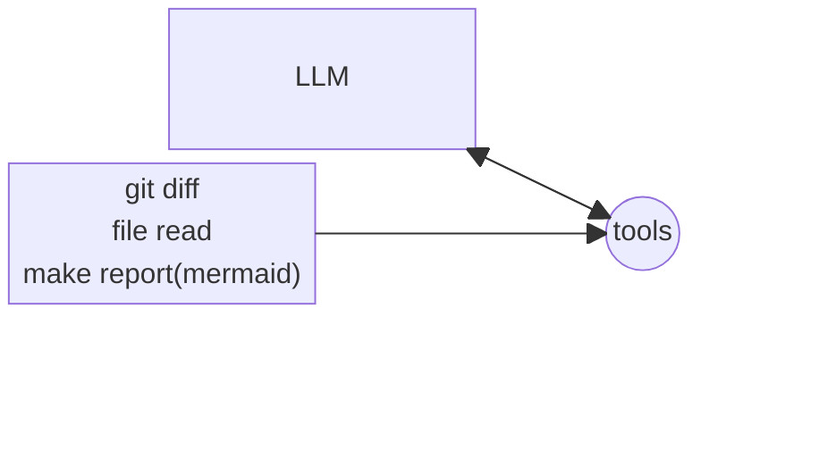
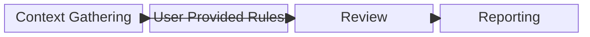
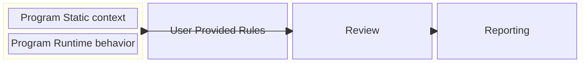

# System Design — Block Diagram View

This version uses Mermaid **Block Diagrams** rather than Flowcharts. The component set, hierarchy, labels, and relationships are preserved from the source design; the change is only the visual representation and layout.

## Level 1

## Level 2

## Level 3

## Level 4

```mermaid
block-beta
    columns 6

    block:CONTEXT:2
        columns 2

        block:STATIC:2
            columns 3
            DIFF["Git Change diff"]
            AST["AST Parsers"]
            UNIT["Unit test cases"]
        end

        block:RUNTIME:2
            columns 2
            CHAOS["Integration / chaos testing (pre-written test cases)"]
            OTHER["Other Dynamic behavior"]
        end
    end

    space:1

    RULES["User Provided Rules"]:2

    space:1

    block:REVIEWER:3
        columns 3
        MATCH["Rule Matching"]:3
        LLM_CALL["LLM CALL"]:3
    end

    block:REPORTER:6
        columns 4
        TEXT["Text Reporter"]
        JSON["JSON reporter"]
        PR["Github PR Comments"]
        VISUAL["Visual Reporting"]
    end

    CONTEXT --> RULES
    CONTEXT --> REVIEWER
    RULES --> REVIEWER
    LLM_CALL --> REPORTER

    classDef rules fill:#ffffff,stroke:#6b6b6b,stroke-width:1.5px,color:#111111;
    classDef static fill:#d5e8d4,stroke:#82b366,stroke-width:1.5px,color:#111111;
    classDef runtime fill:#fff2cc,stroke:#d6b656,stroke-width:1.5px,color:#111111;
    classDef green fill:#008a00,stroke:#005700,stroke-width:1.5px,color:#ffffff;
    classDef rule fill:#f8cecc,stroke:#b85450,stroke-width:1.5px,color:#111111;
    classDef call fill:#d5e8d4,stroke:#82b366,stroke-width:1.5px,color:#111111;
    classDef component fill:#ffffff,stroke:#333333,stroke-width:1.5px,color:#111111;

    class RULES rules;
    class DIFF,AST,UNIT,CHAOS green;
    class OTHER component;
    class MATCH rule;
    class LLM_CALL call;
    class CONTEXT,REVIEWER,REPORTER component;
    class TEXT,JSON,PR,VISUAL component;
```

