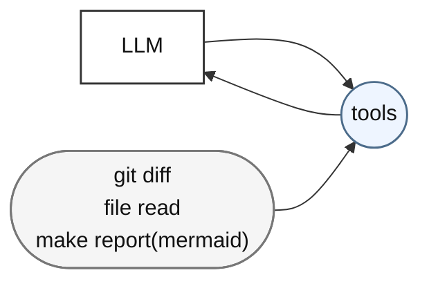
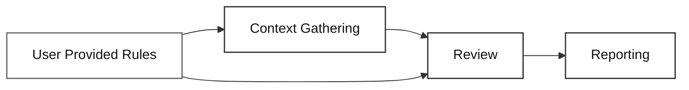
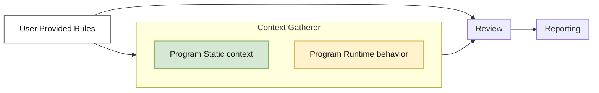

# System Design

## Level 1



## Level 2



## Level 3



## Level 4

```mermaid
flowchart LR
    RULES["User Provided Rules"]

    subgraph CONTEXT["Context Gatherer"]
        direction TB

        subgraph STATIC["Program Static context"]
            direction TB
            DIFF["Git Change diff"]
            AST["AST Parsers"]
            UNIT["Unit test cases"]
        end

        subgraph RUNTIME["Program Runtime behavior"]
            direction TB
            CHAOS["Integration / chaos testing (pre-written test cases)"]
            OTHER["Other Dynamic behavior"]
        end
    end

    subgraph REVIEW["Review"]
        direction TB
        MATCH["Rule Matching"]
        LLM_CALL["LLM CALL"]
    end

    subgraph REPORTER["Reporter"]
        direction LR
        TEXT["Text Reporter"]
        JSON["JSON reporter"]
        PR["Github PR Comments"]
        VISUAL["Visual Reporting"]
    end

    RULES --> CONTEXT
    CONTEXT --> REVIEW
    RULES --> REVIEW
    LLM_CALL --> REPORTER

    classDef rules fill:#ffffff,stroke:#6b6b6b,stroke-width:1.5px,color:#111111;
    classDef static fill:#d5e8d4,stroke:#82b366,stroke-width:1.5px,color:#111111;
    classDef runtime fill:#fff2cc,stroke:#d6b656,stroke-width:1.5px,color:#111111;
    classDef green fill:#008a00,stroke:#005700,stroke-width:1.5px,color:#ffffff;
    classDef rule fill:#f8cecc,stroke:#b85450,stroke-width:1.5px,color:#111111;
    classDef call fill:#d5e8d4,stroke:#82b366,stroke-width:1.5px,color:#111111;
    classDef reporter fill:#ffffff,stroke:#333333,stroke-width:1.5px,color:#111111;

    class RULES rules;
    class STATIC static;
    class RUNTIME runtime;
    class DIFF,AST,UNIT,CHAOS green;
    class OTHER reporter;
    class MATCH rule;
    class LLM_CALL call;
    class TEXT,JSON,PR,VISUAL reporter;
```
