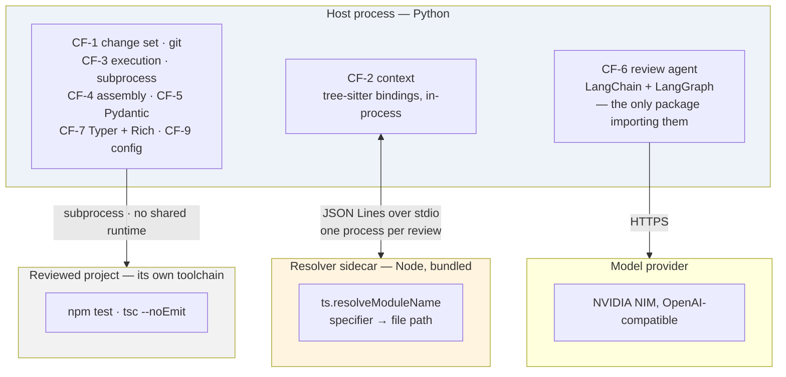
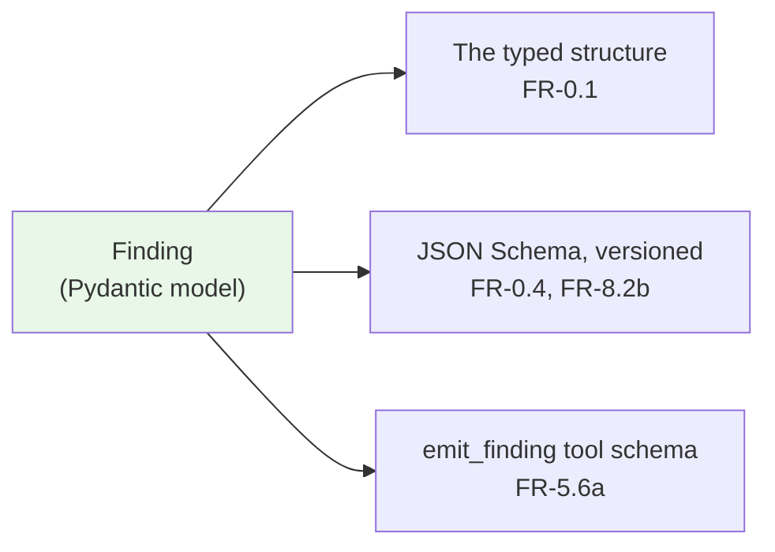

# Technical Stack

**Status:** Live · **Version:** 1.0 · **Date:** 2026-09-08
**Decided by:** [ADR-0007](./adr/0007-python-harness-typescript-target.md) · **Serves:** [`agentic-code-review-srs-v1.md`](./agentic-code-review-srs-v1.md)

---

## 0. What this document is, and what it is not

This is the single place that says **what the system is built with**. It names libraries, versions, protocols, and repository layout.

It does **not** say what the system must do. That authority belongs to the v1 specification, and this document is subordinate to it without exception:

| Question | Answered by |
|---|---|
| *What must the system do?* | [`agentic-code-review-srs-v1.md`](./agentic-code-review-srs-v1.md) — normative |
| *Why is it shaped this way?* | [`adr/`](./adr/) — normative where the SRS cites it |
| ***What is it built with?*** | **This document** |
| *What did we consider and reject?* | [ADR-0007](./adr/0007-python-harness-typescript-target.md), and [`Draft/`](./Draft/) |

Two rules follow from that ordering:

1. **A technology choice here never relaxes a requirement.** If a library cannot satisfy a requirement, the library is wrong — not the requirement. Changing the requirement is a specification change.
2. **This document changes; ADR-0007 does not.** ADRs are append-only records of a decision at a moment. Library choices move — a version is pinned, a package is swapped, a protocol detail is settled. Those belong here. A change that reverses ADR-0007's *reasoning* rather than its *details* needs a new ADR.

---

## 1. The shape in one paragraph

**The host language is not the target language.** The system is written in Python; the code it reviews is TypeScript. Syntax is handled in-process through `tree-sitter`; the one question Python cannot answer about TypeScript — *which file does this import specifier refer to?* — is delegated to a bundled Node process running TypeScript's own resolution algorithm. The reviewed project's checks run as subprocesses through its own toolchain, so the two runtimes never mix. The agent framework is confined to the single step where a model runs.



---

## 2. The stack

| Layer | Choice | Serves |
|---|---|---|
| Host language | **Python** | ADR-0007 |
| Packaging | **PyPI wheel**, console entry point, `uv tool install` / `pipx` | FR-9.1, FR-10.6 |
| CLI | **Typer** (over Click) | FR-10.1, FR-10.3a |
| Terminal rendering | **Rich** — confined to CF-7 | FR-10.4a, AC-10 |
| Finding model | **Pydantic v2** | FR-0.1, FR-0.4, FR-5.6a |
| Config | **PyYAML** + a Pydantic settings model | FR-1.2a–d |
| Parsing | **`tree-sitter`** bindings + **`tree-sitter-typescript`** grammar | FR-2.2 |
| Module resolution | **Bundled Node sidecar** over the TypeScript compiler API | FR-2.6f, FR-2.6g |
| Model interface | **LangChain**, OpenAI-compatible client | FR-0.3, FR-5.6a, FR-5.6b |
| Review step | **LangGraph** — confined to CF-6 | FR-5.7, FR-5.8 |
| Check execution | **`subprocess`** against the project's toolchain | FR-4.1, FR-4.2, FR-4.7 |
| Measurement | **pytest** over a corpus directory | FR-6.2b, FR-6.2d, AC-5 |
| Structural checks | **import-linter** | AC-10 |
| Concurrency | **None in v1 — the pipeline is sequential** | No requirement asks for it, and the latency budget that would justify it is unmeasured (SRS §8, TBD-2). Revisit against a measurement, not an estimate |

---

## 3. Component detail

### 3.1 Packaging and distribution

A PyPI package with a console entry point, installed with `uv tool install` or `pipx`. The wheel carries three kinds of content: Python source, the native `tree-sitter` grammar binding, and the built resolver bundle as package data.

The adoption cost is recorded honestly as **R-8** in the specification: the target user is a TypeScript developer who has Node and may not have Python. That is accepted for v1, whose users are the people building the system. Standalone binaries and a container image are v2 work under FR-10.6, and the reasoning for not doing either now is in ADR-0007.

### 3.2 CF-2 — parsing

`tree-sitter` runs in-process through its Python bindings. It answers everything that is a question about the *shape* of the source text:

- depth-0 expansion of a hunk to its enclosing function, class, or type boundary (FR-2.4)
- file outlines and symbol extraction
- the import specifiers a changed file names

It does not answer what those specifiers point at. That boundary is the entire reason §3.3 exists.

**Grammar loading.** The TypeScript grammar covers both `.ts` and `.tsx` as separate languages; select per file extension. Parse failures are expected on a mid-edit working tree and must not be fatal — FR-10.7 defers full tolerance to v2, but a parse error is a reported degradation, never a crash.

### 3.3 CF-2 — the resolver sidecar

A small TypeScript program, bundled to a single JavaScript file, that answers module resolution using `ts.resolveModuleName` — the same function the TypeScript compiler uses. This is what makes `tsconfig` `paths` and `baseUrl`, directory index files, package `exports` maps, and workspace links resolve correctly rather than approximately.

| Property | Choice | Why |
|---|---|---|
| **Transport** | JSON Lines over stdio — one JSON object per line, no length framing | Adequate for a request/response pair; avoids LSP's framing complexity for no loss |
| **Lifetime** | Spawned lazily on the first resolution request; one process per review; explicit shutdown | FR-2.6f. Lazy spawn means `--help` and depth-0 runs never pay the boot cost |
| **Batching** | One `resolve` call carrying every specifier from every changed file | What makes "at most once per invocation" actually cheap — the boot cost is fixed, not per-import |
| **Bundling** | esbuild to a single CJS file including `typescript`; shipped as package data | FR-2.6f forbids fetching at review time. No `npx`, no network, no version skew |
| **Node discovery** | `node` on `PATH`, overridable in `.agentic-review.yml` | Keeps the prerequisite explicit and diagnosable (FR-9.3) |
| **Handshake** | Version exchange on startup; a mismatch fails loudly | The bundle and the wheel ship together, so a mismatch means a broken install, not a degraded one |
| **Failure** | Any of: no Node, spawn failure, handshake timeout, malformed response → heuristic fallback, `degraded: 'unresolvable-imports'`, review completes | FR-2.6g, FR-11.2, AC-12 |

The protocol surface is deliberately tiny — `resolve`, `shutdown`, and the handshake. It is **not** a general bridge to the TypeScript compiler, and it should be resisted as one. Every method added to it is a method CF-2 must degrade gracefully without.

**Nothing outside CF-2 knows the sidecar exists.** FR-2.6e already forbids consumers from branching on which provider implementation served a request; the sidecar sits one level below that, inside `ParserContextProvider`. Its request/response shape is therefore free to change without a schema version — it is the one interface in the system with no external contract.

### 3.4 CF-3 — check execution

`subprocess` invoking the project's own toolchain. The command is discovered from the project manifest or named in configuration, and it runs in the project's directory with the project's environment.

The requirement that makes this a design property rather than an implementation detail is FR-4.7: the host runtime never imports the project's dependencies, and the project is never asked to install anything belonging to the reviewer. With a Python host this is close to free — there is no mechanism by which it could happen — which is the one place the language split pays a dividend rather than charging a cost.

Captured output is distilled before it reaches the model (FR-2.5c) and retained in full only for the structured output.

### 3.5 CF-5 — the finding model

Pydantic v2, and **one class definition producing three artifacts**:



§5 of the specification requires the `emit_finding` schema to *equal* the finding model — "one definition, not two". Deriving the tool schema from the model rather than writing it alongside is what makes that structurally true instead of a thing to remember. Validation at the tool-call boundary is then Pydantic's own validation, and its error messages are already field-precise, which is exactly the correction signal ADR-0004 argued for.

The schema version is a field on the model, bumped deliberately — never derived from the package version.

### 3.6 CF-6 — the review agent

LangChain provides the model interface; LangGraph provides the review step's control flow. **Both are confined to CF-6 (FR-5.8)**, and that confinement is checked by import-linter, not by discipline.

| Requirement | Mechanism |
|---|---|
| FR-5.6a — findings only via `emit_finding` | Tool binding, with the schema derived from the Pydantic model |
| FR-5.6b — fallback where tool calling is unavailable | Structured output, with a documented retry cap; the path used is reported |
| FR-5.7 — ceiling zero by default | A graph with one node and no cycle |
| FR-5.7a–c — the ceiling above zero | The same graph with a conditional edge back to the model node |

That last pair is the whole reason for choosing this boundary. At ceiling zero the review step is a one-node graph; raising the ceiling adds an edge. FR-5.7's promise that this is *configuration, not restructuring* is true because of where the boundary was drawn, not because anyone intends to be careful.

**Provider access** is an OpenAI-compatible client pointed at the NVIDIA NIM endpoint, rather than a vendor-specific integration package. FR-0.3 — integrating a new provider without downstream change — then reduces to a base URL and a model name for anything OpenAI-compatible.

The caveat, restated from [`Draft/agent-harness-design.md`](./Draft/agent-harness-design.md) §8: a framework that makes providers interchangeable **in code** does not make them interchangeable **in behaviour**. A model that accepts a tool binding is not necessarily a model that reliably calls it, and the abstraction will hide that difference. See §7 below.

### 3.7 CF-7 — output

Typer for the command surface, Rich for rendering. Rich is the dependency AC-10 names: no module outside CF-7 may import it, which keeps every renderer downstream of the finding model rather than beside it.

Machine-readable output is the Pydantic model serialised directly (FR-8.2a), so the terminal and the JSON cannot disagree about what was found.

### 3.8 CF-8 — measurement

pytest, with the corpus as a directory of defect cases and expected outcomes. AC-5 requires the harness to *run as a test*, which pytest gives without a bespoke runner, and FR-6.2d's requirement that depth and ceiling be parameters maps onto parametrised fixtures directly.

FR-6.2e requires runs to pin the settings that affect reproducibility — depth, ceiling, model, sampling. Those are recorded with the result, so a catch rate is never reported without the configuration that produced it.

### 3.9 CF-9 — configuration and credentials

`.agentic-review.yml` parsed with PyYAML and validated against a Pydantic settings model, so FR-1.2d — a malformed file fails with the offending field named — is the validator's error message rather than hand-written checking. Defaults live in the model (FR-1.2b, FR-1.2c).

The provider credential is read from the environment or user-level configuration only (FR-1.3a). It is never written to the repository, never logged, and never included in the structured output or the trace.

---

## 4. Repository layout

Two languages, with the boundary visible in the directory structure.

```
pyproject.toml
src/agentic_review/
    cli/              adapter · Typer entry point, exit codes — translates only
    core/
        pipeline/     the fixed order of operations (ADR-0001) — imported by cli/ only
        changeset/    CF-1 · git, files and hunks, exclusion applied here (FR-3.5)
        context/      CF-2 · parsing, the depth interface, the provider factory
            resolver/ CF-2 · the sidecar client — the only caller of the bundle
        execution/    CF-3 · subprocess, evidence record
        assembly/     CF-4 · budgets, distillation, eviction — sole budget owner
        findings/     CF-5 · Pydantic models, schema, versioning, the model port
        agent/        CF-6 · the ONLY package importing LangChain / LangGraph
                             also holds the port's LangChain implementation
        output/       CF-7 · verdict, renderers, JSON serialisation
        patterns/     CF-8 · rule library
        config/       CF-9 · settings model, diagnostics
    _vendor/
        resolver.js   built artifact — package data, never edited by hand
resolver/             TypeScript source for the sidecar
    src/index.ts
    package.json
tests/
    corpus/           CF-8 · the regression corpus
```

`src/agentic_review/_vendor/resolver.js` is a build output. It is produced from `resolver/` before the wheel is built, and it is the only place in the tree where the two languages meet.

### Directories follow responsibility, not the core-function numbering

*Revised 2026-09-14.* This layout previously mirrored CF-1…CF-9 into nine directories, one for one. That mapping is **not** maintained, for the reason given in [`DESIGN_BLOCKERS.md`](../DESIGN_BLOCKERS.md) DO-5: the core functions are an excellent way to **group requirements**, and a poor way to **draw module boundaries**, because they were drawn along subject matter rather than along reasons-to-change.

Three places where the mapping is deliberately not one-to-one:

| | What the taxonomy says | What the tree does | Why |
|---|---|---|---|
| **The pipeline** | No CF owns the order of operations | `core/pipeline/` | ADR-0001's decision is that *our code owns orchestration*. Code with no directory lands in its nearest caller, and that is `cli/` — the one place [ADR-0006](./adr/0006-local-cli-core-action-as-adapter.md) says orchestration must not be, because v3's Action adapter would then have to reimplement it |
| **CF-5** | "Finding model **and** provider interface" | Model and port in `findings/`; the LangChain implementation in `agent/` | FR-5.8 forbids anything outside CF-6 importing the framework, and the provider client *is* the framework. One directory for both could not legally exist |
| **CF-7** | "Output" | Verdict and rendering in `core/output/`; writing and exit codes in `cli/` | It spans the core/adapter seam. The **verdict is computed in core** — if the adapter decided which findings mattered, it would be deciding what a finding means (FR-10.2) |

The CF → module mapping is maintained in [`design/01-logical-architecture.md`](./design/01-logical-architecture.md) §2, and Appendix B of the specification remains the traceability record. Both axes are kept; neither is derived from the other by copying.

### The structural contracts

**Six** import-linter contracts, cheap enough to run on every commit. *Revised 2026-09-14: SRS v1.1 extended AC-10 to cover FR-2.6e, and the design phase added two more that no criterion names but the layering needs.*

| # | Contract | Enforces | Named by AC-10? |
|---|---|---|---|
| 1 | Only `core/output/` and `cli/` may import Rich | FR-10.4a | ✅ |
| 2 | Only `core/changeset/` may import the git layer | CF-1 encapsulation | ✅ |
| 3 | Only `core/agent/` may import LangChain or LangGraph | FR-5.8 | ✅ |
| 4 | Only `core/context/resolver/` may reference the resolver bundle path | FR-2.6f | ✅ *(added in v1.1)* |
| 5 | **No module outside `core/context/` may name a concrete related-context implementation** — construction goes through the factory | **FR-2.6e** | ✅ *(added in v1.1)* |
| 6 | Nothing imports `cli/`; the capability packages do not import each other | The layering in [`design/01-logical-architecture.md`](./design/01-logical-architecture.md) §3 | ❌ |

Contract 5 is the one worth insisting on. The specification calls FR-2.6e *"the highest-value structural constraint in this document"*, and until v1.1 it was the only structural claim with **no test behind it** — AC-10 cited it without checking it. A grep for a class name is a cheap thing to be right about.

Contract 6 has no acceptance criterion because it defends a design decision rather than a requirement: capabilities that call each other cannot be tested alone, and an adapter that anything imports has stopped being an adapter.

---

## 5. Dependency inventory

| Dependency | Role | If it were swapped |
|---|---|---|
| `pydantic` | Finding model, config validation | High cost — the schema, the tool definition, and the config validator all derive from it |
| `langchain` / `langgraph` | Provider interface, review-step control flow | Contained to CF-6 by FR-5.8. That is the point of FR-5.8 |
| `tree-sitter`, `tree-sitter-typescript` | Parsing | High cost — FR-2.2 names it, and the depth ladder is built on it |
| `typer`, `rich` | CLI and rendering | Low cost — confined to CF-7 |
| `pyyaml` | Config parsing | Low cost |
| `pytest` | Regression harness | Low cost |
| `import-linter` | Structural checks (AC-10) | Low cost — dev-only |
| `typescript` (in the bundle) | Module resolution | The sidecar *is* this dependency. Removing it means reimplementing resolution in Python, which ADR-0007 rejected as Option A |

---

## 6. Deliberately not used

| Not used | Why |
|---|---|
| **Vector database / embeddings** | We follow *actual* edges in the import graph, not semantic similarity. An approximate answer to a question with an exact answer is a downgrade. LangChain makes this the path of least resistance, which is why it is stated rather than assumed — see [`Draft/agent-harness-design.md`](./Draft/agent-harness-design.md) §8 |
| **A vendor-specific provider package** | An OpenAI-compatible client keeps FR-0.3 to a base URL and a model name |
| **LangSmith as load-bearing tracing** | FR-11.3 requires our own trace, sufficient to explain why a finding was produced. A hosted service may be used alongside it; it may not be the only record |
| **An LSP client** | Rejected in ADR-0007: the language server's warm-up can consume the whole latency budget before the review starts |
| **PyInstaller / Docker, in v1** | Deferred under FR-10.6. A container also breaks CF-3, which depends on the project's warm local `node_modules` |
| **A Python reimplementation of module resolution** *alongside* the sidecar | ADR-0007 names this as a violation: two answers to the same question, guaranteed to diverge. The heuristic fallback under FR-2.6g is explicitly a degraded path, reported as such — not a second implementation competing with the first |

---

## 7. To verify before pinning

Three things this document asserts that should be tested rather than trusted, because they are the assumptions most likely to be wrong and cheapest to check early:

| # | Assumption | How to check | If wrong |
|---|---|---|---|
| **S-1** | The chosen NIM model calls `emit_finding` reliably enough for one call per review | A fixed prompt, fifty runs, count malformed and missing tool calls | FR-5.6b's structured-output fallback becomes the primary path, and the retry cap needs a measured value. This is flagged in ADR-0001, ADR-0004 and the harness design as the single highest-risk provider assumption |
| **S-2** | Current `tree-sitter` Python bindings and the TypeScript grammar install as wheels on all three platforms, at a stable API | Install on Linux, macOS, Windows; parse a `.ts` and a `.tsx` file | The API across binding versions has changed before. Pin exactly, and record the pinned versions here |
| **S-3** | Sidecar boot plus a batched resolve is a small enough share of a review to be acceptable | Time boot and a batch of ~50 specifiers on a real repository, and **record the figure** | If boot dominates, the fallback is a persistent daemon across invocations. Note that SRS v1.1 restated FR-2.6f as a property plus a budget (TBD-1), so a daemon is no longer forbidden by the requirement — it is a design choice to be made against a measurement |

Version floors are deliberately not written into this document until S-2 is run. **Pin exact versions at the first commit that installs them, and record them here** — a stack document that lists versions nobody verified is worse than one that admits it has not looked.

---

## 8. Requirement → technology

The reverse of Appendix B: for each technology choice, the requirement that justifies it. A choice with no requirement behind it is a choice to re-examine.

| Requirement | Served by |
|---|---|
| FR-0.1, FR-0.4, FR-5.2 | Pydantic model + generated JSON Schema |
| FR-0.3 | OpenAI-compatible client behind LangChain |
| FR-1.2a–d, FR-1.3a | PyYAML + Pydantic settings model; environment-only credentials |
| FR-2.2, FR-2.4 | `tree-sitter` bindings, in-process |
| FR-2.6f, FR-2.6g | Bundled Node resolver sidecar; heuristic fallback |
| FR-4.1, FR-4.2, FR-4.7 | `subprocess` against the project's toolchain |
| FR-5.6a, FR-5.6b | LangChain tool binding; structured-output fallback |
| FR-5.7, FR-5.7a–c | LangGraph — one node at ceiling zero, a conditional edge above it |
| FR-5.8, FR-10.4a, FR-10.2 | import-linter contracts (§4) |
| FR-6.2b, FR-6.2d, FR-6.2e | pytest, parametrised over depth and ceiling |
| FR-8.2a, FR-10.4b | Pydantic serialisation of the same model the terminal renders |
| FR-9.1, FR-10.6 | PyPI wheel, console entry point |
| FR-11.3 | Our own trace record — not a hosted tracing service |

---

## 9. Open

- Exact version pins, pending S-2 (§7).
- Whether the sidecar gets a documented minimum Node version, or accepts whatever resolves (FR-10.6, deferred to v2).
- The distillation strategy for check output (FR-2.5c) — the requirement is fixed, the implementation is not.
- Async boundaries: CF-3 overlaps CF-2 in the pipeline diagram, but whether that overlap is worth its complexity at v1's change-set sizes is unmeasured. **v1 ships sequential** — concurrency is an optimisation to be earned against SRS TBD-2, once that number exists.
- The `.agentic-review.yml` default for the execution timeout is a **placeholder, not a finding** (SRS TBD-4). It should be labelled as such wherever it is documented.
- Whether the v3 Action ships as a Docker action. Recorded in ADR-0007 as the likely shape; not a v1 decision.
