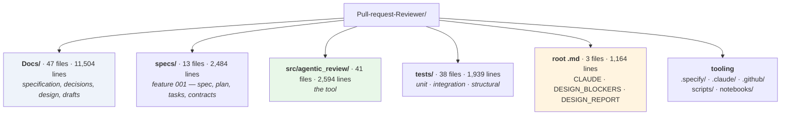
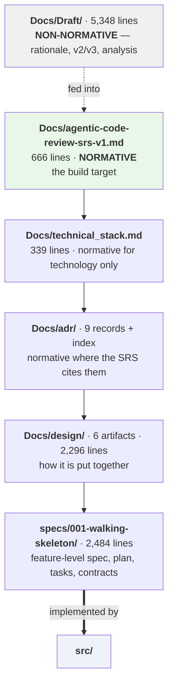
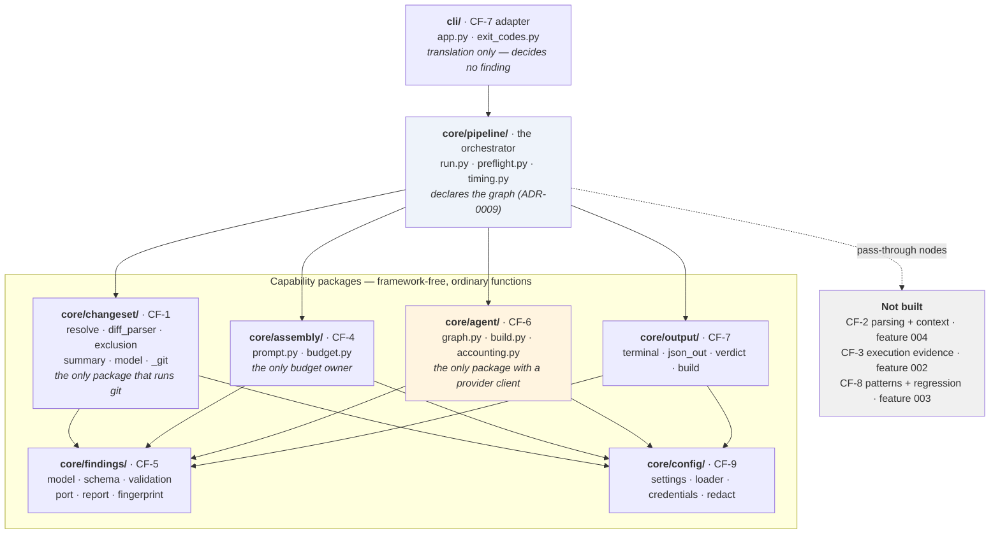
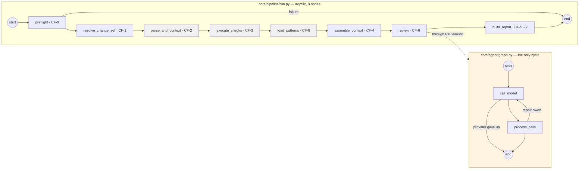
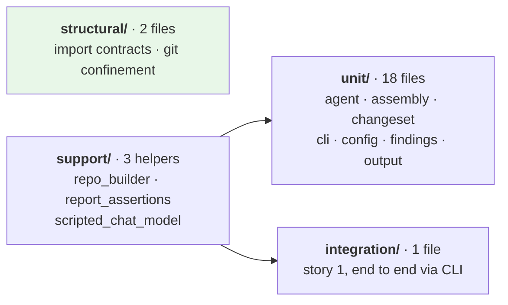
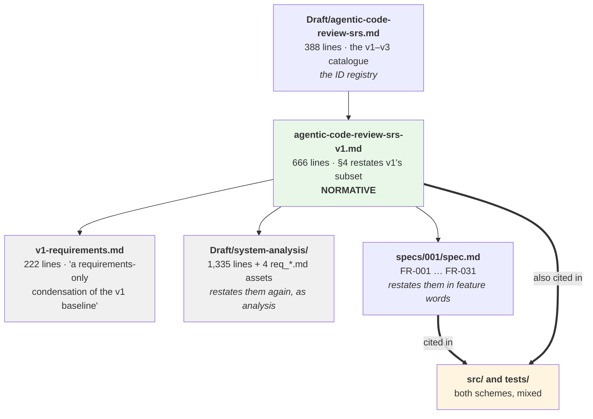

# Structure Review — Agentic Code Review

**Date:** 2026-09-20 · **Branch:** `001-walking-skeleton` · **Status:** Observation, not a decision

A map of what is in this repository today, how the parts relate, and where the same thing is said more than once. This document describes the repository as found. It proposes simplifications in §8 but decides nothing.

---

## 1 · In one page

The repository holds **15,152 lines of Markdown against 2,594 lines of Python** — a prose-to-code ratio of roughly **5.8 : 1**. That ratio is not by itself a fault: this project deliberately specified before it built, and the specification is the reason the code has the shape it has. But the prose has now accumulated **four layers that each restate the same requirements in different words**, and the code has begun citing two incompatible identifier schemes for them.

| | Files | Lines |
|---|---|---|
| `Docs/` | 47 | 11,504 |
| `specs/` | 13 | 2,484 |
| Root `.md` (CLAUDE, DESIGN_BLOCKERS, DESIGN_REPORT) | 3 | 1,164 |
| `src/` | 41 | 2,594 |
| `tests/` | 38 | 1,939 |

**The three findings that matter most**, in order:

1. **`CLAUDE.md` is factually wrong about the repository it describes.** It opens with *"This repository contains no source code yet… There is no `pyproject.toml`, no build, no test runner, and no lint config — do not invent commands for them or claim to have run them."* There are 41 source files, a `pyproject.toml`, pytest, import-linter and CI. It actively instructs future contributors and agents not to run checks that exist. **This is the cheapest and highest-value fix in the repository.**
2. **Two parallel requirement ID namespaces** — `FR-x.y` (SRS, 105 identifiers) and `FR-0NN` (specs, 31 identifiers) — now both appear inside `src/` and `tests/`, inconsistently.
3. **Two root documents have no inbound links at all** and one `Docs/` document is referenced only by a non-normative draft.

---

## 2 · Repository map

`.claude/` and `.specify/` are both gitignored. `.claude/skills/` holds the `git-mentor` skill and eleven `speckit-*` workflow skills; `.specify/` holds the Spec Kit templates, scripts and the project constitution that produced `specs/`.

---

## 3 · The document stack

Six layers, each subordinate to the one above. The hierarchy itself is sound and well-documented — the problem is how much material sits at each level.

**This layering is genuinely good.** Every document states its own authority and what wins on disagreement. The issue in §7 is not that the layers are wrong — it is that requirements are *restated in full* at four of them rather than referenced.

---

## 4 · Code — component view

Nine core functions (CF-1…CF-9) map onto seven packages, with the CLI as the only adapter and `core/pipeline/` owning the order.

### Enforced structural contracts

Five run in CI via import-linter, and all five currently pass:

| # | Contract | Defends |
|---|---|---|
| 1 | Only `core/output/` and `cli/` may import Rich | FR-10.4a |
| 2 | Only `core/changeset/` may import the git layer | CF-1 encapsulation |
| 3 | No core-function package may import LangChain, LangGraph or openai | FR-5.8 |
| 3b | `core/pipeline/` may import LangGraph, but never a provider client | FR-5.8 / ADR-0009 |
| 6 | Nothing imports `cli/`; capabilities do not import each other | layering |

Contracts **4** and **5** are specified in `technical_stack.md` §4 but not yet written — they arrive with CF-2 (feature 004). Contract 5 guards FR-2.6e, which the SRS calls *"the highest-value structural constraint in this document"*.

---

## 5 · Runtime — the two graphs

Since ADR-0009 the pipeline is a declared graph. It is acyclic; CF-6's graph is the only place a cycle occurs.

Grey nodes are pass-throughs for capabilities not yet built. Two conditional edges the seams contract requires — *nothing to review* and *budget exhausted* — are **not** present in either graph; they remain open as tasks T074/T075.

`process_calls` still carries four distinct phases in one node (validate, observe, recompute coverage, decide repair). Splitting it is outstanding work discussed but not done.

---

## 6 · Tests

207 tests run offline in ~20s; the scripted stand-in model drives the real review graph, and an autouse fixture blocks the network. **3 currently fail**, all from uncommitted local changes that switched `DEFAULT_BASE_URL` to a local Ollama endpoint and rewrote the prompt, against tests still asserting the NVIDIA defaults.

---

## 7 · Redundancy findings

### 7.1 The same requirements, restated four times

This is the largest single source of duplication.

Counts of requirement references by location:

| Location | `FR-x.y` refs | `FR-0NN` refs |
|---|---|---|
| `Docs/agentic-code-review-srs-v1.md` | 357 | 0 |
| `Docs/v1-requirements.md` | 128 | 0 |
| `Docs/design/` | 234 | 0 |
| `Docs/Draft/system-analysis/` | 306 | 0 |
| `specs/` | 125 | **178** |
| **`src/`** | **39** | **33** |
| **`tests/`** | **6** | **44** |

The bottom two rows are the problem. A developer reading `src/` sees both schemes with no rule about which to use, and the mapping between them exists only as inline asides inside `specs/001/spec.md` (`FR-001 … — *FR-9.3, AC-9*`). There is **no mapping table anywhere**.

### 7.2 Orphaned and near-orphaned documents

| Document | Lines | Inbound links | Note |
|---|---|---|---|
| `DESIGN_REPORT.md` | 253 | **0** | Nothing in the repository links to it |
| `Docs/v1-requirements.md` | 222 | **1**, from a non-normative draft | Not listed in `Docs/README.md`'s index |
| `Docs/Draft/system-analysis/` | 1,995 | Self-referential + 1 from `Docs/README.md` | 10 of 11 links are internal to the cluster |
| `Docs/Draft/agentic-code-review-srs-ar.md` | 353 | 4 | Arabic translation; goes stale on every catalogue edit, by `CLAUDE.md`'s own admission |

### 7.3 Overlapping diagram sets

**82 mermaid diagrams** across four locations: `Docs/design/` (30), `Docs/adr/` (28), `Docs/Draft/system-analysis/` (24), `specs/` (6). `system-analysis/assets/domain_model.md` and `Docs/design/02-domain-model.md` model the same domain; `assets/seq_review_pass.md` and `design/03-behaviour.md` describe the same pass.

### 7.4 Stale statements

| Where | Claim | Reality |
|---|---|---|
| `CLAUDE.md` §"Current state" | "contains no source code yet… no `pyproject.toml`, no build, no test runner, no lint config" | 41 source files, 21 test files, `pyproject.toml`, pytest, import-linter, CI |
| `CLAUDE.md` §"git-mentor skill" | "untracked and sits at the repository root rather than under `.claude/skills/`" | It is at `.claude/skills/git-mentor/` |
| `Docs/design/README.md` | "Status: Complete — all six milestones delivered" | Accurate, but written before ADR-0009 changed §8's contract table |

### 7.5 Loose ends

- `scripts/__pycache__/` is on disk; `scripts/make_review_demo.py` is untracked.
- `Docs/operation_guidelines.md` (527 lines) is untracked — a substantial document at risk of being lost.
- `.env` is present and correctly gitignored (`.env*` with `!.env.example`).

---

## 8 · What simplification would look like

Ranked by value over effort. **None of this is done; it is a menu.**

| # | Action | Effort | Why |
|---|---|---|---|
| 1 | **Rewrite `CLAUDE.md`'s "Current state"** to describe the repository that exists, and fix the git-mentor path | Minutes | It currently tells contributors not to run the test suite. Everything else on this list is optional; this is not |
| 2 | **Pick one requirement ID scheme for `src/` and `tests/`** and add a mapping table where the other is needed | Hours | Removes the only ambiguity that reaches the code |
| 3 | **Commit or delete `Docs/operation_guidelines.md`** and `scripts/make_review_demo.py` | Minutes | Untracked work is lost work |
| 4 | **Retire `Docs/v1-requirements.md`** | Low | An unlinked condensation of a normative document is a second place for it to drift |
| 5 | **Fold `DESIGN_REPORT.md` into `Docs/design/README.md`**, or link it from somewhere | Low | 253 orphaned lines |
| 6 | **Collapse `Draft/system-analysis/assets/`** into its parent, or into `Docs/design/` where it duplicates | Medium | 11 files, 10 of them linked only by each other |
| 7 | **Mark the Arabic translation stale in its own front matter**, or drop it | Low | `CLAUDE.md` already says changes leave it stale; the file does not say so itself |
| 8 | **Split `core/agent/graph.py`'s `process_calls`** into one node per phase | Low | The original request that started this thread; still outstanding |

**What should not be touched:** the document authority hierarchy (§3), the nine core functions, the import contracts, and the ADR set. Those are the parts carrying their weight — the layering is what let ADR-0009 be a contained change rather than a rewrite.

---

## 9 · Honest caveats

This review counted lines, links and identifiers; it did not read all 15,152 lines of prose. The redundancy claims in §7.1 and §7.3 are based on document self-descriptions, title overlap and reference counts — a full content diff of `Docs/design/02-domain-model.md` against `Draft/system-analysis/assets/domain_model.md` would be needed before deleting either. The orphan counts in §7.2 are link-based and exact.
